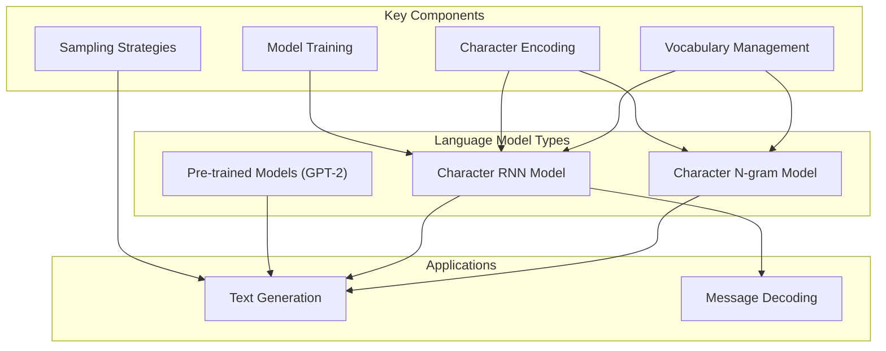
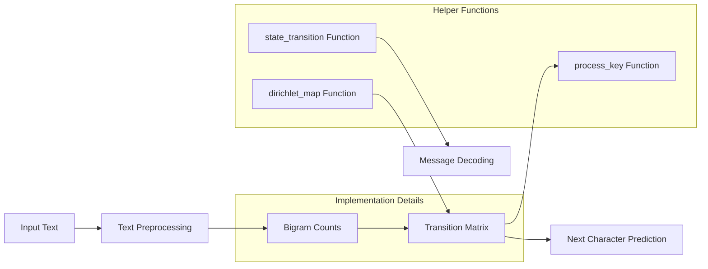
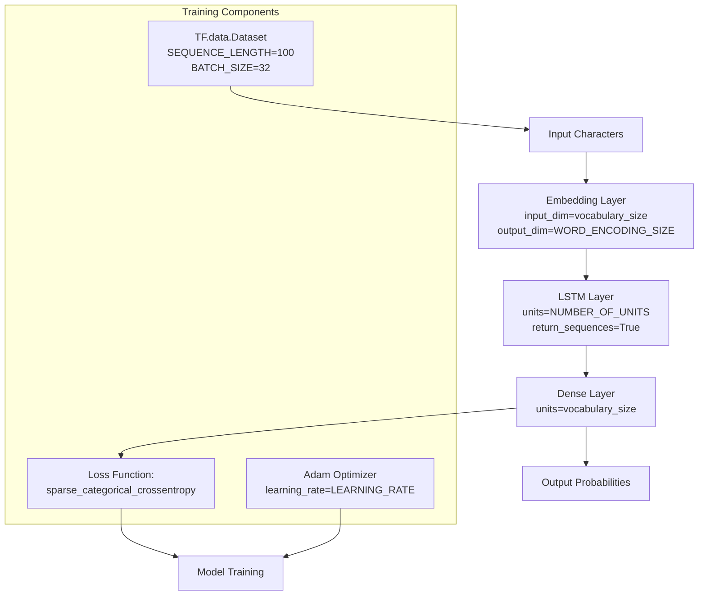
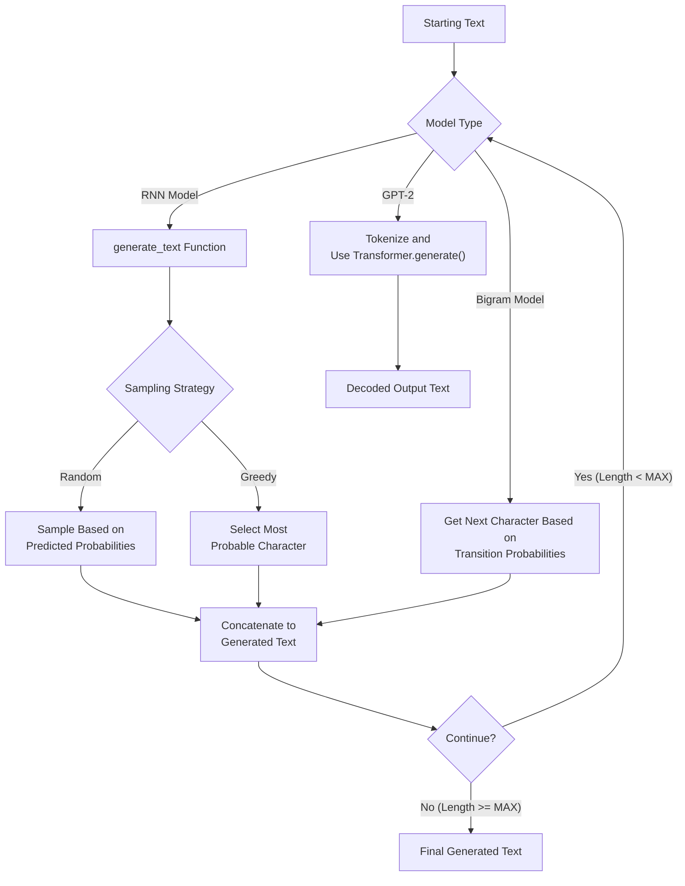
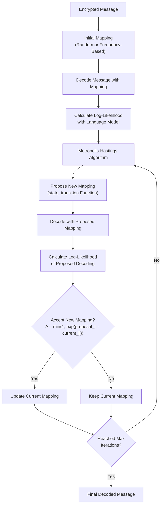
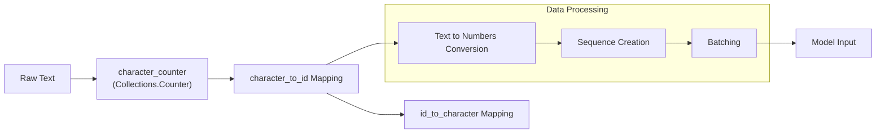

<!-- source: DeepWiki mcp.deepwiki.com · repo google-deepmind/educational · page 3 Language Models · fetched 2026-10-26 -->

# Language Models

Relevant source files

The following files were used as context for generating this wiki page:

- [colabs/introductory/fun_with_language.ipynb](colabs/introductory/fun_with_language.ipynb)

This document provides a technical overview of language model implementations in the DeepMind Educational repository, focusing on the character-based language models, text generation techniques, and message decoding applications found in the Fun with Language notebook. For information about Graph Neural Networks and how they process structured data, see [Graph Neural Networks](#2).

## Purpose and Scope

This documentation covers the implementation and technical details of language models in the educational repository, including:

1. Character-based language model implementations (n-gram and RNN approaches)
2. Text generation techniques with different sampling strategies
3. Applications of language models to cryptographic message decoding
4. Integration with pre-trained transformer models (GPT-2)

## Overview of Language Models

Language models are statistical models that learn to predict the probability distribution of the next token (character or word) given previous tokens. In the educational repository, language models are primarily implemented in the Fun with Language notebook.

**Diagram: Language Model Types and Applications**

Sources: [colabs/introductory/fun_with_language.ipynb:566-573](), [colabs/introductory/fun_with_language.ipynb:1434-1436]()

## Character-based Language Models

The repository implements two main types of character-based language models:

1. **N-gram Model (Bigram)**: A simple statistical model that counts character transitions in the training text
2. **Recurrent Neural Network (RNN)**: A more complex neural model using LSTM (Long Short-Term Memory) architecture

### N-gram Language Model

The n-gram model calculates transition probabilities between characters. In the specific implementation, a bigram model is used which considers only the immediate preceding character when predicting the next one.

**Diagram: N-gram Language Model Implementation**

Sources: [colabs/introductory/fun_with_language.ipynb:830-874](), [colabs/introductory/fun_with_language.ipynb:314-361]()

The bigram model implementation includes:

1. Creation of a reduced alphabet of common characters
2. Counting character occurrences (unigrams) and transitions (bigrams)
3. Calculating transition probabilities using Dirichlet MAP estimation
4. Visualizing character transition probabilities

Key implementation details:
- The transition matrix has dimensions [alphabet_size, alphabet_size]
- Each row i represents probabilities of transitions from character i to all other characters
- The model uses a Dirichlet prior (alpha=5) for smoothing the probabilities

### RNN Language Model

The RNN model uses a sequential architecture to predict the next character based on a sequence of previous characters.

**Diagram: RNN Language Model Architecture**

Sources: [colabs/introductory/fun_with_language.ipynb:984-1007](), [colabs/introductory/fun_with_language.ipynb:946-955]()

The RNN implementation consists of:

1. Data preprocessing and vocabulary creation
2. Model architecture definition with Embedding, LSTM, and Dense layers
3. Training configuration with Adam optimizer and categorical cross-entropy loss
4. Sequence batching and input-target splitting

Key implementation details:
- The model uses a configurable embedding dimension (default: 64)
- LSTM unit count is configurable (default: 256)
- Learning rate defaults to 0.001
- Sequences are split as input (all characters except last) and target (all characters except first)

## Text Generation Techniques

The repository implements text generation with both the n-gram and RNN models, as well as using pre-trained GPT-2 models.

**Diagram: Text Generation Workflow**

Sources: [colabs/introductory/fun_with_language.ipynb:228-249](), [colabs/introductory/fun_with_language.ipynb:1466-1476]()

Text generation methods include:

1. **Character-by-character generation** with the `generate_text()` function:
   - Takes a starting text, desired length, and sampling strategy
   - Iteratively predicts and appends new characters
   - Supports both random (sampling from distribution) and greedy (selecting highest probability) approaches

2. **GPT-2 text generation**:
   - Uses Hugging Face's transformers library
   - Supports various pre-trained model sizes (small, medium, large, XL)
   - Generates text in a single operation rather than character-by-character

Key code references:
- The `generate_text()` function is defined at [colabs/introductory/fun_with_language.ipynb:228-249]()
- GPT-2 generation code is at [colabs/introductory/fun_with_language.ipynb:1466-1476]()

## Message Decoding Application

One key application demonstrated is the decryption of encoded messages using language models to identify statistically plausible character mappings.

**Diagram: Message Decoding Workflow**

Sources: [colabs/introductory/fun_with_language.ipynb:1132-1140](), [colabs/introductory/fun_with_language.ipynb:1318-1334]()

The decoding algorithm works by:

1. Starting with an initial character mapping (random or frequency-based)
2. Iteratively proposing random swaps in the mapping
3. Evaluating the language "plausibility" of the resulting text using a language model
4. Using Metropolis-Hastings sampling to decide whether to accept the proposed mapping
5. Repeating for a configurable number of steps

Key implementation details:
- Language model log-likelihood is used as a measure of text plausibility
- The `state_transition()` function randomly swaps two character mappings
- Acceptance probability is calculated using the ratio of likelihoods (exp(proposal_ll - current_ll))
- Two language model options: simple n-gram (faster) or RNN (slower but potentially more accurate)

## Character Encoding and Vocabulary Management

Both language model implementations share common character processing components:

**Diagram: Character Encoding Pipeline**

Sources: [colabs/introductory/fun_with_language.ipynb:673-682](), [colabs/introductory/fun_with_language.ipynb:766-774]()

The character encoding process includes:

1. Building a vocabulary by counting all unique characters in the text
2. Creating bidirectional mappings between characters and numeric IDs
3. Converting text to sequences of numbers for model input
4. Creating input-target pairs for training

Key implementation components:
- `character_counter`: A `Collections.Counter` that tracks character frequencies
- `character_to_id`: Dictionary mapping characters to unique numeric IDs
- `id_to_character`: Reverse mapping from IDs back to characters
- `split_input_target()`: Function to create input-target pairs from sequences

## Integration with Pre-trained Models

The repository demonstrates integration with Hugging Face's transformers library to use pre-trained GPT-2 models for text generation.

| Model Version | Description | Parameters |
|---------------|-------------|------------|
| gpt2          | Base model  | 124M       |
| gpt2-medium   | Medium size | 355M       |
| gpt2-large    | Large size  | 774M       |
| gpt2-xl       | XL size     | 1.5B       |

Key implementation details:
- Uses `transformers.GPT2Tokenizer` for text tokenization
- Uses `transformers.TFGPT2LMHeadModel` for the model inference
- Performs generation in a single step rather than character-by-character
- Allows controlling the maximum generation length

Sources: [colabs/introductory/fun_with_language.ipynb:1447-1452](), [colabs/introductory/fun_with_language.ipynb:1466-1476]()

## Helper Functions and Utilities

The implementation includes several helper functions to facilitate working with language models:

| Function Name | Purpose |
|---------------|---------|
| `generate_text()` | Generates text from a starting sequence using the RNN model |
| `print_generated_text()` | Formats and prints generated text |
| `get_probabilities()` | Gets probabilities of next character given previous ones |
| `nn_seq_log_likelihood()` | Calculates log-likelihood of a sequence using the RNN model |
| `seq_log_likelihood()` | Calculates log-likelihood using the n-gram model |
| `decode()` | Applies a character mapping to decode a sequence |
| `state_transition()` | Randomly swaps two mappings for the message decoding algorithm |
| `random_permutation()` | Creates a random mapping between two alphabets |

Sources: [colabs/introductory/fun_with_language.ipynb:222-398]()

## Conclusion

The language model implementations in the educational repository demonstrate both simple statistical approaches (n-gram models) and more sophisticated neural network-based methods (RNN with LSTM). The applications showcase practical uses of language models in text generation and cryptographic message decoding, providing educational examples that bridge theory and application.

For more detailed information on specific implementations, refer to the following subpages:
- [Character-based Language Models](#3.1)
- [Text Generation Techniques](#3.2)
- [Message Decoding Application](#3.3)

---

