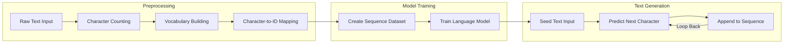
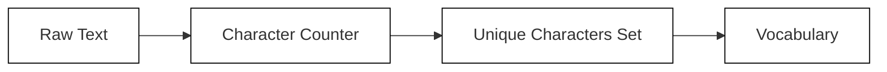
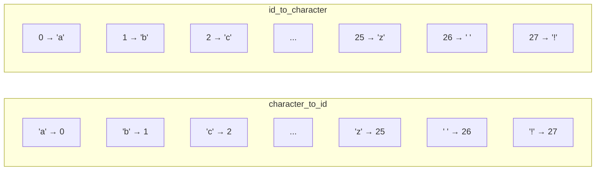
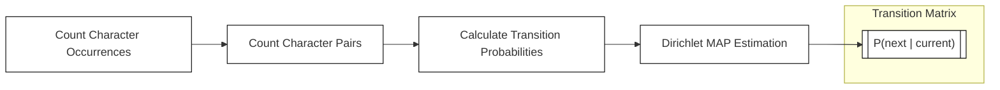
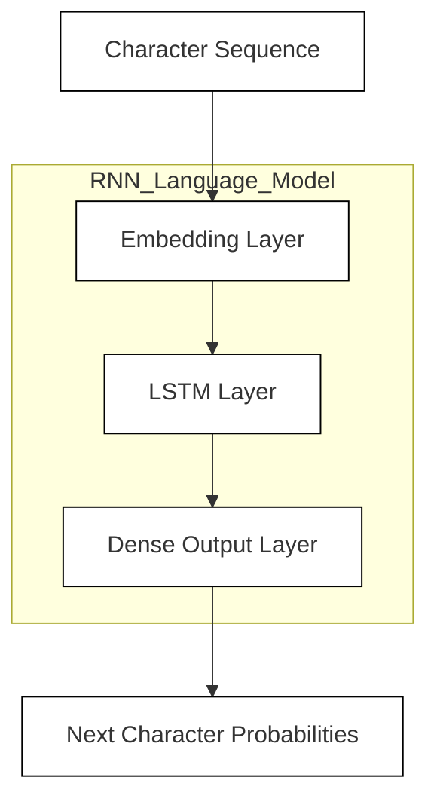
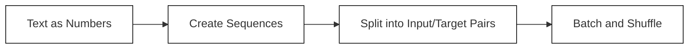
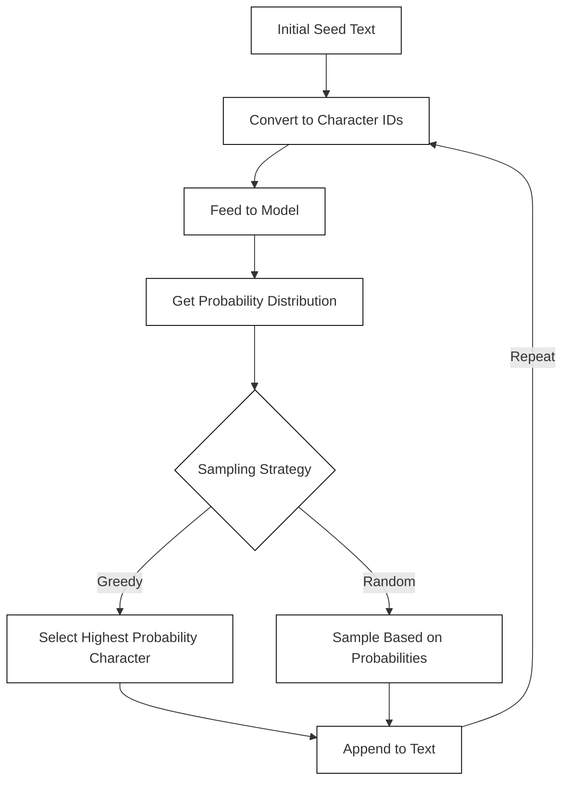

<!-- source: DeepWiki mcp.deepwiki.com · repo google-deepmind/educational · page 3.1 Character-based Language Models · fetched 2026-10-26 -->

# Character-based Language Models

<details>
<summary>Relevant source files</summary>

The following files were used as context for generating this wiki page:

- [colabs/introductory/fun_with_language.ipynb](colabs/introductory/fun_with_language.ipynb)

</details>


## Purpose and Scope

This document details the implementation and functionality of character-based language models as demonstrated in the "Fun with Language" notebook. Character-based language models predict the next character in a sequence based on preceding characters, serving as a foundation for text generation and language understanding. This page focuses on the core concepts, implementation details, and practical applications of these models within the educational framework. For applications like message decoding using language models, see [Message Decoding Application](#3.3).

## Introduction to Language Models

Character-based language models learn statistical patterns in text by analyzing which characters are likely to follow previous characters. Unlike word-based models, these models operate at the character level, making them simpler to implement while still capturing many linguistic patterns.

The fundamental task of these models is to assign probabilities to character sequences, enabling them to:
1. Predict the next character given a sequence of previous characters
2. Generate new text by repeatedly predicting and appending characters
3. Evaluate the likelihood of a given text sequence

Sources: [colabs/introductory/fun_with_language.ipynb:560-573]()

## Model Architecture Overview

### Character-based Language Model Pipeline



Sources: [colabs/introductory/fun_with_language.ipynb:560-573](), [colabs/introductory/fun_with_language.ipynb:929-956](), [colabs/introductory/fun_with_language.ipynb:226-249]()

## Key Components

### Vocabulary Building

Character-based language models first analyze the input text to identify all unique characters, forming a vocabulary:



The vocabulary consists of all unique characters in the text, including letters, numbers, punctuation, and whitespace. This step is implemented using a Counter object:

```python
character_counter = collections.Counter()
character_counter.update(text)
vocabulary_size = len(character_counter.keys())
```

Sources: [colabs/introductory/fun_with_language.ipynb:671-683]()

### Character-to-Number Mapping

Since neural networks operate on numerical data, each character must be mapped to a unique numerical identifier:



The implementation creates both a mapping from characters to IDs and the reverse:

```python
character_to_id = {c: i for i, c in enumerate(sorted(character_counter.keys()))}
id_to_character = {v: k for k, v in character_to_id.items()}
```

This bidirectional mapping allows for converting between text and numerical representations efficiently.

Sources: [colabs/introductory/fun_with_language.ipynb:766-774]()

## Model Implementations

### Simple Bigram Model

The simplest character-based language model is a bigram model that tracks transition probabilities between pairs of characters:



The bigram model tracks:
- Initial character probabilities (`initial`)
- Transition probabilities between character pairs (`transition`)

This model uses Dirichlet MAP (Maximum A Posteriori) estimation to obtain probabilities:

```python
# Find maximum a posteriori probability (MAP)
initial = dirichlet_map(alphabet_size*[alpha], 
                        unigram_counts[np.newaxis, :]).flatten()

# Find maximum a posteriori probability (MAP) for transitions
transition = dirichlet_map(alphabet_size*[alpha], bigram_counts)
```

While simple, this model can only consider the immediately preceding character when making predictions.

Sources: [colabs/introductory/fun_with_language.ipynb:811-874]()

### Recurrent Neural Network Model

A more sophisticated approach uses Recurrent Neural Networks (RNNs), specifically LSTM (Long Short-Term Memory) networks, to model longer-range dependencies:



The RNN model architecture consists of:
1. An embedding layer that converts character IDs to dense vectors
2. An LSTM layer that processes sequences and maintains memory of previous characters
3. A dense output layer that produces probabilities for each character in the vocabulary

This model is implemented as follows:

```python
model = keras.models.Sequential([
    keras.layers.Embedding(input_dim=vocabulary_size,
                           output_dim=WORD_ENCODING_SIZE),
    keras.layers.LSTM(NUMBER_OF_UNITS, return_sequences=True),
    keras.layers.Dense(vocabulary_size)
])
```

The RNN model's advantage is its ability to capture longer-range dependencies across characters, making it more effective at modeling natural language.

Sources: [colabs/introductory/fun_with_language.ipynb:966-1007]()

## Training Process

### Dataset Creation

Before training, sequences of characters must be converted into an appropriate dataset format:



The dataset preparation involves:
1. Converting text to sequences of numerical IDs
2. Creating fixed-length sequences
3. Splitting each sequence into input (all but last character) and target (all but first character)
4. Batching and shuffling for efficient training

```python
text_as_numbers = [character_to_id[character] for character in text]
dataset = tf.data.Dataset.from_tensor_slices(np.array(text_as_numbers))
dataset = dataset.batch(SEQUENCE_LENGTH + 1, drop_remainder=True)
dataset = dataset.map(split_input_target)
dataset = dataset.shuffle(10000)
dataset = dataset.batch(BATCH_SIZE, drop_remainder=True)
```

The `split_input_target` helper function separates the input sequence from the target sequence:

```python
def split_input_target(data):
  """Splits the data into input and target."""
  return data[:-1], data[1:]
```

Sources: [colabs/introductory/fun_with_language.ipynb:929-956](), [colabs/introductory/fun_with_language.ipynb:222-225]()

### Model Training

Training the RNN model involves:
1. Configuring the optimizer and loss function
2. Iterating through the dataset for multiple epochs
3. Monitoring metrics like loss and accuracy

```python
optimizer = tf.keras.optimizers.Adam(learning_rate=LEARNING_RATE)

def get_loss(labels, logits):
  return keras.losses.sparse_categorical_crossentropy(labels, logits,
                                                    from_logits=True)

model.compile(loss=get_loss, optimizer=optimizer, metrics=['accuracy'])
history = model.fit(dataset, epochs=EPOCHS, callbacks=[print_callback], 
                   batch_size=BATCH_SIZE)
```

During training, a callback function generates sample text after each epoch to demonstrate the model's improving capabilities.

Sources: [colabs/introductory/fun_with_language.ipynb:1001-1007](), [colabs/introductory/fun_with_language.ipynb:1061-1070]()

## Text Generation

### Generation Process

After training, the model can generate text by repeatedly predicting the next character:



The `generate_text` function implements two sampling strategies:
1. **Greedy**: Always select the character with the highest probability
2. **Random**: Sample characters according to their predicted probabilities

```python
def generate_text(text, length=100, sampling='random'):
  """A function used to generate a text from starting text.
  Args:
    text: starting text
    length: the length of the generated text (default: 100)
    sampling: 'greedy' or 'random' (default: random)
  Returns:
    A string containing the generated text
  """
  assert sampling in ['greedy', 'random']
  for _ in range(length):
    data = tf.expand_dims([character_to_id[char] for char in text], 0)
    predicted = model(data)
    last_predicted = predicted[0, -1]
    if sampling == 'greedy':
      next_character = id_to_character[np.argmax(last_predicted)]
    elif sampling == 'random':
      rand_char = tf.random.categorical(np.expand_dims(last_predicted, axis=0),
                                      num_samples=1).numpy()[0, 0]
      next_character = id_to_character[rand_char]
    text = text + next_character
  return text
```

Sources: [colabs/introductory/fun_with_language.ipynb:226-249]()

### Sampling Strategies Comparison

| Strategy | Description | Characteristics |
|----------|-------------|-----------------|
| Greedy   | Selects the most probable character | Deterministic, can get stuck in repetitive patterns |
| Random   | Samples based on probability distribution | Non-deterministic, produces more diverse outputs |

Random sampling typically produces more interesting and varied text, while greedy sampling may produce more coherent but potentially repetitive text.

Sources: [colabs/introductory/fun_with_language.ipynb:1391-1411]()

## Limitations and Considerations

Character-based language models have several limitations:

1. **Limited Semantic Understanding**: They operate at the character level without deeper semantic comprehension
2. **Memory Constraints**: Even with RNNs, they struggle with very long-range dependencies
3. **Coherence Issues**: Generated text may be locally coherent but globally inconsistent
4. **Training Data Bias**: The models reflect patterns, biases, and limitations of their training data

Despite these limitations, character-based language models serve as an excellent educational introduction to language modeling and can produce surprisingly good results for their simplicity.

Sources: [colabs/introductory/fun_with_language.ipynb:566-572](), [colabs/introductory/fun_with_language.ipynb:917-923]()

## Implementation Details Reference

The following utility functions support the character-based language model implementation:

| Function | Purpose |
|----------|---------|
| `split_input_target` | Splits sequences into input/target pairs |
| `generate_text` | Generates text using the model |
| `get_probabilities` | Gets probabilities of next characters |
| `print_generated_text` | Formats and prints generated text |
| `dirichlet_map` | Calculates Dirichlet MAP estimates |

The complete implementation can be found in the "Fun with Language" notebook, which demonstrates both simple bigram models and more complex RNN-based language models.

Sources: [colabs/introductory/fun_with_language.ipynb:222-312]()

## Conclusion

Character-based language models provide an accessible entry point to language modeling and generation. They demonstrate how statistical patterns in text can be captured and reproduced, even without explicit linguistic rules or semantic understanding. While they have been largely superseded by more sophisticated word and subword-based models (like GPT-2, as demonstrated later in the notebook), they remain valuable for educational purposes and as building blocks for understanding more complex approaches.

---

