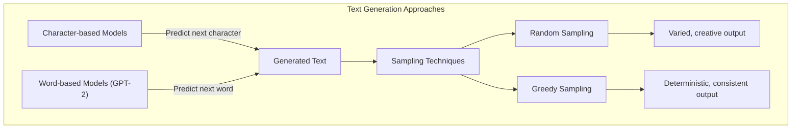
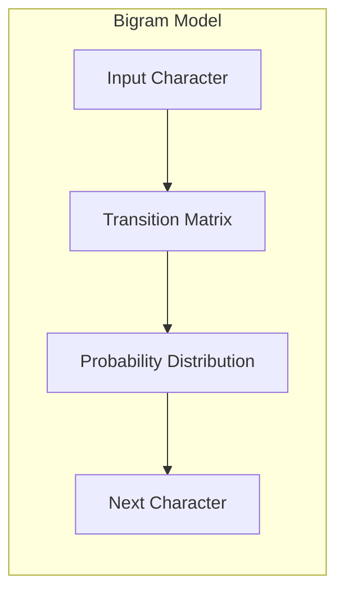
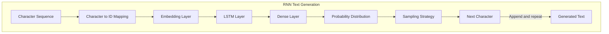
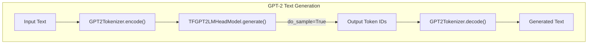
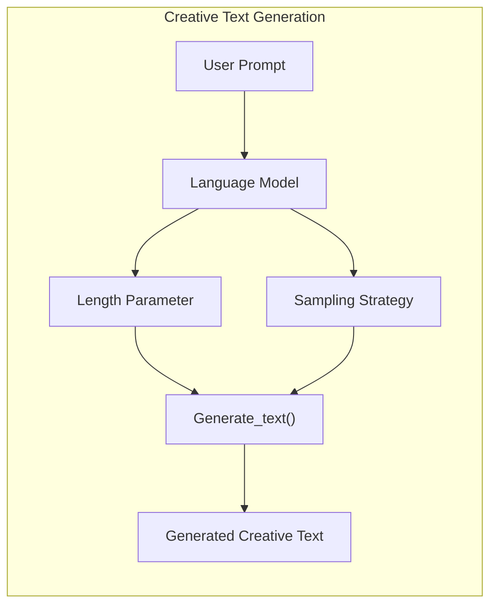
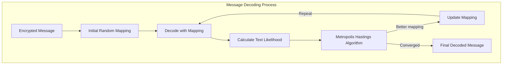
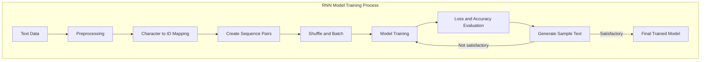

<!-- source: DeepWiki mcp.deepwiki.com · repo google-deepmind/educational · page 3.2 Text Generation Techniques · fetched 2026-10-26 -->

# Text Generation Techniques

<details>
<summary>Relevant source files</summary>

The following files were used as context for generating this wiki page:

- [colabs/introductory/fun_with_language.ipynb](colabs/introductory/fun_with_language.ipynb)

</details>


## Purpose and Scope

This document provides a technical overview of the text generation techniques implemented in the Fun with Language notebook. It covers both simple character-based language models and more advanced pre-trained models, along with different sampling strategies for text generation. The document also explores practical applications including creative text generation and message decoding using the Metropolis Hastings algorithm. For information about message decoding applications specifically, see [Message Decoding Application](#3.3).

## Overview of Text Generation Techniques

Text generation is a natural language processing task where models learn to predict and generate sequences of characters or words. The techniques range from simple statistical models to advanced neural networks, enabling machines to produce human-like text based on patterns learned from training data.



Sources: [colabs/introductory/fun_with_language.ipynb:227-249](), [colabs/introductory/fun_with_language.ipynb:1464-1477]()

## Character-based Language Models

Character-based language models operate at the character level, learning the probability distribution of the next character given a sequence of previous characters. The notebook implements two types of character-based models:

### Simple Bigram Model

The simplest approach is a bigram model that only looks at the immediately preceding character to predict the next one. This model calculates transition probabilities between character pairs.



Sources: [colabs/introductory/fun_with_language.ipynb:828-874](), [colabs/introductory/fun_with_language.ipynb:889-910]()

### Recurrent Neural Network Model

A more sophisticated approach uses a Recurrent Neural Network (RNN) with Long Short-Term Memory (LSTM) units to capture longer-range dependencies in the text.



Sources: [colabs/introductory/fun_with_language.ipynb:990-1007](), [colabs/introductory/fun_with_language.ipynb:227-249]()

### Text Preprocessing and Vocabulary Creation

Before training, the text is preprocessed and a vocabulary of unique characters is created. Each character is mapped to a unique numerical ID for model input.

```
Vocabulary Creation Process:
1. Collect all unique characters from the text
2. Create a character to ID mapping (and reverse mapping)
3. Convert text to sequences of numerical IDs
4. Create training data pairs of input and target sequences
```

Sources: [colabs/introductory/fun_with_language.ipynb:659-682](), [colabs/introductory/fun_with_language.ipynb:766-774]()

## Text Sampling Strategies

After training a language model, text generation requires sampling strategies to select the next character or word based on the model's predictions.

### Random Sampling

Random sampling selects the next character according to the probability distribution predicted by the model. This approach produces more diverse and sometimes creative output.

```python
# Random sampling implementation
rand_char = tf.random.categorical(np.expand_dims(last_predicted, axis=0), 
                                 num_samples=1).numpy()[0, 0]
next_character = id_to_character[rand_char]
```

### Greedy Sampling

Greedy sampling always selects the character with the highest probability. This approach produces more deterministic and often more coherent but less creative output.

```python
# Greedy sampling implementation
next_character = id_to_character[np.argmax(last_predicted)]
```

The notebook implements both sampling strategies in the `generate_text` function:

Sources: [colabs/introductory/fun_with_language.ipynb:227-249](), [colabs/introductory/fun_with_language.ipynb:1402-1411]()

## Advanced Models: GPT-2

The notebook also demonstrates text generation using pre-trained GPT-2 models, which work at the word level rather than character level.



Sources: [colabs/introductory/fun_with_language.ipynb:1446-1452](), [colabs/introductory/fun_with_language.ipynb:1464-1477]()

### Model Variants

GPT-2 is available in multiple sizes, each with different capabilities:

| Model Variant | Parameters | Characteristics |
|---------------|------------|-----------------|
| gpt2          | 124M       | Base model, faster generation |
| gpt2-medium   | 355M       | Better text quality than base |
| gpt2-large    | 774M       | Higher quality but slower |
| gpt2-xl       | 1.5B       | Highest quality, slowest |

Sources: [colabs/introductory/fun_with_language.ipynb:1446-1452]()

## Applications of Text Generation

### Creative Text Generation

Text generation can be used for creative writing, with examples in the notebook showing how to generate text continuations from a given prompt.



Sources: [colabs/introductory/fun_with_language.ipynb:1402-1411](), [colabs/introductory/fun_with_language.ipynb:1464-1477]()

### Message Decoding

A more practical application is using language models to decode encrypted messages by leveraging the model's understanding of language patterns.



The process uses the Metropolis Hastings algorithm to iteratively improve the decryption mapping by measuring how "English-like" the decoded text is using the language model.

Sources: [colabs/introductory/fun_with_language.ipynb:1271-1347](), [colabs/introductory/fun_with_language.ipynb:294-325]()

## Model Training Process

The character-based RNN model is trained on text data, typically books from Project Gutenberg.



Sources: [colabs/introductory/fun_with_language.ipynb:946-955](), [colabs/introductory/fun_with_language.ipynb:1068-1069]()

## Implementation Details

The key components for text generation are implemented in these functions:

1. `generate_text()`: Takes a starting text, desired length, and sampling strategy, then generates text by repeatedly predicting the next character.

2. `get_probabilities()`: Returns the probability distribution for the next character given a sequence of characters.

3. `print_generated_text()`: Helper function for displaying the generated text with formatting.

For GPT-2:
- Uses the `transformers` library to load pre-trained models
- Calls `gpt2_model.generate()` with the `do_sample` parameter to control randomness

Sources: [colabs/introductory/fun_with_language.ipynb:227-249](), [colabs/introductory/fun_with_language.ipynb:276-292](), [colabs/introductory/fun_with_language.ipynb:252-266](), [colabs/introductory/fun_with_language.ipynb:1464-1477]()

## Comparison of Character vs. Word-based Models

| Feature | Character-based Models | Word-based Models (GPT-2) |
|---------|------------------------|---------------------------|
| Granularity | Predict next character | Predict next word/token |
| Vocabulary size | Small (usually < 100) | Large (often > 50,000) |
| Model complexity | Simpler, fewer parameters | More complex, more parameters |
| Training speed | Faster | Slower |
| Quality of output | Can form coherent short phrases | More coherent longer passages |
| Novel word creation | Can create novel words | Limited to vocabulary |
| Example in code | RNN/LSTM implementation | Pre-trained GPT-2 |

Sources: [colabs/introductory/fun_with_language.ipynb:990-1007](), [colabs/introductory/fun_with_language.ipynb:1446-1452](), [colabs/introductory/fun_with_language.ipynb:1477-1492]()

---

