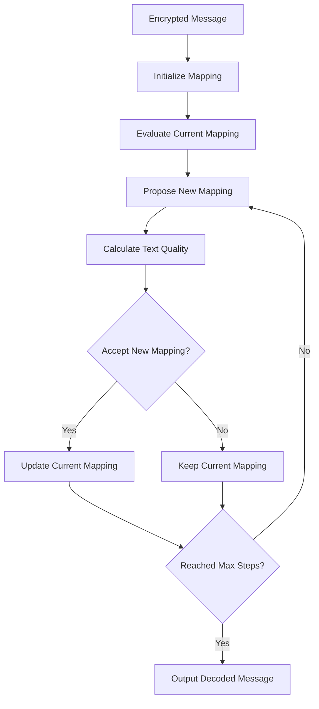
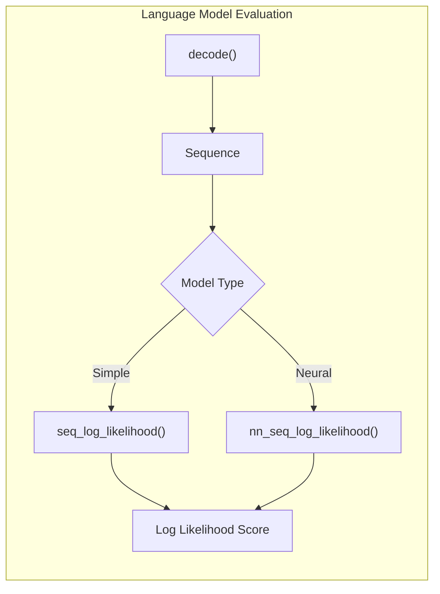
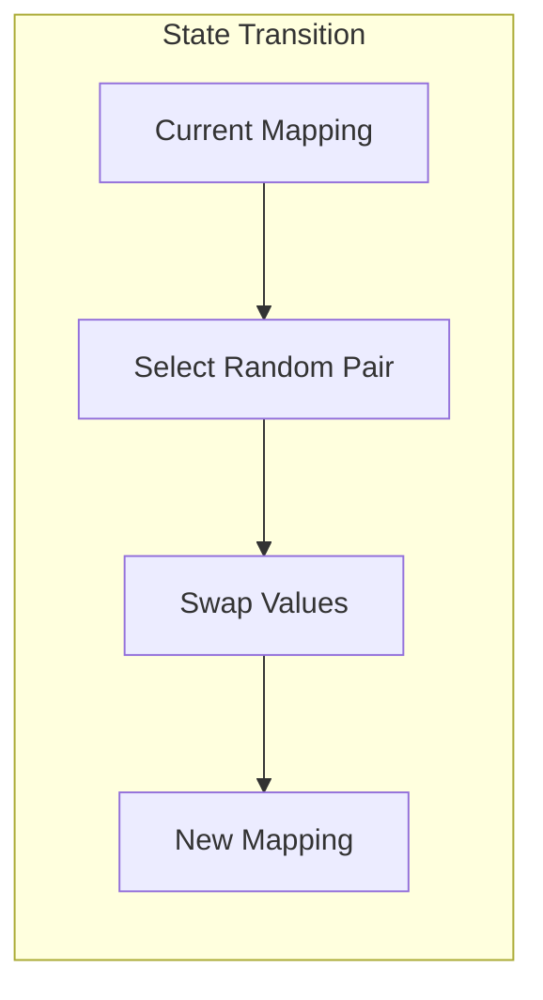
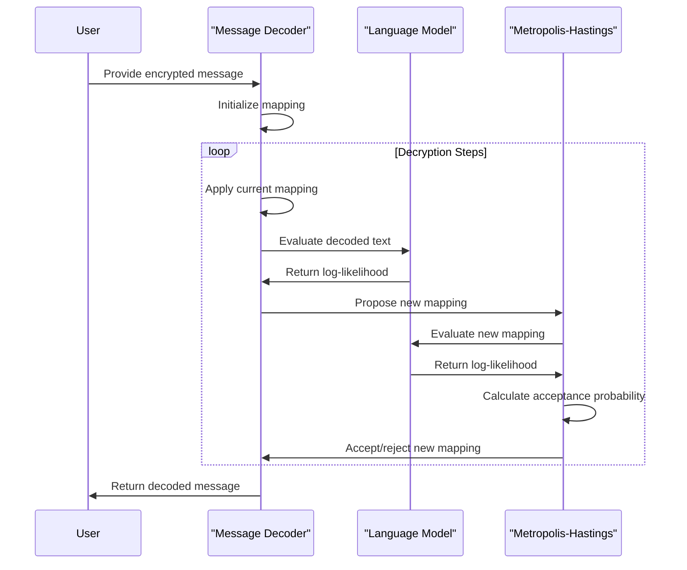
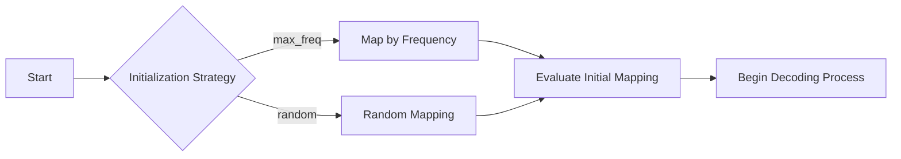
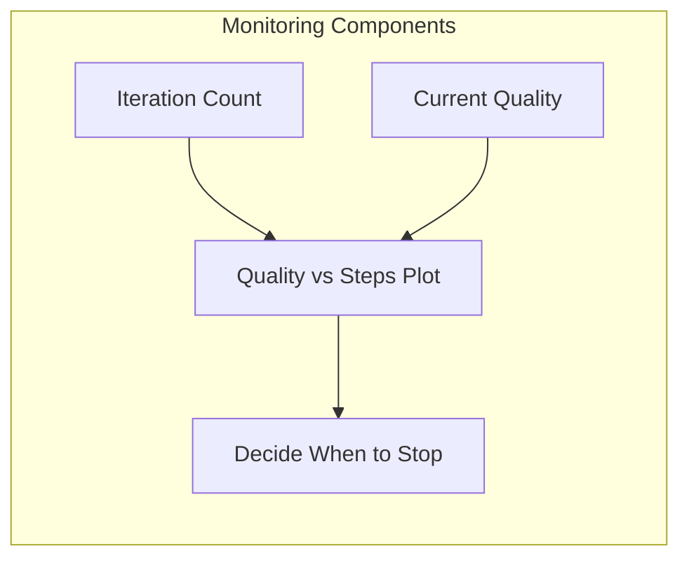

<!-- source: DeepWiki mcp.deepwiki.com · repo google-deepmind/educational · page 3.3 Message Decoding Application · fetched 2026-10-26 -->

# Message Decoding Application

<details>
<summary>Relevant source files</summary>

The following files were used as context for generating this wiki page:

- [colabs/introductory/fun_with_language.ipynb](colabs/introductory/fun_with_language.ipynb)

</details>


## Purpose and Scope

This page documents the message decoding application in the Google DeepMind Educational repository, which demonstrates how language models can be applied to decrypt substitution ciphers. The application uses a Metropolis-Hastings algorithm combined with language model evaluation to automatically crack encrypted messages. This document explains the architecture, components, and algorithms used in the decoding process.

For information about character-based language models used in this application, see [Character-based Language Models](#3.1). For text generation techniques, see [Text Generation Techniques](#3.2).

Sources: [colabs/introductory/fun_with_language.ipynb:1121-1239]()

## Problem Description: Substitution Ciphers

The message decoding application addresses the problem of decrypting messages encrypted with a substitution cipher. In this encryption scheme, each character in the original message is systematically replaced with another character according to a fixed mapping. For example, every 'a' might be replaced with 's', every 'b' with 'x', and so on.

The challenge is to recover the original message without knowing the mapping. While there are 403,291,461,126,605,635,584,000,000 possible mappings for a standard alphabet, the application uses language models to efficiently search the solution space.

### Substitution Cipher Illustration

```mermaid
flowchart LR
    subgraph "Original Message"
        plaintext["pancake"]
    end

    subgraph "Character Mapping"
        a["a → s"] 
        p["p → ["]
        n["n → n"]
        c["c → c"]
        k["k → k"]
        e["e → e"]
    end

    subgraph "Encrypted Message"
        ciphertext["[sncske"]
    end

    plaintext --> Character Mapping
    Character Mapping --> ciphertext
```

Sources: [colabs/introductory/fun_with_language.ipynb:1133-1143]()

## Decryption Approach

The key insight of the decoding application is using language models to evaluate the "English-ness" of potential solutions. The application employs a probabilistic search approach with these main components:

1. **Language Models**: Used to evaluate how likely a given text is to be proper English
2. **State Transition Mechanism**: For exploring the space of possible mappings
3. **Metropolis-Hastings Algorithm**: For efficiently accepting or rejecting proposed mappings

### Decryption System Architecture



Sources: [colabs/introductory/fun_with_language.ipynb:1262-1347]()

## Core Components

### 1. Language Model Evaluation

Two types of language models are used to evaluate the quality of decoded text:

- **Simple Bigram Model**: Uses character transition probabilities calculated from a training corpus
- **Neural Model**: Uses a more complex RNN-based model that can capture longer dependencies

The language model assigns a probability score to a decoded message, which serves as a measure of how likely the text is to be proper English.



Sources: [colabs/introductory/fun_with_language.ipynb:294-342]()

### 2. State Transition Mechanism

The `state_transition()` function generates new candidate mappings by randomly swapping two character mappings:



Sources: [colabs/introductory/fun_with_language.ipynb:375-395]()

### 3. Metropolis-Hastings Algorithm

The Metropolis-Hastings algorithm is used to decide whether to accept a proposed mapping:

1. Evaluate the current mapping (log-likelihood of the decoded message)
2. Propose a new mapping by swapping two characters
3. Evaluate the new mapping
4. Calculate the acceptance probability: `A = min(1, exp(new_likelihood - current_likelihood))`
5. Accept the new mapping with probability A

This approach allows the algorithm to:
- Accept changes that improve the solution
- Sometimes accept changes that don't improve the solution, helping escape local optima
- Converge to a high-quality solution over time

Sources: [colabs/introductory/fun_with_language.ipynb:1320-1333]()

## Detailed Implementation Components

### Core Functions

| Function | Purpose | Code Location |
|----------|---------|---------------|
| `decode()` | Applies a mapping to decode a sequence | [colabs/introductory/fun_with_language.ipynb:362-372]() |
| `state_transition()` | Randomly swaps two mappings to generate a new candidate | [colabs/introductory/fun_with_language.ipynb:375-395]() |
| `seq_log_likelihood()` | Calculates log-likelihood of a sequence for the simple model | [colabs/introductory/fun_with_language.ipynb:314-342]() |
| `nn_seq_log_likelihood()` | Calculates log-likelihood for the neural model | [colabs/introductory/fun_with_language.ipynb:294-311]() |
| `random_permutation()` | Creates a random initial mapping | [colabs/introductory/fun_with_language.ipynb:398-419]() |

### Decoding Process Flow



Sources: [colabs/introductory/fun_with_language.ipynb:1262-1347]()

## Initialization Strategies

The system supports two initialization strategies for the character mapping:

1. **Frequency-Based Initialization** (`init_type = 'max_freq'`):
   - Map the most frequent characters in the encrypted message to the most frequent characters in the language model's training data
   - Provides a better starting point than random initialization

2. **Random Initialization** (`init_type = 'random'`):
   - Create a completely random mapping between characters
   - Useful for testing the algorithm's robustness



Sources: [colabs/introductory/fun_with_language.ipynb:1290-1316]()

## Configuration Parameters

The message decoding application can be configured with several parameters:

| Parameter | Description | Default |
|-----------|-------------|---------|
| `decryption_steps` | Number of iterations for the Metropolis-Hastings algorithm | 15000 |
| `use_which_model` | Which language model to use ('simple' or 'neural') | 'simple (quick)' |
| `init_type` | Initialization strategy for the mapping | 'max_freq' |
| `message_alphabet` | Character set used in the messages | Standard alphabet |

Sources: [colabs/introductory/fun_with_language.ipynb:1276-1277]()

## Performance Monitoring

The algorithm tracks text quality (log-likelihood) over iterations, allowing users to monitor convergence:



The algorithm prints intermediate results every 1000 steps, allowing users to see the progress of the decoding process and decide if more iterations are needed.

Sources: [colabs/introductory/fun_with_language.ipynb:1322-1323](), [colabs/introductory/fun_with_language.ipynb:1336-1347]()

## Usage Example

Here's a typical workflow for using the message decoding application:

1. Select an encrypted message to decode
2. Choose a language model (simple or neural)
3. Set the number of decryption steps
4. Run the decoding algorithm
5. Monitor the quality progression graph
6. If needed, adjust parameters and re-run
7. Retrieve the final decoded message

The performance of the decoding improves with the number of steps, with significant initial gains that tend to plateau after a certain point.

Sources: [colabs/introductory/fun_with_language.ipynb:1250-1364]()

## Limitations and Considerations

- **Computational Complexity**: Neural models are more accurate but significantly slower
- **Message Length**: Longer messages provide more statistical information, making decoding easier
- **Character Set**: Limited to the defined alphabet; special characters may cause issues
- **Convergence**: May require adjusting the number of steps based on message complexity
- **Local Optima**: Despite Metropolis-Hastings, the algorithm can still get stuck in local optima with poor initial mappings

Sources: [colabs/introductory/fun_with_language.ipynb:1233-1239](), [colabs/introductory/fun_with_language.ipynb:1343-1347]()

---

