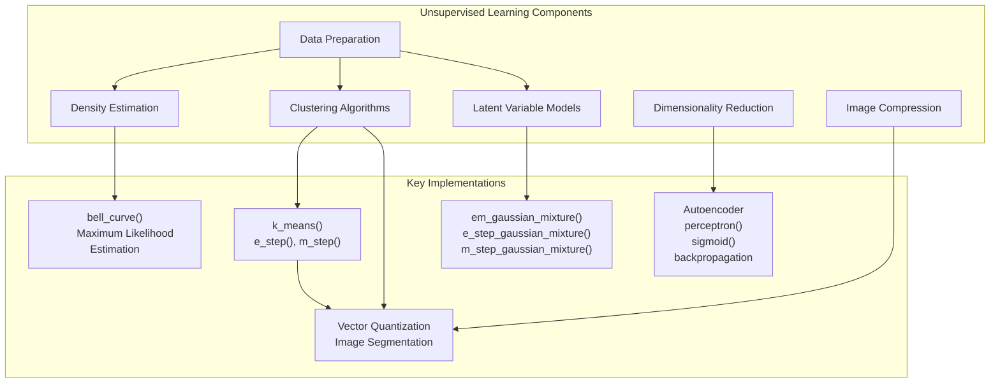
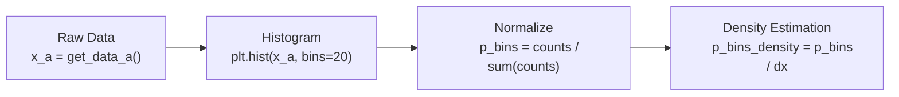
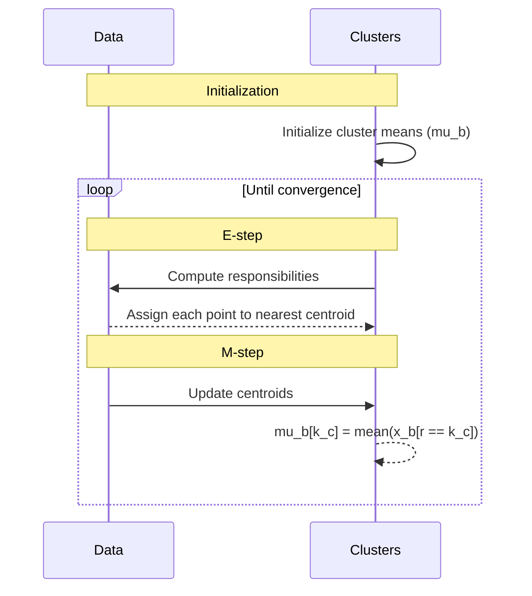
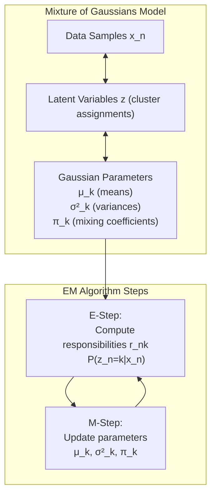
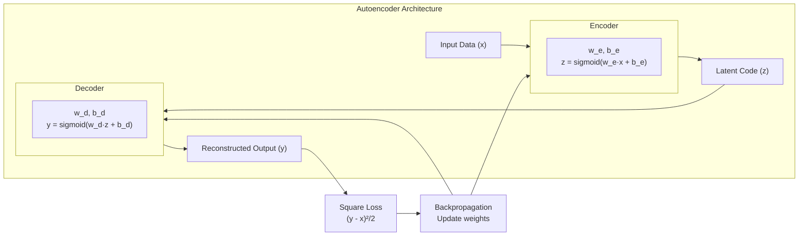
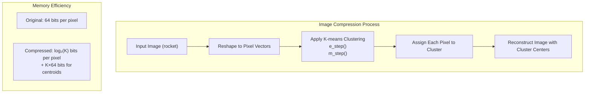

<!-- source: DeepWiki mcp.deepwiki.com · repo google-deepmind/educational · page 4 Unsupervised Learning · fetched 2026-10-26 -->

# Unsupervised Learning

<details>
<summary>Relevant source files</summary>

The following files were used as context for generating this wiki page:

- [colabs/summer_schools/intro_to_unsupervised_learning.ipynb](colabs/summer_schools/intro_to_unsupervised_learning.ipynb)

</details>


## Purpose and Scope

This page provides a technical overview of the unsupervised learning implementations and concepts as presented in the Google DeepMind Educational repository. The material covers the fundamentals of unsupervised learning, including density estimation, clustering algorithms, and latent variable models. It also includes practical implementations of K-means clustering, Expectation-Maximization (EM) algorithm, autoencoders, and image compression techniques.

The primary focus is on the implementation found in the introductory notebook on unsupervised learning, which provides hands-on examples and visualizations to understand these concepts.

Sources: [colabs/summer_schools/intro_to_unsupervised_learning.ipynb:20-34]()

## Unsupervised Learning Overview

Unsupervised learning operates solely on input data without labeled outputs. In contrast to supervised learning (which works with input-output pairs) and reinforcement learning (which uses reward signals), unsupervised learning algorithms discover patterns in data and create compact representations without explicit guidance.

The key areas addressed in unsupervised learning are:

1. **Density estimation**: Models the probability distribution of data, p(x)
2. **Clustering**: Discovers and characterizes groups of similar examples in the data
3. **Dimensionality reduction/latent variable models**: Enables analysis, visualization, and compression by extracting informative features

These areas are interconnected. For example, clustering can be viewed as a method for density estimation, and it can facilitate data compression.

Sources: [colabs/summer_schools/intro_to_unsupervised_learning.ipynb:51-64]()

### System Architecture

The following diagram illustrates the main components of the unsupervised learning systems implemented in the educational repository:



Sources: [colabs/summer_schools/intro_to_unsupervised_learning.ipynb:51-64](), [colabs/summer_schools/intro_to_unsupervised_learning.ipynb:99-103]()

## Density Estimation

Density estimation models the probability distribution of data. The notebook demonstrates this concept through histograms and Gaussian distribution fitting.

### Empirical Data Distribution

The process starts with binning continuous data into a histogram, then normalizing to obtain probability mass and density estimates:



Sources: [colabs/summer_schools/intro_to_unsupervised_learning.ipynb:193-207](), [colabs/summer_schools/intro_to_unsupervised_learning.ipynb:228-262]()

### Gaussian Distribution Fitting

The implementation includes a Gaussian probability density function:

```python
def bell_curve(x, mu, sigma_2):
  y = np.exp(- (x - mu)**2 / 2 / sigma_2)
  y /= np.sqrt(2 * np.pi * sigma_2)
  return y
```

Maximum Likelihood Estimation (MLE) is used to find optimal parameters for the Gaussian distribution by maximizing the likelihood of the data or equivalently minimizing the negative log-likelihood:

```python
def log_loss_gaussian(x_, mu, sigma_2):
  log_p = ((x_ - mu)**2 / sigma_2 + np.log(sigma_2) + np.log(2 * np.pi)) / 2
  return np.sum(log_p)
```

Sources: [colabs/summer_schools/intro_to_unsupervised_learning.ipynb:342-346](), [colabs/summer_schools/intro_to_unsupervised_learning.ipynb:514-518]()

## K-means Clustering

K-means is an iterative algorithm that partitions data into K clusters, where each cluster is represented by its centroid (mean).

### K-means Algorithm Implementation

The K-means algorithm consists of two alternating steps:

1. **E-step (Expectation)**: Assign each data point to the nearest cluster
2. **M-step (Maximization)**: Update cluster centroids based on the assignments



The implementation includes these key functions:

```python
def e_step(x, mu):
  r = [np.nanargmin(np.abs(x_k - mu)) for k, x_k in enumerate(x)]
  return np.array(r)

def m_step(x, r, cluster_ids):
  mu_c = np.ones_like(cluster_ids) * np.nan
  for k_c in cluster_ids:
    x_c = x[r == k_c]
    if np.any(x_c):
      mu_c[k_c] = np.mean(x_c)
  return mu_c
```

The algorithm is wrapped in a function that tracks the evolution of cluster parameters:

```python
def k_means(x, n_clusters, n_steps=10):
  # Implementation details...
  for t in range(1, n_steps):
    r = e_step(x, mu_over_time[t - 1])
    # Update cluster regions
    mu_over_time[t] = m_step(x, r, range(n_clusters))
  return mu_over_time, rlim_over_time
```

Sources: [colabs/summer_schools/intro_to_unsupervised_learning.ipynb:616-632](), [colabs/summer_schools/intro_to_unsupervised_learning.ipynb:766-776](), [colabs/summer_schools/intro_to_unsupervised_learning.ipynb:809-822]()

## Expectation-Maximization (EM) Algorithm

The EM algorithm is a generalization of K-means that incorporates probabilistic assignments and can be used for mixture models.

### Mixture of Gaussians

A mixture of Gaussians models the data as being generated from multiple Gaussian distributions. Each data point has a probability of belonging to each cluster, rather than the hard assignment in K-means.



The EM algorithm implementation includes:

```python
def e_step_gaussian_mixture(x, mu, sigma_2, pi):
  # Compute posterior for each data sample
  r = np.array([pi_c * bell_curve(x, mu_c, sigma_2c) 
       for pi_c, mu_c, sigma_2c in zip(pi, mu, sigma_2)]).T
  # Normalize posterior
  r /= np.sum(r, -1, keepdims=True)
  return np.array(r)

def m_step_gaussian_mixture(x, r):
  # Maximum likelihood update
  n_k = np.sum(r, 0)
  mu = np.sum(r * x[:, None], 0) / n_k
  sigma_2 = np.sum(r * (x[:, None] - mu[None])**2, 0) / n_k
  pi = n_k / np.sum(n_k)
  return mu, sigma_2, pi
```

Sources: [colabs/summer_schools/intro_to_unsupervised_learning.ipynb:1092-1103](), [colabs/summer_schools/intro_to_unsupervised_learning.ipynb:1164-1183]()

## Autoencoders

Autoencoders are neural networks that learn efficient encodings of data by trying to reconstruct the input data after passing it through a bottleneck layer.

### Autoencoder Architecture

The implemented autoencoder is a simple multi-layer perceptron (MLP) with an encoder and decoder:



The implementation includes the perceptron function that applies weights and the sigmoid activation:

```python
def sigmoid(x):
  return 1 / (1 + np.exp(-x))

def perceptron(x, w, b):
  return sigmoid(np.dot(w, x) + b)
```

The network is trained using backpropagation with stochastic gradient descent:

```python
# Training loop
for epoch in range(n_epochs):
  for x_ in x_c:
    # Forward pass
    z = sigmoid(np.dot(w_e, x_) + b_e)
    y = sigmoid(np.dot(w_d, z) + b_d)
    
    # Backpropagation
    dL_dylin = (y - x_) * sigmoid_gradient(y)
    dL_dzlin = np.matmul(dL_dylin, w_d) * sigmoid_gradient(z)
    
    # Weight updates
    dL_dw_d = dL_dylin[:, None] * z[None]
    dL_dw_e = dL_dzlin[:, None] * x_[None]
    w_d -= learning_rate * dL_dw_d
    w_e -= learning_rate * dL_dw_e
```

Sources: [colabs/summer_schools/intro_to_unsupervised_learning.ipynb:1468-1484](), [colabs/summer_schools/intro_to_unsupervised_learning.ipynb:1569-1574](), [colabs/summer_schools/intro_to_unsupervised_learning.ipynb:1852-1876]()

## Image Compression with K-means

K-means clustering can be used for image compression through vector quantization, where similar pixel values are replaced with their cluster centroids.

### Vector Quantization Process



The implementation adapts the K-means algorithm to work with vector data (RGB pixels):

```python
def e_step(x, mu):
  d = distance_matrix(x, mu)
  return np.nanargmin(d, 1)

def m_step(x, r, cluster_ids):
  mu_c = np.zeros((len(cluster_ids), x.shape[-1]))
  for k_c in cluster_ids:
    x_c = x[r == k_c]
    if np.any(x_c):
      mu_c[k_c] = np.mean(x_c, 0)
  return mu_c
```

The compression process involves:
1. Loading an image and reshaping it to a collection of pixel vectors
2. Applying K-means to cluster similar colors
3. Replacing each pixel with its cluster centroid
4. Reconstructing the compressed image

This approach achieves significant memory savings, especially when the number of clusters (K) is much smaller than the number of pixels in the image.

Sources: [colabs/summer_schools/intro_to_unsupervised_learning.ipynb:2032-2044](), [colabs/summer_schools/intro_to_unsupervised_learning.ipynb:2094-2107](), [colabs/summer_schools/intro_to_unsupervised_learning.ipynb:2117-2122]()

## Implementation Details

### Data Generation Functions

The notebook includes several data generation functions for creating synthetic datasets:

```python
def get_data_a(n=1000, k=0):
  return np.random.randn(n) * HIDDEN_SIGMA[k] + HIDDEN_MU[k]

def get_responsibilities(p, n=10000):
  n_per_cluster = np.random.multinomial(n, p)
  r = [[k] * n_k for k, n_k in enumerate(n_per_cluster)]
  r = np.concatenate(r)
  np.random.shuffle(r)
  return r

def get_data_b():
  y = np.random.randn(len(R))
  for t, k in enumerate(R):
    y[t] *= HIDDEN_SIGMA[k]
    y[t] += HIDDEN_MU[k]
  return y

def get_data_c(n_x=6):
  return np.eye(n_x * 3).reshape((-1, n_x, 3))
```

These functions generate data for different unsupervised learning tasks:
- `get_data_a()`: Generates Gaussian-distributed data (used for density estimation)
- `get_data_b()`: Creates a mixture of Gaussians (for clustering experiments)
- `get_data_c()`: Produces orthogonal samples (for autoencoder training)

Sources: [colabs/summer_schools/intro_to_unsupervised_learning.ipynb:142-169]()

### Visualization and Animation

The notebook includes extensive visualization functions to illustrate the algorithms' behavior:

```python
def animate_kmeans(x, mu_over_time, rlim_over_time):
  # Creates animation of K-means algorithm
  
def animate_em_gaussian_mixture(x, params_over_time):
  # Creates animation of EM algorithm
  
def visualise_predictions(data):
  # Visualizes autoencoder predictions
```

These functions help to visualize:
1. The evolution of cluster assignments in K-means
2. The progressive updates of Gaussian mixture components in EM
3. The original and reconstructed data in autoencoders

Sources: [colabs/summer_schools/intro_to_unsupervised_learning.ipynb:826-857](), [colabs/summer_schools/intro_to_unsupervised_learning.ipynb:1336-1367](), [colabs/summer_schools/intro_to_unsupervised_learning.ipynb:1600-1612]()

## Summary

The unsupervised learning notebook implements and explains several fundamental algorithms:

| Algorithm | Implementation | Application |
|-----------|---------------|-------------|
| Gaussian Fitting | `bell_curve()`, `log_loss_gaussian()` | Density estimation |
| K-means | `e_step()`, `m_step()`, `k_means()` | Clustering, Image compression |
| EM for Gaussian Mixtures | `e_step_gaussian_mixture()`, `m_step_gaussian_mixture()` | Probabilistic clustering |
| Autoencoder | `perceptron()`, Manual backpropagation | Dimensionality reduction |
| Vector Quantization | Adaptation of `e_step()`, `m_step()` | Image compression |

These implementations provide practical insights into unsupervised learning techniques with a focus on educational clarity rather than computational efficiency.

Sources: [colabs/summer_schools/intro_to_unsupervised_learning.ipynb:20-34](), [colabs/summer_schools/intro_to_unsupervised_learning.ipynb:99-103]()

---

