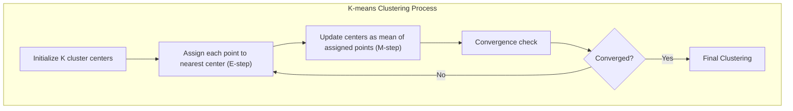
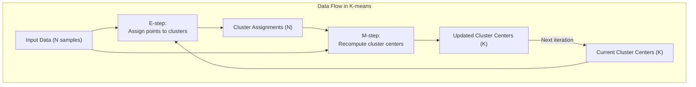
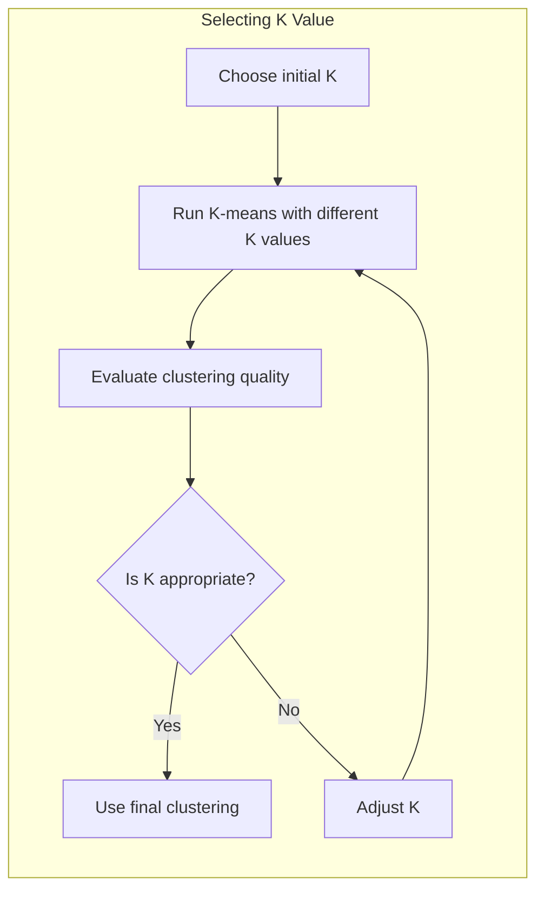
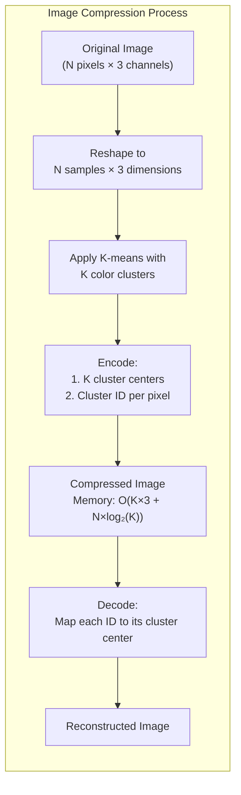

<!-- source: DeepWiki mcp.deepwiki.com · repo google-deepmind/educational · page 4.1 K-means Clustering · fetched 2026-10-26 -->

# K-means Clustering

<details>
<summary>Relevant source files</summary>

The following files were used as context for generating this wiki page:

- [colabs/summer_schools/intro_to_unsupervised_learning.ipynb](colabs/summer_schools/intro_to_unsupervised_learning.ipynb)

</details>


## Purpose and Scope

This document provides a detailed explanation of the K-means clustering algorithm, its implementation, and its application to image compression. K-means is one of the most fundamental unsupervised learning techniques for partitioning data into distinct clusters based on similarity. The implementation discussed here is part of the unsupervised learning module in the DeepMind educational repository.

For information about more sophisticated clustering methods like Expectation-Maximization (EM) for Gaussian mixtures, see [Expectation-Maximization Algorithm](#4.2).

Sources: [colabs/summer_schools/intro_to_unsupervised_learning.ipynb:576-586]()

## Overview of K-means Clustering

K-means clustering is an algorithm that partitions data into K clusters by iteratively assigning data points to the nearest cluster center and updating these centers. Unlike more complex unsupervised learning approaches, K-means makes a hard assignment of each data point to exactly one cluster.

The algorithm is particularly useful for:
- Data segmentation and grouping
- Feature learning
- Data compression through vector quantization
- Preprocessing for other machine learning algorithms



Sources: [colabs/summer_schools/intro_to_unsupervised_learning.ipynb:616-630]()

## Algorithm Details

### Initialization and Steps

The K-means algorithm consists of the following steps:

1. **Input**: Data (D ∈ ℝ^(d×N)) and number of clusters K
2. **Initialization**: Set initial cluster templates μₖ ∈ ℝᵈ
3. **Iterative Process**:
   - **E-step**: Assign each sample to the closest cluster using a distance metric
   - **M-step**: Update cluster centers by computing the mean of all samples assigned to each cluster
4. **Termination**: Repeat until convergence or maximum iterations reached

The algorithm uses two main steps which are called E and M steps because K-means can be viewed as a special case of the Expectation-Maximization algorithm:
- The E-step computes the expectation over the latent cluster assignment variable
- The M-step maximizes the likelihood by adjusting cluster parameters



Sources: [colabs/summer_schools/intro_to_unsupervised_learning.ipynb:616-645]()

### Mathematical Formulation

For one-dimensional data, assigning a sample to a cluster involves:
- Let xₙ be a data point
- Let μₖ be the center of cluster k
- Assign xₙ to cluster zₙ = argmin_k D(xₙ, μₖ) where D is a distance function
- For 1D data, D(xₙ, μₖ) = |xₙ-μₖ|, the absolute difference
- For multidimensional data, a Euclidean distance is commonly used

After assignments, cluster centers are updated:
- μₖ = ⟨xₙ⟩_zₙ=k (mean of all samples assigned to cluster k)

Sources: [colabs/summer_schools/intro_to_unsupervised_learning.ipynb:616-630]()

## Implementation Details

### Core Functions

The K-means algorithm is implemented with two primary functions:

1. **E-step function**: Assigns each data point to the nearest cluster

```python
def e_step(x, mu):
  r = [np.nanargmin(np.abs(x_k - mu))
      for k, x_k in enumerate(x)]      
  return np.array(r)
```

2. **M-step function**: Updates cluster centers based on assignments

```python
def m_step(x, r, cluster_ids):
  mu_c = np.ones_like(cluster_ids) * np.nan
  for k_c in cluster_ids:
    x_c = x[r == k_c]
    if np.any(x_c):
      mu_c[k_c] = np.mean(x_c) 
  return mu_c
```

Sources: [colabs/summer_schools/intro_to_unsupervised_learning.ipynb:766-778]()

### Complete Algorithm Implementation

The algorithm combines the E-step and M-step functions in an iterative process:

```python
n_steps = 10
for t in range(n_steps):
  r = e_step(x_b, mu_b)
  mu_b = m_step(x_b, r, range(n_c))
  # Visualization code omitted
```

This simple implementation handles the core functionality of the K-means algorithm. A more complete implementation includes visualization and may add handling for special cases like empty clusters.

Sources: [colabs/summer_schools/intro_to_unsupervised_learning.ipynb:780-788]()

### Visualization Techniques

The implementation includes visualization techniques to monitor convergence:

1. **Color-coded cluster assignments**: Shows which data points belong to which cluster
2. **Transparency for iteration progress**: Uses increasing opacity to show how cluster centers move over iterations
3. **Animated visualization**: Shows the E-step and M-step alternating through iterations

Sources: [colabs/summer_schools/intro_to_unsupervised_learning.ipynb:797-857]()

## Choosing the Number of Clusters

A key challenge with K-means clustering is determining the appropriate number of clusters (K). The repository explores this challenge by experimenting with different K values:

- Small K may fail to capture the true structure in the data
- Large K may result in unnecessary or empty clusters
- Clusters may become irrelevant during training when no points are assigned to them



Sources: [colabs/summer_schools/intro_to_unsupervised_learning.ipynb:873-895]()

## Image Compression with K-means

One practical application of K-means clustering is image compression through vector quantization.

### Principles of K-means for Image Compression

The process works as follows:
1. Treat each pixel as a sample (usually 3D for RGB colors)
2. Run K-means to find K color clusters
3. Replace each pixel with its cluster center
4. Store only:
   - The cluster assignments for each pixel (requires only log₂(K) bits)
   - The K cluster centers (3 values per center for RGB)

This drastically reduces memory requirements compared to storing full pixel values.



Sources: [colabs/summer_schools/intro_to_unsupervised_learning.ipynb:2029-2044]()

### Memory Efficiency Analysis

Using K-means for image compression provides significant memory savings:

- Original image: 64 bits per color channel × 3 channels × N pixels = 192N bits
- Compressed image: 
  - Cluster centers: 64 bits × 3 channels × K clusters = 192K bits
  - Pixel assignments: log₂(K) bits × N pixels

For a typical scenario with K=16 and large N, compression ratio approaches 192N/(192K + 4N), which can be substantial when N >> K.

Sources: [colabs/summer_schools/intro_to_unsupervised_learning.ipynb:2029-2044]()

### Implementation for Image Data

For image compression, the K-means implementation requires some modifications:

1. **Vector-based distance**: Uses Euclidean distance between color vectors
2. **Reshaping**: Treats the image as a collection of pixels (samples)
3. **Reconstructing**: Maps cluster IDs back to color values

```python
# For image data
def e_step(x, mu):
  d = distance_matrix(x, mu)
  return np.nanargmin(d, 1) 

def m_step(x, r, cluster_ids):
  mu_c = np.zeros((len(cluster_ids), x.shape[-1]))
  for k_c in cluster_ids:
    x_c = x[r == k_c]
    if np.any(x_c):
      mu_c[k_c] = np.mean(x_c, 0) 
  return mu_c
```

Sources: [colabs/summer_schools/intro_to_unsupervised_learning.ipynb:2093-2107]()

### Compression Workflow

The image compression process follows these steps:

1. Load and normalize the image
2. Reshape the image into a collection of pixel samples
3. Initialize K cluster centers randomly
4. Run the K-means algorithm to convergence
5. Create the compressed representation:
   - Store cluster centers (μₖ)
   - Store cluster assignments for each pixel (zₙ)
6. Reconstruct the image by mapping each pixel to its assigned cluster center

The quality of compression depends on:
- Number of clusters (K)
- Number of iterations
- Initialization of clusters

Sources: [colabs/summer_schools/intro_to_unsupervised_learning.ipynb:2108-2162]()

## Limitations and Extensions

While K-means is powerful and simple, it has some limitations:

1. **Sensitivity to initialization**: Different initial centers can lead to different final clusterings
2. **Fixed number of clusters**: Requires specifying K in advance
3. **Spherical clusters**: Assumes clusters have spherical shapes with similar variance
4. **Equal cluster sizes**: Tends to create clusters of similar sizes

For more sophisticated clustering approaches that address some of these limitations, see [Expectation-Maximization Algorithm](#4.2) which uses probabilistic assignments instead of hard assignments.

Sources: [colabs/summer_schools/intro_to_unsupervised_learning.ipynb:873-895](), [colabs/summer_schools/intro_to_unsupervised_learning.ipynb:944-948]()

## Conclusion

K-means clustering is a fundamental algorithm in unsupervised learning that provides an efficient way to partition data. Its simplicity and effectiveness make it a valuable tool for a variety of applications, particularly for image compression through vector quantization.

The implementation discussed in this document provides a foundation for understanding both the theoretical aspects of K-means and its practical applications. By exploring the provided code and examples, users can gain insights into how clustering algorithms work and how they can be applied to real-world problems.

Sources: [colabs/summer_schools/intro_to_unsupervised_learning.ipynb:576-586](), [colabs/summer_schools/intro_to_unsupervised_learning.ipynb:2029-2044]()

---

