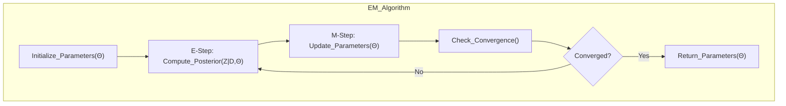
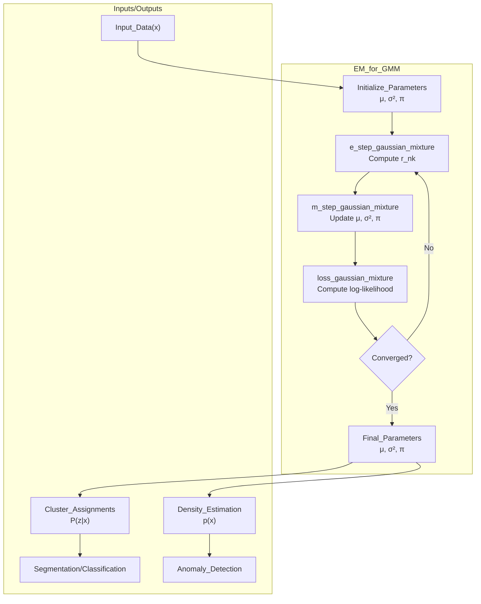
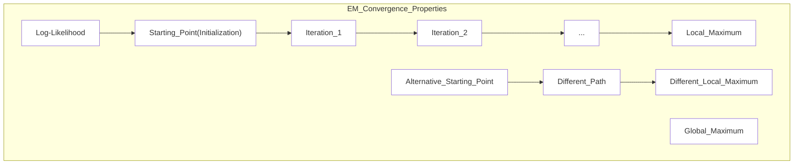

<!-- source: DeepWiki mcp.deepwiki.com · repo google-deepmind/educational · page 4.2 Expectation-Maximization Algorithm · fetched 2026-10-26 -->

# Expectation-Maximization Algorithm

<details>
<summary>Relevant source files</summary>

The following files were used as context for generating this wiki page:

- [colabs/summer_schools/intro_to_unsupervised_learning.ipynb](colabs/summer_schools/intro_to_unsupervised_learning.ipynb)

</details>


The Expectation-Maximization (EM) algorithm is a powerful method for finding maximum likelihood estimates of parameters in statistical models where the model depends on unobserved latent variables. This page provides a comprehensive explanation of the EM algorithm, its theoretical foundations, implementation details, and application in the context of Gaussian mixture models. The primary focus is on understanding how EM iteratively optimizes parameters when dealing with incomplete data or hidden variables.

For information about specific applications like clustering using K-means, see [K-means Clustering](#4.1). For dimensionality reduction techniques using autoencoders, refer to [Autoencoders](#4.3).

Sources: [colabs/summer_schools/intro_to_unsupervised_learning.ipynb:1120-1154]()

## Theoretical Foundation

The EM algorithm is used for finding maximum likelihood estimates in probabilistic models with latent (hidden) variables. In settings where direct optimization of the likelihood is difficult due to the presence of hidden variables, EM provides an iterative approach to parameter estimation.

The fundamental problem addressed by EM can be formalized as:
- We have observed data $\mathcal{D}$
- There exist unobserved latent variables $Z$
- We want to find parameters $\Theta$ that maximize the likelihood $P(\mathcal{D}|\Theta)$
- Direct optimization is challenging because the likelihood involves summing or integrating over all possible values of $Z$

Instead of directly maximizing the likelihood, EM alternates between estimating the distribution of latent variables and optimizing the parameters.

Sources: [colabs/summer_schools/intro_to_unsupervised_learning.ipynb:1120-1127](), [colabs/summer_schools/intro_to_unsupervised_learning.ipynb:1397-1400]()

## EM Algorithm Steps

The EM algorithm consists of two primary steps that are executed iteratively:

### Expectation Step (E-step)
In the E-step, we compute the posterior distribution of the latent variables given the current parameter estimates and the observed data. For a model with categorical latent variables (like cluster assignments), this means calculating the probability of each data point belonging to each cluster.

### Maximization Step (M-step)
In the M-step, we update the parameters to maximize the expected complete-data log-likelihood, where the expectation is taken with respect to the posterior distribution computed in the E-step.

These steps are repeated until convergence, which is typically determined by monitoring the change in log-likelihood or parameter values between iterations.

The diagram below illustrates the iterative nature of the EM algorithm:



Sources: [colabs/summer_schools/intro_to_unsupervised_learning.ipynb:1130-1154]()

## EM for Gaussian Mixture Models

One of the most common applications of the EM algorithm is fitting Gaussian Mixture Models (GMMs), which model the data as a mixture of several Gaussian distributions.

### Model Specification

For a GMM, we assume the data was generated by the following process:
1. For each sample $n$, draw a cluster assignment $z_n$ from a categorical distribution: $P(z_n=k) = \pi_k$
2. Draw the sample from the Gaussian distribution associated with the selected cluster: $p(x_n|z_n=k) = \mathcal{N}(x_n|\mu_k, \sigma^2_k)$

The likelihood of observing a data point is given by:
$$p(x_n) = \sum_k \pi_k \frac{1}{\sqrt{2\pi\sigma^2_k}} e^{-\frac{(x_n-\mu_k)^2}{2\sigma^2_k}}$$

### E-step for GMMs

In the E-step, we compute the posterior probability (also called "responsibilities") of each data point belonging to each cluster:

$$r_{nk} \equiv P(z_n=k|x_n) = \frac{\pi_k p(x_n|z_n=k)}{\sum_j \pi_j p(x_n|z_n=j)}$$

This is implemented in the function `e_step_gaussian_mixture` in the codebase:

```python
def e_step_gaussian_mixture(x, mu, sigma_2, pi):
  # Posterior probability for each data sample belonging to each cluster
  r = np.array([pi_c * bell_curve(x, mu_c, sigma_2c) 
       for pi_c, mu_c, sigma_2c in zip(pi, mu, sigma_2)]).T
  # Normalizing posterior to one
  r /= np.sum(r, -1, keepdims=True)
  return np.array(r)
```

Sources: [colabs/summer_schools/intro_to_unsupervised_learning.ipynb:1091-1103](), [colabs/summer_schools/intro_to_unsupervised_learning.ipynb:1137-1138](), [colabs/summer_schools/intro_to_unsupervised_learning.ipynb:1161-1170]()

### M-step for GMMs

In the M-step, we update the parameters $\mu_k$, $\sigma^2_k$, and $\pi_k$ to maximize the expected complete-data log-likelihood:

$$\mu_k = \frac{1}{N_k} \sum_n r_{nk} x_n$$

$$\sigma^2_k = \frac{1}{N_k} \sum_n r_{nk} (x_n - \mu_k)^2$$

$$\pi_k = \frac{N_k}{N}$$

where $N_k = \sum_n r_{nk}$ is the sum of responsibilities for cluster $k$, and $N$ is the total number of samples.

This is implemented in the function `m_step_gaussian_mixture` in the codebase:

```python
def m_step_gaussian_mixture(x, r):
  # Maximum likelihood estimation
  n_k = np.sum(r, 0)
  mu = np.sum(r * x[:, None], 0) / n_k
  sigma_2 = np.sum(r * (x[:, None] - mu[None])**2, 0) / n_k
  pi = n_k / np.sum(n_k)
  return mu, sigma_2, pi
```

Sources: [colabs/summer_schools/intro_to_unsupervised_learning.ipynb:1143-1147](), [colabs/summer_schools/intro_to_unsupervised_learning.ipynb:1171-1183]()

## EM Algorithm Execution Flow

The following diagram shows the execution flow of the EM algorithm for Gaussian mixture models, highlighting the interaction between key components:



Sources: [colabs/summer_schools/intro_to_unsupervised_learning.ipynb:1183-1380]()

## Relationship to K-means

The K-means algorithm can be viewed as a special case of the EM algorithm for Gaussian mixture models, with specific constraints:

1. In K-means, cluster assignments are hard (a data point belongs to exactly one cluster) rather than soft probabilities
2. K-means assumes equal, isotropic covariances for all clusters
3. Cluster weights are assumed to be equal

The relationship between the two algorithms is explained in the following table:

| Algorithm | E-step | M-step | Cluster Assignment |
|-----------|--------|--------|-------------------|
| K-means | Assign each point to the nearest cluster center | Recompute cluster centers as the mean of all assigned points | Hard assignment (0 or 1) |
| EM for GMM | Calculate posterior probabilities (responsibilities) for each point belonging to each cluster | Update means, variances, and weights based on weighted averages | Soft assignment (probabilities) |

When using K-means, the E-step simplifies to:
```python
def e_step(x, mu):
  r = [np.nanargmin(np.abs(x_k - mu)) for k, x_k in enumerate(x)]
  return np.array(r)
```

And the M-step becomes:
```python
def m_step(x, r, cluster_ids):
  mu_c = np.ones_like(cluster_ids) * np.nan
  for k_c in cluster_ids:
    x_c = x[r == k_c]
    if np.any(x_c):
      mu_c[k_c] = np.mean(x_c)
  return mu_c
```

Sources: [colabs/summer_schools/intro_to_unsupervised_learning.ipynb:641-645](), [colabs/summer_schools/intro_to_unsupervised_learning.ipynb:739-790]()

## Variational Interpretation of EM

The EM algorithm can be understood from a variational perspective, which provides deeper insights into its behavior and convergence properties.

### Evidence Lower Bound (ELBO)

EM maximizes a variational lower bound on the log-likelihood, known as the Evidence Lower Bound (ELBO):

$$\text{ELBO} = \log(P(D|\Theta)) - \text{KL}[P(Z|D)||Q(Z)]$$

where $\text{KL}$ is the Kullback-Leibler divergence between the true posterior $P(Z|D)$ and an approximating distribution $Q(Z)$.

The EM steps can be interpreted as:
1. E-step: Maximize ELBO with respect to $Q(Z)$ by setting $Q(Z) = P(Z|D)$, minimizing the KL-divergence to zero
2. M-step: Maximize ELBO with respect to parameters $\Theta$, with fixed $Q(Z)$

This interpretation explains why EM is guaranteed to increase the log-likelihood at each iteration, as the ELBO is a lower bound on the log-likelihood, and each step of EM increases the ELBO.

Sources: [colabs/summer_schools/intro_to_unsupervised_learning.ipynb:1397-1440]()

## Convergence and Limitations

The EM algorithm converges to a stationary point of the log-likelihood function, but this may be a local maximum rather than the global maximum. The quality of the solution depends on the initialization of parameters.

Key properties and limitations include:
- Guaranteed to increase log-likelihood at each iteration
- Convergence to a local maximum, not necessarily global
- Sensitivity to initial parameter values
- Potential for convergence to singular solutions (e.g., components with zero variance)
- May require many iterations for convergence in complex models



Sources: [colabs/summer_schools/intro_to_unsupervised_learning.ipynb:1153-1154](), [colabs/summer_schools/intro_to_unsupervised_learning.ipynb:1400-1402]()

## Implementation and Visualization

The implementation of the EM algorithm for Gaussian mixture models involves functions for the E-step, M-step, and monitoring the log-likelihood. The codebase includes functions for visualizing the progress of the algorithm during training.

```python
# Visualize EM training progress
def animate_em_gaussian_mixture(x, params_over_time):
  n_steps, _, n_clusters = np.shape(params_over_time)
  colors = sns.color_palette(n_colors=n_clusters)

  x_ = np.linspace(min(x), max(x), 1000)
  fig, ax = plt.subplots()
  # Initialize graphics
  pdfs = [plt.plot(x_, np.nan * x_, c=colors[k_c])[0]
          for k_c in range(n_clusters)]
  plt.hist(x, bins=200, density=True, histtype='stepfilled', 
           facecolor='.9', edgecolor='.3')
  lines = [plt.axvline(np.nan, c=colors[k_c])
          for k_c in range(n_clusters)]

  # Animation function
  def animate_(t): 
    mu_t, sigma_2t, pi_t = params_over_time[t]
    for k_c, mu_k in enumerate(mu_t):
      lines[k_c].set_data([mu_k, [0, 1]])
      y_ = bell_curve(x_, mu_k, sigma_2t[k_c]) * pi_t[k_c]
      pdfs[k_c].set_data(x_, y_)

    if t == 0:
      s_title = 'Initialize clusters' 
    else:
      s_title = '{}'.format(t)
    ax.set_title(s_title)
```

Visualizing the training process helps in understanding how the parameters evolve during iterations and can be useful for debugging and parameter tuning.

Sources: [colabs/summer_schools/intro_to_unsupervised_learning.ipynb:1322-1367](), [colabs/summer_schools/intro_to_unsupervised_learning.ipynb:1379-1380]()

## Applications

The EM algorithm for Gaussian mixture models has numerous applications:

1. **Density Estimation**: Estimating complex probability distributions as a mixture of simpler distributions
2. **Clustering**: Probabilistic assignment of data points to clusters
3. **Image Segmentation**: Segmenting images into regions based on color or other features
4. **Anomaly Detection**: Identifying outliers that have low probability under the estimated model
5. **Data Compression**: Representing data using a smaller set of cluster parameters

For image compression applications, see how clustering algorithms like K-means can be applied in the final section of the unsupervised learning notebook.

Sources: [colabs/summer_schools/intro_to_unsupervised_learning.ipynb:2032-2056](), [colabs/summer_schools/intro_to_unsupervised_learning.ipynb:2114-2119]()

## Summary

The Expectation-Maximization algorithm provides a principled approach for parameter estimation in models with latent variables. Its application to Gaussian mixture models results in a powerful method for density estimation and soft clustering.

Key points:
- EM alternates between estimating the posterior distribution of latent variables (E-step) and optimizing parameters (M-step)
- It is guaranteed to increase the likelihood at each iteration
- The algorithm has a variational interpretation in terms of maximizing an evidence lower bound
- For Gaussian mixture models, EM allows for flexible modeling of complex distributions
- K-means clustering can be viewed as a special case of EM with specific constraints

The implementation in the educational repository demonstrates these concepts and provides tools for visualizing the algorithm's behavior and understanding its properties.

Sources: [colabs/summer_schools/intro_to_unsupervised_learning.ipynb:1120-1154](), [colabs/summer_schools/intro_to_unsupervised_learning.ipynb:1397-1440]()

---

