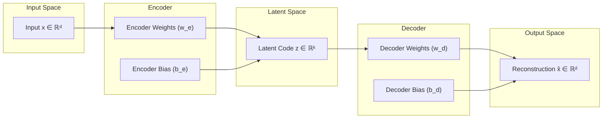
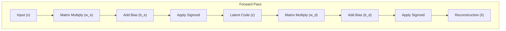
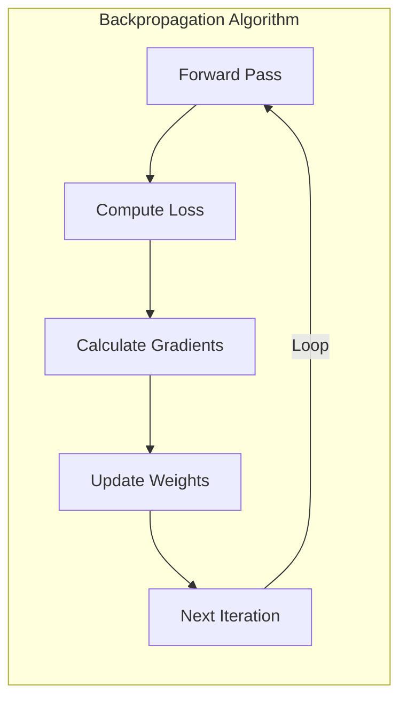

<!-- source: DeepWiki mcp.deepwiki.com · repo google-deepmind/educational · page 4.3 Autoencoders · fetched 2026-10-26 -->

# Autoencoders

<details>
<summary>Relevant source files</summary>

The following files were used as context for generating this wiki page:

- [colabs/summer_schools/intro_to_unsupervised_learning.ipynb](colabs/summer_schools/intro_to_unsupervised_learning.ipynb)

</details>


Autoencoders are a type of neural network architecture used for unsupervised learning of efficient encodings. This page documents the autoencoder implementation in the DeepMind Educational repository, explaining the theory, architecture, mathematical formulation, implementation details, and applications of autoencoders for dimensionality reduction and data compression.

Autoencoders serve as a bridge between neural networks and probabilistic modeling, providing a mechanism to learn latent representations of data without explicit labels. For information about related unsupervised techniques such as K-means clustering and Expectation-Maximization, see [Unsupervised Learning](#4).

## Autoencoder Fundamentals

An autoencoder consists of two main components:
- An **encoder** that maps input data to a compressed representation (latent code)
- A **decoder** that attempts to reconstruct the original input from this compressed representation

The goal is to minimize the difference between the input and its reconstruction, forcing the network to learn an efficient encoding of the data.

### Autoencoder Architecture



Sources: [colabs/summer_schools/intro_to_unsupervised_learning.ipynb:1446-1454]()

## Mathematical Formulation

An autoencoder maps input `x` to a latent code `z(x)` and then reconstructs an approximation `x̂(z)`. In the educational implementation, a multi-layer perceptron (MLP) with a single hidden layer is used.

### Notation and Dimensions

| Symbol | Description | Dimension |
|--------|-------------|-----------|
| **x** | Input vector | ℝᵈ |
| **z** | Latent code | ℝᵏ (k < d) |
| **x̂** | Reconstructed output | ℝᵈ |
| **w^e** | Encoder weights | ℝᵏˣᵈ |
| **b^e** | Encoder bias | ℝᵏ |
| **w^d** | Decoder weights | ℝᵈˣᵏ |
| **b^d** | Decoder bias | ℝᵈ |

Sources: [colabs/summer_schools/intro_to_unsupervised_learning.ipynb:1459-1499]()

### Forward Computation

The encoder and decoder operations are defined as:

1. **Encoder**: 
   ```
   z_k = σ(∑(w^e_kj * x_j) + b^e_k)
   ```

2. **Decoder**: 
   ```
   x̂_l = σ(∑(w^d_lk * z_k) + b^d_l)
   ```

Where σ is the sigmoid activation function: σ(x) = 1/(1 + e^(-x))



Sources: [colabs/summer_schools/intro_to_unsupervised_learning.ipynb:1550-1559](), [colabs/summer_schools/intro_to_unsupervised_learning.ipynb:1600-1642]()

### Loss Function

The autoencoder is trained to minimize the squared reconstruction error:

```
C(x, x̂) = (1/2) * ∑(x̂_i - x_i)²
```

This loss can be interpreted from a probabilistic perspective as the negative log-likelihood of the data under a Gaussian noise model.

Sources: [colabs/summer_schools/intro_to_unsupervised_learning.ipynb:1475-1485]()

## Implementation Details

### Activation Function

The sigmoid function is used for both the encoder and decoder:

```python
def sigmoid(x):
    return 1 / (1 + np.exp(-x))
```

Its derivative is:

```python
def sigmoid_gradient(x):
    return sigmoid(x) * sigmoid(-x)
```

Sources: [colabs/summer_schools/intro_to_unsupervised_learning.ipynb:1569-1573](), [colabs/summer_schools/intro_to_unsupervised_learning.ipynb:1767-1769]()

### Network Initialization

```python
n_hidden = 5  # Dimension of latent space
w_e = np.random.randn(n_hidden, n_x) / np.sqrt(n_x)
w_d = np.random.randn(n_x, n_hidden) / np.sqrt(n_hidden)
b_e = np.zeros(n_hidden)
b_d = np.zeros(n_x)
```

Weights are initialized randomly with scaling for stable gradient flow, while biases are initialized to zero.

Sources: [colabs/summer_schools/intro_to_unsupervised_learning.ipynb:1584-1589]()

### Training Process

The autoencoder is trained using stochastic gradient descent (SGD) with backpropagation:

1. Forward pass: Compute latent code `z` and reconstruction `y` (x̂)
2. Compute loss: Mean squared error between input and reconstruction
3. Backward pass: Calculate gradients via backpropagation
4. Update weights: Adjust weights in the opposite direction of gradients



Sources: [colabs/summer_schools/intro_to_unsupervised_learning.ipynb:1850-1877]()

### Backpropagation Details

During backpropagation, gradients are computed for each layer:

1. Output layer gradients:
   ```
   dL_dylin = (y - x) * sigmoid_gradient(y)
   ```

2. Hidden layer gradients:
   ```
   dL_dzlin = np.matmul(dL_dylin, w_d) * sigmoid_gradient(z)
   ```

3. Weight gradients:
   ```
   dL_dw_d = dL_dylin[:, None] * z[None]
   dL_dw_e = dL_dzlin[:, None] * x[None]
   ```

4. Weight updates:
   ```
   w_d -= learning_rate * dL_dw_d
   w_e -= learning_rate * dL_dw_e
   ```

Sources: [colabs/summer_schools/intro_to_unsupervised_learning.ipynb:1801-1827](), [colabs/summer_schools/intro_to_unsupervised_learning.ipynb:1850-1877]()

## Analysis of Learned Representations

### Visualizing Network Weights

After training, the weights of the encoder and decoder can be visualized to understand what features the network has learned. In the educational implementation, weights are visualized as heatmaps:

```python
_, axes = plt.subplots(1, 2)
for ax, w_, l_ in zip(axes, [w_e, w_d.T], ['Encoder', 'Decoder']):
    sns.heatmap(w_, ax=ax, center=0, cmap='RdBu_r')
    ax.set_title(l_ + ' weights')
```

The pattern of weights reveals how the network encodes and decodes different features of the input data.

Sources: [colabs/summer_schools/intro_to_unsupervised_learning.ipynb:1922-1927]()

### Visualizing the Latent Code

The latent code for each input sample can be visualized to understand the compression achieved:

```python
z = np.squeeze([perceptron(x_, w_e, b_e) for x_ in x_c])
```

Sources: [colabs/summer_schools/intro_to_unsupervised_learning.ipynb:2013-2013]()

## Applications: Data Compression

Autoencoders provide a means for data compression by encoding high-dimensional data into a lower-dimensional latent space. The compression achieved depends on:

1. The dimensionality reduction ratio (input dimension vs. latent dimension)
2. The complexity of patterns in the data
3. The capacity of the network

In the educational repository, a comparison is made between autoencoder-based compression and K-means clustering for image compression. While K-means creates a discrete set of cluster centroids (colors in the image case), autoencoders can create more complex encodings.

The memory savings from compression can be substantial:
- Original data: 64 bits per value × N samples × D dimensions
- Compressed data: (latent code bits × N) + (weights bits)

Sources: [colabs/summer_schools/intro_to_unsupervised_learning.ipynb:2030-2043]()

## Extensions and Related Models

While the implementation in the educational repository focuses on a simple autoencoder with a single hidden layer, several extensions exist:

1. **Deep Autoencoders**: Multiple layers in both encoder and decoder
2. **Denoising Autoencoders**: Training with corrupted inputs to learn robust features
3. **Variational Autoencoders (VAEs)**: Adding probabilistic constraints to the latent space
4. **Sparse Autoencoders**: Adding regularization to encourage sparse activations

For more on generative models like VAEs and GANs, see [Generative Models and GANs](#7.1).

Sources: [colabs/summer_schools/intro_to_unsupervised_learning.ipynb:82-91]()

## Conclusion

Autoencoders provide a powerful framework for unsupervised representation learning, combining neural network architecture with principles from information theory and probabilistic modeling. In the DeepMind Educational repository, the autoencoder implementation serves as an educational tool to understand:

1. The core principles of encoding and decoding in neural networks
2. How dimensionality reduction can be achieved through neural networks
3. The relationship between reconstruction error and information preservation
4. Practical applications in data compression and feature learning

The simplicity of the implementation makes it accessible for educational purposes while demonstrating the fundamental concepts that underpin more complex autoencoder architectures.

---

