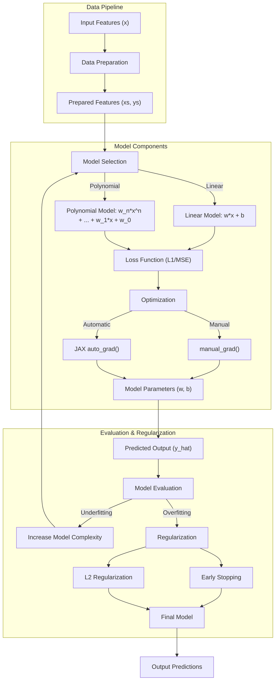
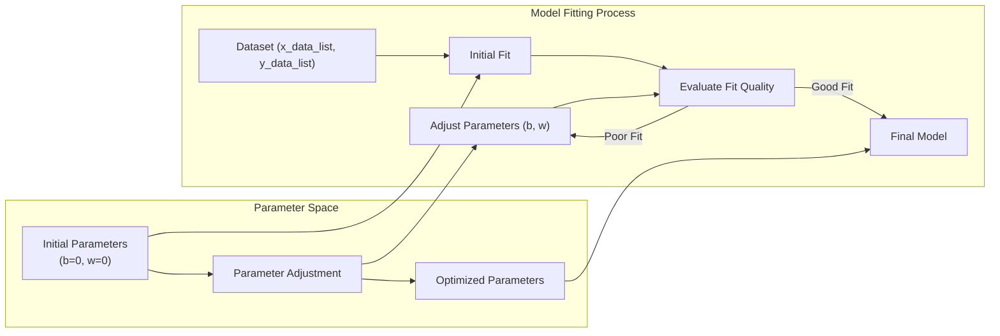
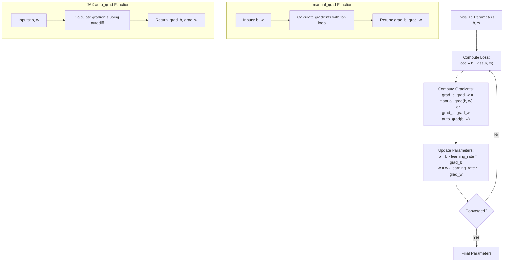
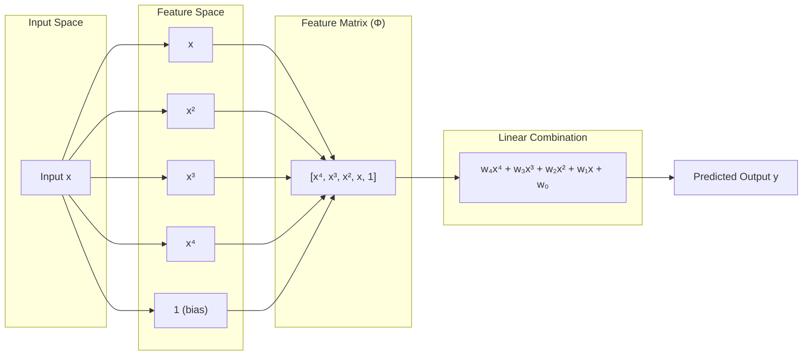
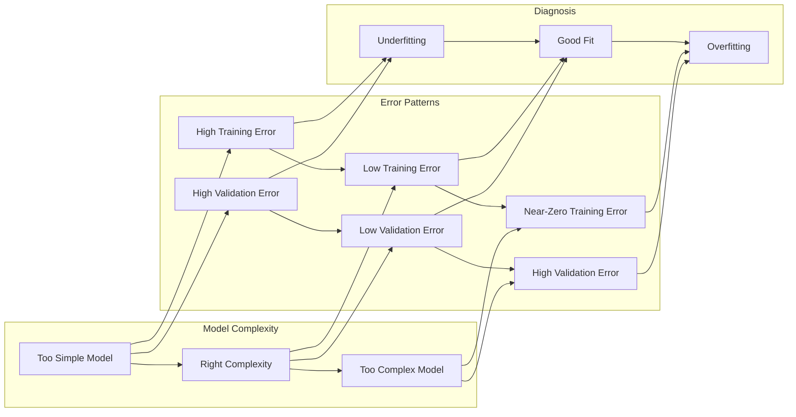
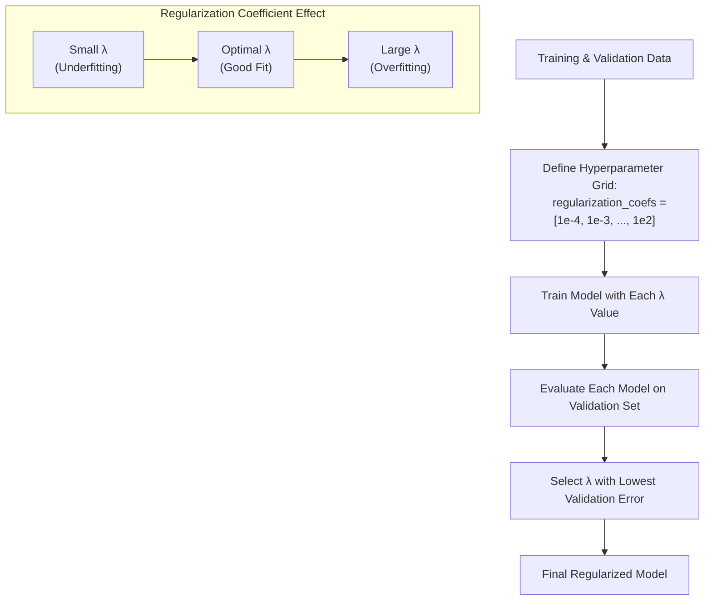
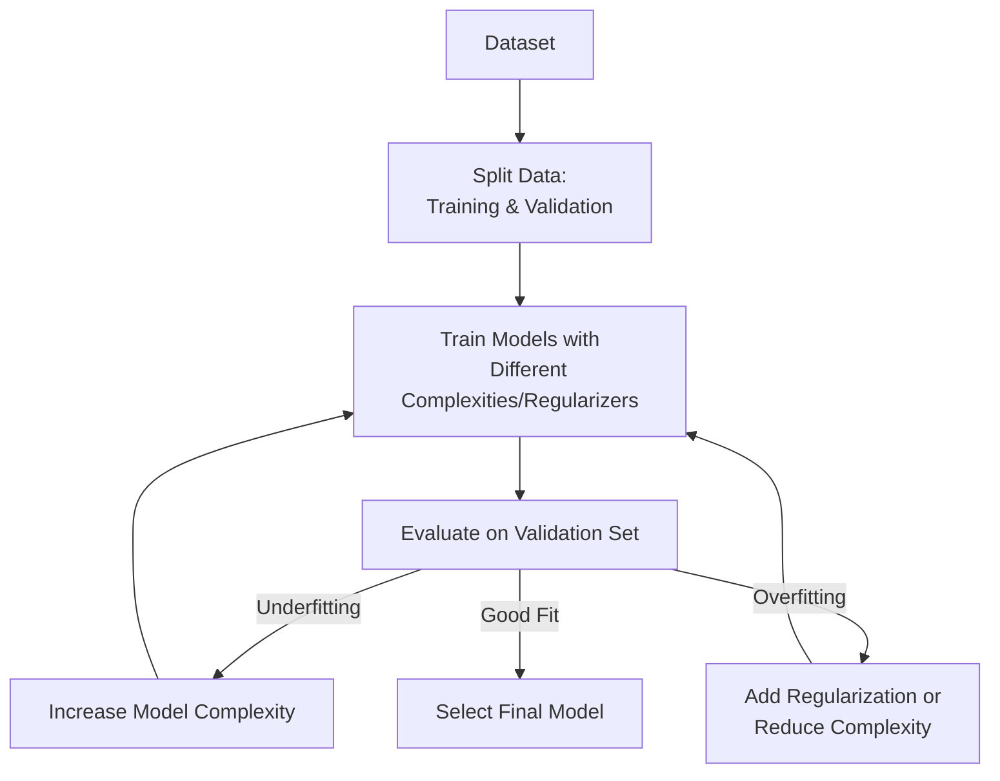

<!-- source: DeepWiki mcp.deepwiki.com · repo google-deepmind/educational · page 5 Supervised Learning: Regression · fetched 2026-10-26 -->

# Supervised Learning: Regression

<details>
<summary>Relevant source files</summary>

The following files were used as context for generating this wiki page:

- [colabs/summer_schools/intro_to_regression.ipynb](colabs/summer_schools/intro_to_regression.ipynb)

</details>


## Purpose and Scope

This document provides a comprehensive guide to regression techniques in supervised learning as implemented in the DeepMind Educational repository. Regression is a foundational technique in machine learning where a model learns to predict a continuous output value from input features. This page covers linear regression, loss functions, gradient descent optimization, automatic differentiation using JAX, nonlinear regression, and methods to prevent overfitting through regularization.

For classification techniques in supervised learning, see [Supervised Learning: Classification](#6).

Sources: [colabs/summer_schools/intro_to_regression.ipynb:38-60]()

## Overview of the Regression System

The regression module demonstrates key supervised learning concepts through practical implementation examples. It progressively builds from simple linear models to complex nonlinear models while introducing optimization techniques and model evaluation approaches.

### Core Regression Pipeline Diagram



Sources: [colabs/summer_schools/intro_to_regression.ipynb:38-60](), [colabs/summer_schools/intro_to_regression.ipynb:151-199](), [colabs/summer_schools/intro_to_regression.ipynb:249-278]()

## Linear Regression Fundamentals

Linear regression models the relationship between input features and a continuous output variable using a linear function. In its simplest form with a single input feature, the model is represented as:

```
f(x) = w * x + b
```

Where:
- `w` is the weight (or slope)
- `b` is the bias (or intercept)
- `x` is the input feature
- `f(x)` is the predicted output

### Parameter Tuning Visual Process



Sources: [colabs/summer_schools/intro_to_regression.ipynb:151-199]()

### Loss Functions

Loss functions quantify how well the model fits the data by measuring the discrepancy between predicted values and actual values. Two common loss functions used in regression:

1. **L1 Loss (Mean Absolute Error)**:
   ```
   loss(b, w) = (1/N) ∑|y_n - (w*x_n + b)|
   ```

2. **MSE Loss (Mean Squared Error)**:
   ```
   loss(b, w) = (1/N) ∑(y_n - (w*x_n + b))²
   ```

The implementation of L1 loss is demonstrated in the `l1_loss` function:

```python
def l1_loss(b, w):
  loss = 0 * b
  for x, y in zip(x_data_list, y_data_list):
    f = w * x + b
    loss += np.abs(f - y)
  return loss / len(x_data_list)
```

Sources: [colabs/summer_schools/intro_to_regression.ipynb:286-291](), [colabs/summer_schools/intro_to_regression.ipynb:349-387]()

## Gradient Descent and Automatic Differentiation

### Gradient Descent Optimization Process

Gradient descent is an iterative optimization algorithm that minimizes the loss function by updating parameters in the direction of steepest descent of the gradient.



Sources: [colabs/summer_schools/intro_to_regression.ipynb:426-443](), [colabs/summer_schools/intro_to_regression.ipynb:452-488]()

### Manual vs Automatic Differentiation

Manual gradient computation requires explicitly calculating the derivative of the loss function with respect to each parameter:

```python
def manual_grad(b, w):
  grad_b = 0
  grad_w = 0
  for x, y in zip(x_data_list, y_data_list):
    f = w * x + b
    grad_b += np.sign(f - y)
    grad_w += np.sign(f - y) * x
  grad_b /= len(x_data_list)
  grad_w /= len(x_data_list)
  return grad_b, grad_w
```

JAX's automatic differentiation simplifies this process by automatically computing gradients:

```python
def loss_function(b, w):
  f = w * x + b
  errors = jnp.abs(y - f)
  return jnp.mean(errors)

auto_grad = jax.grad(loss_function, argnums=(0, 1))
```

Sources: [colabs/summer_schools/intro_to_regression.ipynb:426-443](), [colabs/summer_schools/intro_to_regression.ipynb:518-538]()

### Gradient Descent Implementation

The implementation of gradient descent using automatic differentiation:

```python
b, w = -1.0, -2.0
learning_rate = 0.1

parameters_step_list = []

for _ in range(200):
  parameters_step_list.append([b, w])
  grad_b, grad_w = auto_grad(b, w)
  b = b - learning_rate * grad_b
  w = w - learning_rate * grad_w
```

Sources: [colabs/summer_schools/intro_to_regression.ipynb:574-585]()

## Nonlinear Regression

### Feature Transformation Approach

Linear regression can be extended to capture nonlinear relationships by transforming the input features while keeping the model linear in its parameters.



The polynomial feature matrix is created with:

```python
def create_data_matrix(xs):
  return np.vstack([np.power(xs, 4),
                    np.power(xs, 3),
                    np.power(xs, 2),
                    xs,
                    np.ones(len(xs))]).T
```

Sources: [colabs/summer_schools/intro_to_regression.ipynb:737-753](), [colabs/summer_schools/intro_to_regression.ipynb:766-773]()

### Fitting Nonlinear Models

Nonlinear models can be fitted using the same gradient descent approach:

```python
w = gradient_descent(phi, ys, num_steps=5000)
y_hat = phi.dot(w)
```

Alternatively, for polynomial regression with mean squared error loss, an analytical solution exists:

```python
w = regression_analytical_solution(phi, ys)
y_hat = phi.dot(w)
```

Sources: [colabs/summer_schools/intro_to_regression.ipynb:793-800](), [colabs/summer_schools/intro_to_regression.ipynb:822-827]()

## Underfitting and Overfitting

### Model Complexity and Error Relationship



Sources: [colabs/summer_schools/intro_to_regression.ipynb:929-943](), [colabs/summer_schools/intro_to_regression.ipynb:944-971]()

### Detecting Overfitting with Validation

The system splits the dataset into training and validation sets to monitor model performance:

```python
# Split data into training and validation sets
training_set = np.random.permutation(n) < 0.5 * n
x_train = x_all[training_set]
y_train = y_all[training_set]
phi_train = create_data_matrix(x_train)

x_val = x_all[~training_set]
y_val = y_all[~training_set]
phi_val = create_data_matrix(x_val)
```

Sources: [colabs/summer_schools/intro_to_regression.ipynb:1146-1153]()

## Regularization Techniques

### Early Stopping

Early stopping prevents overfitting by halting the training process when the validation error starts to increase, even if the training error continues to decrease.

```python
def gradient_descent_with_validation(phi_train, y_train, phi_val, y_val,
                                   learning_rate=1e-1, num_steps=1000):
  # ...training loop...
  for i in range(num_steps):
    (train_loss, y_hat), grad = loss_and_grad(w, phi_train, y_train)
    (val_loss, y_hat), _ = loss_and_grad(w, phi_val, y_val)
    
    train_losses.append(train_loss)
    val_losses.append(val_loss)
    
    w = w - learning_rate * grad
  # ...
```

Sources: [colabs/summer_schools/intro_to_regression.ipynb:1095-1128](), [colabs/summer_schools/intro_to_regression.ipynb:1186-1199]()

### L2 Regularization

L2 regularization (Ridge Regression) adds a penalty term to the loss function based on the squared magnitude of model parameters:

```
loss(w) = (1/N) * ||y - Φw||² + λ * ||w||²
```

The analytical solution with L2 regularization:

```python
def regularized_regression_analytical_solution(phi, y, regularization_coef):
  t = phi.shape[0]
  return (np.linalg.inv(phi.T.dot(phi) +
                      regularization_coef * np.identity(t)
                      ).dot(phi.T)).dot(y)
```

Sources: [colabs/summer_schools/intro_to_regression.ipynb:1262-1291](), [colabs/summer_schools/intro_to_regression.ipynb:1300-1304]()

### Hyperparameter Selection Process



Sources: [colabs/summer_schools/intro_to_regression.ipynb:1308-1329](), [colabs/summer_schools/intro_to_regression.ipynb:1376-1387]()

## Practical Considerations

### Learning Rate Selection

The learning rate is a critical hyperparameter in gradient descent that controls the step size:
- Too large: can cause divergence and instability
- Too small: slow convergence and may require many iterations

```python
# Example of gradient descent with a specific learning rate
b = -1  
w = -2  
learning_rate = 0.1  # This value affects convergence speed and stability

for _ in range(200):
  grad_b, grad_w = manual_grad(b, w)
  b = b - learning_rate * grad_b
  w = w - learning_rate * grad_w
```

Sources: [colabs/summer_schools/intro_to_regression.ipynb:474-488](), [colabs/summer_schools/intro_to_regression.ipynb:1527-1549]()

### Model Evaluation Workflow



Sources: [colabs/summer_schools/intro_to_regression.ipynb:1072-1085](), [colabs/summer_schools/intro_to_regression.ipynb:1191-1199]()

## Summary

The regression implementation in the DeepMind Educational repository demonstrates key supervised learning concepts through practical examples:

1. **Linear regression basics**: Implementing models as `f(x) = w * x + b`
2. **Loss functions**: L1 loss and MSE for measuring model performance
3. **Optimization techniques**: Manual and automatic gradient descent with JAX
4. **Nonlinear regression**: Extending linear models with polynomial features
5. **Regularization techniques**: Early stopping and L2 regularization to prevent overfitting
6. **Model evaluation**: Using validation sets to select the best model

These concepts provide a foundation for understanding more complex supervised learning techniques and deep learning models.

Sources: [colabs/summer_schools/intro_to_regression.ipynb:38-60]()

---

