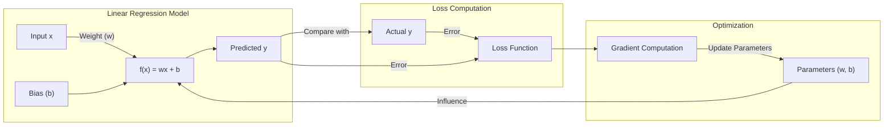
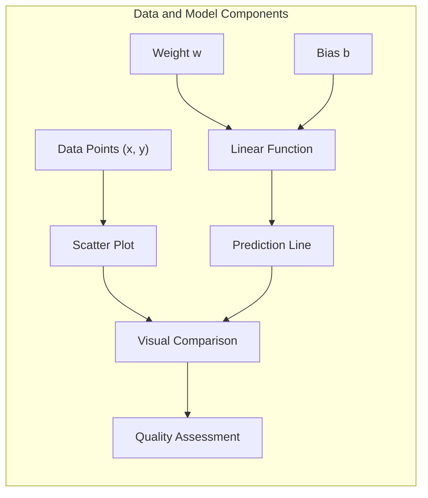
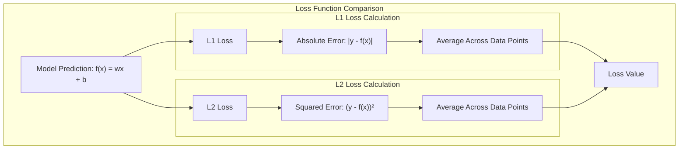
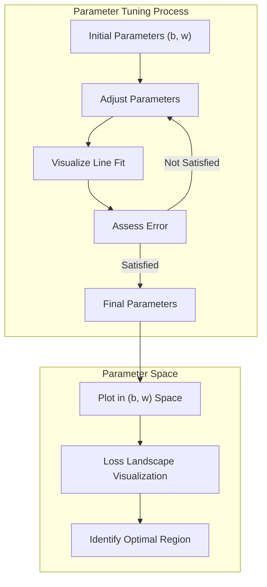
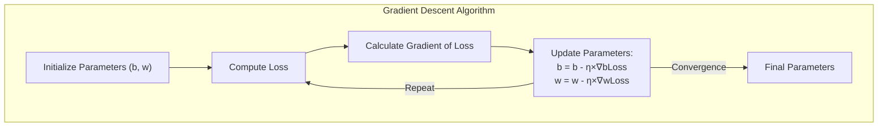
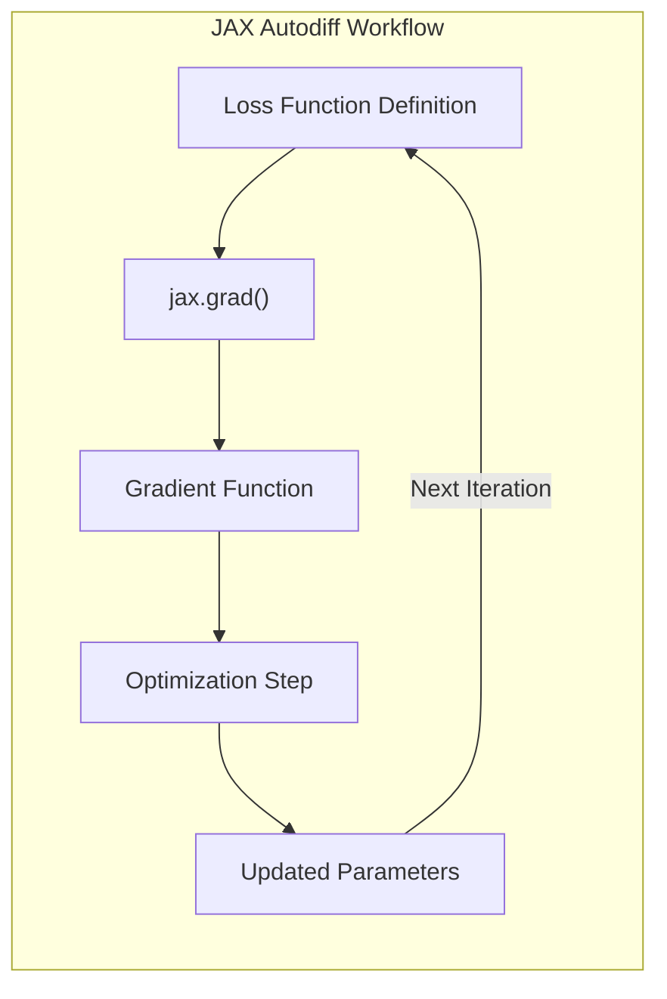
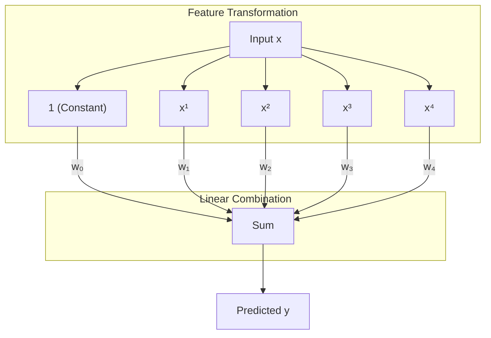
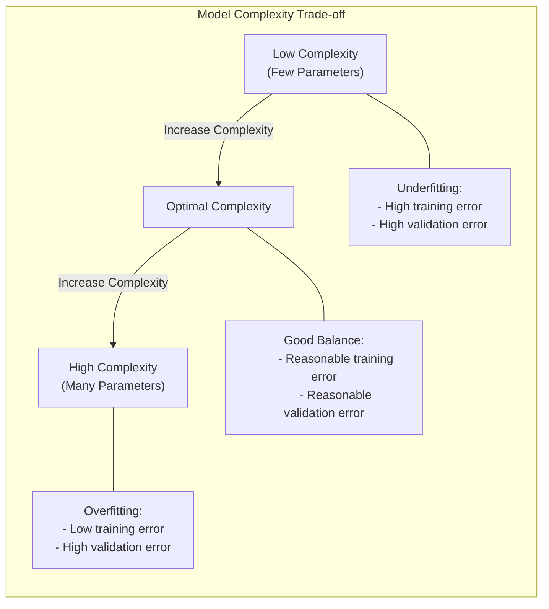
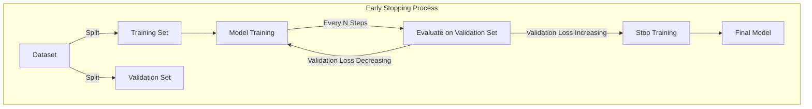

<!-- source: DeepWiki mcp.deepwiki.com · repo google-deepmind/educational · page 5.1 Linear Regression Fundamentals · fetched 2026-10-26 -->

# Linear Regression Fundamentals

<details>
<summary>Relevant source files</summary>

The following files were used as context for generating this wiki page:

- [colabs/summer_schools/intro_to_regression.ipynb](colabs/summer_schools/intro_to_regression.ipynb)

</details>


This document explains the core concepts of linear regression as implemented in Google DeepMind's educational repository. It covers model parameters, loss functions, optimization techniques, and automatic differentiation with JAX. For advanced topics like regularization and model selection, see [Regularization and Model Selection](#5.3), and for gradient descent optimization with JAX, see [Gradient Descent and Autodiff](#5.2).

## Model Overview

Linear regression is a supervised learning technique that models the relationship between an input variable $x$ and an output variable $y$ using a linear function:

$f(x) = wx + b$

Where:
- $w$ is the weight (or slope)
- $b$ is the bias (or intercept)

These parameters define a line that attempts to fit the observed data points.



Sources: [colabs/summer_schools/intro_to_regression.ipynb:152-162]()

## Data and Model Representation

The notebook uses a simple dataset with 5 data points to demonstrate linear regression concepts:

```
x_data_list = [1, 2, 3, 4, 5]
y_data_list = [3, 2, 3, 1, 0]
```

This data is visualized with a scatter plot, and the prediction function $f(x) = wx + b$ is visualized as a line that can be adjusted by changing the parameters $w$ and $b$.



Sources: [colabs/summer_schools/intro_to_regression.ipynb:106-130]()

## Loss Functions

To quantify how well our model fits the data, we use loss functions that measure the discrepancy between predictions and actual values. The notebook explores two common loss functions:

1. **L1 Loss (Mean Absolute Error)**:
   $\text{loss}(b, w) = \frac{1}{N} \sum_{n=1}^N |y_n - (wx_n + b)|$

2. **L2 Loss (Mean Squared Error)**:
   $\text{loss}(b, w) = \frac{1}{N} \sum_{n=1}^N (y_n - (wx_n + b))^2$

The choice of loss function affects how the model responds to errors. L1 loss treats all errors linearly, while L2 loss penalizes larger errors more severely due to the squaring operation.



Sources: [colabs/summer_schools/intro_to_regression.ipynb:285-340](), [colabs/summer_schools/intro_to_regression.ipynb:349-388]()

## Manual Parameter Tuning

The notebook first demonstrates manual parameter tuning, where users can adjust $w$ and $b$ using sliders to find a good fit for the data. This helps build intuition about how parameters influence the model's predictions.

### Parameter Space Visualization

The notebook visualizes parameter adjustments as points in a 2D parameter space, where each point represents a pair of values $(b, w)$. This allows us to see how parameter changes affect the loss function.



Sources: [colabs/summer_schools/intro_to_regression.ipynb:176-183](), [colabs/summer_schools/intro_to_regression.ipynb:212-243]()

## Gradient Descent Optimization

Rather than manually adjusting parameters, gradient descent automatically finds optimal parameters by iteratively following the gradient of the loss function.

The gradient descent update rule is:
- $b \leftarrow b - \eta \nabla_b \text{loss}(b, w)$
- $w \leftarrow w - \eta \nabla_w \text{loss}(b, w)$

Where $\eta$ is the learning rate that controls the step size.



Sources: [colabs/summer_schools/intro_to_regression.ipynb:452-468](), [colabs/summer_schools/intro_to_regression.ipynb:474-489]()

## Manual Gradient Calculation

The notebook first demonstrates manual gradient calculation for the L1 loss:

```python
def manual_grad(b, w):
  grad_b = 0
  grad_w = 0
  for x, y in zip(x_data_list, y_data_list):
    f = w * x + b
    grad_b += np.sign(f - y)
    grad_w += np.sign(f - y) * x
  grad_b /= len(x_data_list)
  grad_w /= len(x_data_list)
  return grad_b, grad_w
```

This implementation:
1. Loops through each data point
2. Calculates the prediction $f = wx + b$
3. Computes the gradient components with respect to $b$ and $w$
4. Averages the gradients across all data points

Sources: [colabs/summer_schools/intro_to_regression.ipynb:429-443]()

## Automatic Differentiation with JAX

Instead of manually deriving and implementing gradients, the notebook introduces JAX for automatic differentiation:

```python
def loss_function(b, w):
  f = w * x + b
  errors = jnp.abs(y - f)
  return jnp.mean(errors)

# Automatic differentiation with one line of code
auto_grad = jax.grad(loss_function, argnums=(0, 1))
```

JAX allows:
1. Vectorized operations that process all data points simultaneously
2. Automatic computation of gradients for any differentiable function
3. Hardware acceleration on GPU/TPU



Sources: [colabs/summer_schools/intro_to_regression.ipynb:518-539](), [colabs/summer_schools/intro_to_regression.ipynb:575-585]()

## From Linear to Nonlinear Regression

While linear regression fits data with a straight line, many real-world relationships are nonlinear. The notebook shows how to extend linear regression to fit nonlinear patterns by using polynomial features.

For a 4th-degree polynomial model:
$f(x) = w_4x^4 + w_3x^3 + w_2x^2 + w_1x + w_0$

This is still a linear model in terms of parameters $(w_0, w_1, w_2, w_3, w_4)$, but nonlinear in the input $x$.



Sources: [colabs/summer_schools/intro_to_regression.ipynb:741-757](), [colabs/summer_schools/intro_to_regression.ipynb:766-774]()

## Underfitting and Overfitting

The notebook demonstrates two common problems in regression models:

1. **Underfitting**: When the model is too simple to capture the underlying pattern in the data (e.g., fitting a linear model to wave-like data)

2. **Overfitting**: When the model is too complex and captures noise in the training data, failing to generalize to new data



Sources: [colabs/summer_schools/intro_to_regression.ipynb:932-943](), [colabs/summer_schools/intro_to_regression.ipynb:944-1017](), [colabs/summer_schools/intro_to_regression.ipynb:1049-1067]()

## Train-Validation Split and Early Stopping

To detect and prevent overfitting, the notebook introduces:

1. **Train-Validation Split**: Dividing data into training set (used to fit the model) and validation set (used to evaluate it)

2. **Early Stopping**: Monitoring validation loss during training and stopping when it starts to increase, even if training loss continues to decrease



Sources: [colabs/summer_schools/intro_to_regression.ipynb:1087-1103](), [colabs/summer_schools/intro_to_regression.ipynb:1196-1198]()

## Summary

Linear regression fundamentals form the building blocks for more complex machine learning models. The key concepts covered include:

- Model parameters (weight and bias)
- Loss functions (L1 and L2)
- Gradient descent optimization
- Automatic differentiation with JAX
- Feature transformations for nonlinear relationships
- Underfitting, overfitting, and regularization techniques

These concepts are essential for understanding more advanced supervised learning techniques covered in subsequent sections.

| Component | Purpose |
|---|---|
| Parameters (w, b) | Define the linear function f(x) = wx + b |
| Loss Function | Measures discrepancy between predictions and actual values |
| Gradient Descent | Algorithm to optimize parameters |
| JAX | Library for automatic differentiation |
| Feature Transformation | Method to handle nonlinear relationships |
| Early Stopping | Technique to prevent overfitting |

Sources: [colabs/summer_schools/intro_to_regression.ipynb:38-61]()

---

