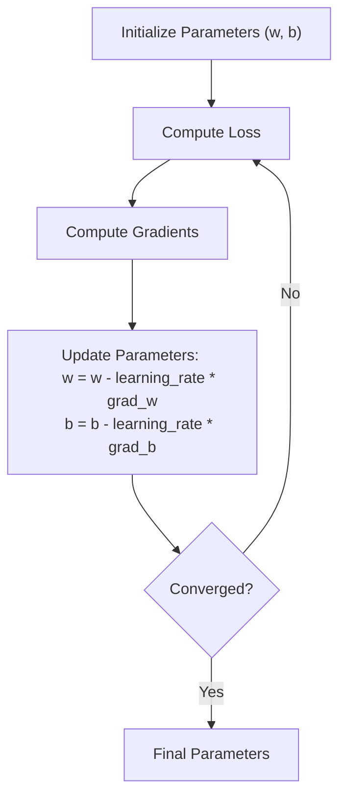
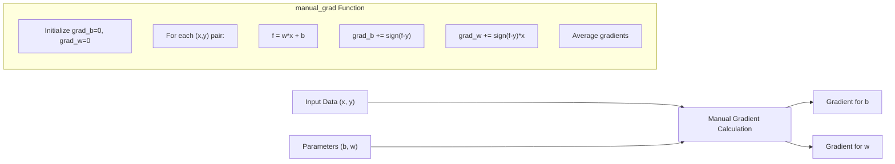
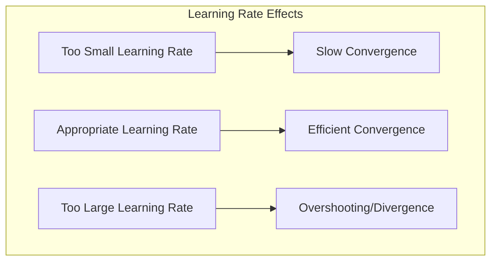
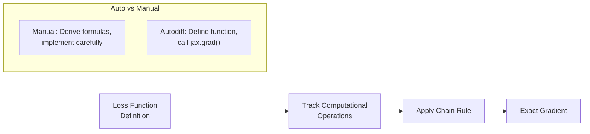
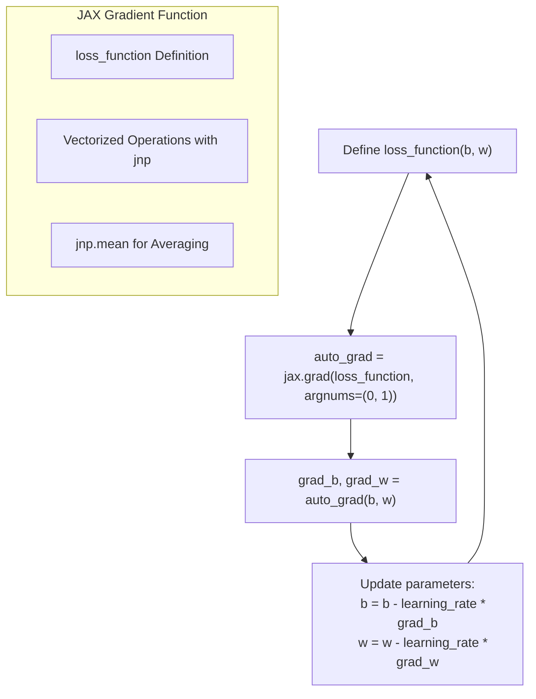
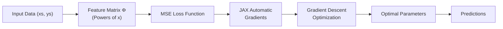
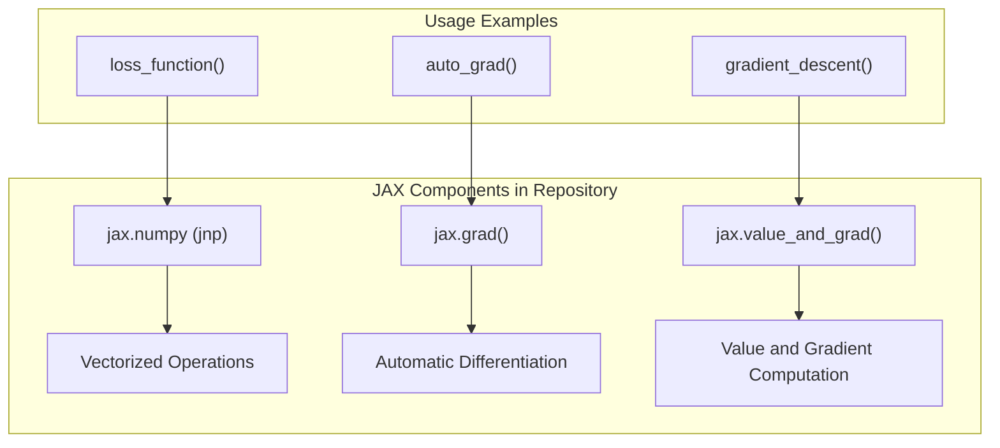

<!-- source: DeepWiki mcp.deepwiki.com · repo google-deepmind/educational · page 5.2 Gradient Descent and Autodiff · fetched 2026-10-26 -->

# Gradient Descent and Autodiff

<details>
<summary>Relevant source files</summary>

The following files were used as context for generating this wiki page:

- [colabs/summer_schools/intro_to_regression.ipynb](colabs/summer_schools/intro_to_regression.ipynb)

</details>


## Purpose and Scope

This page details gradient descent optimization and automatic differentiation as implemented in the DeepMind Educational repository, with a particular focus on JAX's autodiff functionality. Gradient descent is a fundamental optimization algorithm used to minimize loss functions in machine learning models, while automatic differentiation allows for efficient and accurate computation of gradients without manual derivation. This document covers the implementation and practical application of these techniques in the regression context. For information about regularization techniques that build on these concepts, see [Regularization and Model Selection](#5.3).

## Gradient Descent

Gradient descent is an iterative optimization algorithm used to find the minimum of a loss function by taking steps proportional to the negative of the gradient (slope) of the function at the current point.

### Basic Concept

In supervised learning, we define a loss function that measures how well our model fits the data. The goal is to find parameters that minimize this loss function. Gradient descent accomplishes this by iteratively adjusting the parameters in the direction of steepest descent.



**Diagram: Gradient Descent Optimization Process**

Sources: [colabs/summer_schools/intro_to_regression.ipynb:470-488]()

### Mathematical Formulation

For a simple linear model `f(x) = w * x + b` with parameters `w` and `b`, and a loss function like the mean absolute error (L1 loss), the update rules are:

```
b = b - learning_rate * grad_b
w = w - learning_rate * grad_w
```

Where `grad_b` and `grad_w` are the partial derivatives of the loss function with respect to `b` and `w`.

For L1 loss, these gradients are:

```
grad_b = 1/N * sum(sign(f(x) - y))
grad_w = 1/N * sum(sign(f(x) - y) * x)
```

Where `sign()` returns 1 if the input is positive and -1 if it's negative.

Sources: [colabs/summer_schools/intro_to_regression.ipynb:430-439]()

### Implementation of Manual Gradient Calculation

The repository implements manual gradient calculation as:



**Diagram: Manual Gradient Calculation Flow**

Sources: [colabs/summer_schools/intro_to_regression.ipynb:430-439]()

### Learning Rate and Optimization Challenges

The learning rate (`learning_rate`) is a hyperparameter that controls the step size during parameter updates. It significantly impacts the convergence behavior:

1. **Too large**: Parameters may overshoot the minimum, potentially leading to divergence
2. **Too small**: Convergence will be slow, requiring many iterations



**Diagram: Impact of Learning Rate Selection**

Sources: [colabs/summer_schools/intro_to_regression.ipynb:460-488]()

## Automatic Differentiation with JAX

Automatic differentiation (autodiff) eliminates the need to manually derive and implement gradients, making the implementation of gradient-based optimization more efficient and less error-prone.

### What is Autodiff?

Autodiff is a technique that automatically computes the exact gradients of functions by tracking the computational operations and applying the chain rule of calculus. Unlike numerical differentiation (which approximates gradients) or symbolic differentiation (which generates explicit formulas), autodiff offers both accuracy and computational efficiency.



**Diagram: Automatic Differentiation Concept**

Sources: [colabs/summer_schools/intro_to_regression.ipynb:499-539]()

### JAX Implementation

JAX provides a simple interface for automatic differentiation through the `jax.grad()` function. The implementation in the repository demonstrates:

1. Defining a loss function using JAX's NumPy-like interface (`jnp`)
2. Using `jax.grad()` to create a function that computes gradients
3. Calling this function to obtain gradients for parameter updates



**Diagram: JAX Autodiff Implementation Flow**

Sources: [colabs/summer_schools/intro_to_regression.ipynb:518-539](), [colabs/summer_schools/intro_to_regression.ipynb:579-585]()

### Comparison with Manual Gradients

The repository directly compares manual gradient calculation with JAX's automatic differentiation:

| Aspect | Manual Calculation | JAX Autodiff |
|--------|-------------------|--------------|
| Implementation | Requires explicit formula derivation | Automatic from function definition |
| Code complexity | Requires careful implementation of gradient formulas | Simple one-line function call |
| Flexibility | Must re-derive for different loss functions | Works for any differentiable function |
| Efficiency | For-loops over data points | Vectorized operations |
| Scaling to complex models | Difficult and error-prone | Straightforward |

Sources: [colabs/summer_schools/intro_to_regression.ipynb:534-538]()

### Vectorization and Efficiency

The JAX implementation avoids for-loops by using vectorized operations:

```python
def loss_function(b, w):
  f = w * x + b
  errors = jnp.abs(y - f)  # Vector operation
  return jnp.mean(errors)  # Mean over all data points
```

This approach is both more concise and computationally efficient compared to manual loop-based implementations.

Sources: [colabs/summer_schools/intro_to_regression.ipynb:518-526]()

## Practical Applications

### Gradient Descent for Polynomial Regression

The repository demonstrates applying gradient descent with autodiff to fit more complex models, such as polynomial regression:



**Diagram: Polynomial Regression with Gradient Descent and Autodiff**

Sources: [colabs/summer_schools/intro_to_regression.ipynb:785-800]()

### Integration with Advanced Techniques

The gradient descent and autodiff concepts are building blocks for more advanced techniques:

1. **Early Stopping**: Monitoring validation loss to stop training before overfitting
2. **Regularization**: Adding penalty terms to the loss function 
3. **Advanced Optimizers**: Building on basic gradient descent with adaptive learning rates

Sources: [colabs/summer_schools/intro_to_regression.ipynb:1096-1128](), [colabs/summer_schools/intro_to_regression.ipynb:1196-1198]()

## Implementation Details

### Core Functions

The key functions implemented in the repository include:

1. `manual_grad(b, w)`: Manually computes gradients of L1 loss
2. `auto_grad = jax.grad(loss_function, argnums=(0, 1))`: Creates automatic gradient function
3. `gradient_descent(X, y, learning_rate, num_steps)`: Implements basic gradient descent
4. `gradient_descent_with_validation(...)`: Adds validation-based monitoring

Sources: [colabs/summer_schools/intro_to_regression.ipynb:430-439](), [colabs/summer_schools/intro_to_regression.ipynb:518-529](), [colabs/summer_schools/intro_to_regression.ipynb:669-690](), [colabs/summer_schools/intro_to_regression.ipynb:1095-1128]()

### JAX Components

The repository utilizes several JAX components:

1. `jax.numpy (jnp)`: NumPy-like interface for efficient array operations
2. `jax.grad()`: Function to compute gradients automatically
3. `jax.value_and_grad()`: Function to compute both values and gradients



**Diagram: JAX Component Usage in Repository**

Sources: [colabs/summer_schools/intro_to_regression.ipynb:82-84](), [colabs/summer_schools/intro_to_regression.ipynb:518-529](), [colabs/summer_schools/intro_to_regression.ipynb:673-677]()

## Common Pitfalls and Solutions

The repository highlights several common issues that can arise when using gradient descent:

1. **Divergence**: If the learning rate is too high, gradient descent can diverge
2. **Slow Convergence**: If the learning rate is too low, convergence can be very slow
3. **Parameter Scale**: Features with different scales can cause optimization difficulties

Solutions mentioned include:

1. Careful learning rate selection
2. Normalization of input features
3. Advanced optimization techniques beyond basic gradient descent

Sources: [colabs/summer_schools/intro_to_regression.ipynb:1479-1548](), [colabs/summer_schools/intro_to_regression.ipynb:1558-1593]()

---

