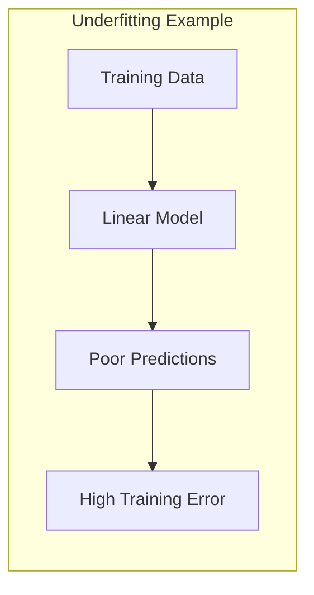
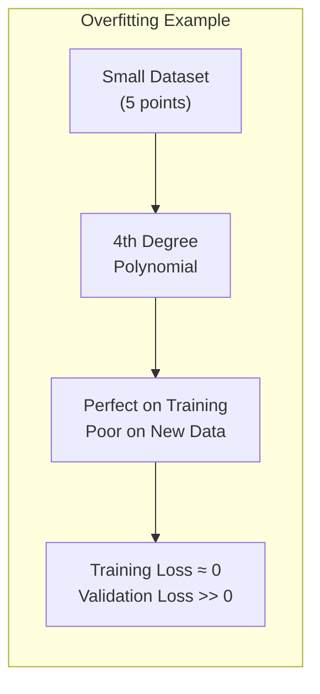
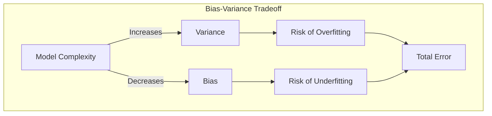
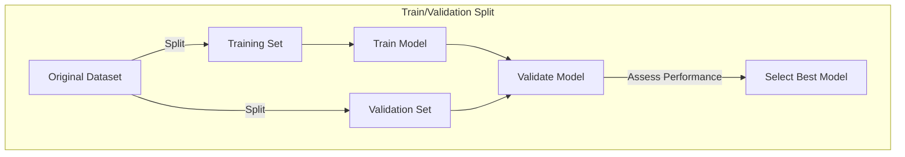
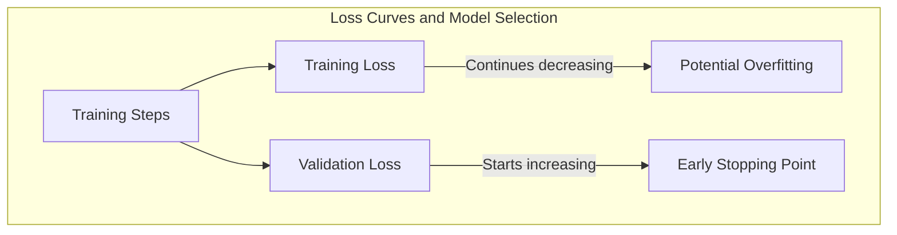
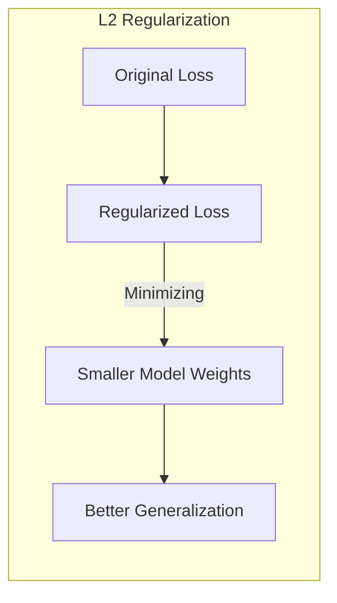
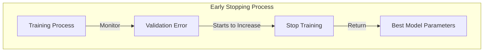
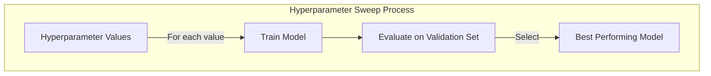
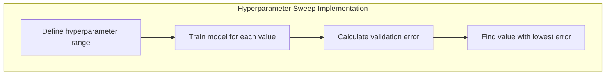
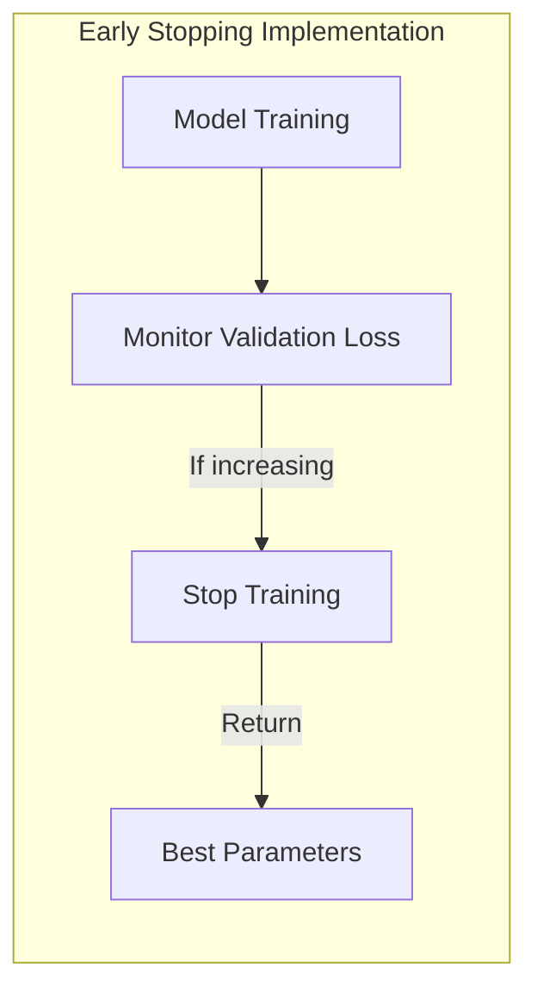

<!-- source: DeepWiki mcp.deepwiki.com · repo google-deepmind/educational · page 5.3 Regularization and Model Selection · fetched 2026-10-26 -->

# Regularization and Model Selection

<details>
<summary>Relevant source files</summary>

The following files were used as context for generating this wiki page:

- [colabs/summer_schools/intro_to_regression.ipynb](colabs/summer_schools/intro_to_regression.ipynb)

</details>


## Purpose and Scope

This document explains techniques for preventing overfitting in machine learning models and methods for selecting optimal models. It covers regularization approaches, validation strategies, and hyperparameter tuning specifically in the context of regression problems. These concepts are fundamental across machine learning applications, as they address the critical challenge of creating models that generalize well to unseen data rather than simply memorizing training examples.

For the fundamentals of linear regression and gradient descent, see [Linear Regression Fundamentals](#5.1) and [Gradient Descent and Autodiff](#5.2).

## Underfitting and Overfitting

Underfitting and overfitting represent the two extremes of model performance that emerge from the bias-variance tradeoff. Understanding these concepts is crucial for building effective machine learning models.

### Underfitting

Underfitting occurs when a model is too simple to capture the underlying pattern in the data. An underfit model:
- Has high error on both training and test data
- Fails to capture important relationships
- Often results from models with insufficient complexity



Sources: [colabs/summer_schools/intro_to_regression.ipynb:931-936]()

### Overfitting

Overfitting occurs when a model learns the training data too well, including its noise and peculiarities, at the expense of generalization. An overfit model:
- Has very low error on training data
- Has high error on new/test data
- Often results from models with excessive complexity

The notebook demonstrates overfitting with a small dataset (5 points) fit with a 4th degree polynomial:



Sources: [colabs/summer_schools/intro_to_regression.ipynb:942-1059]()

### The Generalization Problem

The relationship between model complexity, training error, and validation error is typically U-shaped for validation error:



Sources: [colabs/summer_schools/intro_to_regression.ipynb:1050-1067]()

## Model Selection Using Validation Data

Model selection refers to the process of choosing the best model from a set of candidate models. This process typically involves splitting data into training and validation sets.

### Train/Validation Split

The notebook demonstrates a basic validation approach:



Sources: [colabs/summer_schools/intro_to_regression.ipynb:1069-1087]()

### Monitoring Training and Validation Loss

A crucial technique for model selection is monitoring how performance metrics change during training:



Sources: [colabs/summer_schools/intro_to_regression.ipynb:1087-1095]()

## Regularization Techniques

Regularization techniques modify the learning algorithm to reduce overfitting and improve generalization. They typically involve adding a penalty term to the loss function that discourages complex models.

### L2 Regularization (Ridge Regression)

L2 regularization adds the squared magnitude of the parameter vector scaled by a coefficient λ to the loss function:

```
Loss = (1/N)(y - Xw)ᵀ(y - Xw) + λ‖w‖₂²
```

Where λ is the regularization coefficient and ‖w‖₂² is the sum of squared weights.

The analytical solution becomes:
```
w* = (XᵀX + λI)⁻¹ Xᵀy
```

This has the effect of shrinking parameter values toward zero without necessarily reaching zero.



Sources: [colabs/summer_schools/intro_to_regression.ipynb:1253-1317]()

### [Optional] L1 Regularization (Lasso)

The notebook briefly mentions Lasso regression, which uses the L1 norm of the parameter vector instead of the L2 norm. This tends to produce sparse models by setting some parameters exactly to zero, which can be useful for feature selection.

Sources: [colabs/summer_schools/intro_to_regression.ipynb:1407-1416]()

## Early Stopping

Early stopping is a regularization technique that involves monitoring validation performance during training and stopping when validation performance begins to degrade:



The notebook demonstrates that early stopping results in models with smaller parameter magnitudes compared to fully trained models, leading to better generalization.

Sources: [colabs/summer_schools/intro_to_regression.ipynb:1190-1242]()

## Hyperparameter Tuning

Regularization introduces hyperparameters (like λ in L2 regularization) that need to be tuned for optimal model performance.

### Hyperparameter Sweep

The notebook demonstrates a basic hyperparameter sweep for the regularization coefficient:



This process helps find the optimal regularization strength that balances between underfitting (too much regularization) and overfitting (too little regularization).

```mermaid
flowchart LR
    subgraph "Effect of Regularization Strength"
        dir TB
        lambda["Regularization Coefficient λ"] --- effects["Effects"]
        effects --> |"Too Small"| over["Overfitting"]
        effects --> |"Too Large"| under["Underfitting"]
        effects --> |"Optimal"| best["Best Generalization"]
    end
```

Sources: [colabs/summer_schools/intro_to_regression.ipynb:1299-1342]()

### Training vs. Validation Error Analysis

The notebook shows how training and validation errors respond differently to changes in regularization strength:

```
Training Error: Increases as regularization strength increases
Validation Error: Initially decreases, then increases (U-shaped curve)
```

This relationship demonstrates the bias-variance tradeoff and allows us to find the optimal regularization parameter.

Sources: [colabs/summer_schools/intro_to_regression.ipynb:1365-1387]()

## Implementation in the Codebase

The implementation of regularization and model selection techniques can be found in:

1. L2 regularization implementation:
```python
def regularized_regression_analytical_solution(phi, y, regularization_coef):
  t = phi.shape[0]
  return (np.linalg.inv(phi.T.dot(phi) +
                        regularization_coef * np.identity(t)
                        ).dot(phi.T)).dot(y)
```

2. Hyperparameter sweep implementation:


Sources: [colabs/summer_schools/intro_to_regression.ipynb:1299-1330]()

3. Early stopping implementation:


Sources: [colabs/summer_schools/intro_to_regression.ipynb:1095-1128]()

## Conclusion

Regularization and model selection are critical components of building machine learning models that generalize well to unseen data. The techniques covered in this document—L2 regularization, early stopping, and hyperparameter tuning—provide effective ways to combat overfitting and improve model performance on new data.

The repository demonstrates these concepts in the context of polynomial regression, but the principles apply broadly across different model types and problem domains.

---

