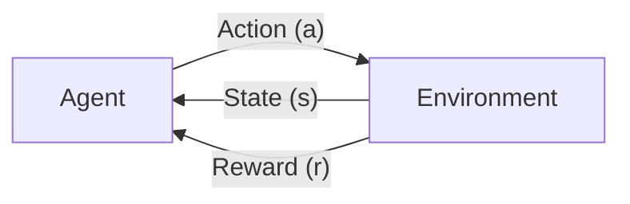
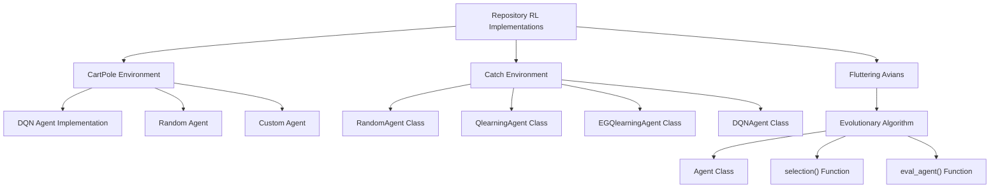
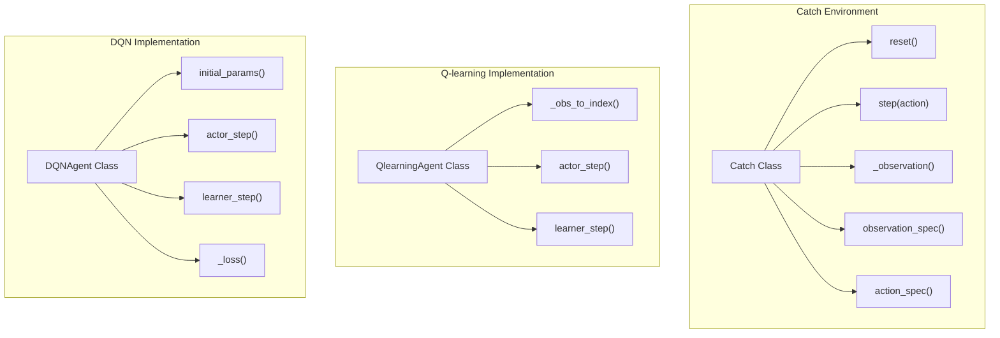
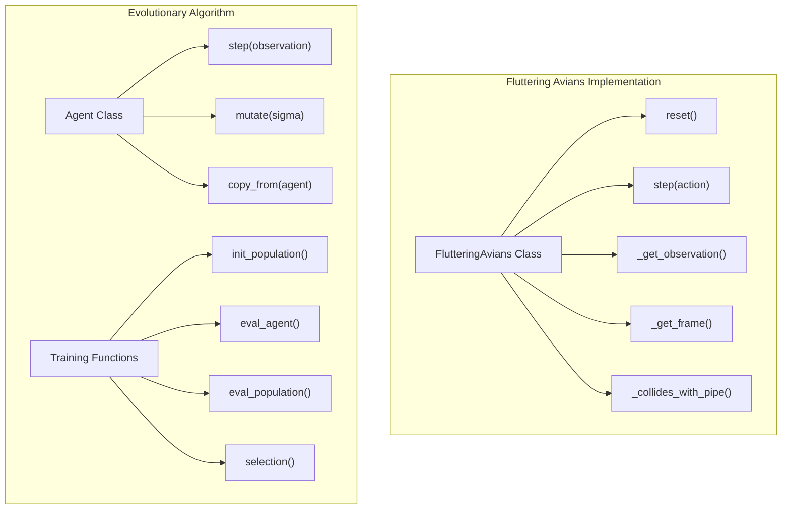
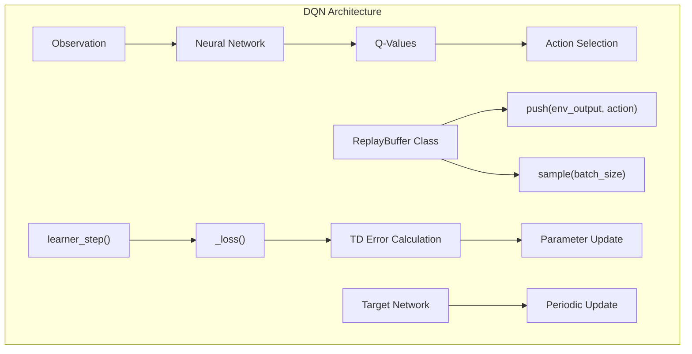
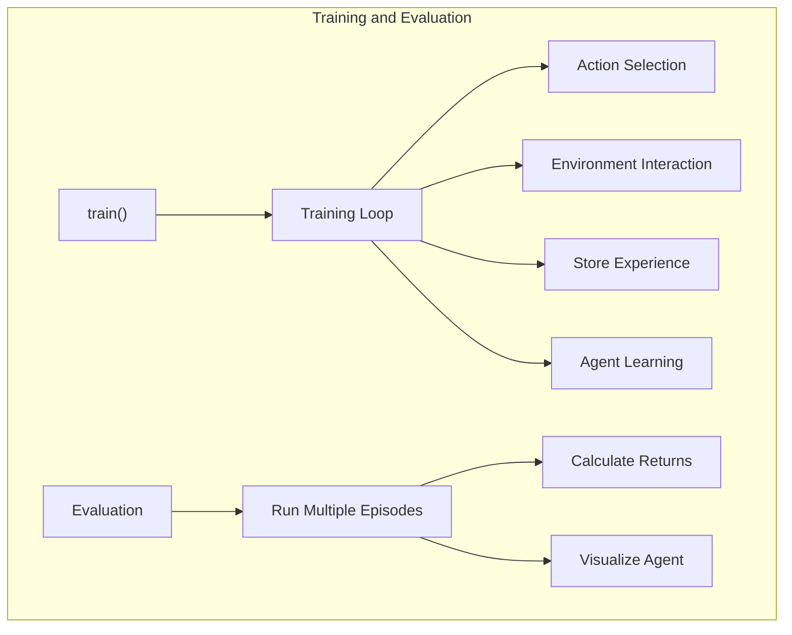

<!-- source: DeepWiki mcp.deepwiki.com · repo google-deepmind/educational · page 6 Reinforcement Learning · fetched 2026-10-26 -->

# Reinforcement Learning

<details>
<summary>Relevant source files</summary>

The following files were used as context for generating this wiki page:

- [colabs/introductory/fluttering_avians.ipynb](colabs/introductory/fluttering_avians.ipynb)
- [colabs/introductory/reinforcement_learning.ipynb](colabs/introductory/reinforcement_learning.ipynb)
- [colabs/summer_schools/intro_to_reinforcement_learning.ipynb](colabs/summer_schools/intro_to_reinforcement_learning.ipynb)

</details>


This page provides an overview of reinforcement learning (RL) concepts and implementations in the Google DeepMind Educational repository. It covers the fundamentals of RL, key algorithms, and specific examples that demonstrate RL principles through interactive environments. For more advanced implementations, see the [Graph Neural Networks](#2) page which incorporates some reinforcement learning techniques.

## Reinforcement Learning Basics

Reinforcement learning is a machine learning paradigm where an agent learns to make decisions by interacting with an environment and receiving feedback in the form of rewards. Unlike supervised learning (which uses labeled examples) or unsupervised learning (which finds patterns in unlabeled data), RL involves learning from direct interaction with an environment.



**Diagram: Basic Reinforcement Learning Loop**

Sources: [colabs/introductory/reinforcement_learning.ipynb:57-69](). [colabs/summer_schools/intro_to_reinforcement_learning.ipynb:29-37]()

### Key Components

1. **Agent**: The decision-maker that selects actions based on observations
2. **Environment**: The world in which the agent operates
3. **State (s)**: Current situation or configuration of the environment 
4. **Action (a)**: Decisions made by the agent that affect the environment
5. **Reward (r)**: Numerical feedback signal indicating action desirability
6. **Policy (π)**: Strategy that maps states to actions
7. **Value Function**: Function estimating the expected future reward

### Learning Process

The agent aims to maximize its cumulative reward (return) over time by:
1. Observing the current state
2. Selecting an action based on policy
3. Receiving a reward and new state from the environment
4. Updating its policy/value estimates based on this experience
5. Repeating the process

Sources: [colabs/introductory/reinforcement_learning.ipynb:55-71](). [colabs/summer_schools/intro_to_reinforcement_learning.ipynb:478-498]()

## Repository Implementations

The repository includes several reinforcement learning implementations that demonstrate different techniques and environments.



**Diagram: Repository RL Implementations**

Sources: [colabs/introductory/reinforcement_learning.ipynb:232-269](). [colabs/summer_schools/intro_to_reinforcement_learning.ipynb:103-209](). [colabs/introductory/fluttering_avians.ipynb:97-112]()

### CartPole Environment

In the CartPole environment, a pole is balanced on a cart that moves along a track. The agent needs to move the cart left or right to prevent the pole from falling.

- **Observation space**: Cart position, cart velocity, pole angle, pole angular velocity
- **Action space**: Move cart left (0) or right (1) 
- **Reward**: +1 for each timestep the pole remains upright
- **Episode termination**: Pole angle exceeds threshold or cart moves out of bounds

```python
def custom_action_for_cartpole(state):
  # state components
  cart_position = state[0]
  cart_velocity = state[1]
  pole_angle = state[2]
  pole_velocity_at_tip = state[3]
  
  # Decision logic goes here
  action = 0
  return action
```

Sources: [colabs/introductory/reinforcement_learning.ipynb:232-269](). [colabs/introductory/reinforcement_learning.ipynb:347-368]()

### Catch Environment

The Catch environment is a simple game where a ball drops from the top of the screen, and the agent controls a paddle to catch it.

- **Observation space**: 2D grid (default 10×5) showing ball and paddle positions
- **Action space**: Move paddle left (-1), stay (0), or move right (1)
- **Reward**: +1 for catching the ball, -1 for missing
- **Episode termination**: Ball reaches bottom of screen



**Diagram: Catch Environment and Agent Implementations**

Sources: [colabs/summer_schools/intro_to_reinforcement_learning.ipynb:103-209](). [colabs/summer_schools/intro_to_reinforcement_learning.ipynb:327-373](). [colabs/summer_schools/intro_to_reinforcement_learning.ipynb:1284-1383]()

### Fluttering Avians

Fluttering Avians is a game similar to Flappy Bird where an agent must navigate a bird character through obstacles by controlling its upward movement.

- **Observation space**: Bird position, angle, velocity, and obstacle locations
- **Action space**: Flutter (1) or not (0)
- **Reward**: +1 per timestep survived, -1 for collision
- **Episode termination**: Bird hits obstacle or goes out of bounds



**Diagram: Fluttering Avians Environment and Evolutionary Algorithm**

Sources: [colabs/introductory/fluttering_avians.ipynb:195-371](). [colabs/introductory/fluttering_avians.ipynb:929-1043]()

## RL Algorithms

The repository implements several key reinforcement learning algorithms across the different environments.

### Random Agents

The most basic approach is a random agent that ignores observations and selects actions randomly.

```python
class RandomAgent(object):
  def __init__(self, action_spec: specs.DiscreteArray):
    self._num_actions = action_spec.num_values

  def actor_step(self, timestep: dm_env.TimeStep):
    del timestep  # Ignores observations
    return np.random.randint(self._num_actions)
```

Sources: [colabs/summer_schools/intro_to_reinforcement_learning.ipynb:333-344](). [colabs/introductory/reinforcement_learning.ipynb:290-302]()

### Value-Based Methods

#### Q-Learning

Q-learning is a model-free algorithm that learns a Q-function mapping state-action pairs to expected rewards. The Q-function is typically initialized to zeros and updated using the temporal difference (TD) error.

**Q-value update rule**:
```
Q(s,a) ← Q(s,a) + α * [r + γ * max_a'(Q(s',a')) - Q(s,a)]
```
Where:
- α is the learning rate
- γ is the discount factor
- r is the reward
- max_a'(Q(s',a')) is the maximum Q-value for the next state

The repository implements both tabular Q-learning and Q-learning with function approximation.

```python
# Simplified Q-learning update
td_error = r_t + discount_t * self._q[obs_t, a_t] - self._q[obs_tm1, a_tm1]
self._q[obs_tm1, a_tm1] += self._step_size * td_error
```

Sources: [colabs/summer_schools/intro_to_reinforcement_learning.ipynb:533-572](). [colabs/summer_schools/intro_to_reinforcement_learning.ipynb:1042-1055]()

#### Deep Q-Networks (DQN)

DQN extends Q-learning by using neural networks to approximate the Q-function. Key innovations include:

1. **Experience Replay**: Store transitions in a buffer and sample randomly to break correlations
2. **Target Network**: Use a separate network for generating target values to stabilize training



**Diagram: Deep Q-Network Implementation**

Sources: [colabs/summer_schools/intro_to_reinforcement_learning.ipynb:1227-1254](). [colabs/summer_schools/intro_to_reinforcement_learning.ipynb:1284-1383](). [colabs/introductory/reinforcement_learning.ipynb:405-435]()

### Policy-Based Methods

#### Evolutionary Algorithms

The Fluttering Avians game demonstrates evolutionary algorithms for reinforcement learning:

1. Create a population of agents (neural networks)
2. Evaluate each agent's performance
3. Select the best-performing agents
4. Create new agents through mutation of the selected agents
5. Repeat for multiple generations

```python
def selection(population, new_pop, env, sigma=0.1, mu=0.4):
  # Find best-performing agents
  fitness = eval_population(population, env)
  best = population[np.argmax(fitness)]
  
  # Selection and reproduction
  order = sorted(enumerate(fitness), key=lambda x: x[1])
  pseudo_f = np.zeros((len(population),))
  for i, pair in enumerate(order):
    pseudo_f[pair[0]] = i
  choices = np.random.choice(len(population), size=len(population),
                           replace=True, p=pseudo_f/sum(pseudo_f))
  
  # Copy and mutate
  for i in range(len(population)):
    new_pop[i].copy_from(population[choices[i]])
    if np.random.random_sample() < mu:
      new_pop[i].mutate(sigma)
  
  return fitness, best
```

Sources: [colabs/introductory/fluttering_avians.ipynb:1008-1026](). [colabs/introductory/fluttering_avians.ipynb:1184-1255]()

## Implementation Details

### Agent-Environment Interaction

The repository implements a standard agent-environment interaction loop:

```python
# Basic interaction loop
timestep = environment.reset()
while not timestep.last():
  action = agent.select_action(timestep.observation)
  timestep = environment.step(action)
  agent.observe(action=action, next_timestep=timestep)
  
  # Learning (if applicable)
  agent.update()
```

Sources: [colabs/introductory/reinforcement_learning.ipynb:490-515](). [colabs/summer_schools/intro_to_reinforcement_learning.ipynb:600-646]()

### Exploration vs. Exploitation

A key challenge in RL is balancing exploration (trying new actions) vs. exploitation (using known good actions). The repository demonstrates:

1. **ε-greedy policy**: Take the best action with probability 1-ε, random action with probability ε
2. **Random exploration**: Try completely random actions

```python
# ε-greedy action selection
if np.random.random() > self._epsilon:
  action = np.argmax(qvalue)  # Exploit
else:
  action = np.random.choice(self._num_actions)  # Explore
```

Sources: [colabs/summer_schools/intro_to_reinforcement_learning.ipynb:770-778](). [colabs/summer_schools/intro_to_reinforcement_learning.ipynb:954-963]()

### Neural Network Implementation

For deep RL implementations, the repository uses neural networks (MLP architecture) to approximate value functions:

```python
def network(obs):
  flatten = lambda x: jnp.reshape(x, (-1,))
  mlp = hk.Sequential(
      [flatten,
       hk.nets.MLP(num_hiddens + [self._num_actions])])
  return mlp(obs)
```

Sources: [colabs/summer_schools/intro_to_reinforcement_learning.ipynb:999-1007](). [colabs/introductory/reinforcement_learning.ipynb:417-422]()

## Training and Evaluation

The repository includes code for training and evaluating RL agents:



**Diagram: Training and Evaluation Process**

Sources: [colabs/introductory/reinforcement_learning.ipynb:476-522](). [colabs/summer_schools/intro_to_reinforcement_learning.ipynb:584-691]()

### Training Process

Training typically involves:
1. Running the agent in the environment for multiple episodes
2. Collecting transitions (state, action, reward, next state)
3. Performing learning updates to improve policy/value estimates
4. Periodically evaluating performance

### Evaluation Metrics

The main evaluation metric is the **episode return** - the sum of rewards obtained during an episode:

```
return = sum(rewards)
```

For discounted returns:
```
return = sum(γ^t * reward_t)
```
where γ is the discount factor.

Sources: [colabs/introductory/reinforcement_learning.ipynb:446-454](). [colabs/summer_schools/intro_to_reinforcement_learning.ipynb:357-365]()

## Getting Started with RL

To experiment with RL using this repository:

1. Begin with the introductory notebook `reinforcement_learning.ipynb` for a gentle introduction
2. Try implementing a custom policy for the CartPole environment
3. Explore tabular Q-learning and DQN with the Catch environment in `intro_to_reinforcement_learning.ipynb`
4. Experiment with evolutionary algorithms in the Fluttering Avians game

### Hyperparameters to Consider

When working with RL algorithms, key hyperparameters include:

| Hyperparameter | Description | Typical Values |
|----------------|-------------|----------------|
| Learning rate | Controls update step size | 0.001-0.1 |
| Discount factor | Weights future vs. immediate rewards | 0.9-0.99 |
| Exploration rate (ε) | Controls exploration-exploitation trade-off | 0.01-0.1 |
| Batch size | Number of transitions per update | 32-128 |
| Hidden layer size | Neural network capacity | 50-256 neurons |
| Target update frequency | How often to update target network (DQN) | 10-1000 steps |

Sources: [colabs/introductory/reinforcement_learning.ipynb:544-556](). [colabs/summer_schools/intro_to_reinforcement_learning.ipynb:1404-1410]()

## Conclusion

The repository provides a comprehensive introduction to reinforcement learning, from basic concepts to practical implementations. The interactive notebooks allow experimentation with different algorithms and environments, demonstrating how agents can learn to solve sequential decision problems through trial and error.

---

