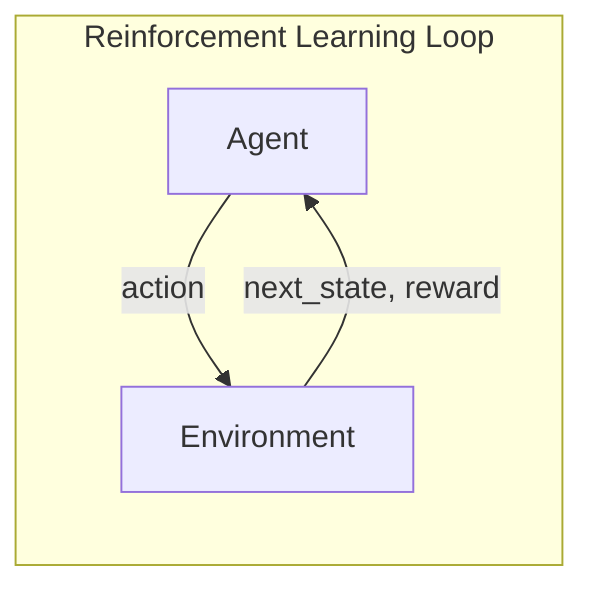
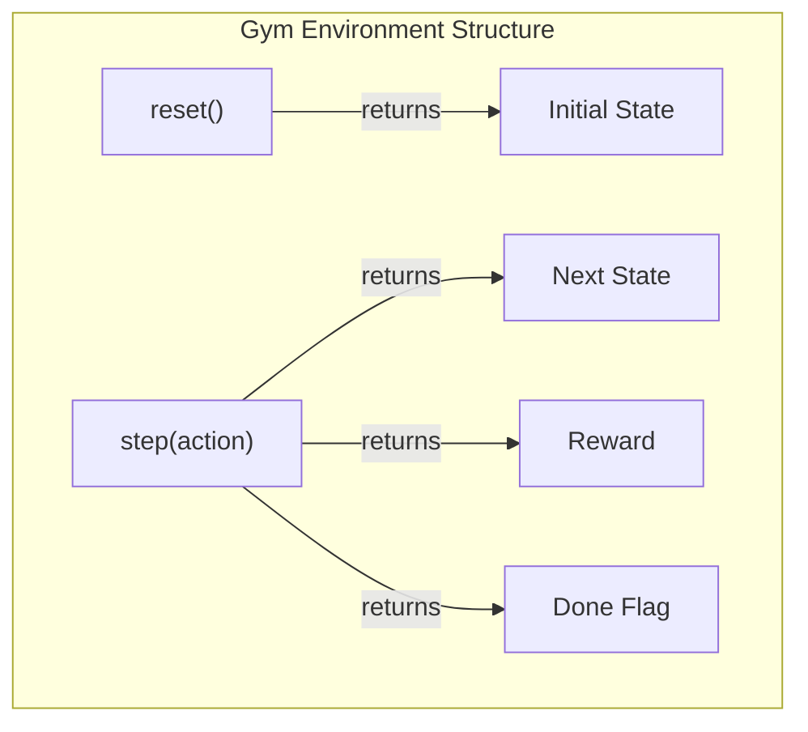
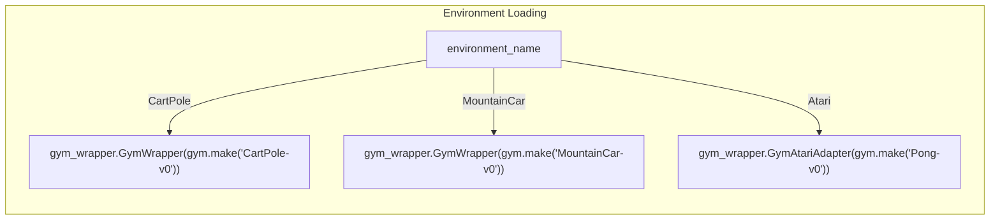
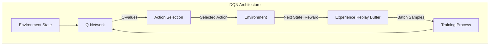
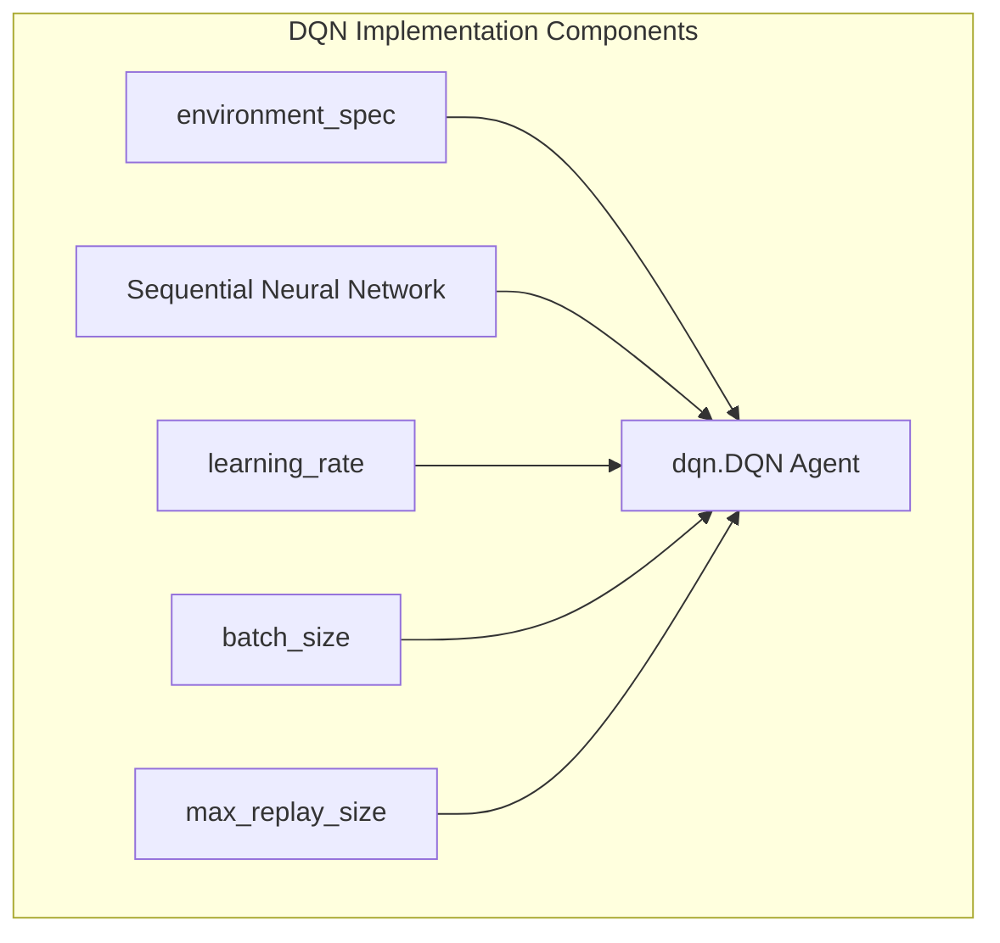
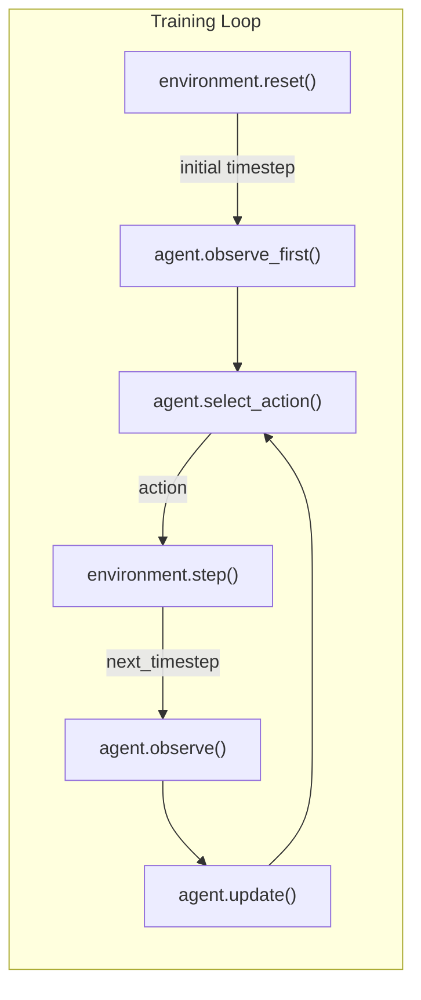
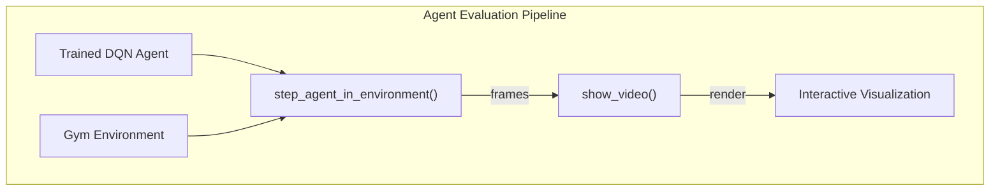
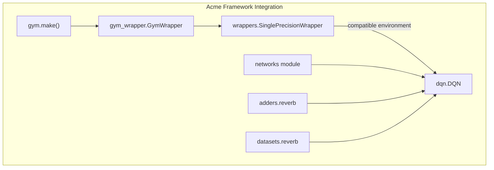

<!-- source: DeepWiki mcp.deepwiki.com · repo google-deepmind/educational · page 6.1 DQN and Gym Environments · fetched 2026-10-26 -->

# DQN and Gym Environments

<details>
<summary>Relevant source files</summary>

The following files were used as context for generating this wiki page:

- [colabs/introductory/reinforcement_learning.ipynb](colabs/introductory/reinforcement_learning.ipynb)

</details>


This document provides a detailed explanation of Deep Q-Networks (DQN) and their implementation with OpenAI Gym environments in the DeepMind Educational repository. It covers the fundamental concepts of reinforcement learning, the architecture of DQN agents, and how they interact with standardized environments to learn optimal behaviors.

Sources: [colabs/introductory/reinforcement_learning.ipynb:33-46]()

## 1. Reinforcement Learning Overview

Reinforcement Learning (RL) is a machine learning paradigm where an agent learns to make decisions by interacting with an environment. The primary goal is to maximize the total reward received over time. The interaction follows a cycle where:

1. The agent observes the current state of the environment
2. Based on this observation, the agent selects an action
3. The environment transitions to a new state based on the action
4. The agent receives a reward signal based on the action and resulting state
5. The process repeats until termination

This agent-environment interaction loop forms the foundation of all reinforcement learning algorithms, including DQN.



Sources: [colabs/introductory/reinforcement_learning.ipynb:56-71]()

## 2. OpenAI Gym Environments

OpenAI Gym provides standardized environments for developing and comparing reinforcement learning algorithms. These environments have a consistent interface that makes it easy to implement and test different learning approaches.

### 2.1 Key Components of Gym Environments

Gym environments implement a standard API with the following core methods:

- `reset()`: Initializes the environment and returns the initial observation
- `step(action)`: Takes an action, transitions the environment, and returns:
  - Next observation (state)
  - Reward
  - Done flag (indicating if the episode is complete)
  - Additional information

In the repository, environments are wrapped with additional functionality using the `gym_wrapper.GymWrapper` class, which adapts the Gym interface to the dm_env interface used by Acme.



### 2.2 Environment Examples

The repository includes several example environments with varying complexity:

1. **CartPole**: A simple environment where a cart must balance a pole. The state consists of:
   - Cart position
   - Cart velocity
   - Pole angle
   - Pole velocity at tip
   
   Actions are discrete (0: push left, 1: push right)

2. **MountainCar**: An environment where an underpowered car must gain enough momentum to reach the top of a hill

3. **Atari**: Complex environments based on Atari games like Pong, which use pixel-based observations



Sources: [colabs/introductory/reinforcement_learning.ipynb:229-269]()

## 3. Deep Q-Networks (DQN)

Deep Q-Networks (DQN) is a reinforcement learning algorithm that combines Q-learning with deep neural networks to approximate the action-value function (Q-function). DQN was a breakthrough algorithm introduced by DeepMind in 2014 that enabled RL to work effectively with high-dimensional observation spaces.

### 3.1 Q-Learning Basics

Q-learning is a value-based RL method that learns an action-value function Q(s, a), which estimates the expected return from taking action 'a' in state 's' and following the optimal policy thereafter. The optimal Q-function satisfies the Bellman equation:

Q*(s, a) = E[r + γ · max_a' Q*(s', a')]

Where:
- r is the immediate reward
- γ is the discount factor
- s' is the next state
- max_a' Q*(s', a') is the maximum Q-value for the next state

### 3.2 DQN Architecture

DQN extends traditional Q-learning by using a neural network to approximate the Q-function. Key components of the DQN implementation in the repository include:

1. **Q-Network**: A neural network that maps states to action values
2. **Replay Buffer**: Stores experiences (state, action, reward, next_state) for training
3. **Target Network**: A copy of the Q-network used for more stable learning
4. **Optimizer**: Updates the Q-network based on the loss function



### 3.3 DQN Implementation

In the repository, the DQN agent is implemented using the Acme framework. The key components are:

1. **Network Definition**:
   - A sequential neural network with MLP layers
   - Input: Environment state
   - Output: Q-values for each possible action

2. **DQN Agent Configuration**:
   - Learning rate: Controls how quickly the agent adapts to new information
   - Batch size: Number of experiences used for each learning update
   - Replay buffer size: Maximum number of experiences stored



Sources: [colabs/introductory/reinforcement_learning.ipynb:380-436]()

## 4. Agent-Environment Interaction

The interaction between the DQN agent and the Gym environment follows a specific training loop:

### 4.1 Training Process

1. **Initialization**:
   - Reset the environment to get initial state
   - The agent observes this initial state

2. **Interaction Loop**:
   - Agent selects an action based on current observation
   - Environment steps forward using the action
   - Agent observes the next state and reward
   - Experience is stored in the replay buffer

3. **Learning**:
   - After collecting enough initial experiences, the agent begins learning
   - Batches of experiences are sampled from the replay buffer
   - The Q-network is updated to minimize the difference between predicted and target Q-values

4. **Evaluation**:
   - Performance is measured by the total reward accumulated per episode
   - Training curves show how performance improves over time



### 4.2 Hyperparameters

The DQN implementation includes several configurable hyperparameters that affect learning:

| Hyperparameter | Description | Default Value |
|----------------|-------------|---------------|
| learning_rate | Controls how quickly the network weights are updated | 3e-4 |
| batch_size | Number of experiences used in each update | 64 |
| max_replay_size | Maximum capacity of the replay buffer | 100000 |
| num_training_episodes | Total number of training episodes | 200 |

Sources: [colabs/introductory/reinforcement_learning.ipynb:463-523]()

## 5. Performance Evaluation

The repository provides tools to evaluate agent performance both quantitatively and qualitatively:

### 5.1 Quantitative Evaluation

Training curves plot the total reward per episode over the course of training, showing how the agent's performance improves with experience. Key metrics include:

- Episode return: Total reward accumulated in an episode
- Learning efficiency: How quickly the agent reaches near-optimal performance
- Stability: Consistency of performance across episodes

### 5.2 Qualitative Evaluation

The repository includes functionality to visualize agent behavior by rendering and recording the environment. This provides an intuitive understanding of what the agent has learned and how it interacts with the environment.

The `step_agent_in_environment` and `show_video` functions facilitate this visualization process.



Sources: [colabs/introductory/reinforcement_learning.ipynb:581-631]()

## 6. Integration with Acme

The repository leverages DeepMind's Acme framework, which provides modular components for reinforcement learning. The key integrations include:

1. **Environment Wrappers**:
   - `gym_wrapper.GymWrapper`: Adapts OpenAI Gym to the dm_env interface
   - `wrappers.SinglePrecisionWrapper`: Ensures consistent numeric precision

2. **DQN Components**:
   - `acme.agents.tf.dqn`: Implementation of the DQN algorithm
   - `acme.tf.networks`: Neural network definitions
   - `acme.adders.reverb`: Experience storage mechanisms
   - `acme.datasets.reverb`: Experience sampling for learning

3. **Training Infrastructure**:
   - `environment_loop`: Manages the agent-environment interaction
   - `loggers`: Tracks and reports training progress



Sources: [colabs/introductory/reinforcement_learning.ipynb:124-156]()

## 7. Common Usage Patterns

### 7.1 Setting Up a DQN Agent

The typical pattern for setting up a DQN agent involves:

1. Creating a specification of the environment
2. Defining a neural network architecture
3. Initializing the DQN agent with appropriate hyperparameters

```python
# Create environment specification
environment_spec = specs.make_environment_spec(environment)

# Define neural network
network = snt.Sequential([
    lambda x: tf.cast(x, tf.float32),
    snt.Flatten(),
    snt.nets.MLP([100, environment_spec.actions.num_values])
])

# Initialize DQN agent
agent = dqn.DQN(
    environment_spec=environment_spec,
    learning_rate=learning_rate,
    batch_size=batch_size,
    max_replay_size=max_replay_size,
    network=network
)
```

### 7.2 Training Loop Implementation

The standard training loop follows this pattern:

1. Reset environment to get initial state
2. Agent observes initial state
3. Loop until episode ends:
   - Select action based on current observation
   - Execute action in environment
   - Observe result and store transition
   - Update agent (learning)
4. Repeat for multiple episodes

Sources: [colabs/introductory/reinforcement_learning.ipynb:407-436](), [colabs/introductory/reinforcement_learning.ipynb:476-523]()

## 8. Summary

The DQN and Gym Environments implementation in the repository provides:

1. A practical introduction to reinforcement learning concepts
2. A modular and extensible DQN implementation using the Acme framework
3. Integration with standard OpenAI Gym environments
4. Tools for training, evaluating, and visualizing agent performance

This implementation serves as an educational resource for understanding how deep reinforcement learning algorithms work in practice, particularly for discrete action spaces like those found in the CartPole, MountainCar, and Atari environments.

Sources: [colabs/introductory/reinforcement_learning.ipynb:33-46](), [colabs/introductory/reinforcement_learning.ipynb:380-436]()

---

