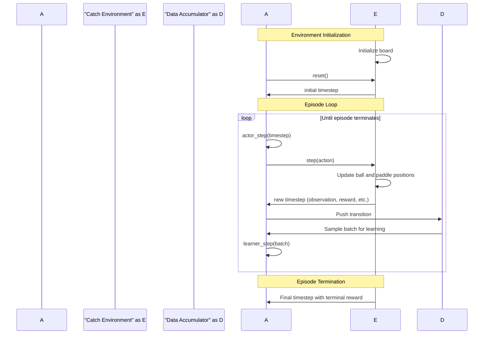
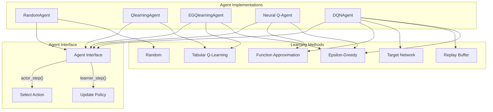

<!-- source: DeepWiki mcp.deepwiki.com · repo google-deepmind/educational · page 6.2 Catch Environment and Agents · fetched 2026-10-26 -->

# Catch Environment and Agents

<details>
<summary>Relevant source files</summary>

The following files were used as context for generating this wiki page:

- [colabs/summer_schools/intro_to_reinforcement_learning.ipynb](colabs/summer_schools/intro_to_reinforcement_learning.ipynb)

</details>


## Purpose and Scope

This page documents the Catch environment and the various agents implemented to interact with it in the educational repository. The Catch environment is a simple game designed as a test bed for reinforcement learning (RL) algorithms. This document covers the environment structure, available actions, reward mechanism, and the implementation of multiple agents with varying complexity, from a random agent to a Deep Q-Network (DQN) agent. For information about other reinforcement learning concepts and environments, see [Reinforcement Learning](#6) and [DQN and Gym Environments](#6.1).

Sources: [colabs/summer_schools/intro_to_reinforcement_learning.ipynb:102-106]()

## Catch Environment Overview

The Catch environment is a simple grid-based game where a ball drops from the top of the screen and the agent controls a paddle at the bottom. The agent's objective is to move the paddle to catch the falling ball. The environment provides a clean, discrete action and state space that makes it ideal for learning reinforcement learning concepts.

### Game Mechanics

- **Ball**: Starts at a random column at the top of the grid and moves down one row per step
- **Paddle**: Located at the bottom row and can move left, stay in place, or move right
- **Objective**: Move the paddle to catch the ball when it reaches the bottom row

### Environment Parameters

| Parameter | Default Value | Description |
| --------- | ------------- | ----------- |
| rows | 10 | Number of rows in the grid |
| columns | 5 | Number of columns in the grid |
| discount | 1.0 | Discount factor for calculating reward |

### Reward Structure

- **+1**: Successfully catching the ball with the paddle
- **-1**: Missing the ball
- **0**: All intermediate steps

Sources: [colabs/summer_schools/intro_to_reinforcement_learning.ipynb:102-106](), [colabs/summer_schools/intro_to_reinforcement_learning.ipynb:137-148]()

## Catch Environment Implementation

The Catch environment is implemented as a class that inherits from `dm_env.Environment`, providing standard reinforcement learning environment interface methods.

### Environment Class Structure

```mermaid
classDiagram
    class "dm_env.Environment" {
        +reset()
        +step(action)
        +observation_spec()
        +action_spec()
    }
    class "Catch" {
        -_rows: int
        -_columns: int
        -_discount: float
        -_board: numpy.ndarray
        -_ball_x: int
        -_ball_y: int
        -_paddle_x: int
        -_reset_next_step: bool
        +reset()
        +step(action)
        +observation_spec()
        +action_spec()
        -_observation()
    }
    "dm_env.Environment" <|-- "Catch"
```

### Environment Methods

The environment implements several critical methods:

1. **reset()**: Initializes a new episode by placing the ball at a random column at the top and the paddle at the center
2. **step(action)**: Processes the agent's action and updates the environment state
3. **observation_spec()**: Provides the specification of observations
4. **action_spec()**: Provides the specification of actions
5. **_observation()**: Internal method that returns the current board state

### State Representation

The state is represented as a 2D matrix of shape (rows, columns) containing binary values:
- **0**: Empty space
- **1**: Paddle
- **2**: Ball

### Action Space

The agent can take one of three discrete actions:

| Action Index | Action Value | Effect |
| ------------ | ------------ | ------ |
| 0 | -1 | Move paddle left |
| 1 | 0 | Keep paddle in current position |
| 2 | 1 | Move paddle right |

Sources: [colabs/summer_schools/intro_to_reinforcement_learning.ipynb:118-209]()

## Agent-Environment Interaction Flow

The following diagram illustrates the interaction between agents and the Catch environment.



Sources: [colabs/summer_schools/intro_to_reinforcement_learning.ipynb:366-402](), [colabs/summer_schools/intro_to_reinforcement_learning.ipynb:620-691]()

## Implemented Agents

The repository implements several agents of increasing complexity to interact with the Catch environment. Each agent follows a similar interface but employs different algorithms for action selection and learning.

### Agent Class Hierarchy



### 1. Random Agent

The simplest agent that selects actions randomly without learning from the environment.

```python
class RandomAgent(object):
    # Takes a random action regardless of observation
    def actor_step(self, timestep):
        del timestep  # Not used
        return np.random.randint(self._num_actions)
```

Sources: [colabs/summer_schools/intro_to_reinforcement_learning.ipynb:333-344]()

### 2. Tabular Q-learning Agent

This agent uses a table to store Q-values for each state-action pair and updates them using temporal difference learning.

#### Key Components:
- **Q Table**: A matrix of size `(number of states, number of actions)`
- **State Indexing**: Converts the 2D observation to a 1D index
- **TD Learning**: Updates Q-values based on the Bellman equation

Sources: [colabs/summer_schools/intro_to_reinforcement_learning.ipynb:532-571]()

### 3. Epsilon-Greedy Q-learning Agent

Extends the Q-learning agent by implementing an epsilon-greedy policy to balance exploration and exploitation.

#### Key Features:
- **Epsilon Parameter**: Controls the probability of taking a random action
- **Separate Training/Evaluation Modes**: Uses greedy policy during evaluation

```python
def actor_step(self, timestep, evaluation):
    qvalue = self._q[self._obs_to_index(timestep.observation)]
    # Epsilon-greedy policy for training
    if np.random.random() > self._epsilon:
        train_a = np.argmax(qvalue)
    else:
        train_a = np.random.choice(self._num_actions)
    # Greedy policy for evaluation
    if evaluation:
        return np.argmax(qvalue)
    else:
        return train_a
```

Sources: [colabs/summer_schools/intro_to_reinforcement_learning.ipynb:740-785]()

### 4. Neural Network-based Q-learning Agent

Replaces the tabular Q-value representation with a neural network function approximator.

#### Key Features:
- **Neural Network**: MLP that maps observations to Q-values
- **Gradient-based Updates**: Uses JAX for automatic differentiation
- **Optimizers**: Adam optimizer for parameter updates
- **Loss Function**: Mean squared TD error

Sources: [colabs/summer_schools/intro_to_reinforcement_learning.ipynb:916-1055]()

### 5. DQN Agent

Implements Deep Q-Networks (DQN) with two key improvements:
- **Replay Buffer**: Stores transitions to break correlations in the data
- **Target Network**: Periodically updated copy of the Q-network for stable learning

#### Implementation Details:
- **Online Network**: Used for action selection
- **Target Network**: Used for computing target Q-values
- **Update Period**: Target network parameters updated every `target_period` steps
- **Batched Learning**: Performs updates on batches sampled from the replay buffer

Sources: [colabs/summer_schools/intro_to_reinforcement_learning.ipynb:1284-1382]()

## Support Components

### TransitionAccumulator

A simple data structure that stores current and previous timesteps to enable learning from transitions.

```python
class TransitionAccumulator:
    def __init__(self):
        self._prev = None
        self._action = None
        self._latest = None
    
    def push(self, env_output, action):
        # Store current state as previous, update latest
    
    def sample(self, batch_size):
        # Return transition tuple for learning
```

Sources: [colabs/summer_schools/intro_to_reinforcement_learning.ipynb:593-619]()

### ReplayBuffer

Enhanced version of the transition accumulator that stores multiple transitions in a fixed-size buffer for experience replay.

```python
class ReplayBuffer(object):
    def __init__(self, capacity, discount_factor=0.99):
        self.buffer = collections.deque(maxlen=capacity)
    
    def push(self, env_output, action):
        # Add transition to buffer
    
    def sample(self, batch_size):
        # Randomly sample batch_size transitions
```

Sources: [colabs/summer_schools/intro_to_reinforcement_learning.ipynb:1227-1254]()

## Training and Evaluation Loop

The training process follows a standard reinforcement learning loop:

1. Reset the environment to start a new episode
2. Get the initial observation
3. For each step in the episode:
   - Select an action based on the current observation
   - Execute the action in the environment
   - Observe the new state and reward
   - Store the transition
   - Update the agent's policy/value function
4. Periodically evaluate the agent's performance

### Evaluation Metrics

The primary evaluation metric is the **average episode return** - the sum of rewards received in an episode, averaged over multiple evaluation episodes.

### Training Parameters

| Parameter | Description |
| --------- | ----------- |
| `batch_size` | Number of transitions used for a single update |
| `train_episodes` | Total number of episodes for training |
| `evaluate_every` | Frequency of evaluation (in episodes) |
| `eval_episodes` | Number of episodes used for evaluation |
| `replay_buffer_capacity` | Size of the replay buffer (for DQN) |
| `discount_factor` | Discount factor for future rewards |
| `epsilon` | Probability of taking a random action |
| `learning_rate` | Step size for optimizer updates |
| `target_period` | Update frequency for target network (for DQN) |

Sources: [colabs/summer_schools/intro_to_reinforcement_learning.ipynb:642-690](), [colabs/summer_schools/intro_to_reinforcement_learning.ipynb:1404-1462]()

## Performance Considerations

- **Tabular methods** are limited by memory requirements when the state space grows
- **Neural network-based methods** scale better to large state spaces but may require more computational resources
- **DQN with replay buffer** requires additional memory for storing transitions but significantly improves learning stability

The DQN agent with a suitably sized replay buffer and appropriate hyperparameters typically achieves the best performance in the Catch environment, consistently reaching positive average returns after sufficient training.

---

