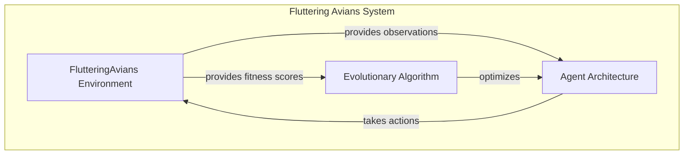
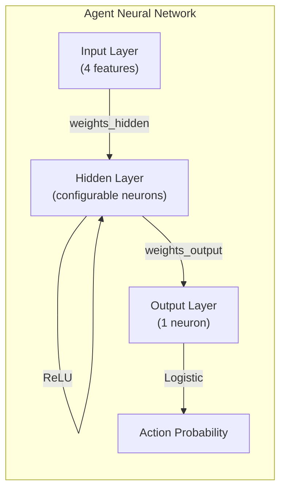
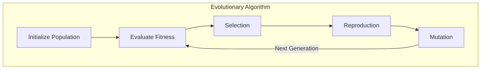
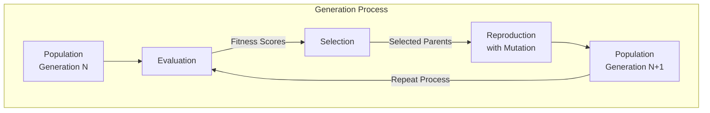

<!-- source: DeepWiki mcp.deepwiki.com · repo google-deepmind/educational · page 6.3 Evolutionary Algorithms: Fluttering Avians · fetched 2026-10-26 -->

# Evolutionary Algorithms: Fluttering Avians

<details>
<summary>Relevant source files</summary>

The following files were used as context for generating this wiki page:

- [colabs/introductory/fluttering_avians.ipynb](colabs/introductory/fluttering_avians.ipynb)

</details>


## Purpose and Scope

This document provides a technical overview of the Fluttering Avians environment and the evolutionary algorithm approach used to train agents to play this game. Fluttering Avians is an educational implementation similar to the popular mobile game Flappy Bird, designed to demonstrate how evolutionary algorithms can be applied to game-playing agents. For information about other reinforcement learning approaches, see [Reinforcement Learning](#6) and [DQN and Gym Environments](#6.1).

Sources: [colabs/introductory/fluttering_avians.ipynb:31-47]()

## System Overview

Fluttering Avians demonstrates an evolutionary approach to training game-playing agents. The system consists of three main components: the game environment, the agent architecture, and the evolutionary training algorithm.



Sources: [colabs/introductory/fluttering_avians.ipynb:77-87](), [colabs/introductory/fluttering_avians.ipynb:195-365]()

## Game Environment

The `FlutteringAvians` class implements a game environment similar to Flappy Bird. The player controls a bird-like character ("flutter") that must navigate through pipes with openings. The environment follows the `dm_env.Environment` interface.

### Key Components

- **Game State**: Includes the flutter's position, angle, and pipe positions
- **Actions**: Binary action space (0: do nothing, 1: flutter/flap)
- **Observations**: Provides both visual observations (frames) and feature vectors
- **Reward Structure**: Agents receive a reward of -1 upon collision, otherwise accumulating score over time

```mermaid
classDiagram
    class "FlutteringAvians" {
        +reset()
        +step(action)
        +_get_observation()
        +_collides_with_pipe()
        +_add_pipe()
        +_get_frame()
    }
    class "dm_env.Environment" {
        +reset()
        +step()
        +observation_spec()
        +action_spec()
    }
    "FlutteringAvians" --|> "dm_env.Environment"
```

Sources: [colabs/introductory/fluttering_avians.ipynb:195-383]()

### Observation Space

The environment provides two types of observations:

1. **Visual Observations**: A rendered frame of the game (`Pixels`)
2. **Feature Vectors**: A structured representation of the game state (`Features`)
   - `angle`: The angle of the character (0-180 degrees)
   - `x`: The x-coordinate of the character
   - `y`: The y-coordinate of the character
   - `pipes`: Positions of upcoming obstacles

Agents can use either the pixel representation or the feature vector, with the evolutionary algorithm in this implementation using the feature vector.

Sources: [colabs/introductory/fluttering_avians.ipynb:292-300](), [colabs/introductory/fluttering_avians.ipynb:372-382]()

## Agent Architecture

The `Agent` class implements a simple neural network that processes the environment observations and outputs action probabilities.

### Neural Network Structure



The neural network has:
- Input layer: 4 nodes (processed game features)
- Hidden layer: Configurable number of neurons with ReLU activation
- Output layer: Single neuron with logistic activation (probability of fluttering)

Sources: [colabs/introductory/fluttering_avians.ipynb:929-972]()

### State Preprocessing

The agent extracts four key features from the environment observation:
1. Distance to the next pipe
2. Y-coordinate of the character
3. Angle of the character
4. Height of the next pipe's opening

These features are normalized and fed into the neural network.

Sources: [colabs/introductory/fluttering_avians.ipynb:944-957]()

## Evolutionary Algorithm

Instead of traditional gradient-based learning, the system uses an evolutionary algorithm to optimize the agent's parameters.



Sources: [colabs/introductory/fluttering_avians.ipynb:1109-1147]()

### Algorithm Components

1. **Population Initialization**: A population of agents is created with random parameter values.
2. **Fitness Evaluation**: Each agent plays the game multiple times, with its average score as fitness.
3. **Selection**: Agents with higher fitness are more likely to be selected for reproduction.
4. **Reproduction**: Selected agents create offspring by copying their parameters.
5. **Mutation**: Offspring parameters are randomly perturbed to explore new solutions.

Sources: [colabs/introductory/fluttering_avians.ipynb:983-1026]()

### Key Implementation Details

| Component | Implementation |
|-----------|----------------|
| Population | Set of `Agent` instances with different parameters |
| Fitness Function | Average score across multiple game episodes |
| Selection Method | Rank-based selection (higher ranks have higher probability) |
| Mutation | Gaussian noise added to parameters with configurable intensity |
| Termination | Fixed number of generations or desired fitness achieved |

Sources: [colabs/introductory/fluttering_avians.ipynb:983-1026](), [colabs/introductory/fluttering_avians.ipynb:1161-1256]()

## Hyperparameters and Configuration

The evolutionary algorithm can be configured with several hyperparameters:

| Parameter | Description | Default |
|-----------|-------------|---------|
| `population_size` | Number of agents in the population | 50 |
| `number_of_hidden_neurons` | Neurons in the hidden layer | 3 |
| `generations` | Number of generations to run | 30 |
| `mutation_rate` | Probability of mutation for offspring | 0.6 |
| `mutation_intensity` | Standard deviation of Gaussian noise for mutation | 0.08 |

These parameters control the exploration-exploitation trade-off and learning speed of the evolutionary algorithm.

Sources: [colabs/introductory/fluttering_avians.ipynb:1161-1173](), [colabs/introductory/fluttering_avians.ipynb:1200-1218]()

## Agent Generation and Selection Process

The following diagram illustrates how agents evolve through the selection and reproduction process:



The function `selection()` implements this process, taking the current population, evaluating it, selecting parents based on fitness rank, and creating a new population with mutations.

Sources: [colabs/introductory/fluttering_avians.ipynb:1008-1026](), [colabs/introductory/fluttering_avians.ipynb:1245-1255]()

## Code Implementation Details

### Environment Implementation

The `FlutteringAvians` class implements the game environment, handling game physics, collision detection, and rendering:

- `reset()`: Resets the environment to initial state
- `step(action)`: Updates the game state based on action
- `_collides_with_pipe()`: Detects collisions with obstacles
- `_get_observation()`: Returns current observation (features and/or pixels)

Sources: [colabs/introductory/fluttering_avians.ipynb:195-382]()

### Agent Implementation

The `Agent` class defines the neural network architecture and implements:

- `step(observation)`: Processes observation to produce action probability
- `mutate(sigma)`: Adds random noise to parameters
- `copy_from(agent)`: Copies parameters from another agent

Sources: [colabs/introductory/fluttering_avians.ipynb:929-978]()

### Evolutionary Algorithm Functions

The evolutionary algorithm is implemented with several key functions:

- `init_population()`: Creates a new population of agents
- `eval_agent()` and `eval_population()`: Evaluate fitness of agents
- `selection()`: Performs selection, reproduction, and mutation

Sources: [colabs/introductory/fluttering_avians.ipynb:983-1026]()

## Usage Example

The Fluttering Avians system demonstrates evolutionary algorithms in an interactive and visual way. Users can:

1. Configure the evolutionary algorithm parameters
2. Train a population of agents over multiple generations
3. Visualize the learning progress through fitness plots
4. Run the best agent to see its performance

This provides an intuitive introduction to evolutionary algorithms and their application to game-playing agents.

Sources: [colabs/introductory/fluttering_avians.ipynb:1161-1282]()

## Integration with Other Systems

Fluttering Avians is part of the reinforcement learning examples in the DeepMind Educational repository. While traditional reinforcement learning approaches like those in [DQN and Gym Environments](#6.1) use gradient-based learning, Fluttering Avians demonstrates an alternative approach using evolutionary methods.

The environment follows the same interface as other environments in the repository, making it compatible with different learning algorithms for comparison.

Sources: [colabs/introductory/fluttering_avians.ipynb:33-45]()

---

