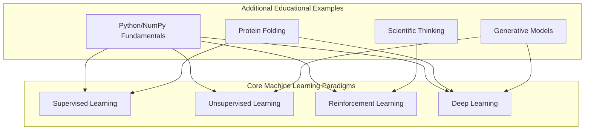
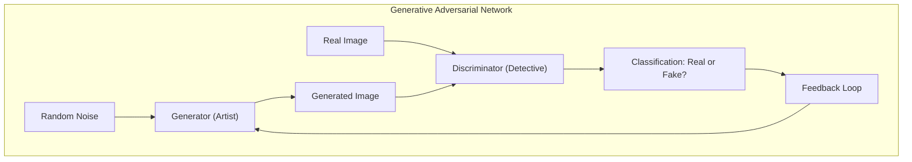
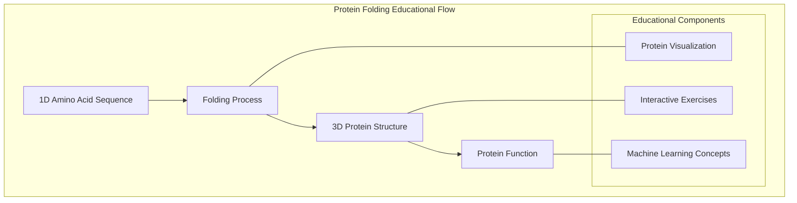
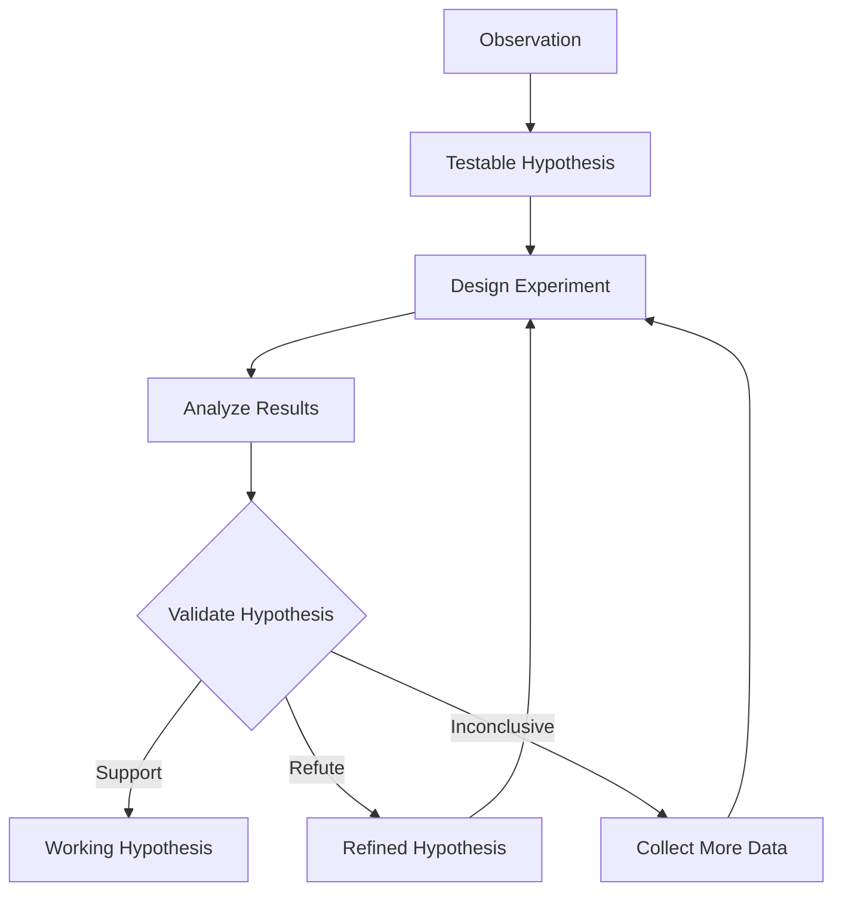
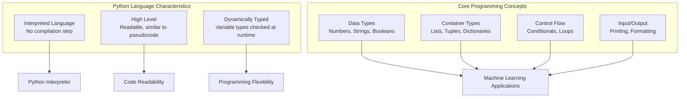
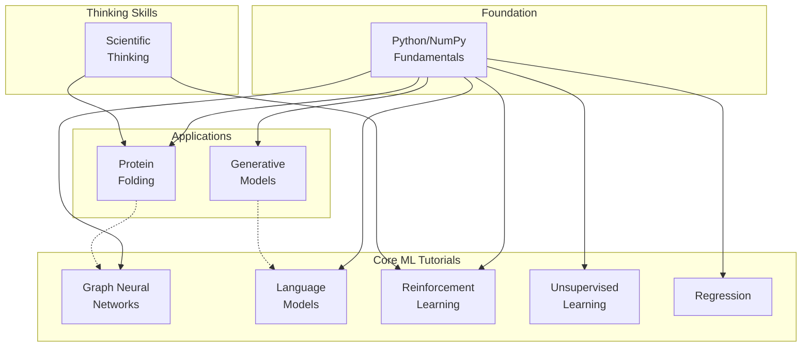

<!-- source: DeepWiki mcp.deepwiki.com · repo google-deepmind/educational · page 7 Additional Educational Examples · fetched 2026-10-26 -->

# Additional Educational Examples

Relevant source files

The following files were used as context for generating this wiki page:

- [colabs/introductory/generative_models.ipynb](colabs/introductory/generative_models.ipynb)
- [colabs/introductory/protein_folding.ipynb](colabs/introductory/protein_folding.ipynb)
- [colabs/introductory/scientific_thinking.ipynb](colabs/introductory/scientific_thinking.ipynb)
- [colabs/summer_schools/intro_to_python_numpy_for_deep_learning.ipynb](colabs/summer_schools/intro_to_python_numpy_for_deep_learning.ipynb)

This page provides an overview of the supplementary educational materials in the repository that extend beyond the core machine learning tutorials. These additional examples offer complementary perspectives on machine learning and educational foundations that support understanding of the main concepts. This page covers the educational examples that don't have their own dedicated sections, including generative models, protein folding, scientific thinking, and Python/NumPy fundamentals.

## Contents and Purpose

The additional educational examples serve several specific purposes:

1. **Introduce specialized application areas** of machine learning (generative models, protein folding)
2. **Develop foundational thinking skills** needed for machine learning research (scientific thinking)
3. **Build technical foundations** required for working with the other tutorials (Python/NumPy)

These examples supplement the core tutorials on [Graph Neural Networks](#2), [Language Models](#3), [Unsupervised Learning](#4), [Regression](#5), and [Reinforcement Learning](#6).

Sources: Files overview from repository structure

## Generative Models and GANs

The Generative Models notebook introduces users, particularly those interested in STEM and Artificial Intelligence, to the world of generative models - algorithms that can generate realistic novel creations like images, text, and music.

### Overview and Educational Approach

The notebook takes an interactive approach through a "Real or Fake" quiz that challenges users to distinguish between AI-generated and real images. This hands-on experience immediately demonstrates the power of modern generative models and engages students before diving into the technical concepts.

Sources: [colabs/introductory/generative_models.ipynb:319-373]()

### Key Components and Implementation

The generative model featured in the notebook is a GAN (Generative Adversarial Network), consisting of two competing neural networks:

1. **The Artist (Generator)** - Creates images that look realistic
2. **The Detective (Discriminator)** - Tries to determine if images are real or fake

The notebook explains this adversarial process using accessible language and visual metaphors, describing how both networks improve through competition - the generator creating increasingly realistic images and the discriminator becoming better at detection.

| Component | Role | Implemented In |
|-----------|------|----------------|
| Generator | Creates images from random noise | BigGAN model loaded from TensorFlow Hub |
| Discriminator | Classifies images as real or fake | Not directly implemented in the notebook |
| Quiz Interface | Tests human ability to distinguish real/fake | Custom quiz UI using JavaScript callbacks |
| Image Combination | Shows creative combinations of categories | Interpolation between category embeddings |

Sources: [colabs/introductory/generative_models.ipynb:349-382](), [colabs/introductory/generative_models.ipynb:411-425]()

### Creative Imagination Demonstration

A key feature of the notebook is demonstrating how generative models can exhibit "imagination" by:
- Creating objects that don't exist in the real world
- Combining features of different object categories
- Interpolating between different object concepts

Users can select different object categories and observe how the model combines them, providing an intuitive understanding of the latent space concept in generative models.

Sources: [colabs/introductory/generative_models.ipynb:411-442]()

## Protein Folding

The Protein Folding notebook introduces students to fundamental concepts in machine learning through the lens of a simplified protein folding problem. This notebook is separate from and unrelated to DeepMind's AlphaFold algorithm, serving purely as an educational introduction to the concepts.

### Problem Context and Significance

The notebook introduces proteins as essential building blocks of life that start as one-dimensional chains of amino acids and fold into 3D structures. It explains how understanding this folding process is one of the most challenging problems in biology, with significant implications for medicine and biotechnology.

Sources: [colabs/introductory/protein_folding.ipynb:21-35]()

### Interactive Learning Approach

The notebook takes a hands-on approach, with three progressive problems that teach core concepts:

1. **Problem #1**: Fix a misfolded protein with a known bond number and rotation angle
2. **Problem #2**: Fix a misfolded protein with an unknown bond number but known angle range
3. **Problem #3**: Fix a misfolded protein with both unknown bond number and angle

Each problem increases in difficulty and introduces different aspects of scientific problem-solving and machine learning concepts.

| Problem | Bond Number | Rotation | Learning Goal |
|---------|-------------|----------|--------------|
| #1 | 165 (known) | 30° (known) | Basic rotation mechanics |
| #2 | 100-120 (unknown) | 42° (known) | Parameter search |
| #3 | Unknown | Unknown | Complete problem-solving |

Sources: [colabs/introductory/protein_folding.ipynb:362-426](), [colabs/introductory/protein_folding.ipynb:454-516](), [colabs/introductory/protein_folding.ipynb:550-606]()

### Machine Learning Integration

The notebook transitions from manual problem-solving to introducing machine learning concepts:

1. **Iterations and Variables**: Basic programming concepts to automate tasks
2. **Machine Learning Fundamentals**: Trial-and-error approach to improvement
3. **Gradient-Based Optimization**: Implicitly taught through the improvement process

The notebook culminates in coding a simple machine learning system that learns to fold proteins with multiple breakages, demonstrating the power of automated approaches over manual solutions.

Sources: [colabs/introductory/protein_folding.ipynb:802-841](), [colabs/introductory/protein_folding.ipynb:859-929]()

## Scientific Thinking

The Scientific Thinking notebook aims to develop scientific intuition and critical thinking skills fundamental to machine learning research and development. It focuses on teaching the scientific method and common pitfalls in hypothesis testing.

### The Scientific Method

The notebook breaks down the scientific method into three fundamental steps:

1. **Observation and Hypothesis Formation**: Making observations and forming testable and falsifiable hypotheses
2. **Experimentation and Analysis**: Designing experiments to test hypotheses and analyzing results
3. **Validation and Refinement**: Validating hypotheses based on results and refining as needed

Sources: [colabs/introductory/scientific_thinking.ipynb:599-708]()

### Cognitive Biases and Scientific Principles

The notebook addresses critical concepts in scientific thinking:

1. **Confirmation Bias**: The tendency to search for and favor information that confirms existing beliefs, demonstrated through an interactive number sequence game
2. **Occam's Razor**: The principle that simpler explanations are more likely to be correct, explained through everyday examples and mathematical probability

| Concept | Interactive Demonstration | Learning Goal |
|---------|---------------------------|--------------|
| Confirmation Bias | Number sequence puzzle | Recognizing tendency to confirm rather than test hypotheses |
| Occam's Razor | Probability calculations | Understanding why simpler explanations are often correct |
| Clever Hans Effect | Story of a "mathematical" horse | Learning to avoid over-attributing causality |

Sources: [colabs/introductory/scientific_thinking.ipynb:726-796](), [colabs/introductory/scientific_thinking.ipynb:799-961]()

### Integration with Reinforcement Learning

A unique aspect of this notebook is connecting scientific thinking to reinforcement learning, showing how agents face similar challenges to scientists:

1. Making observations about the environment
2. Forming hypotheses about what actions lead to rewards
3. Testing these hypotheses through exploration
4. Refining behavior based on results

The notebook uses interactive grid-world games where users must determine reward rules through experimentation, directly applying scientific thinking principles.

Sources: [colabs/introductory/scientific_thinking.ipynb:977-1011](), [colabs/introductory/scientific_thinking.ipynb:1060-1097]()

## Python and NumPy Fundamentals

The Python and NumPy Fundamentals notebook provides essential programming foundations needed to work with the other machine learning tutorials in the repository. It serves as a reference resource rather than a comprehensive Python or NumPy course.

### Python Language Fundamentals

The notebook introduces Python as an interpreted, high-level, and dynamically-typed programming language, explaining these characteristics through clear examples:

Sources: [colabs/summer_schools/intro_to_python_numpy_for_deep_learning.ipynb:107-206]()

### Core Python Types and Operations

The notebook covers essential Python data types and their manipulation:

| Type | Description | Machine Learning Relevance |
|------|-------------|---------------------------|
| Numbers | Integers, floats, operations | Mathematical computations |
| Strings | Text manipulation, formatting | Data processing, output formatting |
| Booleans | Logical values and operations | Conditional logic in algorithms |
| Lists | Ordered, mutable collections | Storing datasets, feature vectors |
| Tuples | Ordered, immutable collections | Fixed-structure data representation |
| Dictionaries | Key-value mappings | Feature mapping, vocabulary indexing |

The material includes practical examples of each type with operations that are commonly used in machine learning contexts.

Sources: [colabs/summer_schools/intro_to_python_numpy_for_deep_learning.ipynb:372-451](), [colabs/summer_schools/intro_to_python_numpy_for_deep_learning.ipynb:648-766](), [colabs/summer_schools/intro_to_python_numpy_for_deep_learning.ipynb:867-967]()

### NumPy for Scientific Computing

The notebook covers NumPy, the fundamental package for scientific computing in Python, which is essential for almost all machine learning applications:

1. **Array creation and manipulation**
2. **Matrix operations**
3. **Mathematical functions**
4. **Broadcasting**
5. **Indexing and slicing**

While the complete NumPy content is not visible in the provided file excerpt, the notebook explains how these operations form the foundation for deep learning implementations.

Sources: [colabs/summer_schools/intro_to_python_numpy_for_deep_learning.ipynb:1013-1018]()

## Relationships and Learning Pathway

The additional educational examples serve distinct but complementary roles in the learning pathway for machine learning:

Sources: Repository structure and file analysis

### Suggested Learning Sequence

For beginners in machine learning, following this learning sequence maximizes understanding:

1. Start with **Python/NumPy Fundamentals** to build technical programming foundations
2. Progress to **Scientific Thinking** to develop critical reasoning skills
3. Explore **Protein Folding** as a simple introduction to machine learning concepts
4. Try **Generative Models** to understand creative applications of machine learning
5. Then proceed to the core tutorials based on specific interests

This pathway ensures students have both the technical skills and conceptual understanding required for more advanced machine learning concepts.

Sources: Integration of file contents and repository structure

## Conclusion

The additional educational examples in this repository provide valuable supplementary material that enhances the core machine learning tutorials. They offer different entry points into machine learning concepts, from technical foundations (Python/NumPy) to scientific reasoning (Scientific Thinking) to specific applications (Generative Models and Protein Folding).

Together, these examples create a more complete educational package that addresses not just the "how" of machine learning algorithms, but also the "why" and "what for" - the reasoning, applications, and foundational skills that make machine learning accessible and meaningful to students from various backgrounds.

---

