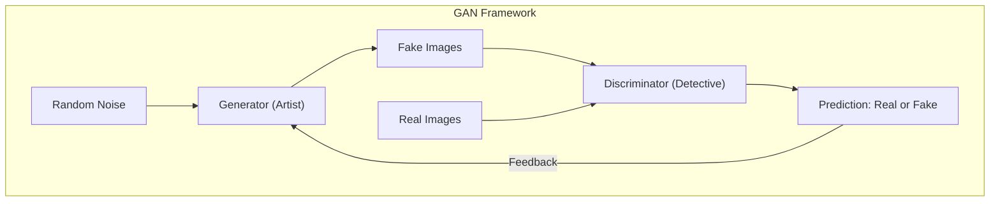
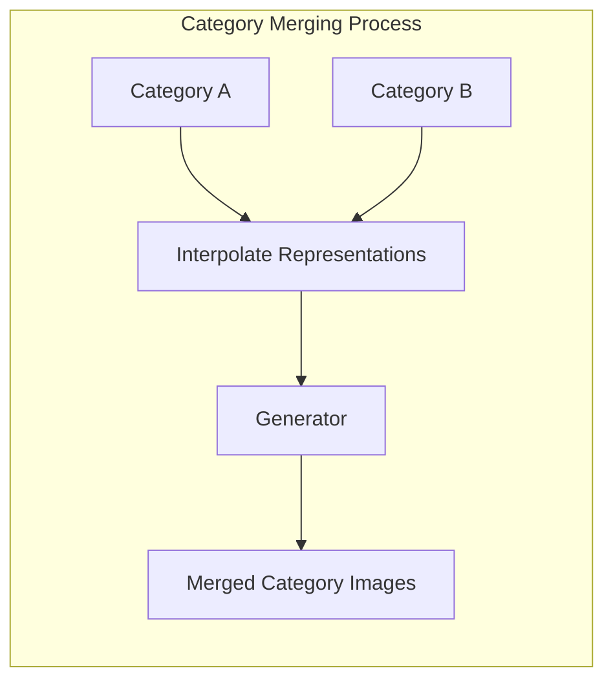
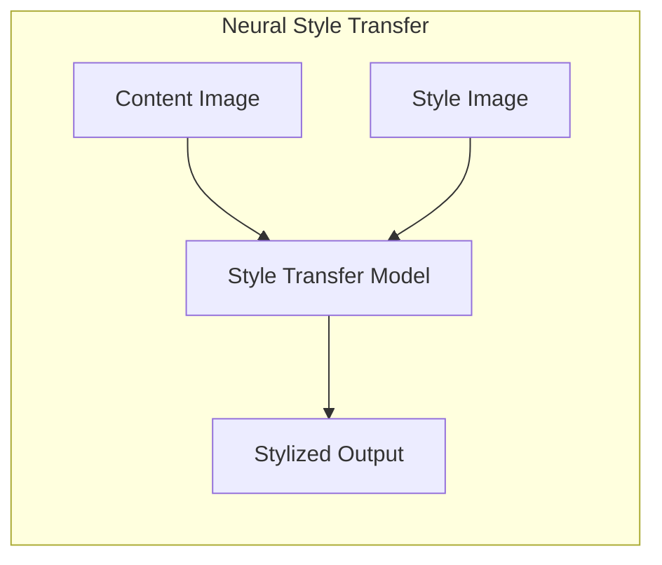
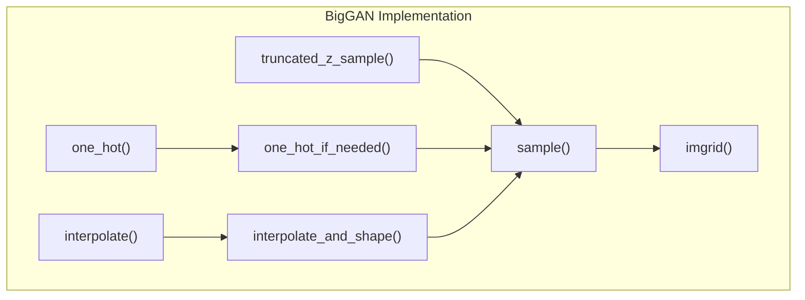
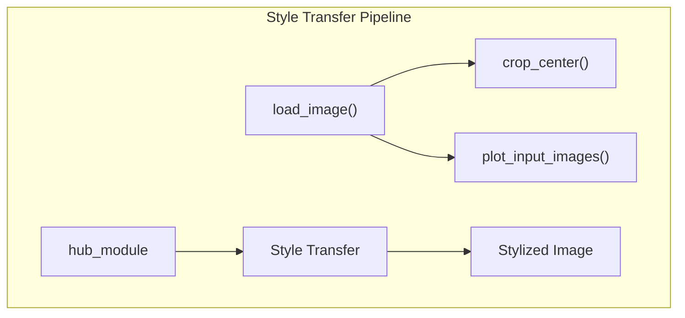
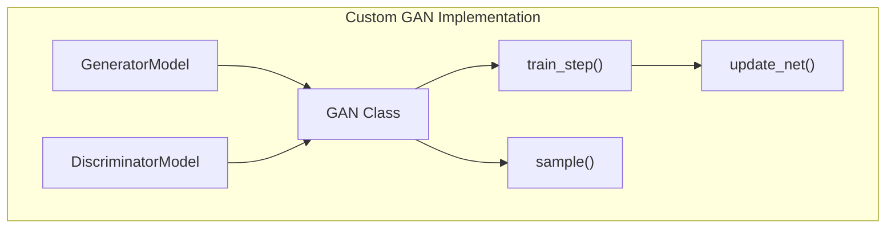
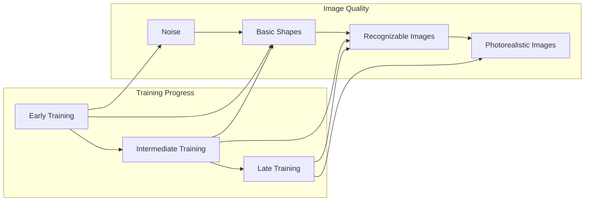
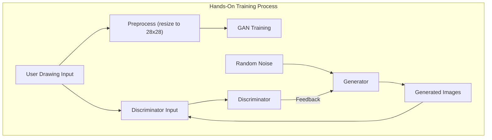

<!-- source: DeepWiki mcp.deepwiki.com · repo google-deepmind/educational · page 7.1 Generative Models and GANs · fetched 2026-10-26 -->

# Generative Models and GANs

Relevant source files

The following files were used as context for generating this wiki page:

- [colabs/introductory/generative_models.ipynb](colabs/introductory/generative_models.ipynb)

## Purpose and Scope

This document explains the Generative Models tutorial in the DeepMind Educational repository, which introduces learners to generative artificial intelligence, with a specific focus on Generative Adversarial Networks (GANs) and style transfer applications. The tutorial provides both conceptual understanding and hands-on experience with generative models through interactive Jupyter notebook examples.

Sources: [colabs/introductory/generative_models.ipynb:21-33]()

## Conceptual Overview of Generative Models

Generative models are a class of artificial intelligence systems that can create new content by learning patterns from existing data. Unlike discriminative models that classify or predict outputs based on inputs, generative models can produce entirely new outputs that resemble their training data. In the context of this tutorial, the focus is primarily on image generation.

The tutorial introduces generative models through an interactive "Real or Fake" quiz that demonstrates how advanced these models have become at creating realistic-looking images that can be difficult to distinguish from real photographs.

### GAN Architecture: The Artist and Detective

The primary generative model explored in this tutorial is the Generative Adversarial Network (GAN), which consists of two competing neural networks:

1. **Generator (Artist)**: Creates images from random noise, attempting to produce outputs that look realistic
2. **Discriminator (Detective)**: Tries to distinguish between real images and those created by the Generator

Through adversarial training, these networks compete and improve together - the Generator gets better at creating realistic images, while the Discriminator becomes more skilled at detecting fakes.

**GAN Architecture Diagram**

Sources: [colabs/introductory/generative_models.ipynb:338-372]()

## Key Capabilities of Generative Models

The tutorial demonstrates several key capabilities of generative models:

### 1. Creating Realistic Images

GANs can generate images that appear realistic and resemble real-world objects or scenes. The tutorial showcases this through the "Real or Fake" quiz using a pre-trained BigGAN model to generate images that can fool human observers.

### 2. Imagination and Category Merging

Generative models can display creativity by combining concepts. The tutorial demonstrates how GANs can merge different object categories (e.g., combining a fish and a dog) to create novel, imaginative images that don't exist in the real world.

**Category Merging Diagram**

Sources: [colabs/introductory/generative_models.ipynb:411-423]()

### 3. Style Transfer

Another generative technique demonstrated is neural style transfer, which applies the artistic style of one image to the content of another. This showcases how generative models can separate and recombine different aspects of images.

**Style Transfer Process**

Sources: [colabs/introductory/generative_models.ipynb:482-484]()

## Code Implementation

The tutorial's codebase includes several key components for implementing and demonstrating generative models:

### BigGAN Implementation

The first part of the tutorial uses a pre-trained BigGAN model from TensorFlow Hub to demonstrate image generation capabilities. The implementation includes helper functions for generating and displaying images.

**BigGAN Components**

Key components:
- `truncated_z_sample()`: Generates noise samples from a truncated Gaussian distribution
- `one_hot_if_needed()`: Creates one-hot vectors to encode labels
- `sample()`: Generates images using the BigGAN model
- `interpolate()`: Linearly interpolates between vectors for category merging
- `imgrid()`: Arranges images in a grid for display

Sources: [colabs/introductory/generative_models.ipynb:123-204]()

### Style Transfer Implementation

The style transfer section uses a pre-trained style transfer model from TensorFlow Hub. Key functions include image loading, preprocessing, and visualization.

Key components:
- `load_image()`: Loads and preprocesses images for style transfer
- `crop_center()`: Creates square images by cropping
- `plot_images()`: Visualizes the content, style, and output images

Sources: [colabs/introductory/generative_models.ipynb:516-571]()

### Custom GAN Implementation

The tutorial includes a simplified GAN implementation for hands-on learning. This implementation allows users to train a GAN on their own drawings.

| Component | Role | Implementation |
|-----------|------|----------------|
| `GeneratorModel` | Creates fake images from random noise | Neural network with dense layers and sigmoid activation |
| `DiscriminatorModel` | Distinguishes real from fake images | Neural network with dense layers and logit output |
| `GAN` | Manages adversarial training | Coordinates training and provides sampling functionality |
| `train_step()` | Performs one training iteration | Updates both generator and discriminator |
| `sample()` | Generates new images | Uses the generator to create outputs from random noise |

Sources: [colabs/introductory/generative_models.ipynb:1186-1265]()

## Training Process Visualization

The tutorial demonstrates how the generator improves over time through training. It visualizes samples from different stages of training to show the progression from random noise to coherent images.

**Training Evolution**

The training visualization is implemented through:
1. Storing samples at different training steps
2. Displaying them in a grid or animation
3. Showing the increasing sophistication of the generated images

Sources: [colabs/introductory/generative_models.ipynb:729-732](), [colabs/introductory/generative_models.ipynb:771-818]()

## Hands-On Experience

The tutorial provides an interactive experience where users can:

1. Draw their own images using a canvas interface
2. Train a simple GAN to reproduce similar images
3. Observe the training process in real-time
4. See how the generator's outputs evolve from random noise to resembling the input drawing

This section uses a simplified GAN architecture for faster training and immediate visual feedback:

The interactive elements are implemented using:
- HTML canvas for drawing input
- Image processing functions to prepare the drawing for training
- Real-time visualization of generator outputs during training
- A grid display showing the progression of generated images

Sources: [colabs/introductory/generative_models.ipynb:977-987](), [colabs/introductory/generative_models.ipynb:1268-1276]()

## Educational Value

This tutorial demonstrates the importance of generative models in artificial intelligence by showing how they enable:

1. Creative problem-solving through imagination
2. Generation of novel content that combines existing concepts
3. Understanding of the underlying patterns in data
4. Development of AI systems that can assist in creative fields

The tutorial frames generative models as a critical step toward AI systems that can help solve future challenges through creative approaches rather than just classification or prediction.

Sources: [colabs/introductory/generative_models.ipynb:381-403]()

## Summary

The Generative Models and GANs tutorial provides an accessible introduction to an important class of deep learning models. Through interactive demonstrations and hands-on exercises, it illustrates how GANs work, their capabilities, and their potential applications. The tutorial combines conceptual explanations with practical code implementations to give learners both theoretical understanding and practical experience with generative models.

---

