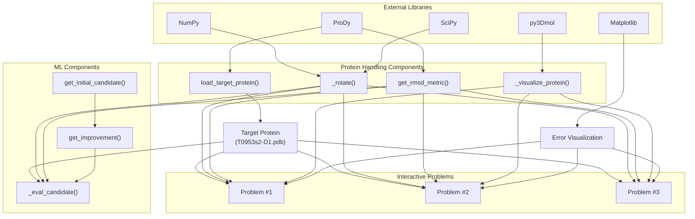
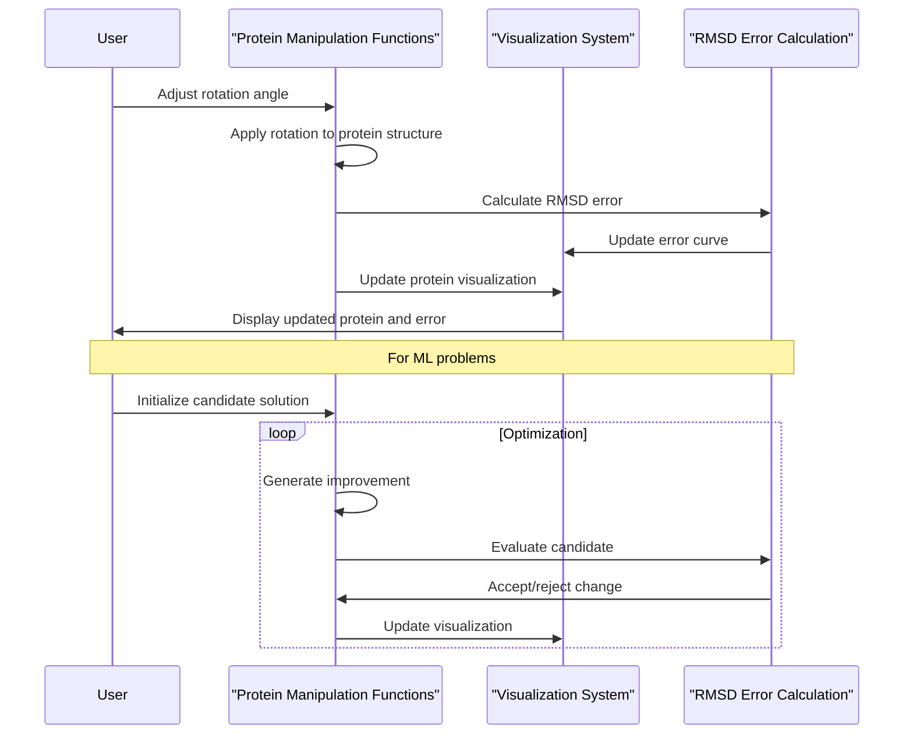
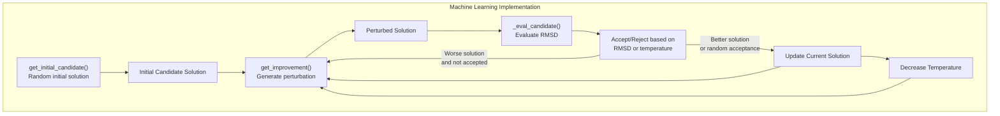

<!-- source: DeepWiki mcp.deepwiki.com · repo google-deepmind/educational · page 7.2 Protein Folding · fetched 2026-10-26 -->

# Protein Folding

Relevant source files

The following files were used as context for generating this wiki page:

- [colabs/introductory/protein_folding.ipynb](colabs/introductory/protein_folding.ipynb)

## Purpose and Scope

This document provides a technical overview of the Protein Folding educational module found in the Google DeepMind Educational repository. The module introduces the protein folding problem through a simplified interactive approach and demonstrates basic machine learning concepts by allowing users to solve toy protein folding problems.

The module is designed as an introductory-level educational tool, focusing on providing intuition about protein structure and optimization techniques rather than implementing state-of-the-art protein folding algorithms. This is explicitly not related to DeepMind's AlphaFold algorithm as stated in the notebook's disclaimer.

Sources: [colabs/introductory/protein_folding.ipynb:20-35]()

## Core Concepts

### Protein Folding Problem

Proteins are fundamental biological macromolecules that begin as one-dimensional chains of amino acids and fold into complex three-dimensional structures. The protein folding problem involves predicting the 3D structure of a protein from its amino acid sequence. This is a critical scientific challenge as a protein's function is determined by its shape.

The module simplifies this complex problem into an interactive demonstration where users correct misfolded proteins by manipulating specific rotation angles at particular bond positions.

Sources: [colabs/introductory/protein_folding.ipynb:21-29]()

### Educational Approach

The notebook implements a progression of challenges:
1. Basic protein manipulation with known rotation parameters
2. Finding correct parameters with partial information
3. Optimizing protein structure using simple machine learning techniques

This gradual increase in complexity helps users develop intuition about both protein structures and machine learning optimization approaches.

Sources: [colabs/introductory/protein_folding.ipynb:327-334]()

## System Architecture

### Component Overview

Sources: [colabs/introductory/protein_folding.ipynb:177-277](), [colabs/introductory/protein_folding.ipynb:866-929]()

### Data Flow

Sources: [colabs/introductory/protein_folding.ipynb:385-425](), [colabs/introductory/protein_folding.ipynb:866-929]()

## Implementation Details

### Core Functions

#### Protein Structure Manipulation

The system uses the following key functions to handle protein structures:

1. `_rotate()`: Splits a protein into two parts at a specified position and rotates the second part using Euler rotation angles.
   - Takes parameters: protein object, position (bond number), and angle triplet (x, y, z)
   - Uses SciPy's rotation transformations
   - Returns a new protein object with the applied rotation

2. `get_rmsd_metric()`: Calculates the Root-Mean-Square Deviation between two protein structures.
   - Used to measure the error between the current protein configuration and the target
   - Lower RMSD values indicate better solutions

Sources: [colabs/introductory/protein_folding.ipynb:240-253](), [colabs/introductory/protein_folding.ipynb:279-289]()

#### Visualization System

The module leverages py3Dmol for protein visualization:

1. `_visualize_protein()`: A wrapper around py3Dmol's functionality to display protein structures.
   - Renders proteins with cartoon representation for the backbone
   - Uses spectrum coloring to differentiate parts of the protein
   - Includes stick representation for hetero atoms and sphere representation for non-bonded atoms

2. `_view_results()`: Updates error plots dynamically using Matplotlib.
   - Displays the progression of RMSD values over optimization steps

Sources: [colabs/introductory/protein_folding.ipynb:214-238](), [colabs/introductory/protein_folding.ipynb:293-301]()

### Interactive Problems

The notebook implements three protein folding problems of increasing difficulty:

| Problem | Task | Challenge |
|---------|------|-----------|
| #1 | Fix a protein misfolded at bond 165 by 30 degrees | Known rotation angle and bond position |
| #2 | Fix a protein misfolded by 42 degrees at a bond between 100-120 | Known rotation angle, unknown bond position |
| #3 | Fix a protein misfolded with unknown parameters | Unknown rotation angle and bond position |

Each problem follows the same structure:
1. User adjusts parameters (bond position and angle)
2. System rotates the protein using these parameters
3. RMSD error is calculated and visualized
4. Protein visualizations are updated
5. User continues adjusting until the error is minimized

Sources: [colabs/introductory/protein_folding.ipynb:364-426](), [colabs/introductory/protein_folding.ipynb:454-516](), [colabs/introductory/protein_folding.ipynb:544-606]()

## Machine Learning Components

### Optimization Strategy

The machine learning section introduces a basic simulated annealing approach to protein structure optimization:

Sources: [colabs/introductory/protein_folding.ipynb:866-900]()

### Implementation Details

1. `get_initial_candidate()`: 
   - Initializes a random candidate solution with rotation angles between -180 and 180 degrees
   - Resets temperature parameter for simulated annealing

2. `get_improvement()`: 
   - Generates small perturbations (-5 to 5 degrees) to the current solution
   - Evaluates the perturbed solution using RMSD
   - Accepts improvements immediately
   - May accept worse solutions based on temperature (simulated annealing)
   - Gradually decreases temperature to reduce acceptance of worse solutions over time

3. `_eval_candidate()`:
   - Applies multiple rotations to the protein based on candidate solution
   - Calculates RMSD between the rotated protein and target structure

Sources: [colabs/introductory/protein_folding.ipynb:865-899]()

## Educational Progression

The notebook's structure guides users through progressively more complex concepts:

1. **Introduction to protein structure**
   - Visualization of complex proteins (ATP synthase)
   - Explanation of biological importance

2. **Basic structure manipulation**
   - Manual correction of misfolded proteins
   - Visual feedback on solution quality

3. **Programming concepts**
   - Variables
   - Iteration
   - Functions

4. **Machine learning principles**
   - Random initialization
   - Iterative improvement
   - Error measurement
   - Basic optimization algorithms

This progression is designed to build intuition about both protein structure and fundamental machine learning concepts.

Sources: [colabs/introductory/protein_folding.ipynb:132-148](), [colabs/introductory/protein_folding.ipynb:674-799]()

## Usage Notes

### Implementation Considerations

1. The notebook uses a simplified representation of protein folding, focusing on rotations around single bonds.

2. The actual protein data is downloaded from CASP13 (Critical Assessment of protein Structure Prediction), providing real protein structures for the exercises.

3. The notebook explicitly disclaims any relationship to DeepMind's AlphaFold algorithm, as it's meant to be purely educational.

4. The implementation prioritizes readability over computational efficiency, making it more accessible to non-technical audiences.

Sources: [colabs/introductory/protein_folding.ipynb:29-32](), [colabs/introductory/protein_folding.ipynb:261-268]()

### Technical Dependencies

The notebook requires several specialized libraries:
- BioPython: For general bioinformatics functionality
- ProDy: For protein structure manipulation and analysis
- py3Dmol: For interactive protein visualization
- NumPy/SciPy: For numerical operations and transformations
- Matplotlib: For visualization of error curves

Sources: [colabs/introductory/protein_folding.ipynb:187-191]()

---

