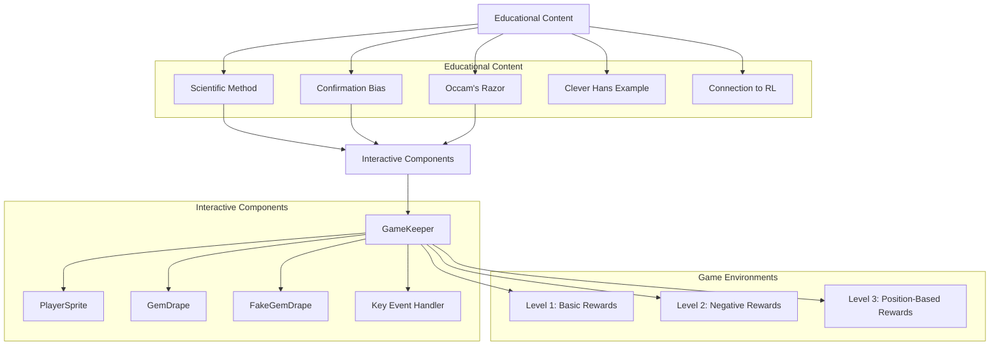
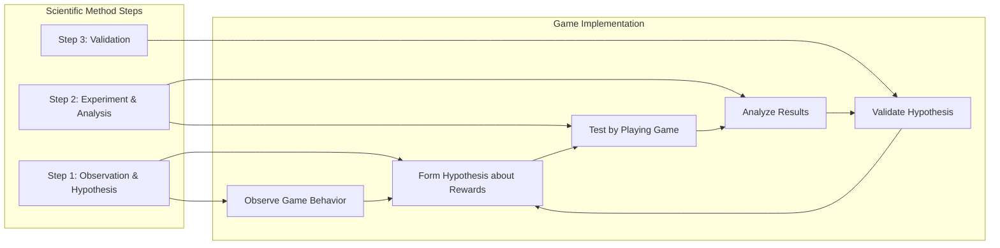
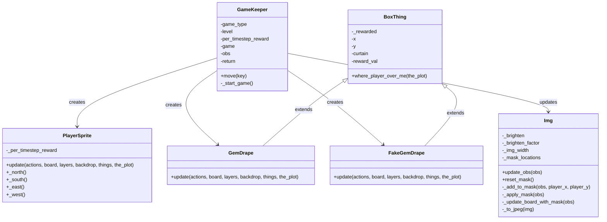
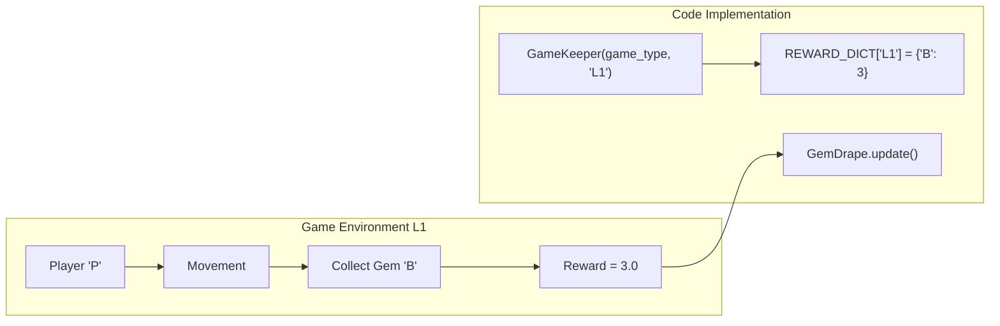
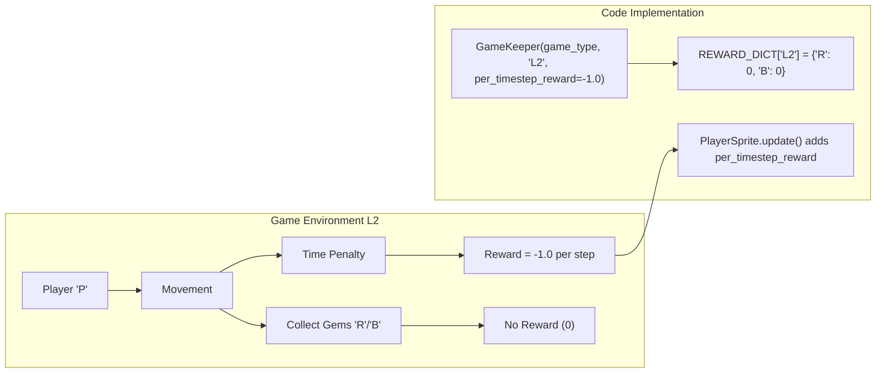
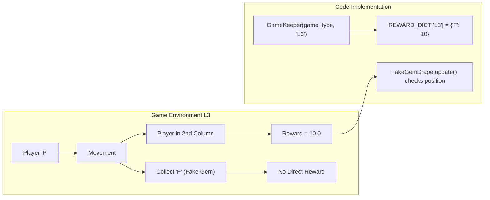
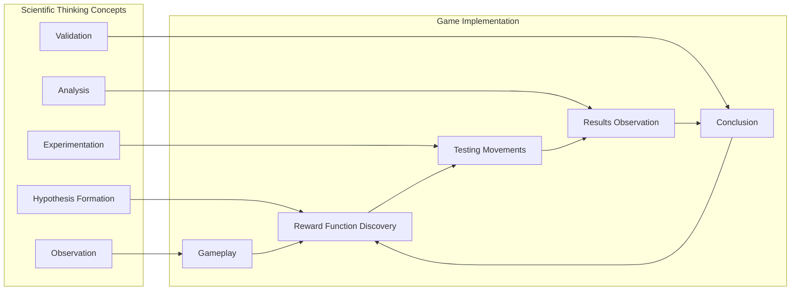
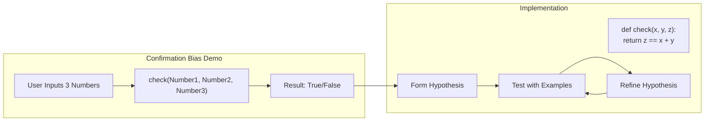

<!-- source: DeepWiki mcp.deepwiki.com · repo google-deepmind/educational · page 7.3 Scientific Thinking · fetched 2026-10-26 -->

# Scientific Thinking

<details>
<summary>Relevant source files</summary>

The following files were used as context for generating this wiki page:

- [colabs/introductory/scientific_thinking.ipynb](colabs/introductory/scientific_thinking.ipynb)

</details>


## Purpose and Scope

This document provides a technical overview of the Scientific Thinking interactive notebook in the Google DeepMind Educational repository. The notebook teaches fundamental concepts of scientific thinking through explanatory content and interactive game-based examples implemented with PyColab. Users learn about the scientific method, confirmation bias, Occam's Razor, and how these concepts relate to reinforcement learning through hands-on experimentation.

Sources: [colabs/introductory/scientific_thinking.ipynb:30-41]()

## System Overview

The Scientific Thinking notebook integrates educational content with interactive games, allowing users to apply scientific thinking principles in a controlled environment. The system consists of several components that work together to provide an engaging learning experience.



Sources: [colabs/introductory/scientific_thinking.ipynb:584-613](), [colabs/introductory/scientific_thinking.ipynb:614-726]()

## Scientific Method Implementation

The notebook first introduces the scientific method and its three main steps through explanatory content. This provides the theoretical foundation for the interactive components that follow.



Sources: [colabs/introductory/scientific_thinking.ipynb:614-708]()

## Game Architecture

The interactive games are built using PyColab, with several key classes handling different aspects of the game mechanics, rendering, and user interaction.



Sources: [colabs/introductory/scientific_thinking.ipynb:246-313](), [colabs/introductory/scientific_thinking.ipynb:449-543]()

## Game Mechanics and Reward Functions

The notebook features three distinct game environments, each with unique reward structures that users must discover through experimentation:

### Level 1: Basic Gem Rewards

In this level, players navigate a grid world where blue gems provide rewards when collected.



Sources: [colabs/introductory/scientific_thinking.ipynb:334-347](), [colabs/introductory/scientific_thinking.ipynb:307-313]()

### Level 2: Negative Rewards

Level 2 introduces a time penalty where each step costs the player -1.0 reward, encouraging efficient pathfinding.



Sources: [colabs/introductory/scientific_thinking.ipynb:379-395](), [colabs/introductory/scientific_thinking.ipynb:262-264]()

### Level 3: Position-Based Rewards

Level 3 introduces a more complex reward mechanism where rewards depend on the player's position rather than just collecting objects.



Sources: [colabs/introductory/scientific_thinking.ipynb:398-442](), [colabs/introductory/scientific_thinking.ipynb:314-326]()

## User Interaction Components

The notebook implements a custom interactive interface that allows users to control the agent using keyboard inputs and view the game state visually.

```mermaid
flowchart TB
    subgraph "User Interface Components"
        KB["Keyboard Input"] --> JS["JavaScript Event Handler"]
        JS --> CB["Callback 'notebook.UpdateImg'"]
        CB --> GK["GameKeeper.move()"]
        GK --> GM["game.play(action)"]
        GM --> U["Update Game State"]
        U --> I["Img.update_obs()"]
        I --> R["Render Updated Board"]
    end

    subgraph "Board Rendering"
        OB["Observation Board"] --> UM["_update_board_with_mask()"]
        UM --> TI["to_img()"]
        TI --> JP["_to_jpeg()"]
        JP --> DS["Display Image"]
    end
```



Sources: [colabs/introductory/scientific_thinking.ipynb:449-508](), [colabs/introductory/scientific_thinking.ipynb:544-575]()

## Integration with Scientific Concepts

The notebook creates a direct parallel between scientific thinking processes and reinforcement learning, with the interactive games serving as practical examples of hypothesis formation and testing.



Sources: [colabs/introductory/scientific_thinking.ipynb:970-977](), [colabs/introductory/scientific_thinking.ipynb:998-1051]()

## Confirmation Bias Challenge

The notebook includes an interactive example demonstrating confirmation bias, where users must discover a rule based on numeric triplets.



Sources: [colabs/introductory/scientific_thinking.ipynb:728-763](), [colabs/introductory/scientific_thinking.ipynb:772-786]()

## Game Maps and Level Design

The game environments are defined using ASCII art representations, which are converted to interactive game elements.

### Map Definitions

The game maps are defined as ASCII art strings in the `EXPERIMENT_GAMES` and `EVAL_GAMES` dictionaries:

| Level | Game Type | Map Structure | Key Elements |
|-------|-----------|---------------|-------------|
| L1 | Experiment | 13x13 grid | 'B' (Blue gems), 'P' (Player) |
| L1 | Eval | 13x13 grid | 'B' (Blue gems), '-' (Path), 'P' (Player) |
| L2 | Experiment | 13x13 grid | 'B' (Blue gems), 'R' (Red gem), 'P' (Player) |
| L2 | Eval | 13x13 grid | 'B' (Blue gems), 'R' (Red gem), '-' (Path), 'P' (Player) |
| L3 | Experiment | 13x13 grid | 'F' (Fake gems), '@' (Fake walls), 'P' (Player) |
| L3 | Eval | 13x13 grid | 'F' (Fake gems), '-' (Path), '@' (Fake walls), 'P' (Player) |

Sources: [colabs/introductory/scientific_thinking.ipynb:328-442]()

## Reward Structures

The rewards for each level are defined in the `REWARD_DICT` dictionary:

| Level | Reward Structure | Implementation |
|-------|------------------|----------------|
| L1 | {'B': 3} | Blue gems provide 3.0 reward when collected |
| L2 | {'R': 0, 'B': 0} | No reward from gems, -1.0 per step from per_timestep_reward |
| L3 | {'F': 10} | Fake gems provide 10.0 reward only when player is in second column |

Sources: [colabs/introductory/scientific_thinking.ipynb:347](), [colabs/introductory/scientific_thinking.ipynb:394](), [colabs/introductory/scientific_thinking.ipynb:440]()

## Key Implementation Details

### PlayerSprite Movement

The `PlayerSprite` class is responsible for handling player movement and interactions:

```python
def update(self, actions, board, layers, backdrop, things, the_plot):
    """Update the player sprite position based on the action."""
    del layers, backdrop   # Unused.
    the_plot.add_reward(self._per_timestep_reward)

    # Apply motion commands.
    if actions == 0:    # walk upward?
      self._north(board, the_plot)
    elif actions == 1:  # walk downward?
      self._south(board, the_plot)
    elif actions == 2:  # walk leftward?
      self._west(board, the_plot)
    elif actions == 3:  # walk rightward?
      self._east(board, the_plot)
    elif actions == 4:
      the_plot.terminate_episode()
```

Sources: [colabs/introductory/scientific_thinking.ipynb:260-275]()

### Gem Drape Update Logic

The `GemDrape` and `FakeGemDrape` classes handle reward logic when interacting with gems:

- `GemDrape` provides a reward when the player overlaps with it:
```python
def update(self, actions, board, layers, backdrop, things, the_plot):
    """Sets a reward when the player sprite overlaps with the gem."""
    if self.where_player_over_me(the_plot) and not self._rewarded:
      the_plot.add_reward(self.reward_val)
      self._rewarded = True
```

- `FakeGemDrape` provides a reward based on player's position:
```python
def update(self, actions, board, layers, backdrop, things, the_plot):
    """Sets a reward whenever the player is in the second column."""
    for row in board:
      # 80 is the player.
      if 80 in row:
        pos = np.where(row == 80)[0][0]
    if pos == 2 and not self._rewarded:
      the_plot.add_reward(self.reward_val)
      self._rewarded = True
```

Sources: [colabs/introductory/scientific_thinking.ipynb:306-326]()

## Conclusion

The Scientific Thinking notebook effectively integrates educational content about scientific methodology with interactive game experiences. Through three progressively complex game environments, users can actively practice forming and testing hypotheses about reward functions, mirroring the scientific process. The implementation leverages PyColab for game mechanics and custom HTML/JavaScript components for user interaction, creating an engaging learning experience about scientific thinking concepts.

---

