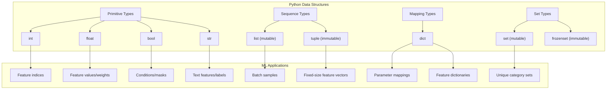
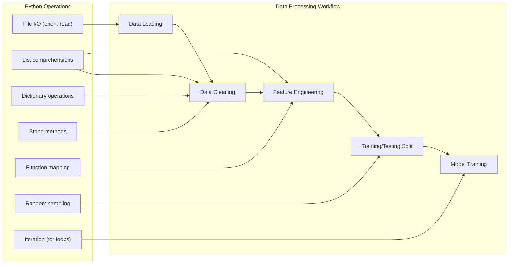
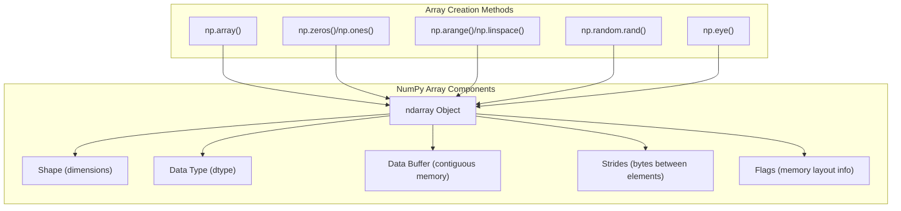
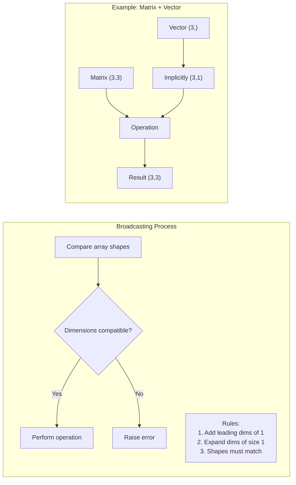
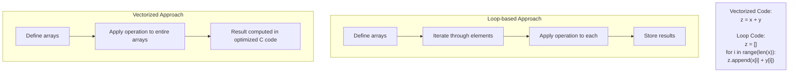
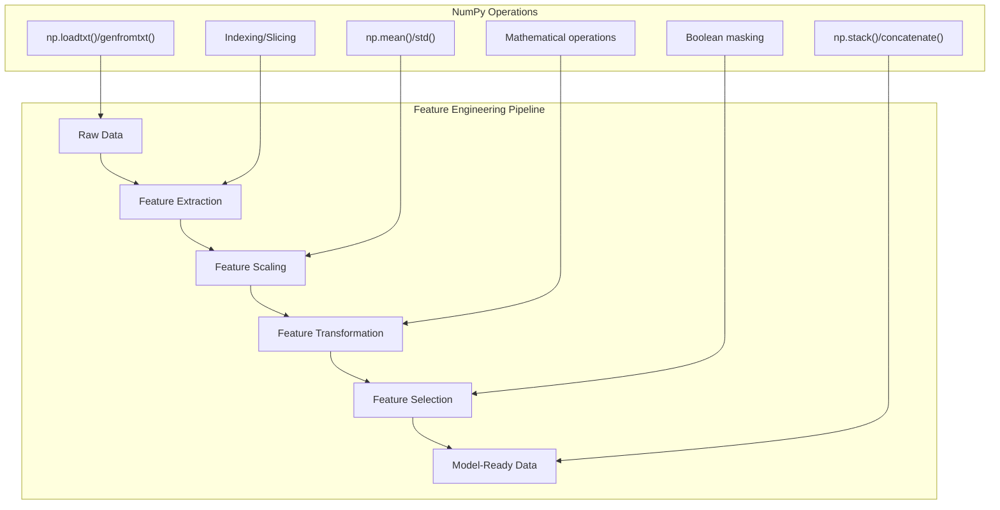
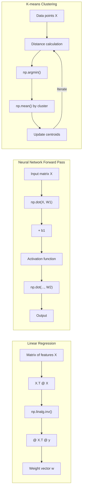
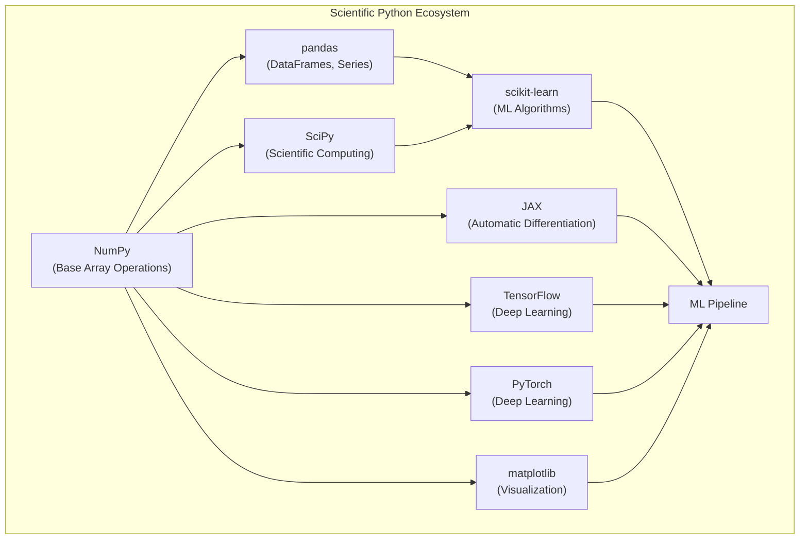
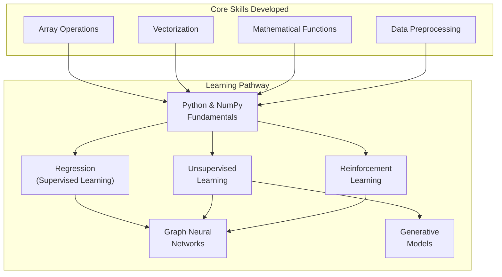

<!-- source: DeepWiki mcp.deepwiki.com · repo google-deepmind/educational · page 7.4 Python and NumPy Fundamentals · fetched 2026-10-26 -->

# Python and NumPy Fundamentals

Relevant source files

The following files were used as context for generating this wiki page:

- [colabs/summer_schools/intro_to_python_numpy_for_deep_learning.ipynb](colabs/summer_schools/intro_to_python_numpy_for_deep_learning.ipynb)

## Purpose and Scope

This document provides a technical overview of Python and NumPy fundamentals as taught in the Google DeepMind Educational Repository. These materials serve as the foundation for scientific computing and machine learning implementation, covering essential programming concepts and numerical computation tools. This material is designed as an entry point for those starting with machine learning and serves as a prerequisite for more advanced tutorials including [Supervised Learning: Regression](#5), [Unsupervised Learning](#4), and [Reinforcement Learning](#6).

## Python for Scientific Computing

Python has become the predominant language for machine learning implementation due to its readability, extensive library ecosystem, and flexibility for both prototyping and production. The fundamental Python concepts covered in this tutorial include data structures, functions, control flow, and object-oriented programming.

### Python Data Structures for Machine Learning

Python's built-in data structures provide the foundation for representing, manipulating, and processing data in machine learning applications.

#### Core Data Structure Hierarchy

Sources: Common Python data structures used in machine learning applications

### Key Python Operations for Data Processing

Sources: Standard Python operations used in data processing pipelines

## NumPy Fundamentals

NumPy (Numerical Python) is the cornerstone library for scientific computing in Python, providing efficient array operations essential for machine learning implementations.

### NumPy Array Architecture

The `ndarray` (N-dimensional array) is NumPy's primary data structure, offering significant advantages over Python's built-in lists for numerical computation.

Sources: NumPy array core components and creation methods

### NumPy vs Python Lists

| Feature | NumPy Arrays | Python Lists |
|---------|--------------|--------------|
| Memory layout | Contiguous, homogeneous | Scattered, heterogeneous |
| Size overhead | Lower (fixed type) | Higher (per-element type info) |
| Speed of operations | Fast (vectorized C implementations) | Slow (interpreted Python loops) |
| Mathematical operations | Built-in efficient operations | Require explicit iteration |
| Shape manipulation | Support for n-dimensional reshaping | Only 1-dimensional |
| Broadcasting | Automatic operations on different shapes | Not available |
| Memory efficiency | High (homogeneous types) | Low (pointers to objects) |

Sources: Comparative analysis of NumPy arrays vs Python lists

### Core NumPy Operations for Machine Learning

```mermaid
flowchart TD
    subgraph "Array Manipulation"
        A1["Creation"] --> A11["np.array()"]
        A1 --> A12["np.zeros()"]
        A1 --> A13["np.ones()"]
        A1 --> A14["np.arange()"]
        A1 --> A15["np.random.randn()"]
        
        A2["Reshaping"] --> A21["reshape()"]
        A2 --> A22["transpose()"]
        A2 --> A23["flatten()"]
        
        A3["Indexing"] --> A31["Basic indexing"]
        A3 --> A32["Boolean masking"]
        A3 --> A33["Fancy indexing"]
    end
    
    subgraph "Mathematical Operations"
        B1["Element-wise"] --> B11["add, subtract"]
        B1 --> B12["multiply, divide"]
        B1 --> B13["sqrt, exp, log"]
        
        B2["Aggregation"] --> B21["sum(), mean()"]
        B2 --> B22["min(), max()"]
        B2 --> B23["std(), var()"]
        
        B3["Linear Algebra"] --> B31["dot(), matmul()"]
        B3 --> B32["inv(), solve()"]
        B3 --> B33["eig(), svd()"]
    end
    
    subgraph "ML Applications"
        C1["Data Preprocessing"]
        C2["Feature Engineering"]
        C3["Model Implementation"] 
        C4["Evaluation Metrics"]
    end
    
    A1 --> C1
    A2 --> C2
    A3 --> C1
    A3 --> C2
    
    B1 --> C2
    B1 --> C3
    B2 --> C4
    B3 --> C3
```

Sources: Core NumPy operations used in machine learning implementations

## Broadcasting and Vectorization

Broadcasting and vectorization are key concepts in NumPy that enable efficient operations on arrays without explicit loops.

### Broadcasting Rules

Sources: NumPy broadcasting concept and rules

### Vectorization Performance

Vectorized operations eliminate explicit loops by operating on entire arrays at once, resulting in significantly faster execution.

Sources: Comparative analysis of vectorized vs loop-based operations

## NumPy for Machine Learning Applications

NumPy provides the foundation for machine learning implementations through efficient numerical operations and data manipulation capabilities.

### Feature Engineering with NumPy

Sources: NumPy operations in feature engineering pipelines

### NumPy in Machine Learning Algorithms

Sources: NumPy implementation of common machine learning algorithms

## Integration with Scientific Python Ecosystem

NumPy serves as the foundation for many scientific Python libraries that build upon its efficient array operations.

Sources: Integration of NumPy with the scientific Python ecosystem

## Python and NumPy in the Educational Repository

This tutorial serves as the foundation for other tutorials in the repository, providing the essential programming concepts needed to implement more advanced machine learning algorithms.

Sources: Educational pathway in the repository

## Conclusion

Python and NumPy form the essential foundation for machine learning implementation, providing efficient data structures and numerical operations that are leveraged throughout the educational repository. These fundamentals enable the implementation of complex algorithms in an efficient and readable manner, serving as prerequisites for the more advanced tutorials in supervised learning, unsupervised learning, and reinforcement learning.

The NumPy paradigm of vectorized operations on n-dimensional arrays extends naturally to specialized frameworks like JAX, TensorFlow, and PyTorch, which build upon these concepts with additional capabilities for automatic differentiation and accelerated computation on GPUs.

Sources: Summary of Python and NumPy's role in the educational repository

---

