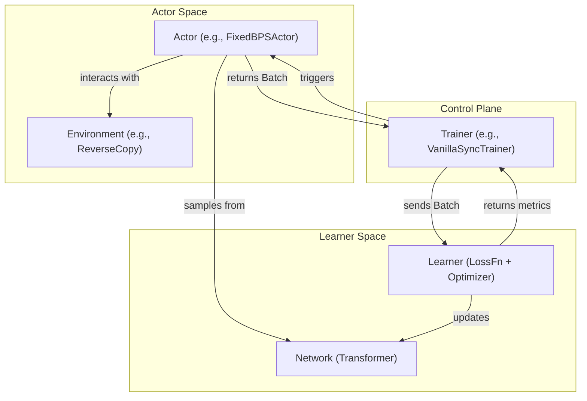
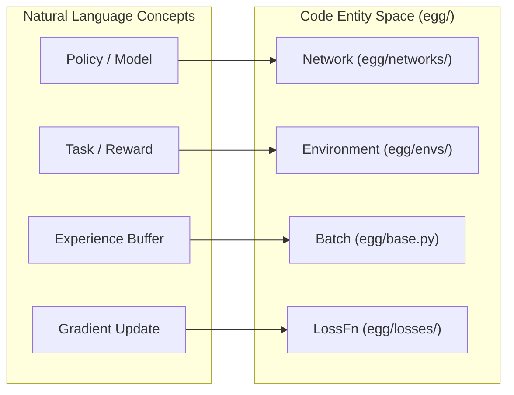

<!-- source: DeepWiki mcp.deepwiki.com · repo google-deepmind/egg · page 1 Overview · fetched 2026-10-26 -->

# Overview

Relevant source files

The following files were used as context for generating this wiki page:

- [Makefile](Makefile)
- [README.md](README.md)
- [egg/__init__.py](egg/__init__.py)

`egg` is a minimal, CPU-friendly simulation framework designed for exploring Reinforcement Learning (RL) on Language Models (LMs). Its primary goal is to provide a transparent, "algorithm-first" incubator where new RL techniques—such as the **Delightful Policy Gradient (DPG)**—can be prototyped and understood before being deployed to full-scale distributed training systems [README.md:1-15]().

The codebase is structured to mirror paper pseudocode, prioritizing readability and rapid iteration over complex abstractions [README.md:12-15]().

## System Philosophy

The design of `egg` revolves around a few core pillars:
*   **Tiny + Transparent**: Minimal dependencies and no hidden framework "magic" [README.md:12-12]().
*   **Algorithm-first**: The code is structured to make the mathematical logic of the RL algorithms explicit [README.md:13-13]().
*   **Insightful**: While the environments are small (e.g., bit parity, reverse copy), the insights gained regarding gradient variance, exploration, and parameter lag are intended to transfer to large-scale LLM training [README.md:15-15]().

## High-Level Architecture

The framework operates on a cyclic interaction between three main functional entities: the **Actor**, the **Learner**, and the **Trainer**.

### Component Interaction Flow

The following diagram illustrates how these entities interact to form the training loop.

**Logic Flow: Data and Parameter Exchange**

Sources: [README.md:1-15](), [Makefile:36-37]()

### Bridging Natural Language to Code Entities

In `egg`, concepts from the RL literature are mapped directly to specific Python classes and protocols.

**Entity Mapping: RL Concepts to Code**

Sources: [README.md:12-15](), [Makefile:31-33]()

## Subsystem Summaries

### 1. Getting Started
The project uses a standard Python ecosystem (`pip`, `venv`, `pytest`). It includes a `Makefile` to streamline installation and running baseline experiments [README.md:17-33](), [Makefile:1-42]().
*   For details, see [Getting Started](#1.1).

### 2. Environments
`egg` includes a variety of synthetic tasks designed to test specific capabilities of RL agents, such as `ReverseCopy` or `SubsequenceMatch`. These are often wrapped in noise or prompt-modifying wrappers to simulate different training conditions.
*   For details, see [Environments](#2).

### 3. Actors
Actors are responsible for the "rollout" phase. They use a `Network` to sample actions from an `Environment` and package the results into a `Batch` object for the learner.
*   For details, see [Actors](#3).

### 4. Networks
The default backbone is a decoder-only `Transformer`. The framework also supports specialized modules for logit noise and quantization to study the robustness of RL algorithms.
*   For details, see [Networks](#4).

### 5. Loss Functions
This is the heart of the "algorithm-first" philosophy. `egg` implements standard RL losses (REINFORCE, PPO) alongside novel ones like **Delightful Gradient (DG)**, which uses "delight" (advantage × surprisal) to gate updates.
*   For details, see [Loss Functions](#5).

### 6. Trainers
Trainers orchestrate the loop between Actors and Learners. `egg` provides both a `VanillaSyncTrainer` for standard runs and a `VanillaAsyncTrainer` to simulate parameter lag in distributed settings.
*   For details, see [Trainers](#6).

### 7. Experiments
The `experiments/` directory contains concrete implementations of research papers. For example, `experiments/baseline/run.py` provides a simple entry point to verify the installation and core logic [README.md:37-41](), [Makefile:36-37]().
*   For details, see [Experiments](#7).

### 8. Utility Libraries
Common logic for autoregressive sampling (`ARSampler`), logging, and statistical calculations are centralized in `egg/lib/` to keep the core algorithms clean.
*   For details, see [Utility Libraries](#8).

---
Sources: [README.md:1-97](), [Makefile:1-42](), [egg/__init__.py:1-17]()

---

