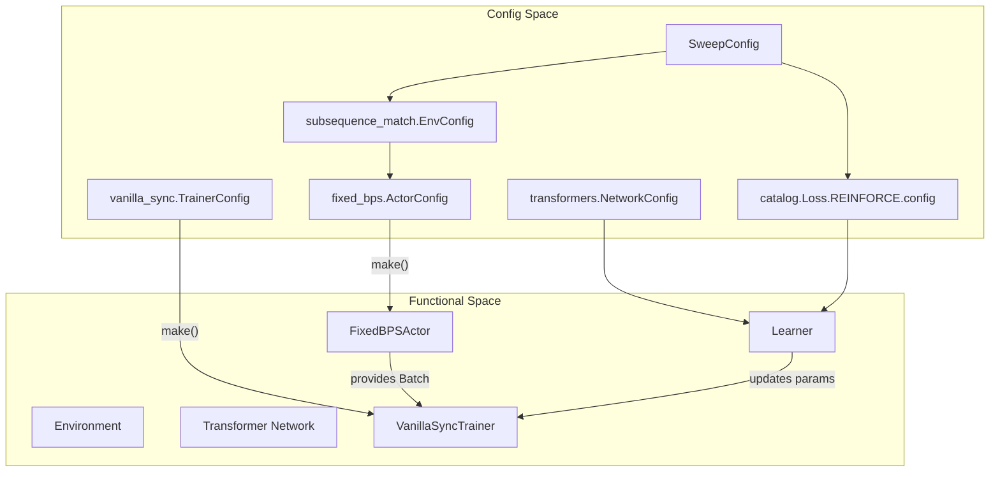
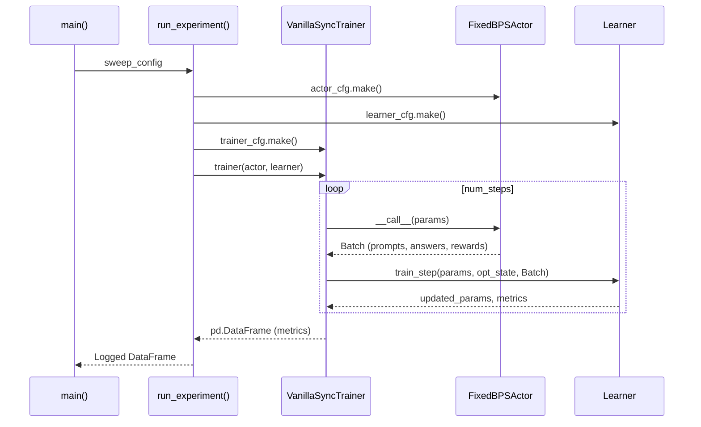

<!-- source: DeepWiki mcp.deepwiki.com · repo google-deepmind/egg · page 1.1 Getting Started · fetched 2026-10-26 -->

# Getting Started

<details>
<summary>Relevant source files</summary>

The following files were used as context for generating this wiki page:

- [Makefile](Makefile)
- [experiments/baseline/__init__.py](experiments/baseline/__init__.py)
- [experiments/baseline/run.py](experiments/baseline/run.py)
- [pyproject.toml](pyproject.toml)
- [requirements.txt](requirements.txt)

</details>


This page provides a technical guide for setting up the `egg` codebase, understanding its project structure, and executing the baseline reinforcement learning experiment. `egg` is designed as a minimal incubator for RL on language models, optimized for CPU-friendly experimentation using JAX and Flax.

## Installation and Environment Setup

The project uses a standard Python ecosystem centered around `pyproject.toml` and a `Makefile` to automate environment provisioning.

### Dependencies
The core dependencies are managed in `pyproject.toml` [6:30]() and `requirements.txt` [1:7](). Key libraries include:
*   **JAX & Flax**: The numerical and neural network foundations [pyproject.toml:23-24]().
*   **Optax**: Gradient processing and optimization [pyproject.toml:25]().
*   **Fancyflags**: For structured, type-safe command-line configuration [pyproject.toml:29]().
*   **Pandas**: Used for logging and metrics aggregation [pyproject.toml:26]().

### Setup via Makefile
The `Makefile` provides a streamlined interface for developers:

| Target | Action |
| :--- | :--- |
| `make install` | Creates a virtual environment (`.venv`), upgrades `pip`, and installs the package in editable mode with test dependencies [Makefile:24-27](). |
| `make test` | Discovers and runs all `*_test.py` files within the `experiments` directory using `pytest` [Makefile:29-34](). |
| `make run` | Executes a short (10-step) version of the baseline experiment to verify the installation [Makefile:36-37](). |
| `make clean` | Removes the `.venv`, build artifacts, and `__pycache__` directories [Makefile:39-42](). |

Sources: [Makefile:1-42](), [pyproject.toml:1-44](), [requirements.txt:1-8]()

## Project Layout

The codebase is organized into two primary top-level packages: `egg` (the framework) and `experiments` (concrete implementations and research suites).

### Framework: `egg/`
This directory contains the core abstractions and modular components:
*   `egg/base.py`: Defines the foundational protocols and the `MakeableConfig` factory pattern.
*   `egg/actors/`: Logic for generating experience batches (e.g., `fixed_bps.py`).
*   `egg/environments/`: Task definitions and reward functions.
*   `egg/networks/`: Neural architectures, including Transformers.
*   `egg/losses/`: Implementations of RL loss functions (REINFORCE, PPO, etc.).
*   `egg/trainers/`: Orchestration loops for syncing actors and learners.

### Research: `experiments/`
Contains self-contained scripts for specific research questions. Each experiment typically includes:
*   `run.py`: The entrypoint for the experiment.
*   `*_test.py`: Smoke tests or unit tests for that specific configuration.

Sources: [pyproject.toml:36-37](), [experiments/baseline/run.py:22-28]()

## Running the First Experiment

The baseline experiment is located in `experiments/baseline/run.py`. It demonstrates a standard RL setup using the `REINFORCE` algorithm on a `SubsequenceMatch` task.

### Configuration with Fancyflags
The experiment uses `SweepConfig` [experiments/baseline/run.py:34-43]() to define hyperparameters. These are exposed as command-line flags via `fancyflags`:
*   `--sweep.prompt_length`: Length of the input sequence.
*   `--sweep.answer_length`: Length of the generated sequence.
*   `--sweep.use_baseline`: Enables grouped baseline for variance reduction in REINFORCE.

### Data Flow: Config to Execution
The `run_experiment` function [experiments/baseline/run.py:50-89]() follows a specific factory pattern to instantiate the system:

1.  **Config Aggregation**: Individual component configs (`EnvConfig`, `NetworkConfig`, `LossConfig`, etc.) are created using values from `SweepConfig`.
2.  **Object Creation**: The `.make()` method is called on these configs to return the functional instances [experiments/baseline/run.py:84-86]().
3.  **Execution**: The `trainer` (a `VanillaSyncTrainer`) is called with the `actor` and `learner` [experiments/baseline/run.py:88]().

### Code Entity Space Mapping
The following diagram illustrates how the configuration entities in `run.py` map to the functional components they instantiate.

**Entity Association: Config to Component**

Sources: [experiments/baseline/run.py:33-89]()

## The Baseline Entrypoint

The `main` function [experiments/baseline/run.py:92-96]() serves as the primary execution hook. It parses flags and triggers the experiment loop.

### Experiment Execution Flow
The `VanillaSyncTrainer` manages the iterative loop between the Actor and the Learner.

**System Data Flow: Baseline run.py**


### Execution Command
To run the baseline with default parameters:
```bash
python3 -m experiments.baseline.run
```
To override specific parameters:
```bash
python3 -m experiments.baseline.run --sweep.learning_rate=0.0005 --sweep.num_steps=5000
```

Sources: [experiments/baseline/run.py:16-100](), [Makefile:36-37]()

---

