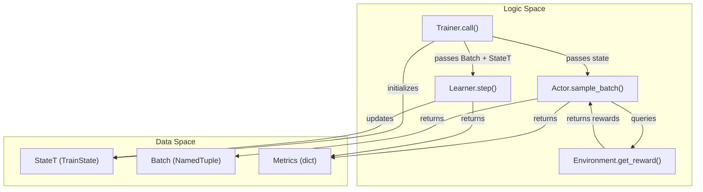
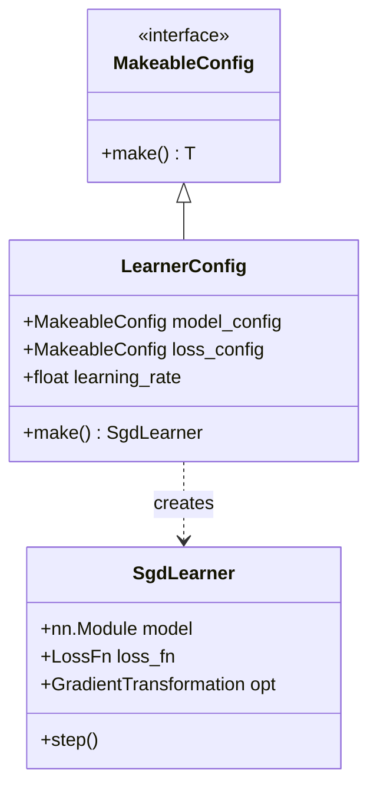

<!-- source: DeepWiki mcp.deepwiki.com · repo google-deepmind/egg · page 1.2 Core Architecture and Design Principles · fetched 2026-10-26 -->

# Core Architecture and Design Principles

Relevant source files

The following files were used as context for generating this wiki page:

- [egg/base.py](egg/base.py)
- [egg/learners.py](egg/learners.py)

This page details the structural design of the `egg` framework. The library is built around a functional, "algorithm-first" philosophy using JAX and Flax, prioritizing stateless abstractions that can be easily JIT-compiled and scaled.

## The Actor → Learner → Trainer Loop

The primary execution flow in `egg` is a cyclic relationship between three main abstractions defined in `egg/base.py`. This separation of concerns ensures that data generation (Actor) is decoupled from gradient optimization (Learner), both of which are orchestrated by a high-level execution manager (Trainer).

### Major Abstractions

| Component | Interface | Role |
| :--- | :--- | :--- |
| **Actor** | `Actor` [egg/base.py:95-106]() | Consumes the current model state to sample sequences from an environment and produce a `Batch`. |
| **Learner** | `Learner` [egg/base.py:126-141]() | Takes a `Batch`, calculates gradients via a `LossFn`, and updates the model parameters. |
| **Trainer** | `Trainer` [egg/base.py:143-151]() | Manages the loop, handles PRNG state, and logs metrics to a `pandas.DataFrame`. |
| **Environment**| `Environment` [egg/base.py:57-78]() | A stateless oracle that provides prompts and evaluates answers with rewards. |

### Data Flow Diagram
The following diagram illustrates how these entities interact within a single training step.

**System Entity Flow: Actor-Learner Loop**

**Sources:** [egg/base.py:95-151](), [egg/learners.py:72-89]()

---

## MakeableConfig Factory Pattern

To ensure experiments are fully serializable and reproducible, `egg` uses the `MakeableConfig` pattern. Instead of passing instantiated objects (which may contain un-serializable JAX arrays or compiled functions) into constructors, the framework passes lightweight configuration dataclasses.

*   **`MakeableConfig`**: An abstract base class [egg/base.py:37-43]() with a single `make()` method.
*   **Composition**: Configurations can nest other configurations. For example, a `LearnerConfig` [egg/learners.py:30-45]() contains a `model_config` and a `loss_config`.
*   **Serialization**: Because these are standard Python dataclasses, they can be easily converted to dictionaries or JSON for logging experiment hyperparameters alongside results.

**Code Entity Space: Configuration Composition**

**Sources:** [egg/base.py:37-43](), [egg/learners.py:30-45]()

---

## The Batch Data Structure

The `Batch` [egg/base.py:82-90]() is the fundamental unit of data transfer between the Actor and the Learner. It is a `tp.NamedTuple` containing JAX arrays, ensuring it is a valid JAX pytree that can be passed into `jit` or `vmap` functions.

### Batch Attributes
| Attribute | Shape | Description |
| :--- | :--- | :--- |
| `prompts` | `(B, prompt_len)` | Input tokens provided by the environment. |
| `answers` | `(B, answer_len)` | Tokens generated by the model (or injected by the actor). |
| `rewards` | `(B,)` | Scalar rewards returned by `Environment.get_reward`. |
| `sample_log_probs` | `(B, total_len)` | The log-probability of each token under the policy that sampled it. |
| `aux` | `dict` | Arbitrary metadata (e.g., environment-specific info). |

**Sources:** [egg/base.py:82-90]()

---

## Algorithm-First Philosophy

The framework is designed to prioritize the mathematical definition of the RL algorithm (the "Loss") over the infrastructure.

### The Learner Implementation
The `SgdLearner` [egg/learners.py:48-90]() provides a reference implementation of the `Learner` protocol. Its `step` function is a pure JAX transformation:

1.  It uses `jax.value_and_grad` on the `loss_fn` [egg/learners.py:79-83]().
2.  The `loss_fn` [egg/base.py:108-124]() is a protocol that defines the RL objective (e.g., REINFORCE, PPO).
3.  The gradients are applied to the `TrainState` using `optax` [egg/learners.py:84]().

### Stateless Environments
Unlike OpenAI Gym, the `Environment` [egg/base.py:57-78]() interface in `egg` is stateless. It does not have a `reset()` or `step()` method that modifies internal variables. Instead:
*   `get_prompt(key)` [egg/base.py:67-69]() generates a prompt given a PRNG key.
*   `get_reward(prompt, answer, key)` [egg/base.py:72-76]() evaluates a completed sequence.

This statelessness allows the Actor to sample thousands of sequences in parallel across accelerators using JAX's vectorization primitives.

**Sources:** [egg/base.py:57-78](), [egg/learners.py:48-90]()

---

