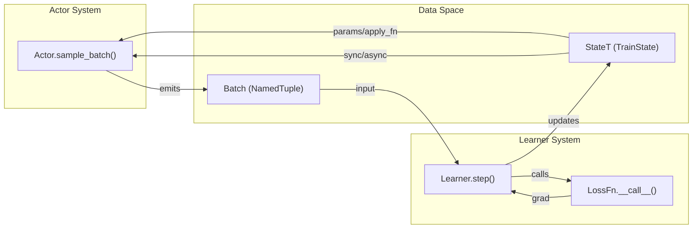
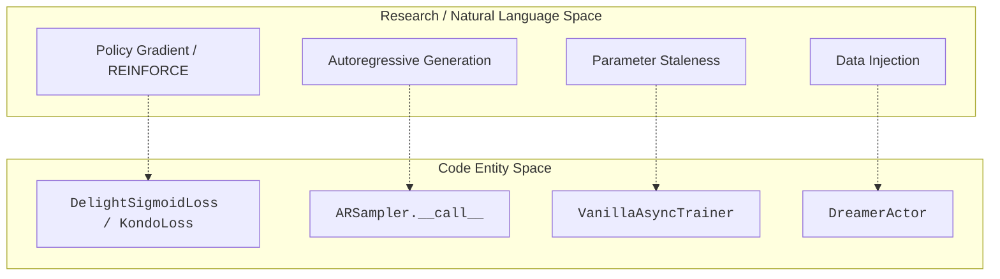

<!-- source: DeepWiki mcp.deepwiki.com · repo google-deepmind/egg · page 10 Glossary · fetched 2026-10-26 -->

# Glossary

Relevant source files

The following files were used as context for generating this wiki page:

- [README.md](README.md)
- [egg/actors/dreamer_bps.py](egg/actors/dreamer_bps.py)
- [egg/actors/fixed_bpc.py](egg/actors/fixed_bpc.py)
- [egg/actors/fixed_bps.py](egg/actors/fixed_bps.py)
- [egg/base.py](egg/base.py)
- [egg/environments/catalog.py](egg/environments/catalog.py)
- [egg/lib/ar_sample.py](egg/lib/ar_sample.py)
- [egg/lib/statistics.py](egg/lib/statistics.py)
- [egg/losses/dg.py](egg/losses/dg.py)
- [egg/losses/kondo.py](egg/losses/kondo.py)
- [egg/networks/logit_noise.py](egg/networks/logit_noise.py)
- [egg/networks/transformers.py](egg/networks/transformers.py)
- [egg/trainers/vanilla_async.py](egg/trainers/vanilla_async.py)

This page provides definitions for codebase-specific terms, abbreviations, and domain concepts used throughout the `egg` framework. It serves as a technical reference for onboarding engineers to understand the mapping between research concepts and their implementation in code.

## Core Abstractions

The `egg` framework is built around a central loop involving four primary components defined in `egg/base.py`.

| Term | Definition | Code Pointer |
| :--- | :--- | :--- |
| **Actor** | A component that reads the shared model state and interacts with an `Environment` to generate a `Batch` of experience. | [egg/base.py:95-105]() |
| **Learner** | Responsible for updating the policy parameters given a `Batch`. It manages the optimizer state and performs the `step`. | [egg/base.py:126-140]() |
| **Trainer** | The high-level orchestrator that executes the Actor → Learner loop. | [egg/base.py:143-152]() |
| **Environment** | A stateless oracle that provides prompts and evaluates rewards for generated answers. | [egg/base.py:57-78]() |

### Code Entity Space: Core Loop Data Flow

This diagram illustrates how data structures defined in `egg/base.py` move between the major system components.

Sources: [egg/base.py:1-152]()

---

## Domain Concepts & Abbreviations

### BPS vs. BPC (Sampling Strategies)
These terms describe how the `Actor` collects data for a training batch.

*   **BPS (Batch Per Sample)**: A fixed number of samples are generated for every prompt, regardless of whether they are "correct" or "successful." Implemented in `FixedBPSActor` [egg/actors/fixed_bps.py:61-106]().
*   **BPC (Batch Per Correct)**: The actor continues sampling until a fixed number of *correct* (high-reward) samples are found for every prompt, or a maximum attempt limit is reached. Implemented in `FixedBPCActor` [egg/actors/fixed_bpc.py:59-190]().

### Delight ($\chi$)
A central concept in the "Delightful Gradient" family of losses. It is defined as the product of **Advantage** ($A$) and **Surprisal** ($S$).
*   **Formula**: $\chi_t = A \times (-\log \pi_\theta(a_t | s_t))$
*   **Implementation**: In `DelightSigmoidLoss`, `delight_tok` is calculated as `advantage[:, None] * surprisal_tok` [egg/losses/dg.py:165-165]().

### Kondo Gating
Inspired by the "KonMari" method (sparking joy), this refers to a compute-saving technique where only "delightful" tokens are used for the backward pass.
*   **Mechanism**: A `pct_learn` parameter determines the top-k tokens (by delight or advantage) to keep. All other tokens have their gradients zeroed.
*   **Implementation**: `KondoLoss` uses `jnp.sort` and a `threshold` to create a binary `gate` [egg/losses/kondo.py:186-191]().

### Logit Noise
A technique used to simulate model diversity or staleness by adding Gaussian noise to the output logits of a network.
*   **Fixed Noise**: A single noise vector is sampled at initialization and added to every forward pass.
*   **Dynamic Noise**: New noise is sampled on every call using a JAX PRNG key.
*   **Implementation**: `LogitNoiseNetwork` [egg/networks/logit_noise.py:46-83]().

---

## Technical Terms

| Term | Description | Code Pointer |
| :--- | :--- | :--- |
| **ARSampler** | Autoregressive Sampler. Uses a `jax.lax.fori_loop` to generate tokens one-by-one. Supports epsilon-greedy exploration. | [egg/lib/ar_sample.py:34-143]() |
| **EnvSpec** | A metadata container defining `vocab_size`, `prompt_length`, and `answer_length`. | [egg/base.py:49-55]() |
| **Grouped Baseline** | An RL baseline calculated per-prompt (group) rather than globally across the batch, reducing variance. | [egg/losses/dg.py:135-156]() |
| **Landmine** | A specific "buggy" sequence injected into training data to test model robustness or "unlearning" capabilities. | [egg/actors/dreamer_bps.py:192-205]() |
| **MakeableConfig** | A factory pattern interface. Objects ending in `Config` implement `make()` to instantiate their functional counterparts. | [egg/base.py:37-43]() |
| **PAD_TOKEN** | Represented as `-1` in the codebase. Networks map this to index `0` internally for safe embedding but mask the loss. | [egg/base.py:30-30](), [egg/networks/transformers.py:114-128]() |

---

## Natural Language to Code Mapping

This diagram maps common research terminology used in the documentation/papers to the specific classes and functions in the `egg` source code.

Sources: [egg/lib/ar_sample.py:47-53](), [egg/losses/dg.py:71-80](), [egg/trainers/vanilla_async.py:1-50](), [egg/actors/dreamer_bps.py:87-94]()

### Implementation Details: ARSampler
The `ARSampler` is a critical utility. It handles the transition from logits to tokens while maintaining log-probabilities for the "mixed policy" (model + epsilon-greedy).

1.  **Looping**: It uses `jax.lax.fori_loop` to ensure the sampling is compatible with JIT compilation [egg/lib/ar_sample.py:132-137]().
2.  **Log-Prob Calculation**: When `epsilon > 0`, it calculates the log-probability of the chosen token under the mixture distribution: $P(a) = (1-\epsilon)P_{model}(a) + \epsilon P_{uniform}(a)$ [egg/lib/ar_sample.py:119-124]().
3.  **Teacher Forcing**: The utility `get_full_logprobs_b_l` is used by learners to re-evaluate sequences under the current parameters [egg/lib/ar_sample.py:146-185]().

Sources: [egg/lib/ar_sample.py:1-192]()