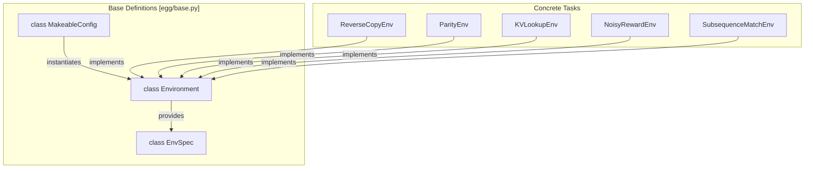
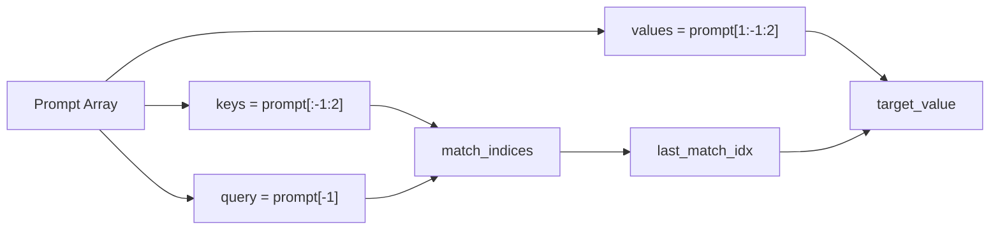

<!-- source: DeepWiki mcp.deepwiki.com · repo google-deepmind/egg · page 2.1 Base Task Environments · fetched 2026-10-26 -->

# Base Task Environments

Relevant source files

The following files were used as context for generating this wiki page:

- [egg/environments/bit_parity.py](egg/environments/bit_parity.py)
- [egg/environments/key_value.py](egg/environments/key_value.py)
- [egg/environments/noisy_reward.py](egg/environments/noisy_reward.py)
- [egg/environments/reverse_copy.py](egg/environments/reverse_copy.py)
- [egg/environments/subsequence_match.py](egg/environments/subsequence_match.py)

This page provides a detailed technical overview of the five built-in task environments in the `egg` framework. These environments serve as standardized benchmarks for Reinforcement Learning (RL) research, testing specific model capabilities such as associative recall, positional reasoning, and information aggregation.

## Environment Abstraction

All base environments implement the `base.Environment` interface and are defined via a corresponding `EnvConfig` which inherits from `base.MakeableConfig`. The core interaction between the actor and the environment is governed by the `base.EnvSpec`, which defines the structural constraints of the task.

### Key Data Structures

*   **`EnvSpec`**: A dataclass containing `vocab_size`, `prompt_length`, and `answer_length`. It informs the model's embedding layer and the ARSampler's generation loop.
*   **`get_prompt(key)`**: Generates a task-specific input sequence.
*   **`get_reward(prompt, answer, key)`**: Evaluates the model's generated response against the prompt and returns a scalar reward.

### Code-to-System Mapping: Environment Interface

The following diagram illustrates how the abstract environment definitions in `base.py` are realized by concrete task implementations.

Title: Environment Implementation Flow

Sources: [egg/environments/reverse_copy.py:48-60](), [egg/environments/bit_parity.py:38-50](), [egg/environments/key_value.py:52-68](), [egg/environments/noisy_reward.py:43-59](), [egg/environments/subsequence_match.py:47-69]()

---

## 1. ReverseCopy
**File**: `egg/environments/reverse_copy.py`

The `ReverseCopyEnv` requires the agent to produce the input tokens in reverse order. This task is a primary probe for positional reasoning in Transformer architectures.

### Reward Shaping and Kappa
The environment implements a sophisticated reward function `reversal_reward` that supports partial credit and "traps":
*   **`kappa`**: A shaping parameter. If $\kappa = 1$, the reward is purely the fraction of correct tokens. If $\kappa < 1$, a completion bonus is added for perfect matches [egg/environments/reverse_copy.py:151-158]().
*   **`reward_to_first_error`**: If enabled, the environment only counts correct tokens from the start of the sequence until the first mistake [egg/environments/reverse_copy.py:139-141]().

### Configuration Parameters
| Parameter | Type | Description |
| :--- | :--- | :--- |
| `target_reverse` | `bool` | If False, the task becomes a forward copy [egg/environments/reverse_copy.py:127-129](). |
| `target_increment` | `bool` | If True, target tokens are $(x + 1) \pmod{\text{vocab\_size}}$ [egg/environments/reverse_copy.py:134-136](). |

Sources: [egg/environments/reverse_copy.py:32-41](), [egg/environments/reverse_copy.py:89-159]()

---

## 2. BitParity
**File**: `egg/environments/bit_parity.py`

The `ParityEnv` assesses the model's ability to aggregate information across all positions in a sequence.

*   **Task**: The agent sees a sequence of binary tokens (0 or 1).
*   **Logic**: It must output **1** if the sum of bits is even, and **0** if odd [egg/environments/bit_parity.py:18-20]().
*   **Reward**: Returns `+1.0` for a correct parity bit and `-1.0` otherwise [egg/environments/bit_parity.py:70-71]().

Sources: [egg/environments/bit_parity.py:38-71]()

---

## 3. KeyValue (Associative Recall)
**File**: `egg/environments/key_value.py`

The `KVLookupEnv` tests content-addressable memory. The prompt consists of $N$ key-value pairs followed by a query key.

### Data Flow
1.  **Prompt Generation**: `[k1, v1, k2, v2, ..., kn, vn, query]` [egg/environments/key_value.py:18-19]().
2.  **Retrieval**: The `kv_lookup_reward` function extracts keys and values from the prompt using slicing [egg/environments/key_value.py:116-117]().
3.  **Conflict Resolution**: If the same key appears multiple times, the environment targets the value associated with the *last* occurrence [egg/environments/key_value.py:128-129]().

Title: KVLookup Data Extraction

Sources: [egg/environments/key_value.py:70-100](), [egg/environments/key_value.py:109-131]()

---

## 4. NoisyReward
**File**: `egg/environments/noisy_reward.py`

This environment is designed for exploring exploration-exploitation trade-offs and the impact of reward variance on RL stability.

*   **Action 0**: Always returns a fixed reward of `1.0` [egg/environments/noisy_reward.py:83]().
*   **Action 1**: Returns a reward sampled from a Gaussian distribution $\mathcal{N}(\mu, \sigma^2)$ [egg/environments/noisy_reward.py:86-88]().
*   **Usage**: Used to test if an algorithm can correctly identify the higher-mean action despite high variance in samples.

Sources: [egg/environments/noisy_reward.py:27-41](), [egg/environments/noisy_reward.py:65-93]()

---

## 5. SubsequenceMatch
**File**: `egg/environments/subsequence_match.py`

The `SubsequenceMatchEnv` tests the agent's ability to "hide" or "include" a specific prompt sequence within a much longer generated response.

### Implementation Details
*   **Subsequence Logic**: Unlike a substring match, gaps are allowed. For example, "ad" is a valid subsequence of "abcd" [egg/environments/subsequence_match.py:23-27]().
*   **JAX-Friendly Search**: The environment uses `jax.lax.scan` to iterate through the response and track the number of matched tokens from the prompt without using Python loops [egg/environments/subsequence_match.py:101-106]().
*   **Reward**: `+1.0` if the entire prompt is found as a subsequence, `-1.0` otherwise [egg/environments/subsequence_match.py:112-114]().

Sources: [egg/environments/subsequence_match.py:37-45](), [egg/environments/subsequence_match.py:90-115]()

---

