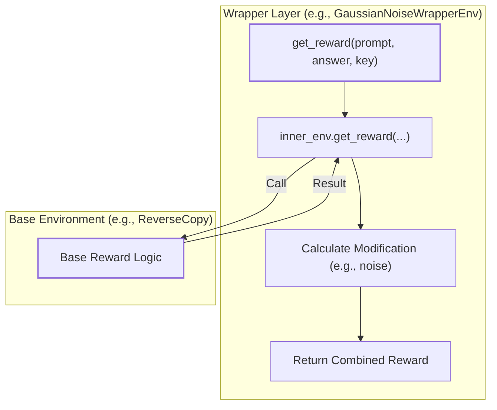
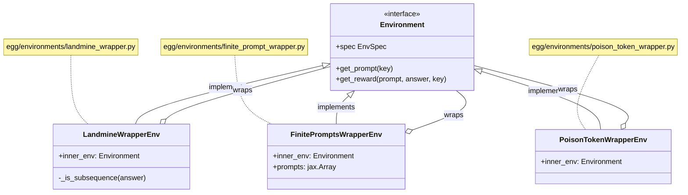

<!-- source: DeepWiki mcp.deepwiki.com · repo google-deepmind/egg · page 2.2 Environment Wrappers · fetched 2026-10-26 -->

# Environment Wrappers

Relevant source files

The following files were used as context for generating this wiki page:

- [egg/environments/bernoulli_noise_wrapper.py](egg/environments/bernoulli_noise_wrapper.py)
- [egg/environments/finite_prompt_wrapper.py](egg/environments/finite_prompt_wrapper.py)
- [egg/environments/gaussian_noise_wrapper.py](egg/environments/gaussian_noise_wrapper.py)
- [egg/environments/landmine_wrapper.py](egg/environments/landmine_wrapper.py)
- [egg/environments/poison_token_wrapper.py](egg/environments/poison_token_wrapper.py)
- [egg/environments/zeros_prompt_wrapper.py](egg/environments/zeros_prompt_wrapper.py)

The `egg` framework utilizes a composable wrapper pattern to modify or augment the behavior of base task environments. These wrappers follow the decorator pattern, implementing the `base.Environment` interface while holding an instance of an `inner_env`. This allows for stacking multiple layers of logic—such as adding reward noise, penalizing specific sequences, or restricting prompt distributions—without modifying the underlying task logic.

### Wrapper Composition Pattern

Wrappers are constructed using the `MakeableConfig` factory pattern [egg/environments/bernoulli_noise_wrapper.py:27-41](). Each wrapper has a corresponding `EnvConfig` that contains an `inner_env_config`. When `make()` is called, it recursively instantiates the inner environments, creating a nested stack.

**Wrapper Data Flow**

The following diagram illustrates how a wrapped environment processes calls to `get_prompt` and `get_reward`.

Title: Environment Wrapper Execution Flow

Sources: [egg/environments/gaussian_noise_wrapper.py:42-77](), [egg/environments/landmine_wrapper.py:50-111]()

---

### Reward Modification Wrappers

These wrappers intercept the `get_reward` call to inject noise or apply penalties based on the agent's generated `answer`.

#### BernoulliNoiseWrapper
Overrides the base reward with a binary choice (`min_val` or `max_val`) based on a probability `p_noise` [egg/environments/bernoulli_noise_wrapper.py:44-51]().
*   **Implementation**: Uses `jax.random.bernoulli` to decide whether to override and another Bernoulli draw (50/50) to select between `min_val` and `max_val` [egg/environments/bernoulli_noise_wrapper.py:75-82]().

#### GaussianNoiseWrapper
Adds zero-mean IID Gaussian noise to the base reward [egg/environments/gaussian_noise_wrapper.py:42-48]().
*   **Implementation**: Samples noise from `jax.random.normal` scaled by `noise_std` and adds it to the `base_reward` [egg/environments/gaussian_noise_wrapper.py:70-75]().

#### PoisonTokenWrapper
Applies a static penalty if a specific "poison" token appears anywhere in the agent's answer [egg/environments/poison_token_wrapper.py:43-50]().
*   **Implementation**: Uses `jnp.any(answer == self.config.poison_token)` to detect the token and adds `poison_reward` (typically a large negative value) to the base reward [egg/environments/poison_token_wrapper.py:71-78]().

#### LandmineWrapper
A more complex version of the poison wrapper that detects a specific multi-token subsequence [egg/environments/landmine_wrapper.py:50-57]().
*   **Subsequence Detection**: Implements `_is_subsequence` using `jax.lax.scan` to efficiently check for the landmine pattern in a JIT-compatible manner [egg/environments/landmine_wrapper.py:72-90]().
*   **Stochastic Penalty**: If hit, it adds a penalty sampled from a Normal distribution defined by `landmine_reward` and `landmine_std` [egg/environments/landmine_wrapper.py:102-110]().

Sources: [egg/environments/bernoulli_noise_wrapper.py:1-90](), [egg/environments/gaussian_noise_wrapper.py:1-78](), [egg/environments/poison_token_wrapper.py:1-81](), [egg/environments/landmine_wrapper.py:1-112]()

---

### Prompt Manipulation Wrappers

These wrappers modify the `get_prompt` behavior, often to simulate specific data distributions or "easy" tasks.

#### FinitePromptWrapper
Restricts the environment to a fixed, pre-generated set of prompts [egg/environments/finite_prompt_wrapper.py:47-52]().
*   **Initialization**: During `make()`, it generates `num_prompts` using the inner environment and stores them in a JAX array [egg/environments/finite_prompt_wrapper.py:36-43]().
*   **Selection**: In `get_prompt`, it uses `jax.random.randint` to index into the stored `prompts` array [egg/environments/finite_prompt_wrapper.py:61-64]().

#### ZerosPromptWrapper
Simulates "easy" prompts by zeroing out the entire prompt sequence with probability `prob_zero` [egg/environments/zeros_prompt_wrapper.py:52-56]().
*   **Reward Noise**: If both the prompt and the answer are all zeros, it can optionally add Gaussian noise (`zero_noise_std`) to the reward, acting as a metaphor for noisy signals on trivial tasks [egg/environments/zeros_prompt_wrapper.py:83-93]().

Sources: [egg/environments/finite_prompt_wrapper.py:1-71](), [egg/environments/zeros_prompt_wrapper.py:1-94]()

---

### Technical Implementation Details

#### Wrapper Classes and Logic
The following table maps the wrapper classes to their primary modification logic.

| Class Name | Primary Method Overridden | Logic Description |
| :--- | :--- | :--- |
| `BernoulliNoiseWrapperEnv` | `get_reward` | Randomly replaces reward with `min_val` or `max_val`. |
| `GaussianNoiseWrapperEnv` | `get_reward` | Adds `N(0, std)` noise to reward. |
| `PoisonTokenWrapperEnv` | `get_reward` | Penalizes presence of a specific token ID. |
| `LandmineWrapperEnv` | `get_reward` | Detects multi-token subsequence via `jax.lax.scan`. |
| `FinitePromptsWrapperEnv` | `get_prompt` | Samples from a pre-cached array of prompt tensors. |
| `ZerosPromptWrapperEnv` | `get_prompt` & `get_reward` | Forces prompts to zero and adds specific "zero-task" noise. |

**Code Entity Association**

Title: Environment Wrapper Class Hierarchy and Associations

Sources: [egg/environments/landmine_wrapper.py:50-61](), [egg/environments/finite_prompt_wrapper.py:47-53](), [egg/environments/poison_token_wrapper.py:43-54]()

---

