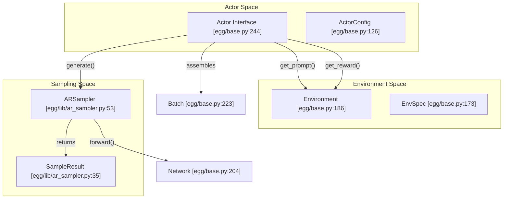
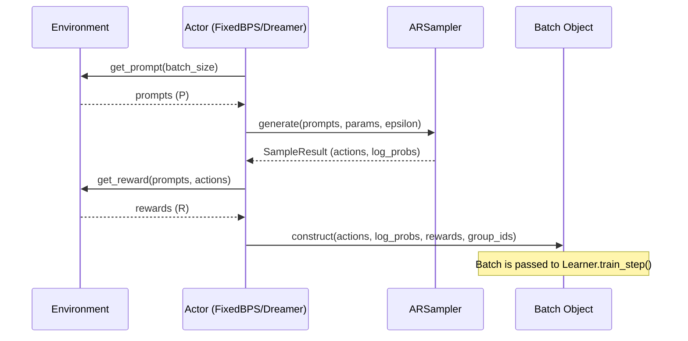

<!-- source: DeepWiki mcp.deepwiki.com · repo google-deepmind/egg · page 3 Actors · fetched 2026-10-26 -->

# Actors

Relevant source files

The following files were used as context for generating this wiki page:

- [egg/actors/__init__.py](egg/actors/__init__.py)

In the **egg** framework, an **Actor** serves as the bridge between the environment and the learner. Its primary responsibility is to interact with an `Environment` using a set of network parameters to generate a `Batch` object [egg/base.py:223-241](). This `Batch` contains the sampled sequences, log-probabilities, rewards, and metadata required by the `Learner` to compute gradients and update the model.

Actors encapsulate the logic of **Autoregressive (AR) sampling**, exploration strategies (like epsilon-greedy), and data augmentation techniques.

### Actor Role in the Training Loop

The Actor is invoked during each training iteration by a `Trainer` [egg/base.py:276-291](). It uses the current model parameters to generate fresh experience from the environment.

#### System Interaction Diagram
This diagram illustrates how the `Actor` orchestrates data flow between the `Environment` and the `ARSampler` to produce a `Batch`.

**Sources:** [egg/base.py:126-291](), [egg/lib/ar_sampler.py:35-70]()

---

### Core Responsibilities

The Actor subsystem is designed to handle three main tasks:

1.  **Prompt Management**: Interfacing with the `Environment` to retrieve task-specific prompts via `get_prompt` [egg/base.py:188-189]().
2.  **Sequence Generation**: Utilizing the `ARSampler` to produce model outputs. This includes managing `epsilon` for exploration and `temperature` for sampling [egg/base.py:128-132]().
3.  **Batch Construction**: Mapping the raw samples and environment rewards into the structured `Batch` format. This includes calculating `group_ids` for advantage estimation and tracking metrics like `fraction_correct` [egg/base.py:223-241]().

### Data Flow: From Environment to Batch
The following diagram maps the transition from Environment-specific entities to the standardized `Batch` object used by the `Learner`.

**Sources:** [egg/base.py:186-241](), [egg/lib/ar_sampler.py:53-120]()

---

### Implementation Variants

The framework provides different Actor implementations based on how they sample data and whether they inject synthetic "perfect" experience into the training stream.

#### [FixedBPS and FixedBPC Actors](#3.1)
These are the standard IID sampling actors used for most RL tasks. 
*   **FixedBPSActor** (Batch Per Step): Generates a fixed number of samples ($S$) for every prompt ($P$), resulting in a total batch size of $B = P \times S$.
*   **FixedBPCActor** (Batch Per Correct): Continues sampling until a fixed number of *correct* sequences are found for each prompt. This is useful for sparse reward environments where random exploration rarely finds a signal.

For details, see [FixedBPS and FixedBPC Actors](#3.1).

#### [DreamerBPS Actor and Data Injection](#3.2)
The **DreamerActor** is a specialized implementation used in research experiments (like DPG and Kondo). It supports **Data Injection**, where the actor mixes model-generated samples with "injected" sequences:
*   **Correct Injection**: Forcing the inclusion of ground-truth correct answers to stabilize early training.
*   **Landmine/Bug Injection**: Injecting specific failure cases to train the model to avoid certain regions of the action space.
*   **Log-prob Recomputation**: Since injected data was not sampled from the current policy, the actor uses the `ARSampler` in "teacher-forcing" mode to compute the log-probabilities of these sequences under the current parameters.

For details, see [DreamerBPS Actor and Data Injection](#3.2).

---
**Sources:** [egg/actors/__init__.py:1-17](), [egg/base.py:126-150](), [egg/lib/ar_sampler.py:35-120]()

---

