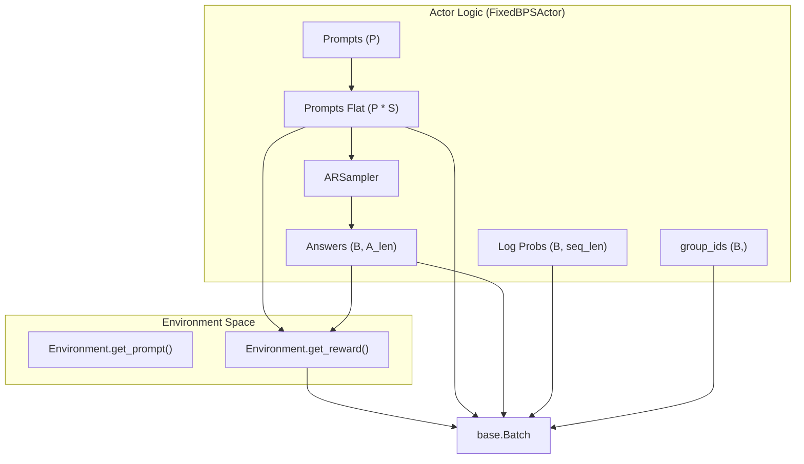
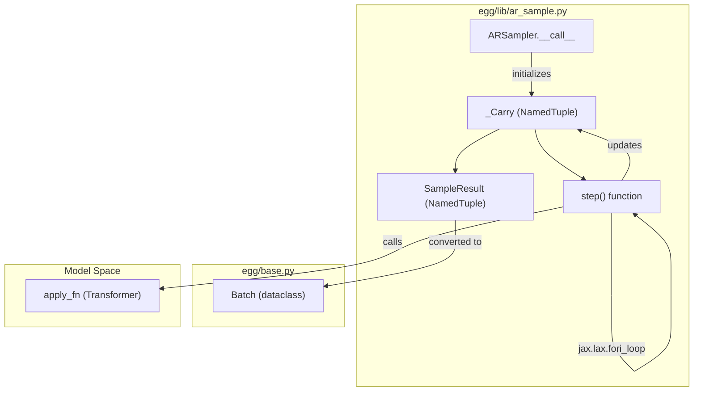

<!-- source: DeepWiki mcp.deepwiki.com · repo google-deepmind/egg · page 3.1 FixedBPS and FixedBPC Actors · fetched 2026-10-26 -->

# FixedBPS and FixedBPC Actors

Relevant source files

The following files were used as context for generating this wiki page:

- [egg/actors/fixed_bpc.py](egg/actors/fixed_bpc.py)
- [egg/actors/fixed_bps.py](egg/actors/fixed_bps.py)
- [egg/lib/ar_sample.py](egg/lib/ar_sample.py)

The Actor subsystem in `egg` bridges the environment and the learner by generating `Batch` objects through interaction with the environment and the model. The `FixedBPSActor` and `FixedBPCActor` are the two primary IID (Independent and Identically Distributed) sampling implementations. They utilize the `ARSampler` to generate sequences and structure them into batches with specific grouping properties, which are often required by loss functions for advantage estimation.

## FixedBPSActor

The `FixedBPSActor` (Fixed Batch Per Sample) generates a batch of a deterministic size $B = P \times S$, where $P$ is the number of unique prompts and $S$ is the number of samples generated for each prompt.

### Implementation and Data Flow
The actor follows a linear execution path to construct a batch:
1.  **Prompt Generation**: It samples $P$ prompts from the environment using `env.get_prompt` [egg/actors/fixed_bps.py:77-78]().
2.  **Expansion**: These prompts are flattened by repeating each prompt $S$ times to create a base for the batch [egg/actors/fixed_bps.py:78]().
3.  **Autoregressive Sampling**: The `ARSampler` is called once on the flattened prompts to generate completion tokens (answers) and their corresponding log probabilities [egg/actors/fixed_bps.py:87-89]().
4.  **Reward Evaluation**: The environment evaluates the generated answers using `env.get_reward` [egg/actors/fixed_bps.py:93-95]().
5.  **Group Identification**: A `group_ids` array is created, mapping each sample back to its original prompt index [egg/actors/fixed_bps.py:97](). This is critical for algorithms like REINFORCE with a grouped baseline.

### Logic Diagram: FixedBPS Batch Construction
The following diagram illustrates the transformation from Environment/Model space to the `Batch` entity.

Sources: [egg/actors/fixed_bps.py:69-106](), [egg/lib/ar_sample.py:34-53]()

## FixedBPCActor

The `FixedBPCActor` (Fixed Batch Per Correct) iterates until a specific number of *correct* samples are collected for every prompt in the batch. This is useful for tasks where positive rewards are sparse, ensuring the learner always sees successful examples.

### Implementation Details
Unlike the BPS actor, the BPC actor uses a loop (up to `max_samples_per_prompt`) to fill a buffer of correct answers:
*   **Active Masking**: In each iteration, it identifies which prompts have not yet reached the `correct_per_prompt` (C) threshold [egg/actors/fixed_bpc.py:105-107]().
*   **Selective Sampling**: It only samples for "active" prompts to save compute [egg/actors/fixed_bpc.py:116-126]().
*   **Thresholding**: A sample is considered "correct" if its reward is $\ge$ `reward_threshold` [egg/actors/fixed_bpc.py:136]().
*   **Padding**: If a prompt fails to produce $C$ correct samples within the maximum attempts, the remaining slots are filled with dummy padding tokens and the `mask` in `aux` is set to `False` [egg/actors/fixed_bpc.py:158-181]().

### Actor-Sampler Integration
The actors interface with `ARSampler` to perform the token-by-token generation.

| Feature | FixedBPSActor | FixedBPCActor |
| :--- | :--- | :--- |
| **Batch Size** | $P \times S$ | $P \times C$ |
| **Termination** | Single Pass | `jnp.all(correct_counts >= c)` or Max Attempts |
| **Primary Metric** | N/A | `padding_fraction`, `attempts_needed` |
| **Epsilon-Greedy** | Supported via `ActorConfig.epsilon` | Not explicitly in config, uses sampler default |

Sources: [egg/actors/fixed_bpc.py:35-55](), [egg/actors/fixed_bpc.py:100-147](), [egg/actors/fixed_bps.py:33-57]()

## ARSampler Integration

Both actors rely on `egg.lib.ar_sample.ARSampler` for sequence generation. The sampler uses `jax.lax.fori_loop` to iteratively predict the next token [egg/lib/ar_sample.py:132-137]().

### Mixed Policy Sampling
If `epsilon > 0`, the sampler implements epsilon-greedy exploration. The log probability recorded in the `Batch` is the log probability under the *mixed* policy:
$$P(a) = (1 - \epsilon) P(a | \text{model}) + \epsilon P(a | \text{uniform})$$
This ensures that the `sample_log_probs` in the `Batch` are mathematically consistent for importance sampling or policy gradient updates [egg/lib/ar_sample.py:109-126]().

### System Entity Mapping
The following diagram maps the logical sampling process to the specific classes and functions in the codebase.

Sources: [egg/lib/ar_sample.py:47-143](), [egg/base.py:136-146]()

## Batch Construction and Aux Data
The `Batch` object returned by these actors includes an `aux` dictionary. This dictionary is vital for the Learner:
*   **`group_ids`**: An array of shape `(B,)` where `group_ids[i]` is the integer ID of the prompt used for sample `i`. This is used by loss functions (e.g., `REINFORCE`) to calculate baselines per prompt [egg/actors/fixed_bps.py:104](), [egg/actors/fixed_bpc.py:181]().
*   **`mask`**: (FixedBPC only) A boolean array indicating if the sample is a valid correct answer or just padding [egg/actors/fixed_bpc.py:181]().

Sources: [egg/actors/fixed_bps.py:99-105](), [egg/actors/fixed_bpc.py:176-182]()

---

