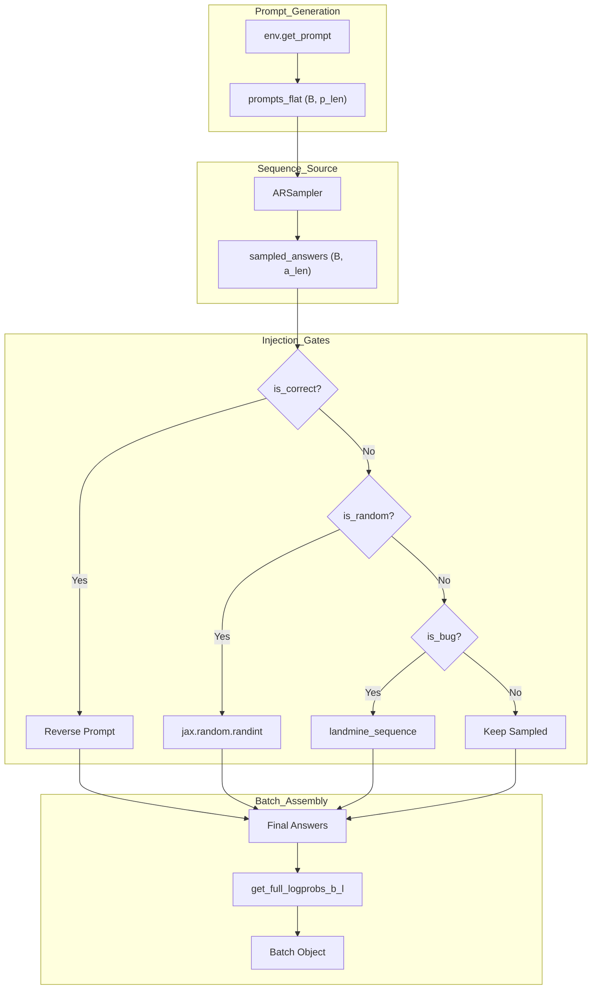
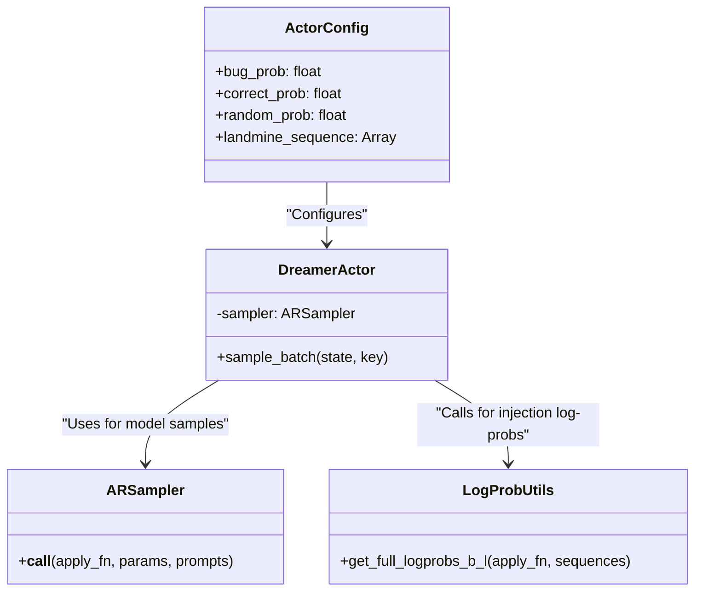

<!-- source: DeepWiki mcp.deepwiki.com · repo google-deepmind/egg · page 3.2 DreamerBPS Actor and Data Injection · fetched 2026-10-26 -->

# DreamerBPS Actor and Data Injection

Relevant source files

The following files were used as context for generating this wiki page:

- [egg/actors/dreamer_bps.py](egg/actors/dreamer_bps.py)
- [egg/lib/ar_sample.py](egg/lib/ar_sample.py)

The `DreamerActor` is a specialized actor implementation that extends the standard `FixedBPSActor` logic by mixing model-generated sequences with synthetically injected data. It is designed to facilitate training in scenarios where specific behaviors (like correct prompt reversals or specific "buggy" failure modes) need to be over-represented in the training distribution to guide the learner [egg/actors/dreamer_bps.py:16-25]().

## Overview and Injection Logic

The `DreamerActor` operates by first generating a batch of candidate sequences using an autoregressive sampler and then conditionally overwriting rows in that batch based on configurable probability gates [egg/actors/dreamer_bps.py:115-117](). The injection logic follows a strict priority hierarchy for each row in the batch:

1.  **Correct Injection**: With probability `correct_prob`, the actor injects a perfect prompt-reversal sequence [egg/actors/dreamer_bps.py:18-18]().
2.  **Random Injection**: If not correct, with probability `random_prob`, it injects a sequence of random tokens [egg/actors/dreamer_bps.py:19-19]().
3.  **Bug/Landmine Injection**: If neither of the above, with probability `bug_prob`, it injects a fixed "landmine" sequence defined in the configuration [egg/actors/dreamer_bps.py:20-21]().
4.  **Model Sampling**: If no injection is triggered, the sequence generated by the `ARSampler` is retained [egg/actors/dreamer_bps.py:22-22]().

### Actor Configuration
The `ActorConfig` class defines the parameters for this behavior:

| Parameter | Type | Description |
| :--- | :--- | :--- |
| `landmine_sequence` | `jax.Array` | The specific token sequence representing a "bug" or "landmine" [egg/actors/dreamer_bps.py:46-46](). |
| `bug_prob` | `float` | Probability of injecting the landmine answer [egg/actors/dreamer_bps.py:47-47](). |
| `correct_prob` | `float` | Probability of injecting a correct answer [egg/actors/dreamer_bps.py:48-48](). |
| `random_prob` | `float` | Probability of injecting a random answer [egg/actors/dreamer_bps.py:49-49](). |
| `override_token_prob` | `float` | Optional fixed log-probability to assign to injected tokens [egg/actors/dreamer_bps.py:50-50](). |

**Sources:** [egg/actors/dreamer_bps.py:38-83](), [egg/actors/dreamer_bps.py:151-162]()

## Data Flow and Implementation

The sampling process in `DreamerActor.sample_batch` follows a structured pipeline from prompt generation to reward calculation and log-probability recomputation.

### Sequence Generation and Recomputation
Because injected sequences were not produced by the model's current policy, their log-probabilities must be recomputed (teacher-forcing) to ensure the `Batch` object contains valid `sample_log_probs` for the learner [egg/actors/dreamer_bps.py:24-25]().

1.  **Prompting**: Prompts are sampled from the environment and repeated to match the `samples_per_prompt` setting [egg/actors/dreamer_bps.py:107-108]().
2.  **Sampling**: The `ARSampler` generates initial sequences and their log-probabilities [egg/actors/dreamer_bps.py:115-117]().
3.  **Injection**: `jax.random.uniform` gates determine which rows are replaced by correct, random, or landmine answers [egg/actors/dreamer_bps.py:154-161]().
4.  **Log-Prob Recomputation**: If `override_token_prob` is not set, the actor uses `get_full_logprobs_b_l` to calculate the model's actual log-probability for the injected sequences [egg/lib/ar_sample.py:146-152]().

### Data Injection Pipeline
The following diagram illustrates the flow from the environment spec to the final batch construction, highlighting the injection gates.

**DreamerActor Sampling Flow**

**Sources:** [egg/actors/dreamer_bps.py:96-210](), [egg/lib/ar_sample.py:146-185]()

## Log-Probability Recomputation

The `get_full_logprobs_b_l` function in `egg/lib/ar_sample.py` is critical for maintaining the integrity of the `Batch` data when injections occur. It performs a teacher-forcing pass:

*   It maps `PAD_TOKEN` to 0 for the model forward pass [egg/lib/ar_sample.py:158-158]().
*   It calculates `jax.nn.log_softmax` over the vocabulary for all sequence positions [egg/lib/ar_sample.py:170-170]().
*   It uses `jnp.take_along_axis` to extract the log-probabilities of the tokens that were actually present in the injected sequence [egg/lib/ar_sample.py:174-176]().
*   It masks out positions where the target was a `PAD_TOKEN` to ensure rewards and gradients are not influenced by padding [egg/lib/ar_sample.py:179-180]().

**Sources:** [egg/lib/ar_sample.py:146-185](), [egg/actors/dreamer_bps.py:202-210]()

## Metrics and Monitoring

The `DreamerActor` returns a `Metrics` dictionary that tracks the distribution of sequence types within each batch. This is essential for debugging injection rates and understanding the data mixture the learner is consuming.

| Metric Key | Description |
| :--- | :--- |
| `bug_fraction` | Percentage of the batch consisting of landmine sequences [egg/actors/dreamer_bps.py:142-142](). |
| `correct_fraction` | Percentage of the batch consisting of injected correct answers [egg/actors/dreamer_bps.py:143-143](). |
| `random_fraction` | Percentage of the batch consisting of random token sequences [egg/actors/dreamer_bps.py:144-144](). |
| `sample_fraction` | Percentage of the batch generated purely by the model [egg/actors/dreamer_bps.py:145-145](). |

### System Entity Mapping
The following diagram maps the logical injection components to their implementation entities in the codebase.

**Injection Entity Mapping**

**Sources:** [egg/actors/dreamer_bps.py:38-94](), [egg/lib/ar_sample.py:34-53](), [egg/lib/ar_sample.py:146-151]()

---

