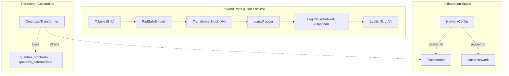

<!-- source: DeepWiki mcp.deepwiki.com · repo google-deepmind/egg · page 4 Networks · fetched 2026-10-26 -->

# Networks

Relevant source files

The following files were used as context for generating this wiki page:

- [egg/networks/__init__.py](egg/networks/__init__.py)

The `egg.networks` package provides the neural architectures used by actors for sampling and by learners for optimization. The design follows a modular approach where a core backbone (typically a Transformer) can be wrapped in functional layers to handle logit transformations, noise injection, or quantization.

The primary entry point for configuring these networks is the `NetworkConfig` [egg/networks/transformer.py:22-44](), which defines hyperparameters such as embedding dimensions, head counts, and layer depths.

### Network Architecture Overview

The system bridges high-level RL requirements with low-level JAX implementations through a layered hierarchy:

1.  **Backbone**: Standard architectures like the `Transformer` [egg/networks/transformer.py:127-147]() or `LinearNetwork` [egg/networks/transformer.py:165-177]().
2.  **Wrappers**: Functional decorators like `LogitNoiseNetwork` [egg/networks/noise.py:47-64]() that modify the output of the backbone.
3.  **Head**: The `LogitWrapper` [egg/networks/transformer.py:150-162]() which maps hidden states to the vocabulary size defined by the `EnvSpec`.

#### System Mapping: Natural Language to Code Entities

The following diagram maps the logical network components to their corresponding classes in the `egg` codebase.

| Logical Component | Code Entity | File Path |
| :--- | :--- | :--- |
| **Configuration** | `NetworkConfig` | [egg/networks/transformer.py:22-44]() |
| **Backbone (Attention)** | `Transformer` | [egg/networks/transformer.py:127-147]() |
| **Backbone (MLP)** | `LinearNetwork` | [egg/networks/transformer.py:165-177]() |
| **Output Head** | `LogitWrapper` | [egg/networks/transformer.py:150-162]() |
| **Noise Layer** | `LogitNoiseNetwork` | [egg/networks/noise.py:47-64]() |
| **Quantization** | `QuantizedTransformer` | [egg/networks/noise.py:87-105]() |

**Sources:** [egg/networks/transformer.py:22-177](), [egg/networks/noise.py:47-105]()

### Core Components

The network layer is divided into two primary modules: the transformer architecture and the noise/quantization utilities.

#### Transformer Backbone
The default architecture is a decoder-only `Transformer` [egg/networks/transformer.py:127-147](). It utilizes `TransformerBlock` [egg/networks/transformer.py:84-111]() units with causal masking to ensure that token predictions only depend on previous context. A specialized `PadSafeEmbed` [egg/networks/transformer.py:53-70]() layer is used to ensure that padding tokens (index 0) result in zero vectors, preventing them from influencing the gradients or hidden states.

For details on the implementation of causal masking and embedding logic, see **[Transformer Architecture (#4.1)](#)**.

#### Noise and Quantization
To support research into robustness and distributed training, `egg` provides wrappers that simulate hardware or environmental constraints:
*   **Logit Noise**: The `LogitNoiseNetwork` [egg/networks/noise.py:47-64]() injects Gaussian noise into the logits, either with a fixed standard deviation or a dynamic schedule.
*   **Quantization**: The `QuantizedTransformer` [egg/networks/noise.py:87-105]() applies uniform rounding (deterministic or stochastic) to the network parameters, simulating low-precision inference in distributed settings.

For details on perturbation methods and rounding algorithms, see **[Noise and Quantization Modules (#4.2)](#)**.

### Network Composition Flow

The diagram below illustrates how a `NetworkConfig` is transformed into a functional model and how data flows from input tokens to final logits.

**Sources:** [egg/networks/transformer.py:22-162](), [egg/networks/noise.py:18-105]()

### Sub-pages
*   **[4.1 Transformer Architecture](#)**: Detailed coverage of the decoder-only Transformer, `NetworkConfig`, `TransformerBlock`, causal masking, and `PadSafeEmbed`.
*   **[4.2 Noise and Quantization Modules](#)**: Covers `LogitNoiseNetwork` (fixed vs. dynamic Gaussian perturbation), `EmbeddingNoise`, `QuantizedTransformer`, and the rounding library.

---

