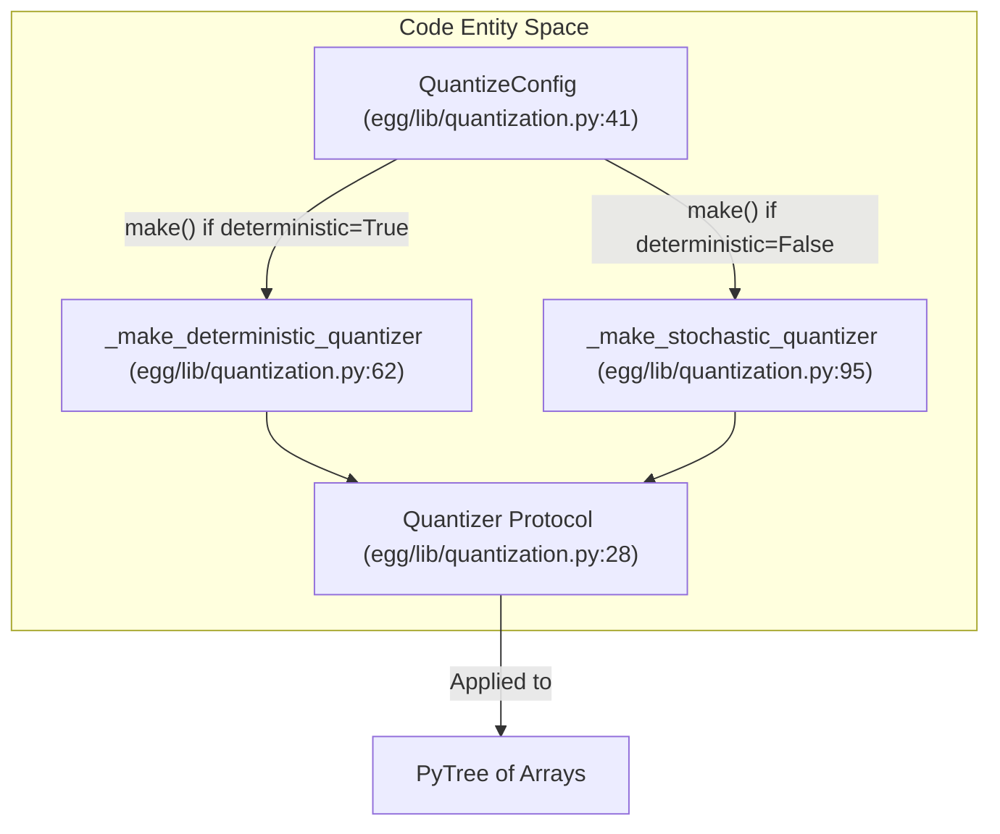
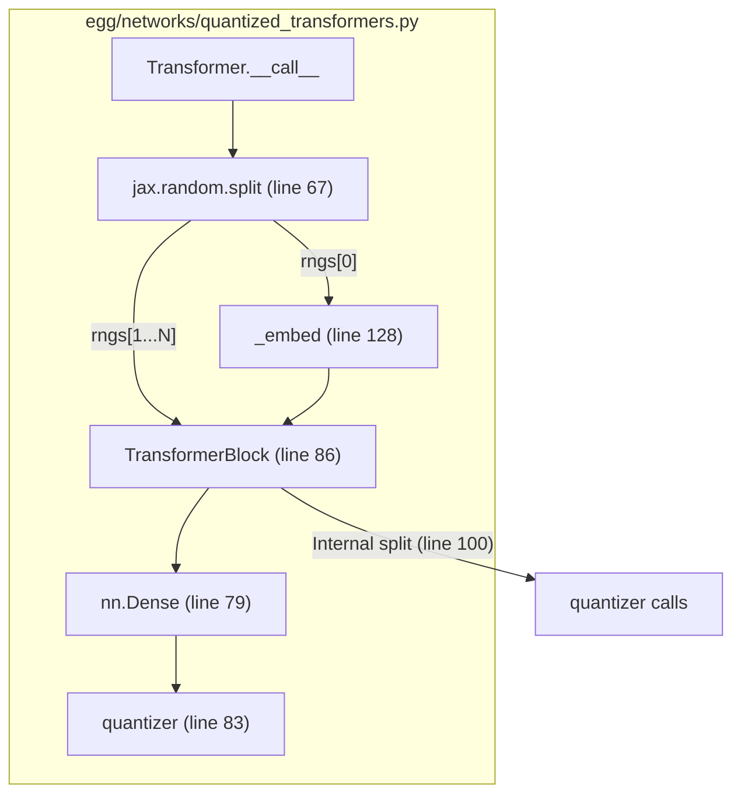

<!-- source: DeepWiki mcp.deepwiki.com · repo google-deepmind/egg · page 4.2 Noise and Quantization Modules · fetched 2026-10-26 -->

# Noise and Quantization Modules

Relevant source files

The following files were used as context for generating this wiki page:

- [egg/lib/quantization.py](egg/lib/quantization.py)
- [egg/networks/embedding_noise.py](egg/networks/embedding_noise.py)
- [egg/networks/logit_noise.py](egg/networks/logit_noise.py)
- [egg/networks/quantized_transformers.py](egg/networks/quantized_transformers.py)

This section covers the specialized network layers and utilities in `egg` designed to simulate hardware constraints and introduce stochasticity into the model's forward pass. These modules are primarily used to study the robustness of RL algorithms under conditions of numerical precision loss (quantization) or logit-level corruption.

## Quantization Library

The `egg/lib/quantization.py` module provides a functional interface for simulating low-precision arithmetic using JAX. It defines a `Quantizer` protocol and a configuration factory for both deterministic and stochastic rounding.

### Implementation Details
The library supports two primary modes of quantization:
1.  **Deterministic Uniform Rounding**: Scales values based on the maximum absolute value in the array to fit within a specified bit range, then rounds to the nearest integer [egg/lib/quantization.py:52-60]().
2.  **Stochastic Rounding**: Instead of rounding to the nearest integer, it rounds up or down with a probability proportional to the fractional distance from the target value. This requires a `jax.random.PRNGKey` [egg/lib/quantization.py:74-93]().

### Data Flow: Quantization Configuration
The following diagram illustrates how `QuantizeConfig` produces a `Quantizer` function used by networks.

**Quantizer Factory Pattern**

Sources: [egg/lib/quantization.py:28-106]()

---

## Logit Noise Network

The `LogitNoiseNetwork` is a `flax.linen` wrapper that perturbs the output logits of an underlying model with Gaussian noise. This is often used to simulate "mismatched" or noisy actors in distributed RL settings.

### Fixed vs. Dynamic Noise
*   **Fixed Noise**: If `fixed=True`, a noise vector is sampled once during parameter initialization and stored as a `flax` parameter named `unit_fixed_logit_noise` [egg/networks/logit_noise.py:55-62](). This noise remains constant across different inputs but is scaled by `sigma` [egg/networks/logit_noise.py:72-74]().
*   **Dynamic Noise**: If `fixed=False`, the network samples new Gaussian noise on every forward pass using the `noise` RNG stream [egg/networks/logit_noise.py:75-80]().

### Implementation
The network wraps an `inner_network` and adds the noise to the resulting `base_logits` before returning them [egg/networks/logit_noise.py:67-82]().

Sources: [egg/networks/logit_noise.py:27-83]()

---

## Embedding Noise Transformer

The `Transformer` in `egg/networks/embedding_noise.py` is a decoder-only architecture that injects noise directly into the embedding space rather than the logits.

### Noise Injection Mechanism
After computing token and positional embeddings, the model checks for a `noise` RNG stream and a non-zero `mismatch_scale` [egg/networks/embedding_noise.py:94-95]().
*   If `fixed_noise` is enabled, it uses a constant `PRNGKey(0)` to ensure the noise is the same for every forward pass [egg/networks/embedding_noise.py:96-97]().
*   Otherwise, it uses `self.make_rng("noise")` for per-pass stochasticity [egg/networks/embedding_noise.py:99-100]().
*   Crucially, the noise is zeroed out for `PAD_TOKEN` positions to prevent the model from attending to padding [egg/networks/embedding_noise.py:103]().

Sources: [egg/networks/embedding_noise.py:48-123]()

---

## Quantized Transformer

The `QuantizedTransformer` (defined in `egg/networks/quantized_transformers.py`) applies the `Quantizer` utility at multiple stages of the Transformer block to simulate hardware with limited numerical precision.

### Quantization Points
The network applies quantization at the following junctions:
1.  **Embedding**: After adding token and positional embeddings [egg/networks/quantized_transformers.py:145-156]().
2.  **Attention Sub-layer**: Before the `MultiHeadDotProductAttention` (post-LayerNorm) and immediately after the attention output [egg/networks/quantized_transformers.py:104-110]().
3.  **Feed-Forward Sub-layer**: After the first `Dense` (up-projection), after the second `Dense` (down-projection), and after the final residual addition [egg/networks/quantized_transformers.py:116-125]().
4.  **Output**: On the final logit projections [egg/networks/quantized_transformers.py:83]().

### Data Flow and RNG Management
Because stochastic quantization requires fresh randomness at every step, the `Transformer` splits a base `noise` RNG into a sequence of keys for every layer and sub-operation.

**Quantized Forward Pass Flow**

### Quantization Logic Table

| Layer Component | Quantization Applied To | RNG Key Usage |
| :--- | :--- | :--- |
| `_embed` | Token Emb, Pos Emb, Combined Emb | 3-way split of `rngs[0]` [egg/networks/quantized_transformers.py:135]() |
| `TransformerBlock` | Post-LN (Attn), Attn Output, Post-LN (FF), FF-Up, FF-Down, Residual | 6-way split of `rng` [egg/networks/quantized_transformers.py:100]() |
| `Transformer` | Final Logits | `rngs[-1]` [egg/networks/quantized_transformers.py:83]() |

Sources: [egg/networks/quantized_transformers.py:33-157]()

---

