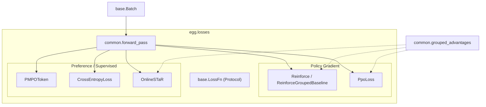
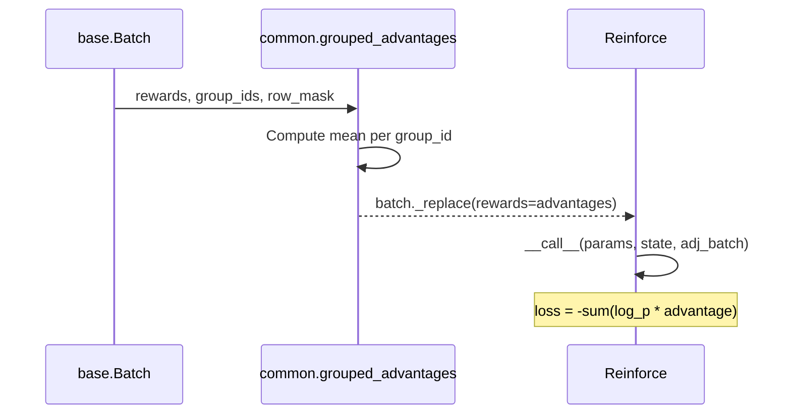

<!-- source: DeepWiki mcp.deepwiki.com · repo google-deepmind/egg · page 5.1 Standard RL Losses: REINFORCE, PPO, PMPO, XENT, OnlineStar · fetched 2026-10-26 -->

# Standard RL Losses: REINFORCE, PPO, PMPO, XENT, OnlineStar

<details>
<summary>Relevant source files</summary>

The following files were used as context for generating this wiki page:

- [egg/losses/online_star.py](egg/losses/online_star.py)
- [egg/losses/pmpo.py](egg/losses/pmpo.py)
- [egg/losses/ppo.py](egg/losses/ppo.py)
- [egg/losses/reinforce.py](egg/losses/reinforce.py)
- [egg/losses/xent.py](egg/losses/xent.py)

</details>


This page details the implementation of classical Reinforcement Learning (RL) and supervised loss functions within the `egg` framework. These losses are implemented as `base.LossFn` protocols, typically utilizing a common forward pass utility to compute log-probabilities over `base.Batch` objects.

## Overview of Standard Losses

The `egg` framework provides several standard policy gradient and preference optimization losses. These implementations share a common data flow:
1.  **Forward Pass**: Using `common.forward_pass` to get log-probabilities for the learner's current parameters [egg/losses/common.py:44-58]().
2.  **Sampler Log-probs**: Retrieving the log-probabilities generated by the actor during sampling via `common.sampler_answer_logprobs` [egg/losses/common.py:61-71]().
3.  **Advantage Estimation**: Optionally centering rewards using a grouped baseline to reduce variance [egg/losses/common.py:74-106]().

### Loss Entity Map
The following diagram maps the logical RL components to their specific class implementations in the `egg.losses` module.

**RL Loss Architecture**

Sources: [egg/losses/reinforce.py:58-125](), [egg/losses/ppo.py:52-139](), [egg/losses/pmpo.py:57-141](), [egg/losses/xent.py:37-66](), [egg/losses/online_star.py:52-109]().

---

## REINFORCE

The REINFORCE implementation in `egg` supports optional Importance Weighting (IW) and a Grouped Baseline.

*   **Importance Weighting**: If `use_iw` is enabled, the loss calculates a sequence-level weight $w = \exp(\log \pi_\theta - \log \pi_{sampler})$ [egg/losses/reinforce.py:85-90](). This weight is clipped by `importance_weight_cap` [egg/losses/reinforce.py:89]().
*   **Grouped Baseline**: Variance reduction is achieved by subtracting the mean reward of a group (samples sharing the same prompt) from the individual reward [egg/losses/reinforce.py:150-156]().

**Data Flow for ReinforceGroupedBaseline**

Sources: [egg/losses/reinforce.py:29-54](), [egg/losses/reinforce.py:125-174]().

---

## PPO (Proximal Policy Optimization)

`PpoLoss` implements a token-level clipped surrogate objective. Unlike sequence-level REINFORCE, PPO in `egg` calculates ratios and clips them at each token position [egg/losses/ppo.py:86-95]().

### Key Components:
*   **Clipped Surrogate**: Clips the ratio $r_t(\theta)$ between $1-\epsilon$ and $1+\epsilon$ [egg/losses/ppo.py:90-92]().
*   **KL Anchor**: An optional penalty term $\beta_{kl} \cdot \text{KL}(\pi_{act} || \pi_\theta)$ can be added to keep the learner near the sampling policy [egg/losses/ppo.py:102-104]().
*   **Advantage Broadcasting**: Sequence-level advantages (optionally grouped) are broadcast across all answer tokens [egg/losses/ppo.py:83]().

Sources: [egg/losses/ppo.py:30-48](), [egg/losses/ppo.py:67-104]().

---

## PMPO (Preference Optimization)

`PMPOToken` is a token-level variant of "Preference Optimization as Probabilistic Inference". It classifies sequences into "preferred" or "dis-preferred" based on whether their advantage is positive [egg/losses/pmpo.py:75-85]().

| Component | Implementation |
| :--- | :--- |
| **Preferred Term** | Minimizes negative log-probability of preferred tokens [egg/losses/pmpo.py:96-99](). |
| **Dis-preferred Term** | Uses `logaddexp` with a `gamma` floor to penalize dis-preferred tokens [egg/losses/pmpo.py:101-107](). |
| **KL Regularization** | Standard KL term to prevent policy collapse [egg/losses/pmpo.py:110-113](). |

Sources: [egg/losses/pmpo.py:36-53](), [egg/losses/pmpo.py:74-120]().

---

## OnlineStar and Cross-Entropy

### OnlineStar
Online STaR (Self-Taught Reasoner) is a supervised fine-tuning loss that only learns from "positive" examples.
*   **Filtering**: It creates a `supervise_mask` where `rewards > reward_threshold` [egg/losses/online_star.py:84-86]().
*   **Supervision**: Standard cross-entropy is applied only to sequences passing the threshold [egg/losses/online_star.py:89-91]().

### Cross-Entropy (XENT)
`CrossEntropyLoss` is the simplest implementation, treating the sampled `batch.answers` as ground truth labels. It computes the negative log-probability of the answer tokens [egg/losses/xent.py:51-53]().

Sources: [egg/losses/online_star.py:30-48](), [egg/losses/online_star.py:72-91](), [egg/losses/xent.py:37-53]().

---

## Grouped Advantage Estimation

Most RL losses in `egg` utilize `common.grouped_advantages`. This utility is critical for reducing variance in environments where reward scales vary significantly across different prompts.

```python
# Conceptual implementation from egg/losses/common.py
def grouped_advantages(rewards, group_ids, num_groups, row_mask):
    # 1. Sum rewards per group_id
    # 2. Count samples per group_id
    # 3. advantage = rewards - (group_sum / group_count)
```

If `num_groups` is not provided but `use_grouped_baseline` is True, the system often defaults to a global baseline (mean of the entire batch) or raises an error depending on the specific loss configuration [egg/losses/ppo.py:40-42](), [egg/losses/reinforce.py:46-49]().

Sources: [egg/losses/common.py:74-106](), [egg/losses/reinforce.py:149-156]().

---

