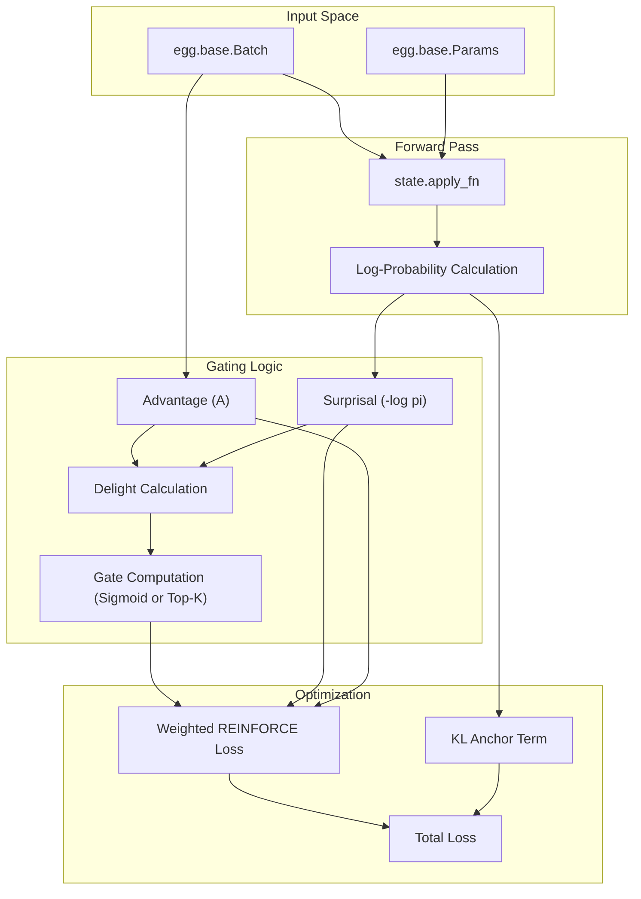
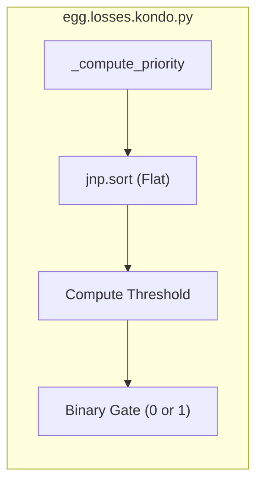

<!-- source: DeepWiki mcp.deepwiki.com · repo google-deepmind/egg · page 5.2 Delightful Gradient (DG) and Kondo Gate Losses · fetched 2026-10-26 -->

# Delightful Gradient (DG) and Kondo Gate Losses

Relevant source files

The following files were used as context for generating this wiki page:

- [egg/losses/dg.py](egg/losses/dg.py)
- [egg/losses/kondo.py](egg/losses/kondo.py)

This page details the implementation of novel token-level gating mechanisms within the `egg` framework. These losses, specifically **Delightful Gradient (DG)** and **Kondo**, are designed to optimize learning by filtering token updates based on "delight" (a product of advantage and surprisal) or other priority signals.

## Overview of Delight and Gating

Both DG and Kondo losses rely on the concept of **Delight** ($\chi_t$), defined as the product of the sequence-level advantage and the token-level surprisal:
$$\chi_t = A \times (-\log \pi_\theta(a_t | s_t))$$

The intuition is that updates should be prioritized for tokens that were both "surprising" to the model and led to a "delightful" (better than expected) outcome.

### Core Components and Data Flow

The following diagram illustrates how the loss functions process a `Batch` to produce gated gradients.

**Figure 1: Gated Loss Data Flow**

**Sources:** [egg/losses/dg.py:91-132](), [egg/losses/kondo.py:113-150]()

---

## Delightful Gradient (DG) Loss

The `DelightSigmoidLoss` implements a probabilistic gating mechanism where each token's update weight $w_t$ is determined by a sigmoid function.

### Implementation Details
The gate probability $p_t$ is calculated as:
$$p_t = \sigma\left(\frac{\chi_t - \lambda}{\eta}\right)$$
Where:
*   $\chi_t$: Delight (or a UCB-style combination of advantage and surprisal).
*   $\lambda$ (`lambda_learn`): The joy threshold.
*   $\eta$ (`eta_learn`): Temperature. If $\eta = 0$, the gate becomes a hard indicator function $I(\chi_t > \lambda)$.

### Stochastic vs. Deterministic Gating
The `stochastic_gate` parameter determines if $w_t$ is the probability $p_t$ (mean) or a Bernoulli sample $Bernoulli(p_t)$.

| Parameter | Type | Description |
| :--- | :--- | :--- |
| `eta_learn` | `float` | Temperature for sigmoid. [egg/losses/dg.py:33]() |
| `lambda_learn` | `float` | Shift/Threshold for the gate. [egg/losses/dg.py:34]() |
| `stochastic_gate`| `bool` | Whether to sample the gate. [egg/losses/dg.py:35]() |
| `override_ucb` | `float` | If set, uses $(1-u)A + u \cdot surprisal$ instead of product. [egg/losses/dg.py:41]() |

**Sources:** [egg/losses/dg.py:29-67](), [egg/losses/dg.py:181-205]()

---

## Kondo Gate Loss

The `KondoLoss` implements a "binary keep/skip" gating mechanism. It is designed for compute savings by skipping the backward pass on uninformative tokens.

### Priority Types
Kondo allows selecting survivors based on several priority signals defined in `PriorityType`:
*   `DELIGHT`: $A \times surprisal$
*   `ADVANTAGE`: $A$
*   `ABS_ADVANTAGE`: $|A|$
*   `SURPRISAL`: $-\log \pi$
*   `ADDITIVE`: $\alpha A + (1-\alpha) surprisal$

### Top-K Selection
Unlike the sigmoid gate, Kondo uses a global threshold based on the `pct_learn` parameter. It identifies the top-k tokens across the entire batch according to the priority score and assigns them a weight of 1.0, while others receive 0.0.

**Figure 2: Kondo Priority Selection**

**Sources:** [egg/losses/kondo.py:36-43](), [egg/losses/kondo.py:178-191]()

---

## Common Features

Both loss functions share several architectural components to ensure stability and compatibility with the `egg` framework.

### Baseline Computation
Both losses support grouped baselines to reduce variance. If `use_grouped_baseline` is enabled, the advantage is calculated relative to the mean reward of samples sharing the same `group_id` within the batch.

**Key Logic:**
1.  Check for `group_ids` in `batch.aux`. [egg/losses/dg.py:136]()
2.  If missing, fall back to global baseline. [egg/losses/dg.py:142]()
3.  Compute `baseline = sum_r / cnt_r` per group. [egg/losses/dg.py:151]()

### KL Anchor
To prevent the policy from drifting too far from the behavior policy that generated the data (the "actor" policy), a KL divergence term is included:
$$Loss = Loss_{PG} + \beta_{kl} \cdot KL(\pi_{act} || \pi_\theta)$$
The `lp_act_answer` is retrieved from `batch.sample_log_probs`.

**Sources:** [egg/losses/dg.py:130-132](), [egg/losses/dg.py:214-216](), [egg/losses/kondo.py:201-203]()

### Statistics and Logging
Both classes return a `base.Metrics` dictionary containing detailed breakdown of the training process, including:
*   `adv_std`: Standard deviation of the advantage.
*   `surprisal_mean`: Average token surprisal.
*   `gate_active_pct`: Percentage of tokens that passed the gate.
*   `delight_mean`: Average delight value.

**Sources:** [egg/losses/dg.py:221-235](), [egg/losses/kondo.py:205-220]()

## Configuration Summary

| Feature | DG (`DelightSigmoidLoss`) | Kondo (`KondoLoss`) |
| :--- | :--- | :--- |
| **Gating Type** | Probabilistic (Sigmoid) | Binary (Top-K) |
| **Selection Criteria** | Per-token Delight | Global priority ranking |
| **Key Parameter** | `eta_learn`, `lambda_learn` | `pct_learn` (fraction to keep) |
| **Weighting** | Soft (0.0 to 1.0) | Hard (0.0 or 1.0) |

**Sources:** [egg/losses/dg.py:30-43](), [egg/losses/kondo.py:46-56]()

---

