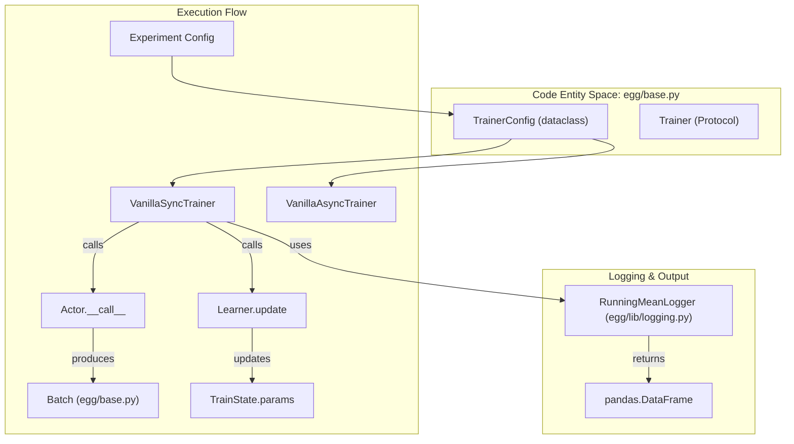

<!-- source: DeepWiki mcp.deepwiki.com · repo google-deepmind/egg · page 6 Trainers · fetched 2026-10-26 -->

# Trainers

Relevant source files

The following files were used as context for generating this wiki page:

- [egg/trainers/__init__.py](egg/trainers/__init__.py)

The `Trainer` is the top-level orchestrator in `egg` that manages the interaction between the **Actor**, the **Learner**, and the **Environment**. It encapsulates the training loop, handling PRNG state management, parameter updates, logging schedules, and the transition between data collection and gradient application.

All trainers in `egg` follow a consistent protocol, taking a `TrainerConfig` and returning a `pandas.DataFrame` containing the training history.

### The Trainer Protocol

The `Trainer` is defined as a `Protocol` (or structural interface) that expects a `train` method. This method serves as the entry point for executing an entire experiment.

| Component | Responsibility |
| :--- | :--- |
| **Actor** | Uses current parameters to sample `Batch` data from the `Environment`. |
| **Learner** | Computes gradients and updates parameters using the `LossFn`. |
| **Trainer** | Manages the loop, handles JIT compilation of the `train_step`, and logs metrics. |

### System Architecture: Trainer Orchestration

The following diagram illustrates how the `Trainer` bridges the "Natural Language Space" of experiment configuration to the "Code Entity Space" of execution.

**Trainer Loop Flow**

**Sources:** [egg/base.py:228-251](), [egg/trainers/vanilla_sync.py:34-45](), [egg/trainers/vanilla_async.py:46-70]()

---

### Concrete Implementations

`egg` provides two primary trainer implementations depending on whether the research focus is on standard synchronous RL or the effects of distributed system dynamics (like parameter lag).

#### 1. VanillaSyncTrainer
The `VanillaSyncTrainer` implements a standard synchronous training loop. In every iteration, the Actor generates a batch of data using the *most recent* parameters, and the Learner immediately updates those parameters. This implementation is optimized for local execution and serves as the framework's baseline.

Key features include:
*   **JIT Compilation**: The `train_step` is typically JIT-compiled using `jax.jit` for high performance [egg/trainers/vanilla_sync.py:75-80]().
*   **Logarithmic Logging**: Uses a specialized schedule to log frequently at the start of training and less frequently as it progresses [egg/trainers/vanilla_sync.py:120-125]().
*   **State Management**: Manages the `PRNGKey` transitions across thousands of steps [egg/trainers/vanilla_sync.py:105-110]().

For details, see [VanillaSyncTrainer](#6.1).

**Sources:** [egg/trainers/vanilla_sync.py:34-150]()

#### 2. VanillaAsyncTrainer and Parameter Lag Simulation
The `VanillaAsyncTrainer` is designed to simulate the complexities of distributed RL environments without requiring a multi-node cluster. It introduces the concept of **Parameter Lag**, where the Actor samples data using stale parameters while the Learner continues to update the "master" weights.

Key features include:
*   **FIFO Parameter Buffer**: Maintains a `params_history` to simulate network delays [egg/trainers/vanilla_async.py:105-115]().
*   **Delay Distributions**: Supports both fixed and uniform random delays to model different network conditions [egg/trainers/vanilla_async.py:55-65]().
*   **Quantization Simulation**: Can simulate the effect of sending low-precision weights to remote actors [egg/trainers/vanilla_async.py:68-70]().

For details, see [VanillaAsyncTrainer and Parameter Lag Simulation](#6.2).

**Sources:** [egg/trainers/vanilla_async.py:46-180]()

---

### Comparison of Trainer Logic

The trainers differ primarily in how they handle the relationship between the `params` used for sampling and the `params` being optimized.

| Feature | VanillaSyncTrainer | VanillaAsyncTrainer |
| :--- | :--- | :--- |
| **Parameter Source** | Always `params_t` | `params_{t-delay}` |
| **Delay Modeling** | None (Synchronous) | Fixed or Uniform Random |
| **Primary Use Case** | Algorithm R&D, Baselines | Distributed RL Research, Lag Robustness |
| **Complexity** | Low | High (requires history buffer) |

**Sources:** [egg/trainers/vanilla_sync.py:112-118](), [egg/trainers/vanilla_async.py:128-145]()

---

