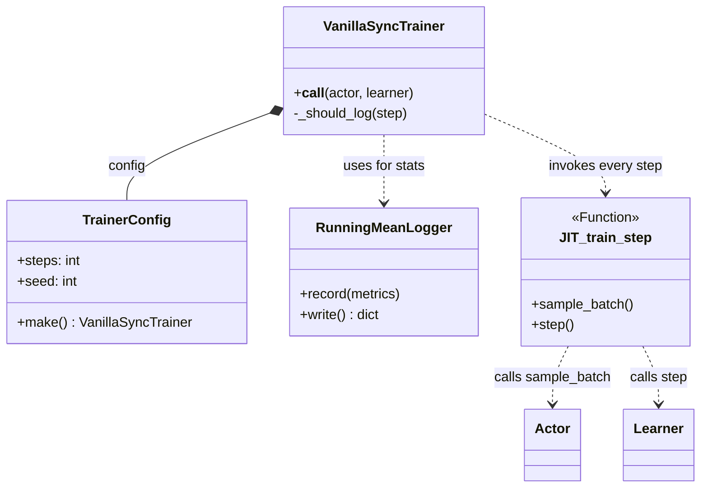

<!-- source: DeepWiki mcp.deepwiki.com · repo google-deepmind/egg · page 6.1 VanillaSyncTrainer · fetched 2026-10-26 -->

# VanillaSyncTrainer

<details>
<summary>Relevant source files</summary>

The following files were used as context for generating this wiki page:

- [egg/lib/logging.py](egg/lib/logging.py)
- [egg/trainers/vanilla_sync.py](egg/trainers/vanilla_sync.py)

</details>


The `VanillaSyncTrainer` is the standard synchronous training implementation in `egg`. It manages the core RL loop by coordinating between an `Actor` (data generation) and a `Learner` (parameter updates) in a single-threaded, JIT-compiled execution flow [egg/trainers/vanilla_sync.py:16-17]().

### Overview and Purpose

The trainer encapsulates the boilerplate of PRNG management, state initialization, metric aggregation, and logging schedules. Unlike the asynchronous variant, the `VanillaSyncTrainer` ensures that the `Learner` always updates parameters based on the most recent batch generated by the `Actor`, with no parameter lag [egg/trainers/vanilla_sync.py:46-49]().

### Configuration: TrainerConfig

The trainer is configured via `TrainerConfig`, which follows the `MakeableConfig` factory pattern [egg/trainers/vanilla_sync.py:32-33]().

| Parameter | Type | Default | Description |
| :--- | :--- | :--- | :--- |
| `steps` | `int` | `1000` | Total number of training iterations to perform [egg/trainers/vanilla_sync.py:36](). |
| `seed` | `int` | `0` | Global random seed for JAX PRNG initialization [egg/trainers/vanilla_sync.py:37](). |
| `log_freq` | `int \| None` | `None` | Fixed step interval for logging. If `None`, uses logarithmic logging [egg/trainers/vanilla_sync.py:38](). |
| `log_details` | `bool` | `False` | If True, includes detailed metrics from both actor and learner in logs [egg/trainers/vanilla_sync.py:39](). |

**Sources:** [egg/trainers/vanilla_sync.py:32-43]()

### The Training Loop

The `VanillaSyncTrainer` implements the `__call__` method to execute the training process. It initializes the `Learner` state and then enters a loop for the specified number of `steps` [egg/trainers/vanilla_sync.py:57-65]().

#### JIT-Compiled `train_step`
To optimize performance, the core interaction between the actor and learner is wrapped in a `@jax.jit` decorated function. This function performs three primary actions in a single compiled step:
1.  **Sampling**: Calls `actor.sample_batch` to generate training data [egg/trainers/vanilla_sync.py:71-73]().
2.  **Learning**: Calls `learner.step` to compute gradients and update the model state [egg/trainers/vanilla_sync.py:75-77]().
3.  **Metric Collection**: Computes basic rewards and optionally aggregates internal actor/learner metrics [egg/trainers/vanilla_sync.py:79-88]().

#### System Data Flow
The following diagram illustrates how the `VanillaSyncTrainer` bridges the abstract components into a concrete execution pipeline.

**Diagram: VanillaSyncTrainer Execution Flow**
```mermaid
graph TD
    subgraph "VanillaSyncTrainer Loop"
        [PRNGKey] --> [train_step]
        [StateT] --> [train_step]
        
        subgraph "JIT Compiled: train_step"
            [train_step] --> A["Actor::sample_batch()"]
            A --> B["Batch Object"]
            B --> L["Learner::step()"]
            L --> S2["New StateT"]
            L --> M["Metrics"]
        end
        
        M --> RML["RunningMeanLogger::record()"]
        S2 --> [Next Iteration]
    end
    
    RML --> Log["logarithmic_logging() Check"]
    Log -->|True| DF["pandas.DataFrame"]
```
**Sources:** [egg/trainers/vanilla_sync.py:67-98](), [egg/lib/logging.py:78-85]()

### Logging and Metrics

The trainer uses two primary utilities for managing output: `RunningMeanLogger` and a logarithmic scheduling function.

#### RunningMeanLogger
Located in `egg/lib/logging.py`, this class implements **Welford's online algorithm** to compute numerically stable running means of scalar metrics [egg/lib/logging.py:78-95]().
*   **`record(metrics)`**: Accumulates values for the current logging window [egg/lib/logging.py:85-96]().
*   **`write()`**: Returns the computed means and resets the internal accumulators for the next window [egg/lib/logging.py:97-103]().

#### Logarithmic Scheduling
If `log_freq` is not specified, the trainer uses `logarithmic_logging(t)`. This function returns `True` only when the step `t` matches specific ratios (1.0, 1.2, 1.4, 1.7, 2.0, 2.5, 3.0, 4.0, 5.0, 6.0, 7.0, 8.0, 9.0) multiplied by powers of 10 [egg/lib/logging.py:68-75](). This allows for high-resolution logging at the start of training when metrics change rapidly, while reducing overhead as training stabilizes.

**Sources:** [egg/lib/logging.py:68-103](), [egg/trainers/vanilla_sync.py:51-55]()

### Return Value: Pandas DataFrame
Upon completion, the trainer returns a `pd.DataFrame` containing the logged records [egg/trainers/vanilla_sync.py:124](). Each row in the DataFrame represents a logging event and typically includes:
*   `step`: The current iteration count [egg/trainers/vanilla_sync.py:107]().
*   `time`: Elapsed time in seconds [egg/trainers/vanilla_sync.py:108]().
*   `reward`: Mean reward over the logging window [egg/trainers/vanilla_sync.py:80]().
*   `cum_reward`: Total reward accumulated since step 0 [egg/trainers/vanilla_sync.py:109]().
*   `cum_positive`: Total count of positive rewards observed [egg/trainers/vanilla_sync.py:110]().

### Code Entity Mapping
The following diagram maps the logical RL concepts to the specific classes and methods implemented in the trainer.

**Diagram: RL Concepts to Code Entities**

**Sources:** [egg/trainers/vanilla_sync.py:32-49](), [egg/trainers/vanilla_sync.py:67-89](), [egg/lib/logging.py:78-83]()

---

