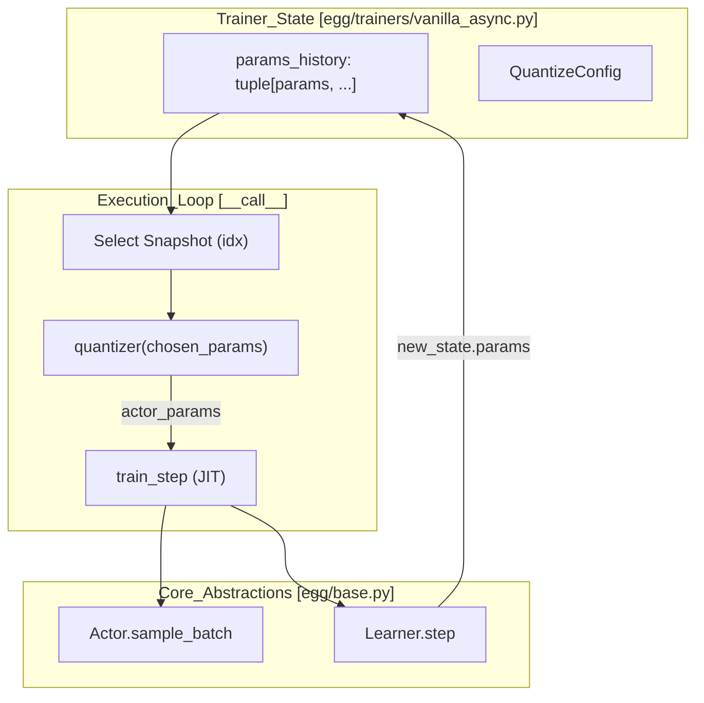

<!-- source: DeepWiki mcp.deepwiki.com · repo google-deepmind/egg · page 6.2 VanillaAsyncTrainer and Parameter Lag Simulation · fetched 2026-10-26 -->

# VanillaAsyncTrainer and Parameter Lag Simulation

<details>
<summary>Relevant source files</summary>

The following files were used as context for generating this wiki page:

- [egg/lib/logging.py](egg/lib/logging.py)
- [egg/lib/quantization.py](egg/lib/quantization.py)
- [egg/trainers/vanilla_async.py](egg/trainers/vanilla_async.py)

</details>


The `VanillaAsyncTrainer` is a specialized trainer implementation designed to simulate the effects of distributed training environments. Specifically, it models **parameter staleness** (lag between the actor and learner) and **numerical quantization** of model weights during transmission from the learner to the actor [egg/trainers/vanilla_async.py:16-19]().

Unlike the synchronous trainer, this implementation maintains a history of model parameters and forces the `Actor` to sample data using older, potentially lower-precision versions of the network weights [egg/trainers/vanilla_async.py:54-58]().

## Core Architecture and Data Flow

The trainer operates by maintaining a First-In-First-Out (FIFO) buffer of parameter states called `params_history`. At each training step, the learner updates the most recent parameters, while the actor samples data using a snapshot retrieved from this history [egg/trainers/vanilla_async.py:82-83]().

### Async Training Loop Logic

1.  **Initialization**: A history buffer of size `sampler_delay + 1` is initialized with the starting parameters [egg/trainers/vanilla_async.py:82-83]().
2.  **Parameter Selection**: Depending on `uniform_delay`, the trainer selects either the oldest snapshot (fixed delay) or a random snapshot from the buffer (simulated network jitter) [egg/trainers/vanilla_async.py:131-139]().
3.  **Quantization**: The selected parameters are passed through a `Quantizer` to simulate reduced bit-depth (e.g., 4-bit or 8-bit weights) [egg/trainers/vanilla_async.py:142-142]().
4.  **Execution**: The `train_step` (JIT-compiled) executes the actor sampling and learner update in sequence [egg/trainers/vanilla_async.py:85-109]().
5.  **Buffer Update**: The oldest parameters are dropped, and the newly optimized parameters from the learner are appended to the end of the history [egg/trainers/vanilla_async.py:148-148]().

### Entity Mapping: Actor-Learner Staleness

The following diagram illustrates how the `VanillaAsyncTrainer` manages the separation between the `Learner` state and the `Actor` parameters.

"VanillaAsyncTrainer Entity Relationship"

Sources: [egg/trainers/vanilla_async.py:54-150](), [egg/base.py:144-180]()

## Parameter Lag Simulation

The trainer provides two modes for simulating delay via the `TrainerConfig` [egg/trainers/vanilla_async.py:35-47]():

| Configuration | Behavior | Implementation Logic |
| :--- | :--- | :--- |
| `sampler_delay` | Sets the maximum staleness (N steps). | Buffer size = `N + 1`. [egg/trainers/vanilla_async.py:82]() |
| `uniform_delay = False` | Fixed worst-case delay. | Always selects `params_history[0]`. [egg/trainers/vanilla_async.py:139]() |
| `uniform_delay = True` | Stochastic delay (jitter). | Random `idx` in `[0, sampler_delay]`. [egg/trainers/vanilla_async.py:134-137]() |

### Parameter History Management

"FIFO Buffer Data Flow"
```mermaid
sequenceDiagram
    participant B as params_history[0] (Oldest)
    participant M as params_history[1...N-1]
    participant F as params_history[N] (Newest)
    participant L as Learner.step

    Note over B, F: Step T
    B -->> Actor: Sample with Delay N
    L ->> F: Produces Params_T
    
    Note over B, F: Step T+1 (Shift)
    rect rgb(240, 240, 240)
        B --x void: Pop Oldest
        M ->> B: Shift Left
        F ->> M: Shift Left
        L ->> F: Append Params_T+1
    end
```
Sources: [egg/trainers/vanilla_async.py:131-148]()

## Quantization Simulation

The trainer integrates with `egg.lib.quantization` to simulate hardware constraints or communication compression [egg/trainers/vanilla_async.py:70-73]().

*   **Deterministic Quantization**: Uses uniform rounding to the specified `num_bits`. [egg/lib/quantization.py:52-60]()
*   **Stochastic Quantization**: Rounds to the nearest upper or lower quantization level with probability proportional to the distance (unbiased rounding). [egg/lib/quantization.py:74-93]()
*   **Implementation**: The `QuantizeConfig` produces a `Quantizer` function that uses `jax.tree_util.tree_map` to apply the transformation across all model weights in the PyTree [egg/lib/quantization.py:45-50](), [egg/lib/quantization.py:67-69]().

## Performance Evaluation and Metrics

The `VanillaAsyncTrainer` distinguishes between two types of performance metrics to help diagnose issues caused by staleness [egg/trainers/vanilla_async.py:101-108]():

1.  **Actor Reward**: The reward obtained by the (stale/quantized) actor during training. This is what the learner actually optimizes against.
2.  **Learner Reward**: If `log_learner_performance` is enabled, the trainer performs an additional forward pass using the *current* (non-stale, full-precision) learner parameters [egg/trainers/vanilla_async.py:112-118]().

### Metric Aggregation
Metrics are aggregated using the `RunningMeanLogger`, which employs Welford's online algorithm for numerical stability [egg/lib/logging.py:78-95](). Logging frequency is controlled by `logarithmic_logging`, which provides high-resolution data at the start of training and reduces frequency as the step count increases [egg/lib/logging.py:68-75]().

Sources: [egg/trainers/vanilla_async.py:151-165](), [egg/lib/logging.py:78-102]()

---

