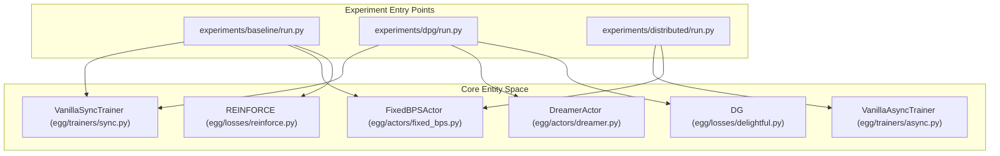

<!-- source: DeepWiki mcp.deepwiki.com · repo google-deepmind/egg · page 7 Experiments · fetched 2026-10-26 -->

# Experiments

Relevant source files

The following files were used as context for generating this wiki page:

- [experiments/__init__.py](experiments/__init__.py)
- [experiments/baseline/__init__.py](experiments/baseline/__init__.py)

The `experiments/` directory contains complete implementations of Reinforcement Learning (RL) training runs. These experiments serve as both functional research tools and integration examples, demonstrating how to compose `egg` components—such as Actors, Trainers, and Loss functions—into executable pipelines.

The experiments are structured to validate specific research hypotheses, ranging from standard policy gradient baselines to novel gating mechanisms and distributed training simulations.

### Experiment Architecture

Each experiment typically follows a standard pattern defined in its respective `run.py`:
1.  **Configuration**: Defining a `SweepConfig` or `RunConfig` to parameterize the environment, model, and optimizer.
2.  **Environment Setup**: Initializing tasks from the `egg.envs` catalog.
3.  **Actor Selection**: Choosing an `Actor` (e.g., `FixedBPSActor` or `DreamerActor`) to manage data collection.
4.  **Loss Definition**: Selecting a `LossFn` (e.g., `REINFORCE`, `DG`, or `Kondo`) to compute gradients.
5.  **Trainer Execution**: Passing these components to a `Trainer` (e.g., `VanillaSyncTrainer` or `VanillaAsyncTrainer`) to run the loop.

### Experiment Suites

The framework provides four primary experiment suites:

| Experiment | Purpose | Key Components |
| :--- | :--- | :--- |
| **Baseline** | Standard RL validation | `REINFORCE`, `SubsequenceMatch`, `FixedBPSActor` |
| **DPG** | Delightful Policy Gradient research | `DG` Loss, `ReverseCopy`, `DreamerActor` |
| **Kondo** | Costly-compute gating research | `Kondo` Loss, Gated Token Selection |
| **Distributed** | Parameter lag and staleness simulation | `VanillaAsyncTrainer`, `LogitNoiseNetwork` |

### System Mapping

The following diagram illustrates how experiment entry points bridge high-level research configurations with the low-level code entities in the `egg` core.

**Experiment Composition Flow**

**Sources:** [experiments/__init__.py:1-17](), [experiments/baseline/run.py:1-50](), [experiments/dpg/run.py:1-50]()

---

### [Baseline Experiment](#7.1)
The Baseline experiment provides a reference implementation for standard RL using the `REINFORCE` algorithm. It is primarily used to verify the core training loop and the `SubsequenceMatch` environment. It utilizes the `FixedBPSActor`, which generates a fixed number of samples per prompt, and the `VanillaSyncTrainer` for synchronous updates.

For details, see [Baseline Experiment](#7.1).

**Sources:** [experiments/baseline/__init__.py:1-17](), [experiments/baseline/run.py:1-50]()

### [DPG and Kondo Experiments](#7.2)
These experiments focus on advanced policy gradient techniques. 
- **DPG (Delightful Policy Gradient)**: Implements a loss function that weights updates by "delight" (a product of advantage and surprisal). It uses the `DreamerActor` to inject synthetic data (e.g., correct answers or "landmines") into the training batch to improve exploration.
- **Kondo**: Introduces a costly-compute gate, where the model must decide which tokens are "important" enough to receive full gradient updates, simulating compute-constrained training.

For details, see [DPG and Kondo Experiments](#7.2).

**Sources:** [experiments/dpg/run.py:1-50](), [experiments/kondo/run.py:1-50]()

### [Distributed Experiment](#7.3)
The Distributed experiment utilizes the `VanillaAsyncTrainer` to simulate the effects of parameter staleness in large-scale distributed training. It introduces a `sampler_delay` to the `params_history` buffer, forcing the Actor to generate data using older versions of the network weights. This experiment is used to study the robustness of algorithms like "Delightful Distributed Policy Gradient" under asynchronous conditions.

For details, see [Distributed Experiment](#7.3).

**Sources:** [experiments/distributed/run.py:1-50]()

---

