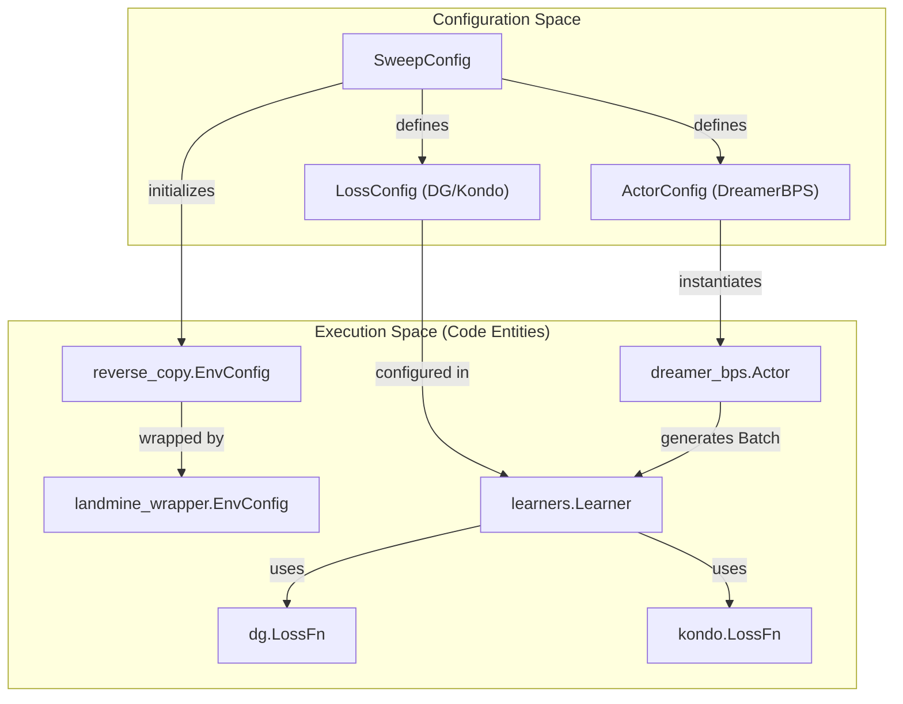
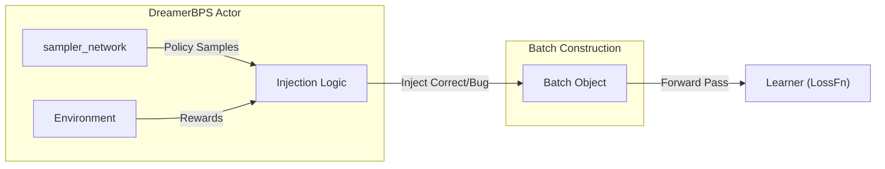

<!-- source: DeepWiki mcp.deepwiki.com · repo google-deepmind/egg · page 7.2 DPG and Kondo Experiments · fetched 2026-10-26 -->

# DPG and Kondo Experiments

Relevant source files

The following files were used as context for generating this wiki page:

- [experiments/dpg/README.md](experiments/dpg/README.md)
- [experiments/dpg/run.py](experiments/dpg/run.py)
- [experiments/dpg/run_test.py](experiments/dpg/run_test.py)
- [experiments/kondo/README.md](experiments/kondo/README.md)
- [experiments/kondo/run.py](experiments/kondo/run.py)
- [experiments/kondo/run_test.py](experiments/kondo/run_test.py)

This page covers the implementation and configuration of the Delightful Policy Gradient (DPG) and Kondo (costly-compute gate) experiments. These experiments are designed to investigate selective learning updates where gradients are only computed for "delightful" transitions—those that provide significant learning signals—thereby improving sample efficiency and reducing computational costs.

## Overview

The DPG and Kondo experiments are based on the research paper *"Does This Gradient Spark Joy?"* (Osband et al., 2026) [[experiments/dpg/README.md:1-15](), [experiments/kondo/README.md:1-15]()]. 

*   **DPG (Delightful Policy Gradient):** Uses a sigmoid gate to weight gradients based on "delight" (a combination of advantage and surprisal). It focuses on learning from high-value samples but does not inherently reduce backward-pass compute [[experiments/dpg/run.py:184-190](), [experiments/kondo/run.py:22-24]()].
*   **Kondo Experiment:** Implements the **Kondo Gate**, a binary top-k selection mechanism. It selects a fixed percentage (`pct_learn`) of tokens for gradient updates, allowing the system to skip the backward pass for non-selected tokens to achieve compute speedups [[experiments/kondo/run.py:16-27](), [experiments/kondo/run.py:163-171]()].

### Experiment Data Flow

The following diagram illustrates how the experiment configurations bridge the environment, the actor (with data injection), and the specialized loss functions.

**Experiment Configuration to Code Entity Mapping**

Sources: [experiments/dpg/run.py:101-211](), [experiments/kondo/run.py:99-211]()

---

## Environment: ReverseCopy with Wrappers

Both experiments primarily use the `ReverseCopy` environment, where the model must output a sequence in reverse order (or incremented) relative to the prompt [[experiments/dpg/run.py:105-112](), [experiments/kondo/run.py:102-108]()].

### Configuration and Noise
The environment is typically wrapped to increase task difficulty and test robustness:
1.  **LandmineWrapper:** Injects a "landmine" sequence (usually all zeros) which, if generated, results in a specific `landmine_reward` (penalty) [[experiments/dpg/run.py:135-141](), [experiments/kondo/run.py:117-121]()].
2.  **ZerosPromptWrapper:** Occasionally replaces the prompt with zeros to test the model's behavior under uninformative inputs [[experiments/dpg/run.py:128-133](), [experiments/kondo/run.py:110-115]()].
3.  **Gaussian/Bernoulli Noise:** (DPG specific) Adds noise to the reward signal to simulate stochastic environments [[experiments/dpg/run.py:115-126]()].

Sources: [experiments/dpg/run.py:41-58](), [experiments/kondo/run.py:60-71]()

---

## Actor: DreamerBPS and Data Injection

The experiments use the `DreamerBPS` actor. Unlike standard actors that only sample from the current policy, `DreamerBPS` can inject specific sequences into the training batch to simulate "imagination" or high-quality demonstrations [[experiments/dpg/run.py:170-181](), [experiments/kondo/run.py:145-152]()].

### Injection Types
The actor configuration supports three types of injection probabilities:
*   **`bug_prob`**: Probability of injecting the landmine (failure) sequence.
*   **`correct_prob`**: Probability of injecting the ground-truth correct sequence.
*   **`random_prob`**: Probability of injecting a completely random sequence.

### Biased Actor Network
In DPG, the actor's network can be configured with `actor_sigma` to add logit noise, creating a discrepancy between the sampling policy and the learner's policy to test off-policy correction [[experiments/dpg/run.py:162-167]()].

**Actor-Learner Interaction with Injection**

Sources: [experiments/dpg/run.py:170-181](), [egg/actors/dreamer_bps.py]()

---

## Loss Configurations

The core of these experiments lies in the specialized loss functions that implement selective gating.

### Delightful Policy Gradient (DG)
The DG loss uses a sigmoid gate defined by a delight threshold $\lambda$. 
*   **Gate:** $\sigma(\eta \cdot (\text{Advantage} \times \text{Surprisal} - \lambda))$ [[experiments/dpg/run.py:184-190]()].
*   **Parameters:** `eta_learn` (slope), `lambda_learn` (threshold), and `stochastic_gate` (boolean) [[experiments/dpg/run.py:79-86]()].

### Kondo Gate (DG-K)
The Kondo loss implements a binary selection mechanism for compute efficiency.
*   **Priority Types:** Tokens are ranked by `delight`, `advantage`, `abs_advantage`, `surprisal`, `uniform`, or `additive` [[experiments/kondo/run.py:82-83]()].
*   **Mechanism:** Only the top `pct_learn` fraction of tokens (based on priority) are selected for the backward pass [[experiments/kondo/run.py:163-171]()].
*   **Grouped Baseline:** Both losses typically use `use_grouped_baseline=True` with `num_groups` set to the number of prompts per batch to reduce variance [[experiments/dpg/run.py:189-191](), [experiments/kondo/run.py:169-170]()].

| Feature | DPG (`dg`) | Kondo (`kondo`) |
| :--- | :--- | :--- |
| **Gating Type** | Sigmoid (Soft) | Binary Top-K (Hard) |
| **Primary Param** | `eta_learn` (slope) | `pct_learn` (fraction) |
| **Compute Saving** | No (Full backward pass) | Yes (Partial backward pass) |
| **Priority** | Advantage $\times$ Surprisal | Configurable (`priority`) |

Sources: [experiments/dpg/run.py:75-90](), [experiments/kondo/run.py:75-85](), [experiments/kondo/run.py:154-171]()

---

## Running the Experiments

Both experiments utilize the `VanillaAsyncTrainer` to manage the training loop, allowing for potential delays in parameter updates between the learner and the actor [[experiments/dpg/run.py:204-208](), [experiments/kondo/run.py:203-207]()].

### Execution Entrypoints
*   **DPG:** `python -m egg.experiments.dpg.run --sweep.loss=dg`
*   **Kondo:** `python -m egg.experiments.kondo.run --sweep.loss=kondo --sweep.loss_param_one=0.1` (to learn from 10% of tokens).

### Smoke Tests
The experiments include smoke tests to verify the integration of different loss types with the environment and actor setup [[experiments/dpg/run_test.py:23-31](), [experiments/kondo/run_test.py:25-32]()].

Sources: [experiments/dpg/run.py:217-225](), [experiments/kondo/run.py:217-225]()

---

