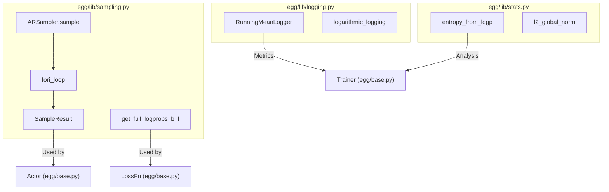
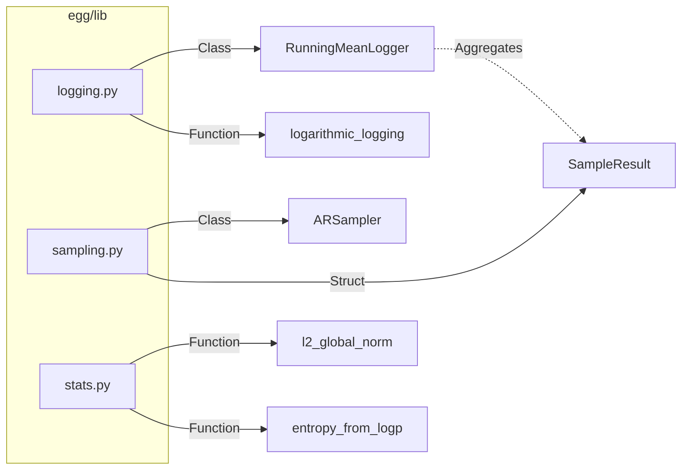

<!-- source: DeepWiki mcp.deepwiki.com · repo google-deepmind/egg · page 8 Utility Libraries · fetched 2026-10-26 -->

# Utility Libraries

Relevant source files

The following files were used as context for generating this wiki page:

- [egg/lib/__init__.py](egg/lib/__init__.py)

The `egg/lib` directory contains the foundational utilities that support the framework's training loops, data generation, and metric tracking. These libraries are designed to be framework-agnostic where possible, providing standardized implementations of statistical methods and sampling logic used by both [Trainers](#6) and [Actors](#3).

The utility layer is divided into two primary functional areas:
1.  **Logging and Statistics**: Tools for online metric aggregation and JAX-compatible statistical computations.
2.  **Autoregressive Sampling**: The core logic for generating sequences from language models using `jax.lax.fori_loop`.

### System Overview

The following diagram illustrates how the utility libraries bridge the gap between raw model outputs and the structured data required by the rest of the system.

**Utility Integration Flow**

**Sources:** [egg/lib/sampling.py:1-20](), [egg/lib/logging.py:1-15](), [egg/lib/stats.py:1-15]()

---

### Logging and Statistics

The logging utilities in `egg` are optimized for high-throughput RL training where standard logging might become a bottleneck or consume excessive memory. 

Key components include:
*   **`RunningMeanLogger`**: Implements Welford's online algorithm to maintain running means and counts of metrics without storing the entire history in memory. This is critical for the `VanillaSyncTrainer` to track performance across millions of steps.
*   **`logarithmic_logging`**: A scheduling utility that reduces logging frequency as training progresses (e.g., logging more frequently at the start of an experiment and less frequently as the model converges).
*   **`stats` module**: Provides JAX-native functions for calculating sequence-level statistics such as `entropy_from_logp`, `logp_stats`, and `l2_global_norm` for gradient monitoring.

For detailed implementation details on metric aggregation and config hashing, see **[Logging and Statistics](#8.1)**.

**Sources:** [egg/lib/logging.py:20-80](), [egg/lib/stats.py:25-100]()

---

### Autoregressive Sampling (ARSampler)

The `ARSampler` is the central engine for sequence generation within `egg`. It abstracts the complexity of step-by-step token generation, handling both exploration and log-probability tracking.

| Component | Description |
| :--- | :--- |
| **`ARSampler`** | The main class using `jax.lax.fori_loop` to generate sequences of length $L$. |
| **`SampleResult`** | A data structure containing generated tokens, log-probabilities, and masks. |
| **`epsilon-greedy`** | Integrated exploration mechanism controlled via `SamplerConfig`. |
| **`get_full_logprobs_b_l`** | A teacher-forcing utility used by learners to re-evaluate sequences. |

The sampler is designed to work with any `Network` that follows the `egg` interface, ensuring that sampling logic remains consistent whether using a standard `Transformer` or a `QuantizedTransformer`.

For details on the sampling loop and mixed-policy computations, see **[Autoregressive Sampling (ARSampler)](#8.2)**.

**Sources:** [egg/lib/sampling.py:30-150]()

---

### Code Entity Mapping

The following diagram maps the logical utility concepts to their specific implementations within the `egg/lib` directory.

**Utility Code Map**

**Sources:** [egg/lib/logging.py:1-100](), [egg/lib/sampling.py:1-200](), [egg/lib/stats.py:1-120]()

---

