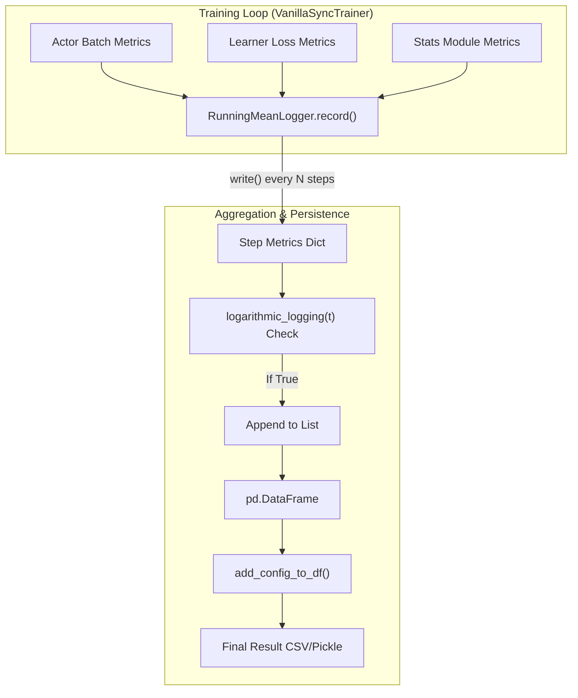
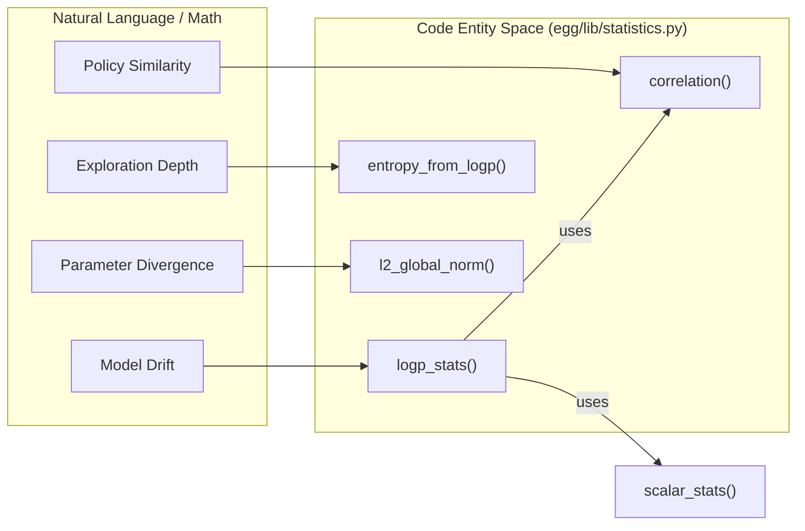

<!-- source: DeepWiki mcp.deepwiki.com · repo google-deepmind/egg · page 8.1 Logging and Statistics · fetched 2026-10-26 -->

# Logging and Statistics

Relevant source files

The following files were used as context for generating this wiki page:

- [egg/lib/logging.py](egg/lib/logging.py)
- [egg/lib/statistics.py](egg/lib/statistics.py)

The `egg` framework provides a robust set of utilities for tracking experiment progress, computing numerically stable online statistics, and performing deep analysis of model distributions. These utilities are designed to be JIT-safe (using pure JAX) and efficient for large-scale RL training loops.

## RunningMeanLogger

The `RunningMeanLogger` is a utility class used to aggregate scalar metrics over multiple training steps. It employs **Welford's online algorithm** to compute means in a numerically stable way without storing the entire history of values [[egg/lib/logging.py:78-79]]().

### Implementation Details
- **Welford's Algorithm**: Instead of summing all values and dividing by the total (which can lead to precision loss for large sums), it updates the mean incrementally using the formula: `new_mean = old_mean + (value - old_mean) / count` [[egg/lib/logging.py:92-95]]().
- **State Management**: It maintains internal `defaultdict` structures for `_means` and `_counts` [[egg/lib/logging.py:82-83]]().
- **Lifecycle**:
    1. `record(metrics)`: Updates the running mean for each key in the provided dictionary [[egg/lib/logging.py:85-96]]().
    2. `write()`: Returns the current means and resets the internal accumulators for the next window [[egg/lib/logging.py:97-102]]().

### Data Flow: Actor-Learner Logging
The following diagram illustrates how metrics flow from the training loop into the logger and finally into a persistent format.

**Figure 1: Logging Data Flow**

Sources: [[egg/lib/logging.py:78-102]](), [[egg/lib/logging.py:68-75]](), [[egg/lib/logging.py:32-49]]().

## Logarithmic Logging Schedule

To manage storage and visualization overhead in long-running experiments, `egg` uses a logarithmic schedule via the `logarithmic_logging(t)` function. This ensures that logging frequency is high at the start of training (where dynamics change rapidly) and decreases as the model converges [[egg/lib/logging.py:68-75]]().

The function returns `True` only when the step `t` matches specific ratios of $10^{exponent}$. The allowed ratios are:
`1.0, 1.2, 1.4, 1.7, 2.0, 2.5, 3.0, 4.0, 5.0, 6.0, 7.0, 8.0, 9.0, 10.0` [[egg/lib/logging.py:70]]().

For example, in the range $[100, 1000]$, it will trigger at steps 100, 120, 140, 170, 200, 250, 300, 400, 500, 600, 700, 800, 900, and 1000 [[egg/lib/logging.py:73-75]]().

Sources: [[egg/lib/logging.py:68-75]]().

## Config Management and Hashing

The `add_config_to_df` utility facilitates reproducible research by embedding experiment hyperparameters directly into the results DataFrame [[egg/lib/logging.py:32-49]]().

- **Serialization**: It converts complex dataclass fields (lists, dicts, types) into JSON strings or standard strings to ensure compatibility with pandas and CSV exports [[egg/lib/logging.py:38-48]]().
- **Hashing**: It generates a unique 8-character SHA-1 hash of the configuration dictionary using `_hash_dict_config` [[egg/lib/logging.py:60-65]](). This allows for easy grouping and filtering of experiments during analysis.

Sources: [[egg/lib/logging.py:32-65]]().

## Statistics Module

The `egg/lib/statistics.py` module provides JIT-safe helpers for analyzing distributions and model parameters. All functions return 0-D `jnp.ndarray` objects [[egg/lib/statistics.py:18-19]]().

### Key Functions

| Function | Description | Implementation Detail |
| :--- | :--- | :--- |
| `scalar_stats` | Computes min, max, mean, and std. | Returns a dict with prefixed keys [[egg/lib/statistics.py:29-36]](). |
| `correlation` | Computes Pearson correlation coefficient. | Returns 0.0 if the denominator is 0 (constant input) [[egg/lib/statistics.py:39-44]](). |
| `entropy_from_logp` | Calculates Shannon entropy. | Computed as $-\sum p \cdot \log p$ across the last axis [[egg/lib/statistics.py:47-50]](). |
| `logp_stats` | Comprehensive comparison of two log-prob distributions. | Computes stats for learner vs. sampler in both log-space and probability-space [[egg/lib/statistics.py:53-74]](). |
| `l2_global_norm` | L2 distance between two PyTrees. | Uses `optax.tree.norm` on the difference tree [[egg/lib/statistics.py:77-80]](). |

### Distribution Analysis Mapping
This diagram bridges the mathematical concepts of policy comparison to the code entities that implement them.

**Figure 2: Distribution Analysis Code Entities**

Sources: [[egg/lib/statistics.py:29-81]]().

### logp_stats Output
The `logp_stats` function is particularly important for diagnosing training stability. It returns a dictionary containing:
1. **Log-space metrics**: `logp_learner`, `logp_sampler`, and their difference/correlation [[egg/lib/statistics.py:60-63]]().
2. **Probability-space metrics**: `prob_learner`, `prob_sampler`, and their difference/correlation [[egg/lib/statistics.py:69-72]]().

This allows developers to monitor if the Learner's policy is diverging significantly from the Sampler's policy (the policy that generated the data), which is critical for Off-Policy Correction and Importance Sampling.

Sources: [[egg/lib/statistics.py:53-74]]().

---

