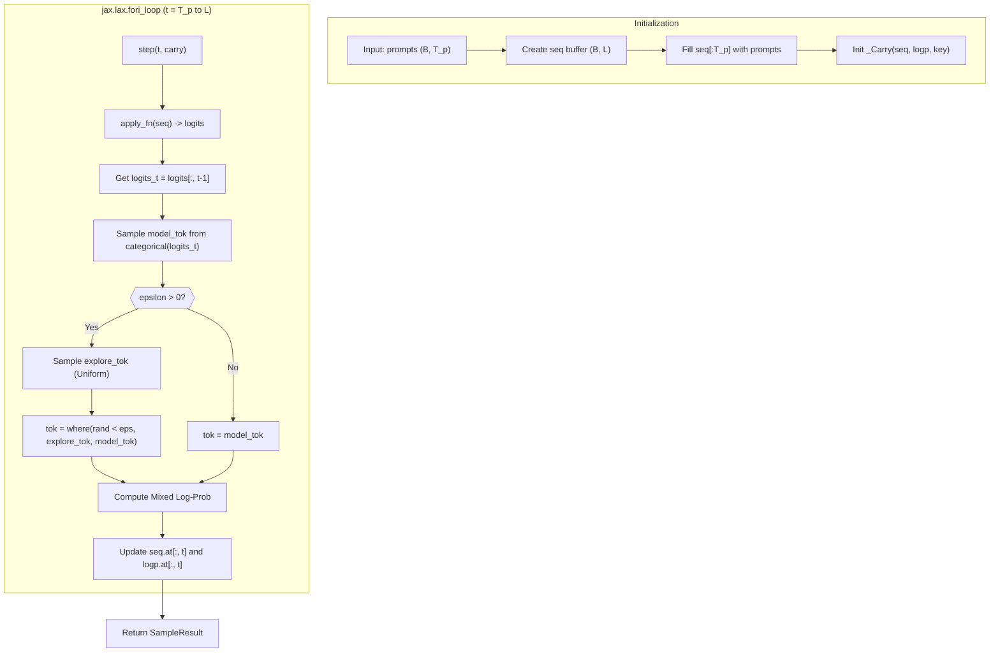
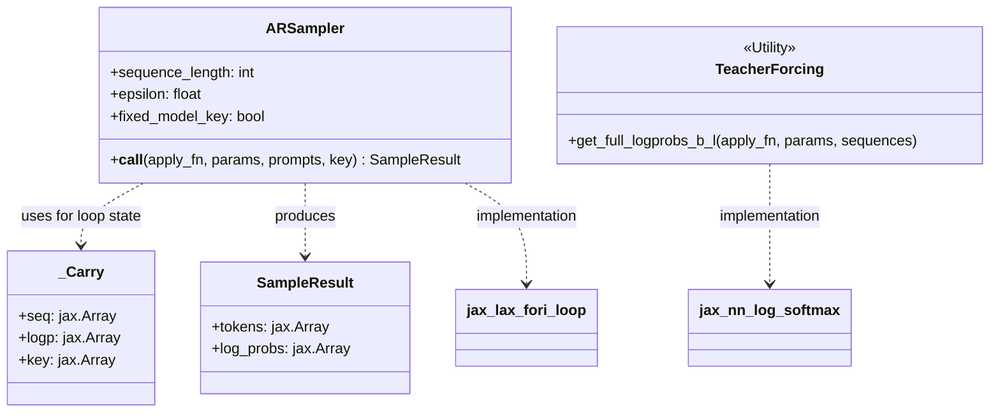

<!-- source: DeepWiki mcp.deepwiki.com · repo google-deepmind/egg · page 8.2 Autoregressive Sampling (ARSampler) · fetched 2026-10-26 -->

# Autoregressive Sampling (ARSampler)

Relevant source files

The following files were used as context for generating this wiki page:

- [egg/lib/ar_sample.py](egg/lib/ar_sample.py)

The `ARSampler` is a core utility in the `egg` framework designed to perform efficient, JIT-compatible autoregressive generation of token sequences. It bridges the gap between a neural network's forward pass (which typically produces logits for all positions in parallel during training) and the sequential nature of inference or RL environment interaction.

## Overview and Purpose

In RL settings, an actor must generate sequences one token at a time, where each token depends on the previously generated context. `ARSampler` encapsulates this logic using `jax.lax.fori_loop` to ensure the generation loop can be compiled into a single XLA executable. It supports epsilon-greedy exploration, mixed-policy log-probability tracking, and flexible PRNG key management for stochastic networks.

### Key Capabilities
*   **Parallel Batch Sampling**: Generates sequences for an entire batch of prompts simultaneously [egg/lib/ar_sample.py:35-35]().
*   **Epsilon-Greedy Exploration**: Supports mixing the model's policy with a uniform random distribution for exploration [egg/lib/ar_sample.py:40-40]().
*   **Log-Probability Computation**: Correctly computes the log-probability of the chosen tokens under the mixed policy (model + exploration) [egg/lib/ar_sample.py:119-124]().
*   **Fixed Model Key**: Option to keep the model's internal stochasticity (e.g., logit noise) fixed across all steps of a single sequence generation [egg/lib/ar_sample.py:39-39]().

Sources: [egg/lib/ar_sample.py:34-45](), [egg/lib/ar_sample.py:119-124]()

---

## Data Structures

The sampler uses two primary data structures to manage inputs, outputs, and the internal loop state.

### SampleResult
A `NamedTuple` returned by the sampler containing the generated tokens and their corresponding log probabilities.
| Field | Type | Description |
| :--- | :--- | :--- |
| `tokens` | `jax.Array` | The full sequence including the prompt, shape `(B, seq_length)`. |
| `log_probs` | `jax.Array` | Log probabilities of each generated token, shape `(B, seq_length)`. |

Sources: [egg/lib/ar_sample.py:28-31]()

### _Carry
An internal `NamedTuple` used to pass state between iterations of the `fori_loop`.
| Field | Type | Description |
| :--- | :--- | :--- |
| `seq` | `jax.Array` | The current sequence being built. |
| `logp` | `jax.Array` | The log probabilities accumulated so far. |
| `key` | `jax.Array` | The PRNG key for the next iteration's sampling. |

Sources: [egg/lib/ar_sample.py:188-192]()

---

## Implementation Details

### The Sampling Loop
The sampler initializes a sequence buffer with the provided prompts and fills the remaining slots using a JAX-native loop [egg/lib/ar_sample.py:60-63]().

**ARSampler Flow**

Sources: [egg/lib/ar_sample.py:47-143]()

### Mixed Policy Log-Probabilities
When `epsilon > 0`, the sampler implements an epsilon-greedy policy. The probability of selecting a token $a$ is defined as:
$$P(a) = (1 - \epsilon) P(a | \text{model}) + \epsilon P(a | \text{random})$$

The implementation ensures that the `log_probs` returned in `SampleResult` reflect this mixture, which is critical for unbiased policy gradient estimates [egg/lib/ar_sample.py:115-124]().
*   `prob_tok_model`: Probability of the chosen token under the model's softmax [egg/lib/ar_sample.py:111-111]().
*   `prob_tok_random`: $1 / \text{vocab\_size}$ [egg/lib/ar_sample.py:113-113]().
*   `mixed_prob_tok`: The weighted sum [egg/lib/ar_sample.py:119-121]().

### Model Key Management
The `fixed_model_key` flag controls how PRNG keys are passed to the network's `noise` RNG collection:
1.  **If `True`**: A single key is split before the loop and reused for every token generation step in the sequence [egg/lib/ar_sample.py:66-67](). This is useful for models where noise represents a latent property that should be consistent across a trajectory.
2.  **If `False`**: A new key is split from the global state at every timestep `t` [egg/lib/ar_sample.py:80-80]().

Sources: [egg/lib/ar_sample.py:66-82]()

---

## Teacher-Forcing Utility: `get_full_logprobs_b_l`

While `ARSampler` is used for generation, `get_full_logprobs_b_l` is a utility for evaluation and training (teacher-forcing). It computes the log-probability of an existing sequence under the model's current parameters in a single forward pass [egg/lib/ar_sample.py:146-152]().

### Logic Flow
1.  **Input Handling**: Maps any `PAD_TOKEN` (usually -1) to 0 to prevent embedding index errors, though these positions are masked later [egg/lib/ar_sample.py:158-158]().
2.  **Shifted Comparison**: The model predicts the token at $t$ given tokens $0 \dots t-1$. Therefore, the logits at index $t$ are compared against the input sequence at index $t+1$ [egg/lib/ar_sample.py:170-173]().
3.  **Masking**: Zeroes out log-probabilities for any position where the target was originally a `PAD_TOKEN` [egg/lib/ar_sample.py:179-180]().
4.  **Alignment**: Pads the output with a leading zero so the resulting array of log-probs has the same length $L$ as the input sequence [egg/lib/ar_sample.py:183-185]().

**Log-Probability Alignment**
| Time (t) | 0 | 1 | 2 | ... | L-1 |
| :--- | :--- | :--- | :--- | :--- | :--- |
| **Input Seq** | $S_0$ | $S_1$ | $S_2$ | ... | $S_{L-1}$ |
| **Model Logits** | $P(\cdot\|S_0)$ | $P(\cdot\|S_0, S_1)$ | $P(\cdot\|S_0, S_1, S_2)$ | ... | (N/A) |
| **Output Log-Prob** | 0 | $\log P(S_1\|S_0)$ | $\log P(S_2\|S_0, S_1)$ | ... | $\log P(S_{L-1}\|\dots)$ |

Sources: [egg/lib/ar_sample.py:146-186]()

---

## Code Entity Map

The following diagram maps the logical components of autoregressive sampling to their specific implementations in `egg/lib/ar_sample.py`.

**System-to-Code Association**

Sources: [egg/lib/ar_sample.py:28-31](), [egg/lib/ar_sample.py:34-40](), [egg/lib/ar_sample.py:146-152](), [egg/lib/ar_sample.py:188-192]()

---

