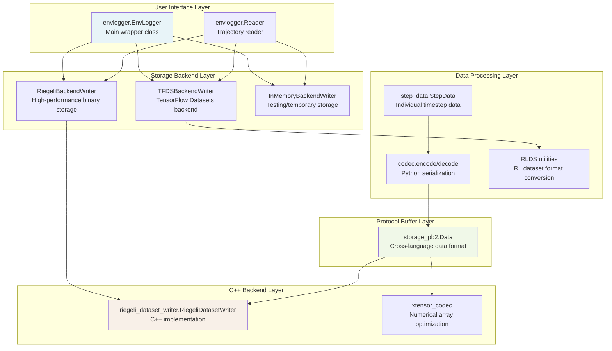
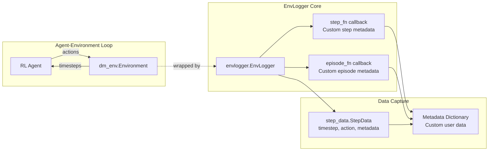
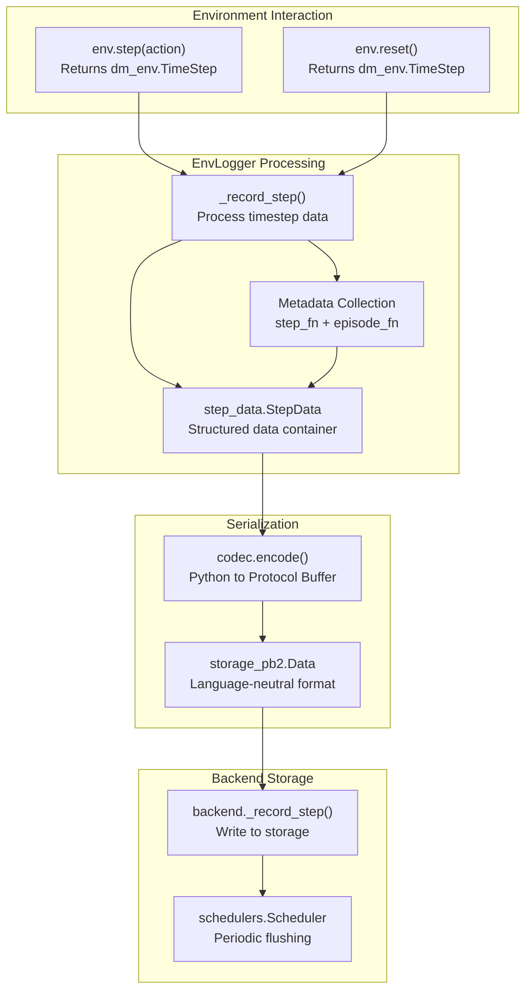
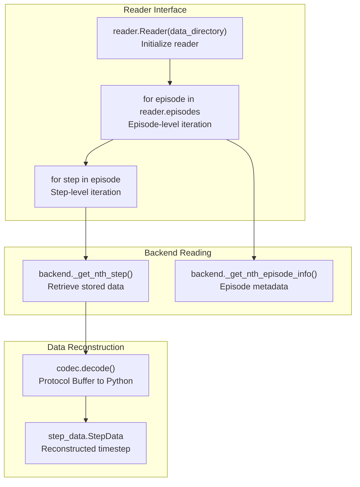
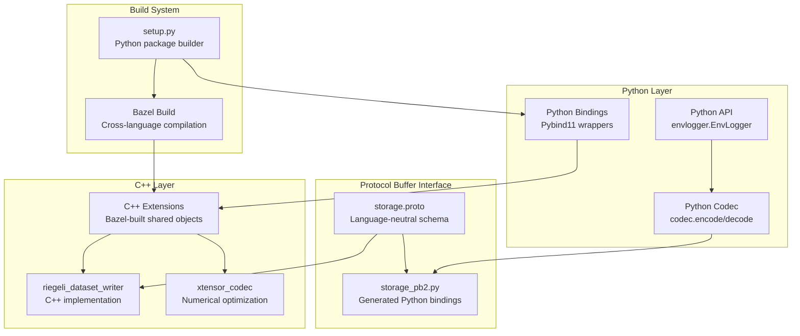

<!-- source: DeepWiki mcp.deepwiki.com · repo google-deepmind/envlogger · page 1 EnvLogger Overview · fetched 2026-10-26 -->

# EnvLogger Overview

<details>
<summary>Relevant source files</summary>

The following files were used as context for generating this wiki page:

- [README.md](README.md)
- [docker/Dockerfile](docker/Dockerfile)
- [docs/images/timings.png](docs/images/timings.png)
- [envlogger/backends/in_memory_backend.py](envlogger/backends/in_memory_backend.py)
- [envlogger/backends/riegeli_backend_writer.py](envlogger/backends/riegeli_backend_writer.py)
- [envlogger/examples/random_agent_catch.py](envlogger/examples/random_agent_catch.py)
- [envlogger/setup.py](envlogger/setup.py)

</details>


## Purpose and Scope

EnvLogger is a trajectory logging system for reinforcement learning environments that provides a standard wrapper around `dm_env.Environment` interfaces. It records interactions between agents and environments, storing them persistently for later analysis, training, or evaluation. The system supports multiple storage backends, cross-language integration between Python and C++, and seamless integration with TensorFlow Datasets (TFDS) and Reinforcement Learning Dataset (RLDS) formats.

This document covers the overall system architecture, core components, and data flow patterns. For detailed information about specific storage backends, see [Storage Backends](#3). For build system configuration, see [Build System and Development Setup](#5).

## System Architecture

### Overall Architecture



Sources: [README.md:1-235](), [envlogger/setup.py:27-174](), [envlogger/backends/riegeli_backend_writer.py:1-100](), [envlogger/backends/in_memory_backend.py:1-92]()

## Core Components

### Environment Wrapper Integration



Sources: [README.md:16-98](), [envlogger/examples/random_agent_catch.py:36-67]()

### Backend Architecture

```mermaid
graph TB
    subgraph "Abstract Interface"
        BackendWriter["backend_writer.BackendWriter<br/>Abstract base class"]
        BackendReader["backend_reader.BackendReader<br/>Abstract base class"]
    end
    
    subgraph "Concrete Implementations"
        TFDSWriter["TFDSBackendWriter<br/>TFDS format writer"]
        RiegeliWriter["RiegeliBackendWriter<br/>Binary format writer"]
        InMemoryWriter["InMemoryBackendWriter<br/>RAM-based writer"]
        
        TFDSReader["TFDSBackendReader<br/>TFDS format reader"]
        RiegeliReader["RiegeliBackendReader<br/>Binary format reader"]
        InMemoryReader["InMemoryBackendReader<br/>RAM-based reader"]
    end
    
    subgraph "Support Components"
        Scheduler["schedulers.BernoulliStepScheduler<br/>Flush timing control"]
        EpisodeInfo["episode_info.EpisodeInfo<br/>Episode metadata"]
    end
    
    BackendWriter <|-- TFDSWriter
    BackendWriter <|-- RiegeliWriter
    BackendWriter <|-- InMemoryWriter
    
    BackendReader <|-- TFDSReader
    BackendReader <|-- RiegeliReader
    BackendReader <|-- InMemoryReader
    
    RiegeliWriter --> Scheduler
    InMemoryWriter --> EpisodeInfo
    InMemoryReader --> EpisodeInfo
```

Sources: [envlogger/backends/riegeli_backend_writer.py:29-100](), [envlogger/backends/in_memory_backend.py:29-92]()

## Data Flow Architecture

### Recording Data Flow



Sources: [envlogger/backends/riegeli_backend_writer.py:80-89](), [README.md:40-70]()

### Reading Data Flow



Sources: [README.md:149-174](), [envlogger/backends/in_memory_backend.py:66-91]()

## Cross-Language Integration

### Python-C++ Bridge



Sources: [envlogger/setup.py:79-137](), [envlogger/setup.py:33-68]()

## Integration Points

### TFDS and RLDS Integration

| Component | Purpose | Key Classes |
|-----------|---------|-------------|
| TFDS Backend | TensorFlow Datasets compatibility | `TFDSBackendWriter`, `tfds_backend_writer` |
| RLDS Format | Reinforcement Learning Dataset format | `rlds_utils`, `DatasetConfig` |
| Dataset Configuration | Environment specification | `tfds.features.Tensor`, `tfds.rlds.rlds_base.DatasetConfig` |
| Shard Management | File organization and recovery | `maybe_recover_last_shard`, `max_episodes_per_file` |

Sources: [README.md:100-148]()

### Performance Characteristics

| Backend | Use Case | Performance Notes |
|---------|----------|-------------------|
| InMemory | Testing, small datasets | Fastest access, limited by RAM |
| Riegeli | Production, large datasets | ~2ms overhead per step, compressed storage |
| TFDS | ML pipeline integration | TFDS-compatible format, batch processing |

The system adds approximately 2 milliseconds overhead per environment step based on benchmark data with a random agent on a 100 steps per second Catch environment.

Sources: [README.md:218-228](), [envlogger/backends/in_memory_backend.py:1-92](), [envlogger/backends/riegeli_backend_writer.py:1-100]()

---

