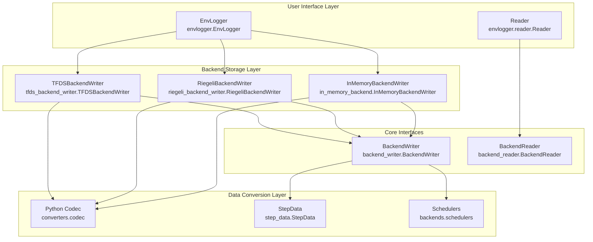
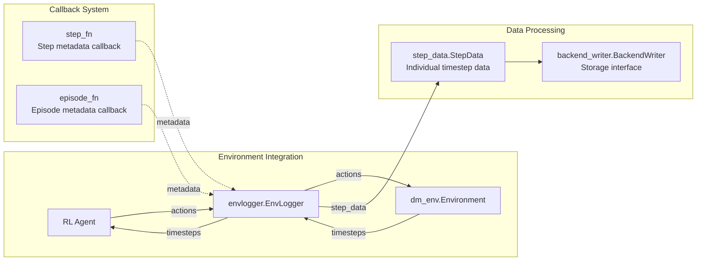
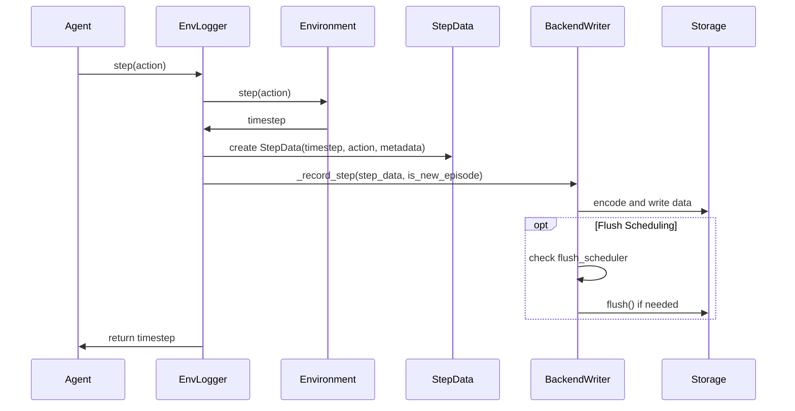
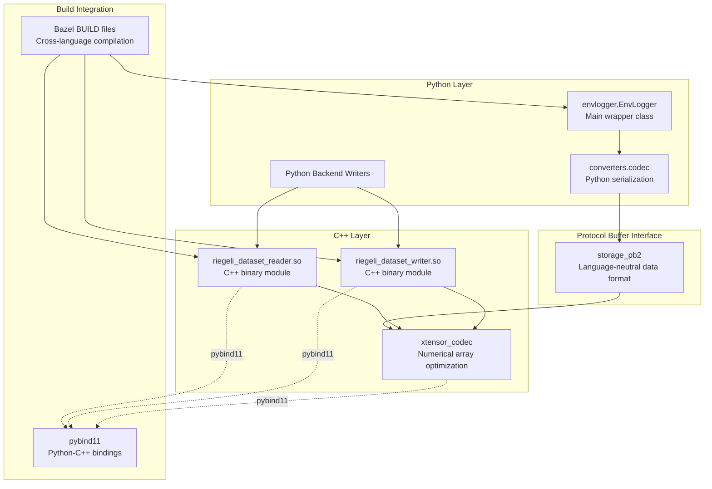
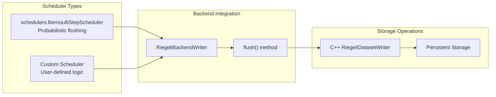
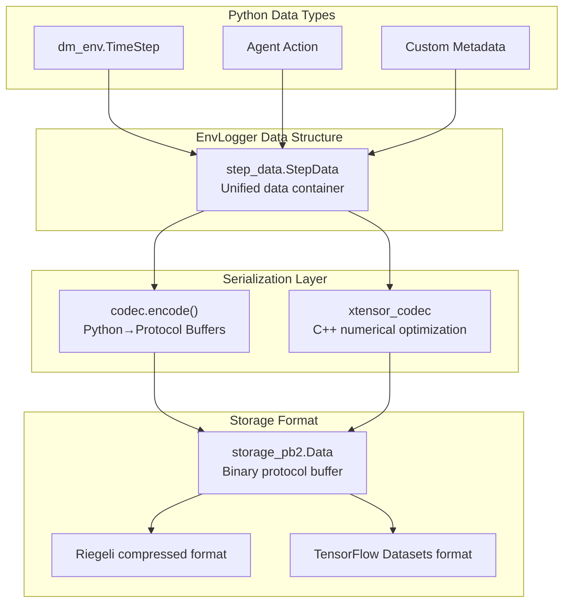

<!-- source: DeepWiki mcp.deepwiki.com · repo google-deepmind/envlogger · page 1.1 System Architecture · fetched 2026-10-26 -->

# System Architecture

<details>
<summary>Relevant source files</summary>

The following files were used as context for generating this wiki page:

- [README.md](README.md)
- [docs/images/timings.png](docs/images/timings.png)
- [envlogger/backends/BUILD.bazel](envlogger/backends/BUILD.bazel)
- [envlogger/backends/in_memory_backend.py](envlogger/backends/in_memory_backend.py)
- [envlogger/backends/riegeli_backend_writer.py](envlogger/backends/riegeli_backend_writer.py)
- [envlogger/examples/random_agent_catch.py](envlogger/examples/random_agent_catch.py)

</details>


This document provides a comprehensive overview of the EnvLogger system architecture, detailing how components interact to provide trajectory logging capabilities for reinforcement learning environments. EnvLogger acts as a wrapper around `dm_env.Environment` instances to record agent-environment interactions and store them in various backend formats.

For information about specific backend implementations, see [Storage Backends](#3). For build system details, see [Build System and Development Setup](#5). For data format specifications, see [Data Conversion and Serialization](#4).

## Overview

EnvLogger implements a layered architecture that separates concerns between environment interaction, data transformation, and persistent storage. The system is designed to be backend-agnostic, allowing users to choose between different storage formats while maintaining a consistent API.



**Sources:** [README.md:1-235](), [envlogger/backends/BUILD.bazel:15-176]()

## Core Components

### EnvLogger Wrapper

The `EnvLogger` class serves as the primary entry point for users. It wraps a `dm_env.Environment` instance and intercepts all interactions to record trajectory data.



**Sources:** [README.md:16-24](), [envlogger/examples/random_agent_catch.py:36-66]()

### Backend Storage Architecture

The system implements a pluggable backend architecture where different storage mechanisms can be used interchangeably through the `BackendWriter` interface.

```mermaid
graph TD
    subgraph "Abstract Interface"
        BackendWriter["backend_writer.BackendWriter<br/>Abstract base class"]
        BackendReader["backend_reader.BackendReader<br/>Abstract base class"]
    end
    
    subgraph "Concrete Implementations"
        TFDSWriter["tfds_backend_writer.TFDSBackendWriter<br/>TensorFlow Datasets format"]
        RiegeliWriter["riegeli_backend_writer.RiegeliBackendWriter<br/>High-performance binary format"]
        InMemoryWriter["in_memory_backend.InMemoryBackendWriter<br/>RAM-based storage"]
    end
    
    subgraph "Supporting Components"
        Scheduler["schedulers.Scheduler<br/>Flush scheduling"]
        RLDSUtils["rlds_utils<br/>RLDS format conversion"]
        Codec["codec<br/>Serialization utilities"]
    end
    
    BackendWriter <|-- TFDSWriter
    BackendWriter <|-- RiegeliWriter
    BackendWriter <|-- InMemoryWriter
    
    TFDSWriter --> RLDSUtils
    RiegeliWriter --> Scheduler
    
    TFDSWriter --> Codec
    RiegeliWriter --> Codec
    InMemoryWriter --> Codec
```

**Sources:** [envlogger/backends/BUILD.bazel:52-58](), [envlogger/backends/riegeli_backend_writer.py:29-100](), [envlogger/backends/in_memory_backend.py:29-92]()

## Data Flow Patterns

### Step Recording Flow

The following diagram illustrates how individual environment steps are processed and stored:



**Sources:** [envlogger/backends/riegeli_backend_writer.py:80-89](), [envlogger/backends/in_memory_backend.py:38-42]()

### Backend Selection and Configuration

EnvLogger supports multiple storage backends that can be configured at initialization:

| Backend Type | Class | Use Case | Key Features |
|--------------|-------|----------|--------------|
| **TFDS** | `tfds_backend_writer.TFDSBackendWriter` | ML pipeline integration | TensorFlow Datasets compatibility, RLDS format |
| **Riegeli** | `riegeli_backend_writer.RiegeliBackendWriter` | High-performance storage | C++ implementation, compression, sharding |
| **InMemory** | `in_memory_backend.InMemoryBackendWriter` | Testing and prototyping | RAM-based, no persistence |

**Sources:** [envlogger/backends/BUILD.bazel:134-141](), [envlogger/backends/BUILD.bazel:99-110](), [envlogger/backends/BUILD.bazel:61-69]()

## Cross-Language Integration

EnvLogger implements a hybrid Python/C++ architecture where performance-critical components are implemented in C++ and exposed through Python bindings:



**Sources:** [envlogger/backends/BUILD.bazel:84-95](), [envlogger/backends/BUILD.bazel:99-103]()

## Scheduling and Persistence

The system implements configurable flush scheduling to balance performance and data safety:



**Sources:** [envlogger/backends/riegeli_backend_writer.py:62-65](), [envlogger/backends/riegeli_backend_writer.py:87-89](), [envlogger/backends/BUILD.bazel:26-31]()

## Data Serialization Pipeline

The system uses a layered approach to data serialization that supports multiple data formats and optimizations:



**Sources:** [envlogger/backends/riegeli_backend_writer.py:82-83](), [envlogger/backends/BUILD.bazel:47-50](), [envlogger/backends/BUILD.bazel:127-131]()

---

