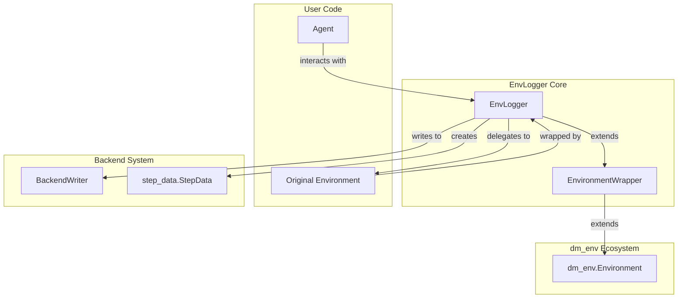
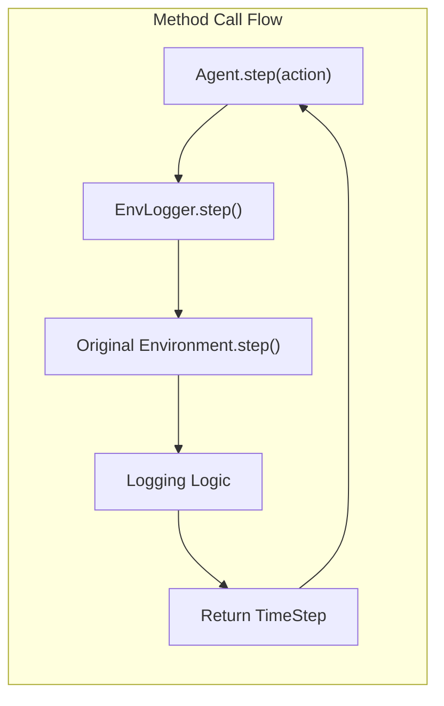
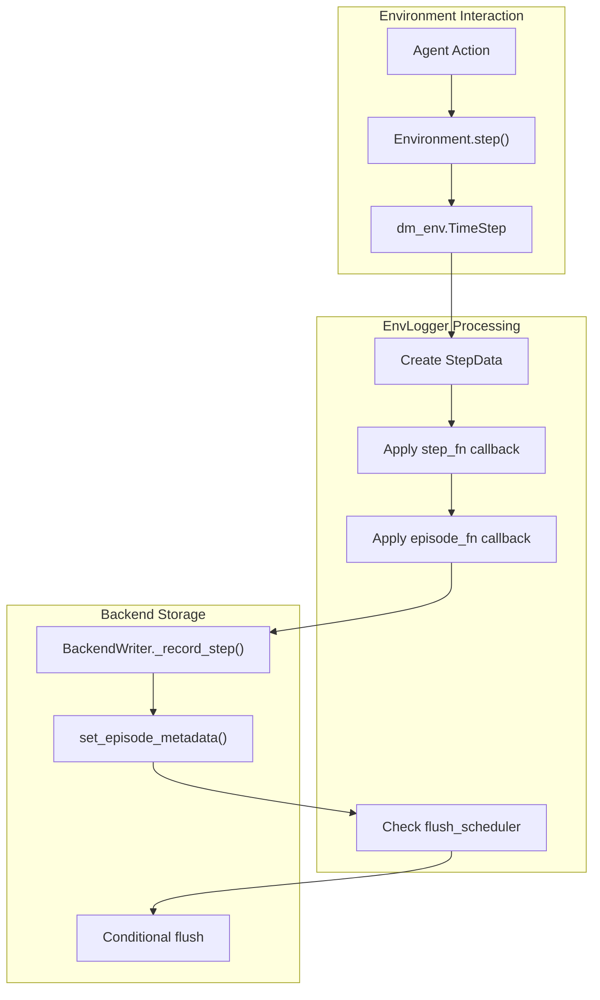
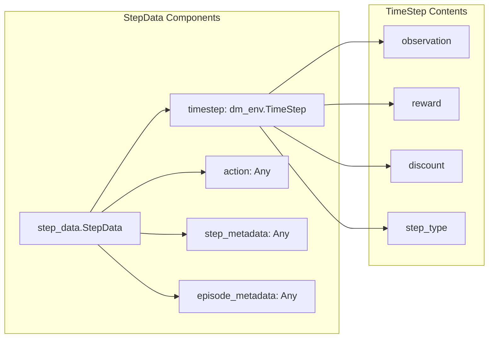
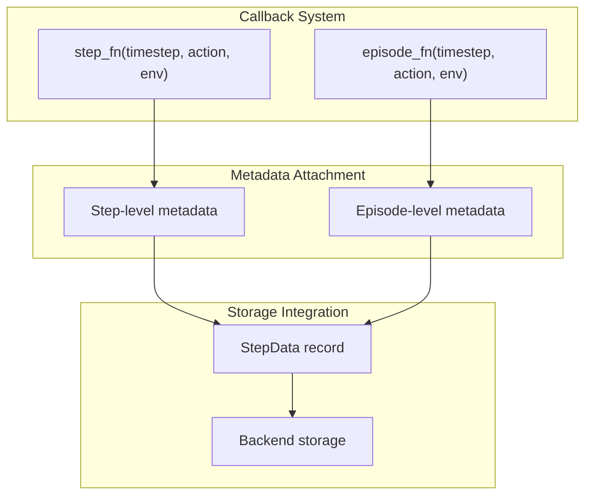
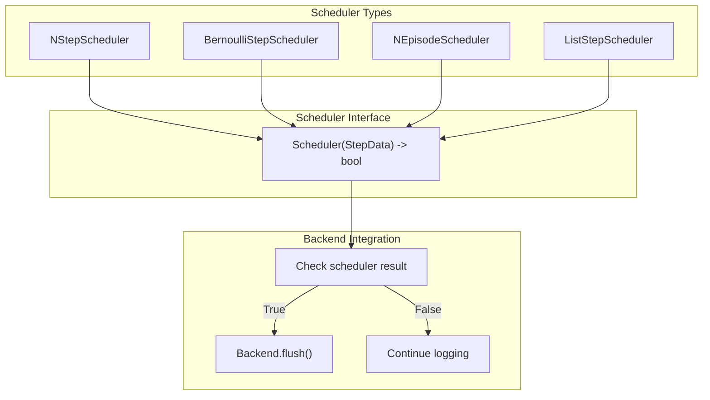

<!-- source: DeepWiki mcp.deepwiki.com · repo google-deepmind/envlogger · page 2 Core EnvLogger System · fetched 2026-10-26 -->

# Core EnvLogger System

Relevant source files

The following files were used as context for generating this wiki page:

- [README.md](README.md)
- [docs/images/timings.png](docs/images/timings.png)
- [envlogger/backends/in_memory_backend.py](envlogger/backends/in_memory_backend.py)
- [envlogger/backends/riegeli_backend_writer.py](envlogger/backends/riegeli_backend_writer.py)
- [envlogger/backends/schedulers.py](envlogger/backends/schedulers.py)
- [envlogger/backends/schedulers_test.py](envlogger/backends/schedulers_test.py)
- [envlogger/environment_wrapper.py](envlogger/environment_wrapper.py)
- [envlogger/examples/random_agent_catch.py](envlogger/examples/random_agent_catch.py)

This document covers the central EnvLogger wrapper class and its integration with dm_env environments. It explains how the system captures environment interactions, processes step data, and coordinates with storage backends. For information about specific storage backends, see [Storage Backends](#3). For details on data serialization and conversion, see [Data Conversion and Serialization](#4).

## EnvLogger Wrapper Architecture

The `EnvLogger` class serves as the primary user-facing interface for trajectory logging. It extends the `EnvironmentWrapper` base class to seamlessly integrate with the dm_env ecosystem while adding logging capabilities.

### Core Class Hierarchy

The `EnvironmentWrapper` class provides the foundational wrapper pattern implementation, handling delegation and attribute forwarding to the wrapped environment. The `EnvLogger` class extends this to add trajectory logging functionality.

**Sources:** [envlogger/environment_wrapper.py:23-66](), [README.md:3-6]()

### Environment Integration Pattern

EnvLogger implements the decorator pattern to transparently add logging to any dm_env.Environment:

This pattern ensures that:
- All dm_env.Environment methods are preserved
- Logging is added transparently without changing the environment interface
- The wrapped environment's behavior remains unchanged
- Agent code requires no modifications

**Sources:** [envlogger/environment_wrapper.py:34-66](), [README.md:29-44]()

## Step Processing Pipeline

The EnvLogger processes each environment interaction through a structured pipeline that captures step data, applies metadata, and coordinates with storage backends.

### Step Data Flow

The pipeline ensures that:
- Each timestep is wrapped in a `step_data.StepData` structure
- Custom metadata can be attached via callback functions
- Episode boundaries are properly tracked
- Data is efficiently flushed based on scheduling policies

**Sources:** [envlogger/step_data.py](), [envlogger/backends/riegeli_backend_writer.py:80-89]()

### Step Data Structure

The `step_data.StepData` class encapsulates all information about a single environment interaction:

This structure provides a complete record of each environment interaction, including the agent's action, the environment's response, and any custom metadata.

**Sources:** [envlogger/step_data.py](), [README.md:160-161]()

## Metadata and Callback System

EnvLogger supports flexible metadata collection through user-defined callback functions that can attach custom information to steps and episodes.

### Callback Function Types

The callback system allows users to:
- Attach arbitrary metadata to individual steps
- Collect episode-level information that persists across steps
- Access the current timestep, action, and environment for context
- Return `None` to skip metadata collection for specific steps

**Sources:** [README.md:50-98](), [envlogger/examples/random_agent_catch.py:41-42]()

### Metadata Example Usage

Common metadata patterns include:

| Metadata Type | Example Use Case | Implementation |
|---------------|------------------|----------------|
| Timing | Step execution time | `{'timestamp': time.time()}` |
| Performance | Agent confidence | `{'confidence': model.confidence()}` |
| Environment | State information | `{'level': env.current_level}` |
| Episode | Episode characteristics | `{'difficulty': 'hard'}` |

The metadata is serialized using the codec system and stored alongside the step data for later retrieval and analysis.

**Sources:** [README.md:58-60](), [envlogger/examples/random_agent_catch.py:41-54]()

## Scheduling and Backend Integration

EnvLogger uses a scheduling system to control when data is flushed to permanent storage, balancing performance with data safety.

### Scheduler Architecture

The scheduler system provides:
- **Step-based scheduling**: Flush every N steps or with probability P
- **Episode-based scheduling**: Flush every N episodes or with probability P
- **List-based scheduling**: Flush at specific step or episode numbers
- **Custom scheduling**: User-defined flush policies

**Sources:** [envlogger/backends/schedulers.py:25-159](), [envlogger/backends/riegeli_backend_writer.py:62-89]()

### Default Scheduling Behavior

Different backends use different default scheduling strategies:

| Backend | Default Scheduler | Rationale |
|---------|-------------------|-----------|
| RiegeliBackendWriter | `BernoulliStepScheduler(1.0/5000)` | Balance performance with data safety |
| TFDSBackendWriter | Episode-based | Align with dataset structure |
| InMemoryBackendWriter | No scheduling | Data already in memory |

The scheduling system ensures that data is periodically persisted while maintaining good performance characteristics.

**Sources:** [envlogger/backends/riegeli_backend_writer.py:62-65](), [envlogger/backends/schedulers.py:48-103]()

---

