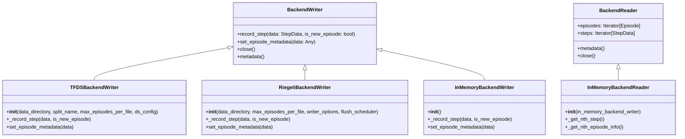
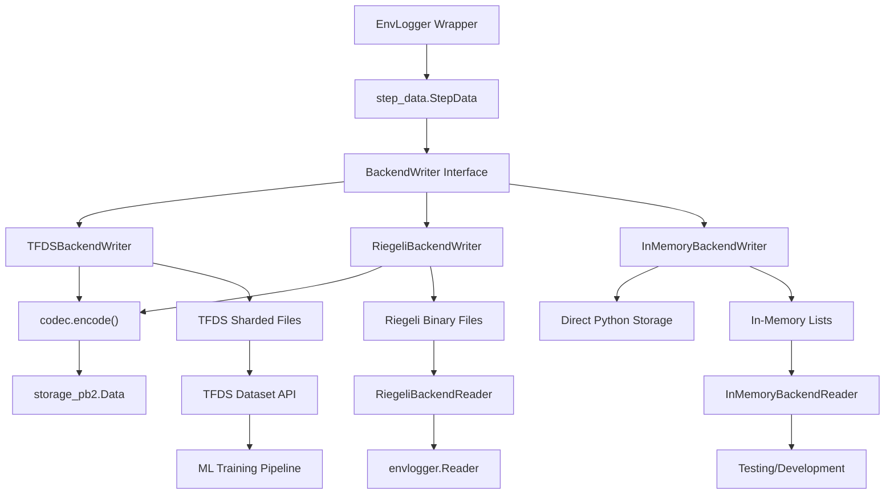
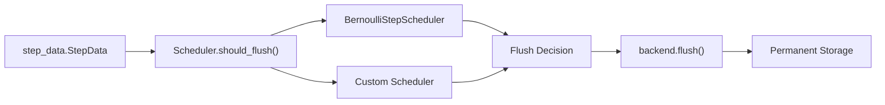

<!-- source: DeepWiki mcp.deepwiki.com · repo google-deepmind/envlogger · page 3 Storage Backends · fetched 2026-10-26 -->

# Storage Backends

<details>
<summary>Relevant source files</summary>

The following files were used as context for generating this wiki page:

- [README.md](README.md)
- [docs/images/timings.png](docs/images/timings.png)
- [envlogger/backends/BUILD.bazel](envlogger/backends/BUILD.bazel)
- [envlogger/backends/in_memory_backend.py](envlogger/backends/in_memory_backend.py)
- [envlogger/backends/riegeli_backend_writer.py](envlogger/backends/riegeli_backend_writer.py)
- [envlogger/examples/random_agent_catch.py](envlogger/examples/random_agent_catch.py)

</details>


This document provides an overview of the storage backend system in EnvLogger, which handles the persistence of trajectory data from reinforcement learning environments. The storage backends provide different options for how and where trajectory data is stored, each optimized for different use cases.

For detailed implementation information about specific backends, see [TFDS Backend](#3.1), [Riegeli Backend](#3.2), and [Backend Interfaces and Utilities](#3.3). For information about the data conversion layer that works with these backends, see [Data Conversion and Serialization](#4).

## Backend Architecture Overview

The storage backend system follows a common interface pattern where all backends implement the `BackendWriter` abstract base class. This allows the core EnvLogger system to work with different storage mechanisms transparently.

### Backend Class Hierarchy



Sources: [envlogger/backends/backend_writer.py:1-100](), [envlogger/backends/backend_reader.py:1-100](), [envlogger/backends/tfds_backend_writer.py:1-50](), [envlogger/backends/riegeli_backend_writer.py:1-50](), [envlogger/backends/in_memory_backend.py:1-50]()

### Data Flow Architecture



Sources: [envlogger/backends/backend_writer.py:54-58](), [envlogger/backends/tfds_backend_writer.py:134-141](), [envlogger/backends/riegeli_backend_writer.py:99-110](), [envlogger/converters/codec.py:1-50]()

## Available Storage Backends

EnvLogger provides three main storage backends, each optimized for different use cases:

| Backend | Format | Use Case | Performance | Compatibility |
|---------|---------|----------|-------------|---------------|
| **TFDS** | TensorFlow Datasets | ML training pipelines | Good | TensorFlow, JAX, PyTorch |
| **Riegeli** | Compressed binary | High-performance storage | Excellent | EnvLogger Reader |
| **In-Memory** | Python objects | Testing, short experiments | Fast (RAM-limited) | EnvLogger Reader |

### TFDS Backend

The `TFDSBackendWriter` stores trajectory data in TensorFlow Datasets format, making it directly compatible with TensorFlow, JAX, and PyTorch training pipelines.

**Key Features:**
- Direct TFDS/RLDS compatibility
- Automatic sharding based on episode count
- Built-in data validation through TFDS features
- Seamless integration with existing ML workflows

**Usage Example:**
```python
dataset_config = tfds.rlds.rlds_base.DatasetConfig(
    name='my_experiment',
    observation_info=tfds.features.Tensor(shape=(64, 64, 3), dtype=tf.uint8),
    action_info=tf.int32,
    reward_info=tf.float32
)

backend = tfds_backend_writer.TFDSBackendWriter(
    data_directory='/tmp/trajectories',
    split_name='train',
    max_episodes_per_file=500,
    ds_config=dataset_config
)
```

Sources: [README.md:100-131](), [envlogger/backends/tfds_backend_writer.py:134-141]()

### Riegeli Backend

The `RiegeliBackendWriter` provides high-performance storage using Google's Riegeli format, optimized for fast sequential access and compression.

**Key Features:**
- Excellent compression ratios
- Fast sequential reading
- Configurable flush scheduling
- C++ implementation for performance

**Usage Example:**
```python
backend = RiegeliBackendWriter(
    data_directory='/tmp/trajectories',
    max_episodes_per_file=10000,
    writer_options='transpose,brotli:6,chunk_size:1M',
    flush_scheduler=schedulers.BernoulliStepScheduler(1.0 / 5000)
)
```

Sources: [envlogger/backends/riegeli_backend_writer.py:32-66]()

### In-Memory Backend

The `InMemoryBackendWriter` stores all trajectory data in Python data structures in RAM, making it ideal for testing and development.

**Key Features:**
- No disk I/O overhead
- Immediate data availability
- Simple debugging interface
- Memory-limited capacity

**Usage Example:**
```python
backend = InMemoryBackendWriter()
# Data is stored in backend.steps and backend.episode_metadata
```

Sources: [envlogger/backends/in_memory_backend.py:29-51]()

## Backend Selection Guide

### When to Use Each Backend

**Use TFDS Backend when:**
- Training ML models with TensorFlow/JAX/PyTorch
- Need compatibility with existing TFDS-based pipelines
- Want automatic data validation
- Sharing datasets with other researchers

**Use Riegeli Backend when:**
- Need maximum storage efficiency
- Handling large-scale data collection
- Want fast sequential access patterns
- Using EnvLogger's native reader interface

**Use In-Memory Backend when:**
- Testing and development
- Short experiments with limited data
- Need immediate data access
- Debugging trajectory collection

### Performance Characteristics

According to the benchmark data, EnvLogger adds approximately 2ms overhead per environment step. The choice of backend affects this overhead:

- **In-Memory**: Lowest overhead, RAM-limited
- **Riegeli**: Balanced performance with compression
- **TFDS**: Higher overhead due to validation and formatting

Sources: [README.md:217-226]()

## Integration with Schedulers

All backends support configurable flush scheduling through the `schedulers` module, which controls when data is written to permanent storage.



The default flush scheduler is a `BernoulliStepScheduler` with a 1/5000 probability of flushing per step, balancing performance with data safety.

Sources: [envlogger/backends/schedulers.py:1-50](), [envlogger/backends/riegeli_backend_writer.py:62-66]()

## Common Interface and Utilities

All backends implement the `BackendWriter` interface, which provides these key methods:

- `record_step(data, is_new_episode)`: Records a single environment step
- `set_episode_metadata(data)`: Sets metadata for the current episode
- `close()`: Finalizes storage and cleans up resources
- `metadata()`: Returns dataset-level metadata

The backends also share common utilities like data encoding through the `codec` module and episode information tracking through the `episode_info` module.

Sources: [envlogger/backends/backend_writer.py:54-58](), [envlogger/backends/BUILD.bazel:42-58]()

---

