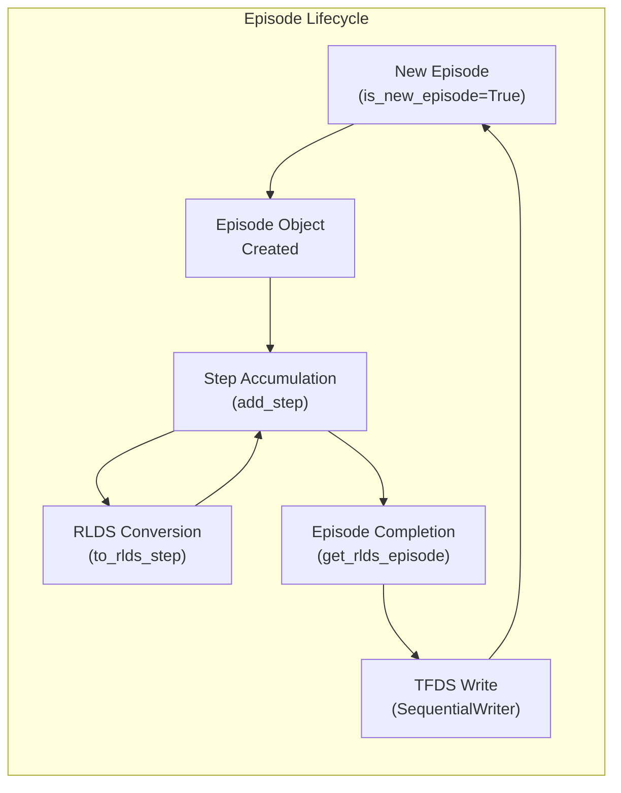
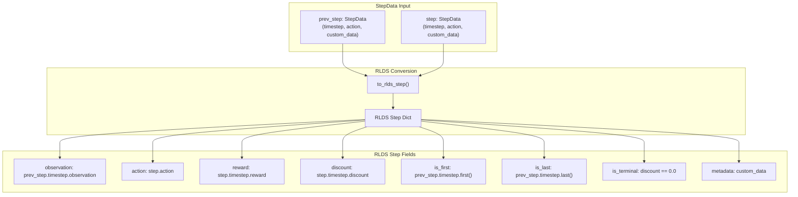
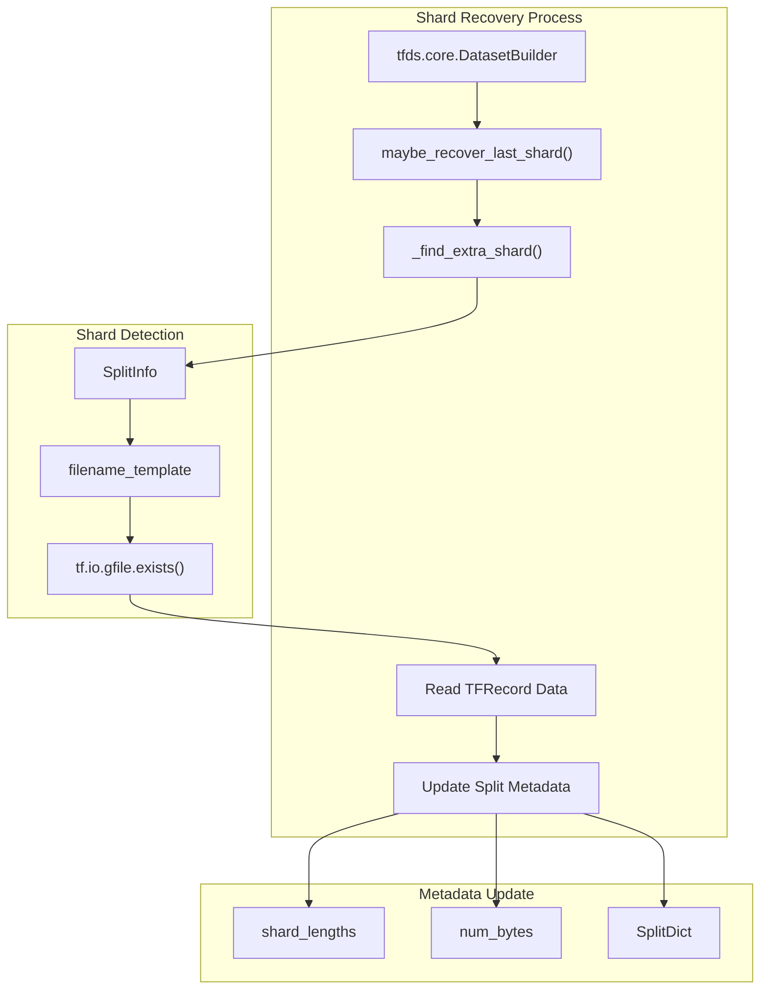
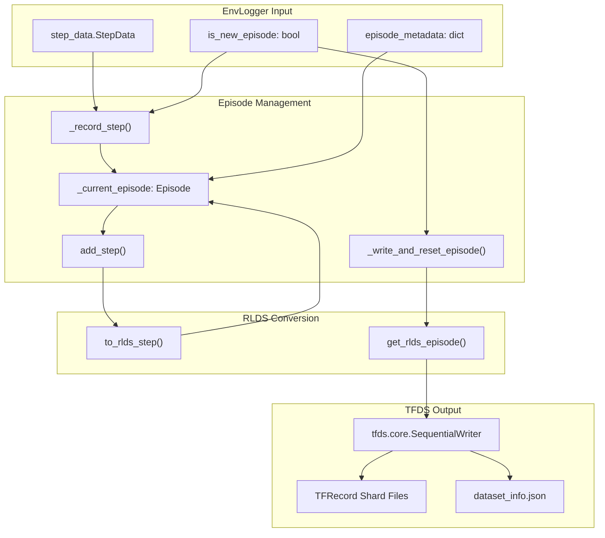

<!-- source: DeepWiki mcp.deepwiki.com · repo google-deepmind/envlogger · page 3.1 TFDS Backend · fetched 2026-10-26 -->

# TFDS Backend

<details>
<summary>Relevant source files</summary>

The following files were used as context for generating this wiki page:

- [envlogger/backends/rlds_utils.py](envlogger/backends/rlds_utils.py)
- [envlogger/backends/rlds_utils_test.py](envlogger/backends/rlds_utils_test.py)
- [envlogger/backends/tfds_backend_testlib.py](envlogger/backends/tfds_backend_testlib.py)
- [envlogger/backends/tfds_backend_writer.py](envlogger/backends/tfds_backend_writer.py)
- [envlogger/backends/tfds_backend_writer_test.py](envlogger/backends/tfds_backend_writer_test.py)
- [envlogger/examples/tfds_random_agent_catch.py](envlogger/examples/tfds_random_agent_catch.py)
- [envlogger/requirements.txt](envlogger/requirements.txt)

</details>


## Purpose and Scope

The TFDS Backend is a storage backend implementation for EnvLogger that writes trajectory data in TensorFlow Datasets (TFDS) format using the Reinforcement Learning Datasets (RLDS) structure. This backend enables integration with the TensorFlow ecosystem and provides standardized dataset formats for machine learning pipelines.

For information about other storage backends, see [Storage Backends](#3). For details about the RLDS data format conversion utilities, see [RLDS Data Format Utilities](#4.3).

## System Architecture

The TFDS Backend consists of several key components that work together to convert EnvLogger step data into TFDS-compatible format:

### TFDS Backend Architecture

```mermaid
graph TB
    subgraph "EnvLogger Integration"
        StepData["step_data.StepData"]
        BackendWriter["backend_writer.BackendWriter"]
    end
    
    subgraph "TFDS Backend Core"
        TFDSWriter["TFDSBackendWriter"]
        EpisodeBuilder["Episode"]
        RLDSConverter["rlds_utils.to_rlds_step"]
    end
    
    subgraph "TFDS Components"
        DatasetConfig["tfds.rlds.rlds_base.DatasetConfig"]
        SequentialWriter["tfds.core.SequentialWriter"]
        DatasetInfo["tfds.core.DatasetInfo"]
    end
    
    subgraph "Output Format"
        TFRecords["TFRecord Shards"]
        Metadata["Dataset Metadata"]
    end
    
    StepData --> TFDSWriter
    BackendWriter <|-- TFDSWriter
    TFDSWriter --> EpisodeBuilder
    EpisodeBuilder --> RLDSConverter
    
    TFDSWriter --> DatasetConfig
    TFDSWriter --> SequentialWriter
    TFDSWriter --> DatasetInfo
    
    SequentialWriter --> TFRecords
    DatasetInfo --> Metadata
    
    RLDSConverter --> SequentialWriter
```

Sources: [envlogger/backends/tfds_backend_writer.py:54-130](), [envlogger/backends/rlds_utils.py:29-66]()

## Core Components

### TFDSBackendWriter Class

The `TFDSBackendWriter` class is the main implementation that extends `BackendWriter` and handles the conversion from EnvLogger data to TFDS format:

| Component | Purpose | Key Methods |
|-----------|---------|-------------|
| `TFDSBackendWriter` | Main backend writer class | `_record_step()`, `set_episode_metadata()`, `close()` |
| `Episode` | Episode construction helper | `add_step()`, `get_rlds_episode()` |
| `tfds.core.SequentialWriter` | TFDS file writing | `add_examples()`, `close_all()` |

The writer maintains a current episode being constructed and writes completed episodes to TFDS shards.

Sources: [envlogger/backends/tfds_backend_writer.py:54-130]()

### Episode Construction Process



Sources: [envlogger/backends/tfds_backend_writer.py:30-52](), [envlogger/backends/tfds_backend_writer.py:109-120]()

### RLDS Data Conversion

The backend uses `rlds_utils.to_rlds_step()` to convert EnvLogger `StepData` objects to RLDS format:



Sources: [envlogger/backends/rlds_utils.py:29-66]()

## Configuration and Usage

### Dataset Configuration

The TFDS Backend requires a `DatasetConfig` object that specifies the schema for observations, actions, rewards, and metadata:

```python
DatasetConfig = tfds.rlds.rlds_base.DatasetConfig
```

Key configuration parameters include:
- `name`: Dataset name
- `observation_info`: TensorFlow feature specification for observations
- `action_info`: TensorFlow feature specification for actions
- `reward_info`: TensorFlow feature specification for rewards
- `discount_info`: TensorFlow feature specification for discounts
- `step_metadata_info`: Additional step-level metadata schema
- `episode_metadata_info`: Additional episode-level metadata schema

Sources: [envlogger/backends/tfds_backend_writer.py:27](), [envlogger/backends/tfds_backend_testlib.py:71-84]()

### Initialization Parameters

| Parameter | Type | Default | Description |
|-----------|------|---------|-------------|
| `data_directory` | `str` | Required | Directory to store TFDS data |
| `ds_config` | `DatasetConfig` | Required | Dataset schema configuration |
| `max_episodes_per_file` | `int` | `1000` | Episodes per shard file |
| `split_name` | `str` | `'train'` | TFDS split name |
| `version` | `str` | `'0.0.1'` | Dataset version |
| `store_ds_metadata` | `bool` | `False` | Whether to store dataset metadata |

Sources: [envlogger/backends/tfds_backend_writer.py:58-77]()

## Shard Management and Recovery

### Shard Recovery System

The TFDS Backend includes utilities for recovering incomplete shards that may result from interrupted writes:



Sources: [envlogger/backends/rlds_utils.py:69-123]()

### Shard Recovery Algorithm

The recovery process works by:
1. Detecting extra shard files that aren't accounted for in metadata
2. Reading the unaccounted shard to count examples and bytes
3. Updating the split metadata to include the recovered shard
4. Writing the updated metadata back to the dataset directory

Sources: [envlogger/backends/rlds_utils.py:82-123]()

## Data Flow

### Complete Data Flow Pipeline



Sources: [envlogger/backends/tfds_backend_writer.py:103-129]()

## Testing Infrastructure

### Test Components

The TFDS Backend includes comprehensive testing infrastructure:

| Component | Purpose | Key Features |
|-----------|---------|--------------|
| `tfds_backend_writer_test.py` | Unit tests for writer | Episode construction, RLDS conversion, metadata handling |
| `tfds_backend_testlib.py` | Test utilities | Environment simulation, dataset generation |
| `rlds_utils_test.py` | RLDS conversion tests | Step conversion, shard recovery |

### Test Environment Integration

The testing infrastructure uses a `Catch` environment to generate realistic trajectory data:

```python
def generate_episode_data(
    backend: backend_writer.BackendWriter,
    num_episodes: int = 2,
) -> list[list[step_data.StepData]]
```

Sources: [envlogger/backends/tfds_backend_testlib.py:30-68]()

## Example Usage

A complete example of using the TFDS Backend can be found in the random agent example:

```python
dataset_config = tfds.rlds.rlds_base.DatasetConfig(
    name='catch_example',
    observation_info=tfds.features.Tensor(
        shape=(10, 5), dtype=tf.float32,
        encoding=tfds.features.Encoding.ZLIB),
    action_info=tf.int64,
    reward_info=tf.float64,
    discount_info=tf.float64,
    step_metadata_info={'timestamp': tf.float32})

backend = tfds_backend_writer.TFDSBackendWriter(
    data_directory=FLAGS.trajectories_dir,
    split_name='train',
    max_episodes_per_file=500,
    ds_config=dataset_config)
```

Sources: [envlogger/examples/tfds_random_agent_catch.py:49-67]()

---

