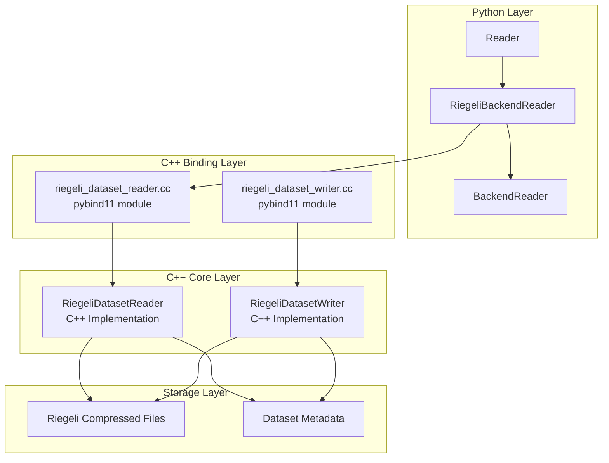
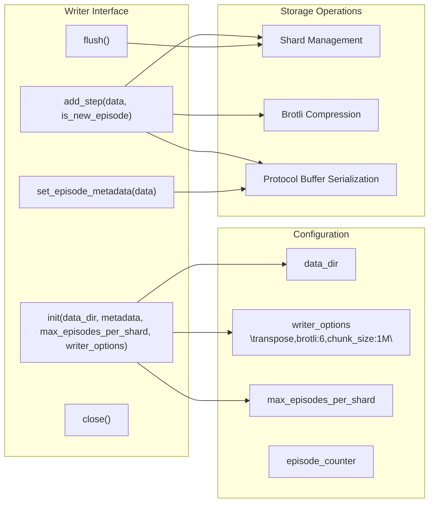
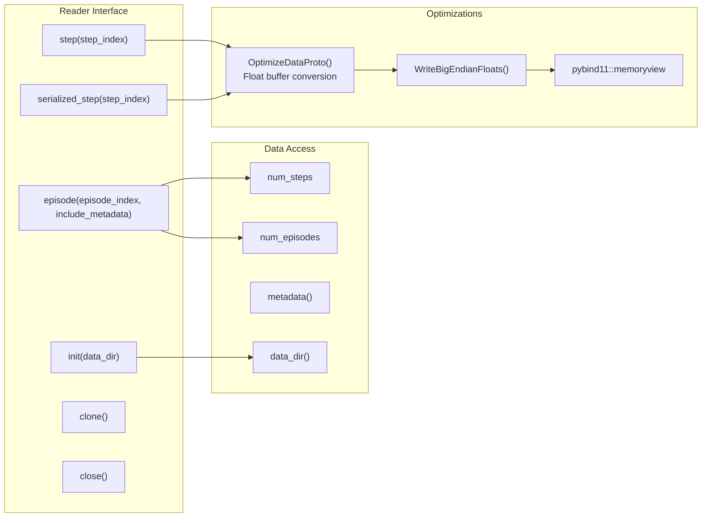
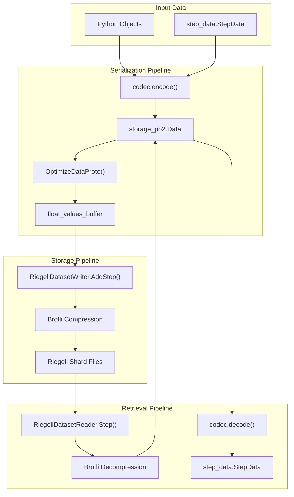
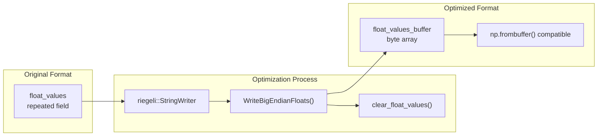
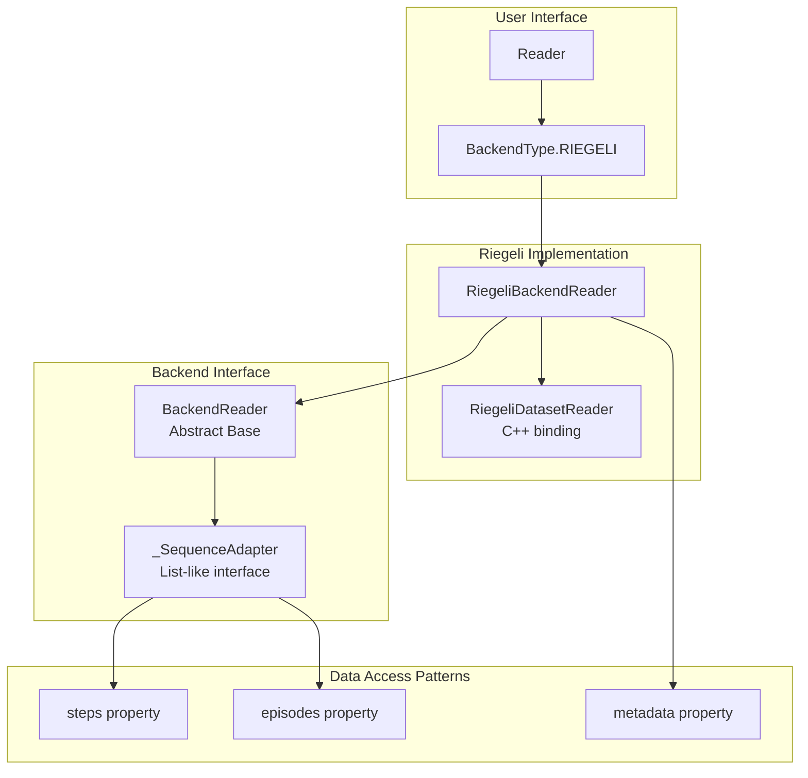

<!-- source: DeepWiki mcp.deepwiki.com · repo google-deepmind/envlogger · page 3.2 Riegeli Backend · fetched 2026-10-26 -->

# Riegeli Backend

Relevant source files

The following files were used as context for generating this wiki page:

- [envlogger/backends/backend_reader.py](envlogger/backends/backend_reader.py)
- [envlogger/backends/python/riegeli_dataset_reader.cc](envlogger/backends/python/riegeli_dataset_reader.cc)
- [envlogger/backends/python/riegeli_dataset_test.py](envlogger/backends/python/riegeli_dataset_test.py)
- [envlogger/backends/python/riegeli_dataset_writer.cc](envlogger/backends/python/riegeli_dataset_writer.cc)
- [envlogger/backends/riegeli_backend_reader.py](envlogger/backends/riegeli_backend_reader.py)
- [envlogger/reader.py](envlogger/reader.py)

## Purpose and Scope

The Riegeli Backend provides a high-performance storage system for EnvLogger trajectory data using the Riegeli compression format. It serves as one of the primary storage backends alongside the TFDS Backend, offering efficient compression and fast I/O operations for large-scale reinforcement learning datasets.

For information about other storage backends, see [Storage Backends](#3) and [TFDS Backend](#3.1). For details about the C++ implementation specifics, see [Riegeli C++ Implementation](#3.2.1).

## Architecture Overview

The Riegeli Backend implements a two-layer architecture with C++ core components exposed to Python through pybind11 bindings:

Sources: [envlogger/backends/riegeli_backend_reader.py:1-110](), [envlogger/backends/python/riegeli_dataset_reader.cc:1-178](), [envlogger/backends/python/riegeli_dataset_writer.cc:1-146]()

## Core Components

### RiegeliDatasetWriter

The `RiegeliDatasetWriter` class provides the primary interface for writing trajectory data to Riegeli format:

Key configuration parameters:
- `data_dir`: Target directory for storing Riegeli files
- `writer_options`: Compression settings (default: "transpose,brotli:6,chunk_size:1M")
- `max_episodes_per_shard`: Episodes per shard file (0 = no limit)

Sources: [envlogger/backends/python/riegeli_dataset_writer.cc:79-145]()

### RiegeliDatasetReader

The `RiegeliDatasetReader` class handles reading trajectory data from Riegeli files:

Sources: [envlogger/backends/python/riegeli_dataset_reader.cc:77-177]()

### RiegeliBackendReader

The `RiegeliBackendReader` class provides the Python-level interface that integrates with the broader EnvLogger system:

| Method | Purpose | Return Type |
|--------|---------|-------------|
| `_get_num_steps()` | Returns total number of steps | `int` |
| `_get_num_episodes()` | Returns total number of episodes | `int` |
| `_get_nth_step(i)` | Retrieves step at index i | `step_data.StepData` |
| `_get_nth_episode_info(i)` | Retrieves episode information | `episode_info.EpisodeInfo` |
| `metadata()` | Returns dataset metadata | `dict` |
| `close()` | Closes the reader | `None` |

Sources: [envlogger/backends/riegeli_backend_reader.py:34-110]()

## Data Flow and Serialization

The Riegeli Backend handles data transformation through multiple stages:

Sources: [envlogger/backends/riegeli_backend_reader.py:95-99](), [envlogger/backends/python/riegeli_dataset_reader.cc:41-74](), [envlogger/backends/python/riegeli_dataset_writer.cc:37-70]()

## Performance Optimizations

### Float Buffer Optimization

The Riegeli Backend implements a critical performance optimization for numerical data through the `OptimizeDataProto` function:

This optimization provides a 2.3x performance improvement for numerical array operations by converting repeated float fields to big-endian byte arrays that can be efficiently processed by NumPy's `frombuffer()` function.

Sources: [envlogger/backends/python/riegeli_dataset_reader.cc:34-75](), [envlogger/backends/python/riegeli_dataset_writer.cc:30-71]()

### Memory Management Features

| Feature | Implementation | Benefit |
|---------|---------------|---------|
| Clone Support | `reader.clone()` | Independent reader instances |
| Pickling Support | `__getstate__` / `__setstate__` | Serialization compatibility |
| Error Recovery | Empty step offset handling | Graceful degradation |
| Memory Views | `pybind11::memoryview` | Zero-copy data access |

Sources: [envlogger/backends/python/riegeli_dataset_reader.cc:85-95](), [envlogger/backends/python/riegeli_dataset_reader.cc:160-176](), [envlogger/backends/riegeli_backend_reader.py:47-65]()

## Integration with Backend System

The Riegeli Backend integrates into the broader EnvLogger architecture through the `BackendReader` interface:

The integration supports both episode-wise and step-wise data access patterns through the `_SequenceAdapter` class, which provides list-like interfaces for trajectory data.

Sources: [envlogger/reader.py:34-55](), [envlogger/backends/backend_reader.py:31-85](), [envlogger/backends/riegeli_backend_reader.py:34-110]()

---

