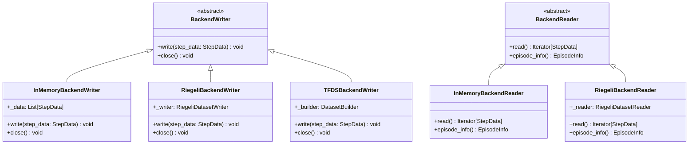
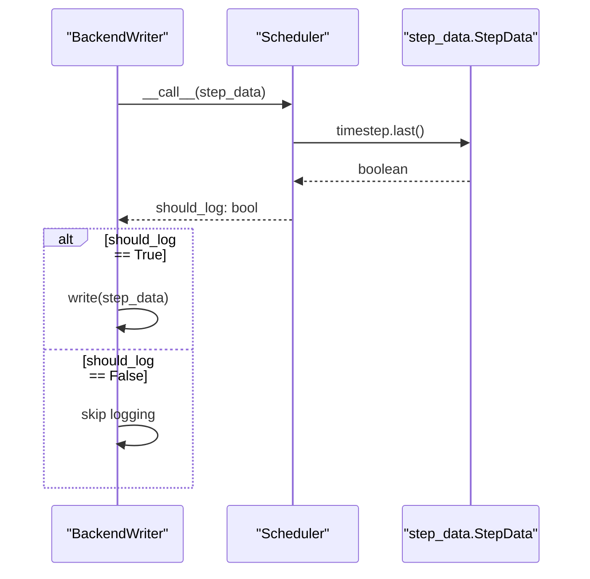
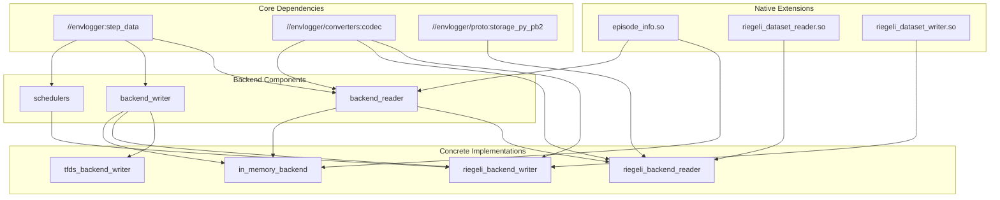
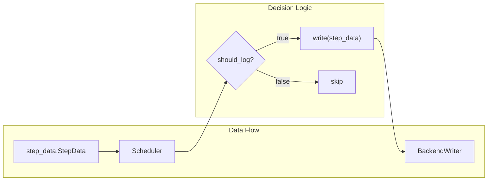
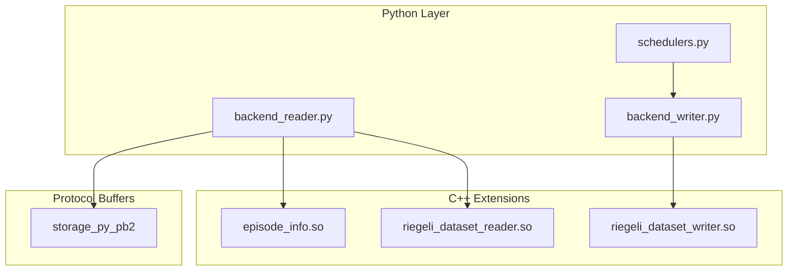

<!-- source: DeepWiki mcp.deepwiki.com · repo google-deepmind/envlogger · page 3.3 Backend Interfaces and Utilities · fetched 2026-10-26 -->

# Backend Interfaces and Utilities

<details>
<summary>Relevant source files</summary>

The following files were used as context for generating this wiki page:

- [envlogger/backends/BUILD.bazel](envlogger/backends/BUILD.bazel)
- [envlogger/backends/schedulers.py](envlogger/backends/schedulers.py)
- [envlogger/backends/schedulers_test.py](envlogger/backends/schedulers_test.py)
- [envlogger/environment_wrapper.py](envlogger/environment_wrapper.py)

</details>


This document covers the abstract backend interfaces, scheduling utilities, and common components that support the various storage backends in EnvLogger. These components provide the foundation for implementing different storage strategies while maintaining a consistent interface.

For information about specific backend implementations, see [TFDS Backend](#3.1), [Riegeli Backend](#3.2), and [Riegeli C++ Implementation](#3.2.1). For the core EnvLogger wrapper that uses these backends, see [Core EnvLogger System](#2).

## Backend Interface Hierarchy

The backend system is built around abstract interfaces that define common operations for reading and writing trajectory data. The core interfaces establish contracts that all backend implementations must follow.

### Abstract Backend Interfaces



The `BackendWriter` interface defines the contract for writing trajectory data, while `BackendReader` provides data retrieval capabilities. All concrete backend implementations inherit from these base classes.

**Sources:** [envlogger/backends/BUILD.bazel:42-58](), [envlogger/backends/BUILD.bazel:83-96]()

### Environment Wrapper Integration

```mermaid
graph TB
    subgraph "Environment Layer"
        EnvironmentWrapper["EnvironmentWrapper"]
        Environment["dm_env.Environment"]
    end
    
    subgraph "Backend Interface Layer"
        BackendWriter["BackendWriter"]
        BackendReader["BackendReader"]
        StepData["step_data.StepData"]
    end
    
    subgraph "Concrete Backends"
        InMemoryWriter["InMemoryBackendWriter"]
        RiegeliWriter["RiegeliBackendWriter"]
        TFDSWriter["TFDSBackendWriter"]
    end
    
    EnvironmentWrapper --> StepData
    StepData --> BackendWriter
    BackendWriter <|-- InMemoryWriter
    BackendWriter <|-- RiegeliWriter
    BackendWriter <|-- TFDSWriter
    
    Environment --> EnvironmentWrapper
```

The `EnvironmentWrapper` class serves as the base for environment decorators that can intercept and modify environment interactions. It provides the foundation for the EnvLogger wrapper to capture trajectory data.

**Sources:** [envlogger/environment_wrapper.py:23-66]()

## Scheduling System

The scheduling system provides flexible control over when trajectory data should be logged. Schedulers implement a common interface and can be used across different backend implementations.

### Scheduler Interface and Types

```mermaid
graph TB
    subgraph "Scheduler Type Definition"
        SchedulerType["Scheduler = Callable[[StepData], bool]"]
        StepData["step_data.StepData"]
    end
    
    subgraph "Step-Based Schedulers"
        NStepScheduler["NStepScheduler"]
        BernoulliStepScheduler["BernoulliStepScheduler"]
        ListStepScheduler["ListStepScheduler"]
    end
    
    subgraph "Episode-Based Schedulers"
        NEpisodeScheduler["NEpisodeScheduler"]
        BernoulliEpisodeScheduler["BernoulliEpisodeScheduler"]
        ListEpisodeScheduler["ListEpisodeScheduler"]
    end
    
    SchedulerType --> StepData
    SchedulerType <|-- NStepScheduler
    SchedulerType <|-- BernoulliStepScheduler
    SchedulerType <|-- ListStepScheduler
    SchedulerType <|-- NEpisodeScheduler
    SchedulerType <|-- BernoulliEpisodeScheduler
    SchedulerType <|-- ListEpisodeScheduler
```

All schedulers implement the `Scheduler` type alias, which is defined as a callable that takes `StepData` and returns a boolean indicating whether the data should be logged.

**Sources:** [envlogger/backends/schedulers.py:25-27]()

### Scheduler Implementation Details

| Scheduler Class | Purpose | Key Parameters | Behavior |
|-----------------|---------|----------------|----------|
| `NStepScheduler` | Log every N steps | `step_interval: int` | Returns `True` every N calls |
| `BernoulliStepScheduler` | Probabilistic step logging | `keep_probability: float`, `seed: Optional[int]` | Returns `True` with given probability |
| `NEpisodeScheduler` | Log every N episodes | `episode_interval: int` | Returns `True` every N episodes |
| `BernoulliEpisodeScheduler` | Probabilistic episode logging | `keep_probability: float`, `seed: Optional[int]` | Returns `True` with given probability per episode |
| `ListStepScheduler` | Log specific steps | `desired_steps: Union[list[int], np.ndarray]` | Returns `True` for steps in the list |
| `ListEpisodeScheduler` | Log specific episodes | `desired_episodes: Union[list[int], np.ndarray]` | Returns `True` for episodes in the list |

### Scheduler Usage Patterns



The schedulers are called with `StepData` objects and return boolean values indicating whether the data should be logged. Episode-based schedulers check `timestep.last()` to detect episode boundaries.

**Sources:** [envlogger/backends/schedulers.py:30-159]()

## Common Utilities and Dependencies

### Build Configuration

The backend system's build configuration shows the dependency relationships between components:



The build configuration reveals that all backends depend on the core `step_data` module, while some backends require additional native extensions built from C++ code.

**Sources:** [envlogger/backends/BUILD.bazel:20-175]()

### Backend Type Classification

The system includes a `backend_type` module that likely defines enumeration or classification of different backend types, though the specific implementation is not shown in the provided files.

**Sources:** [envlogger/backends/BUILD.bazel:20-23]()

## Integration with Backend Writers

### Scheduler Integration Pattern



Backend writers integrate with schedulers to control data logging frequency. The `RiegeliBackendWriter` explicitly depends on the schedulers module, indicating this integration pattern.

**Sources:** [envlogger/backends/BUILD.bazel:99-110]()

### Cross-Language Integration

The backend system supports both Python and C++ implementations through shared interfaces:



The C++ extensions provide high-performance implementations for critical operations like dataset reading and writing, while Python schedulers provide flexible control logic.

**Sources:** [envlogger/backends/BUILD.bazel:42-96]()

---

