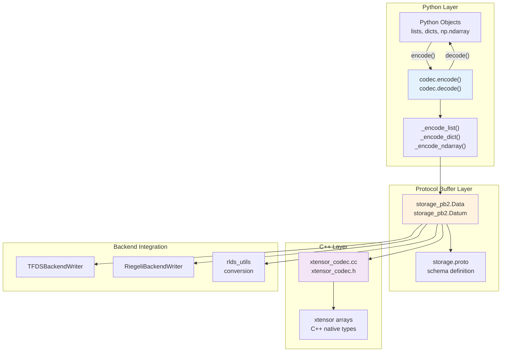
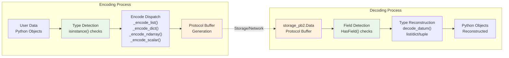
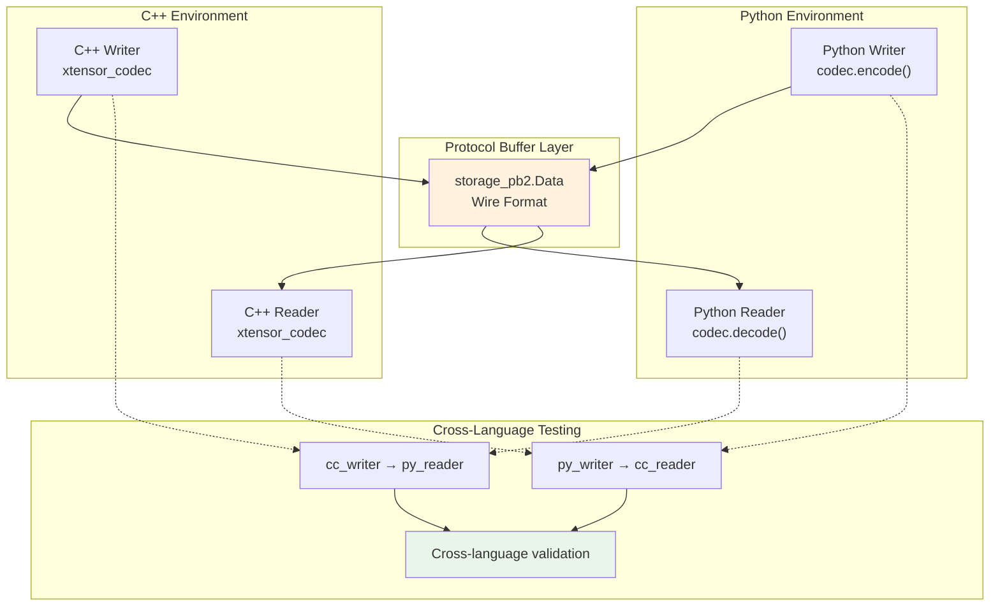

<!-- source: DeepWiki mcp.deepwiki.com · repo google-deepmind/envlogger · page 4 Data Conversion and Serialization · fetched 2026-10-26 -->

# Data Conversion and Serialization

<details>
<summary>Relevant source files</summary>

The following files were used as context for generating this wiki page:

- [envlogger/converters/BUILD.bazel](envlogger/converters/BUILD.bazel)
- [envlogger/converters/codec.py](envlogger/converters/codec.py)
- [envlogger/converters/codec_test.py](envlogger/converters/codec_test.py)
- [envlogger/proto/storage.proto](envlogger/proto/storage.proto)

</details>


This document covers the data conversion and serialization systems in EnvLogger that handle the transformation of Python objects, C++ data structures, and protocol buffers for storage and retrieval. The system provides efficient bidirectional conversion between language-specific data types and a common serialization format.

For information about the storage backends that consume these serialized formats, see [Storage Backends](#3). For details about the RLDS dataset format utilities, see [RLDS Data Format Utilities](#4.3).

## System Overview

The data conversion layer serves as the bridge between high-level programming language objects and the persistent storage format. It handles type preservation, efficient serialization, and cross-language compatibility through a protocol buffer-based intermediate representation.

## Core Architecture



Sources: [envlogger/converters/codec.py:1-466](), [envlogger/converters/BUILD.bazel:51-68](), [envlogger/proto/storage.proto:1-146]()

## Data Type Mapping

The conversion system maintains precise type mappings between different language representations:

| Python Type | Protocol Buffer Field | C++ Type | Notes |
|-------------|----------------------|----------|-------|
| `np.float32` | `float_values` | `float` | 32-bit floating point |
| `np.float64` | `double_values` | `double` | 64-bit floating point |
| `np.int32` | `int32_values` | `int32_t` | 32-bit signed integer |
| `np.int64` | `int64_values` | `int64_t` | 64-bit signed integer |
| `np.uint32` | `uint32_values` | `uint32_t` | 32-bit unsigned integer |
| `np.uint64` | `uint64_values` | `uint64_t` | 64-bit unsigned integer |
| `np.int8` | `int8_values` | `int8_t` | Packed as bytes |
| `np.int16` | `int16_values` | `int16_t` | Packed as bytes |
| `np.uint8` | `uint8_values` | `uint8_t` | Packed as bytes |
| `np.uint16` | `uint16_values` | `uint16_t` | Packed as bytes |
| `bool` | `bool_values` | `bool` | Boolean values |
| `str` | `string_values` | `string` | UTF-8 strings |
| `bytes` | `bytes_values` | `bytes` | Raw byte data |
| `int` | `bigint_values` | `mpz_t` | Arbitrary precision integers |

Sources: [envlogger/converters/codec.py:25-81](), [envlogger/proto/storage.proto:56-100]()

## Serialization Flow



Sources: [envlogger/converters/codec.py:287-333](), [envlogger/converters/codec.py:407-465]()

## Protocol Buffer Schema

The `storage.proto` file defines the serialization format with support for complex nested structures:

### Core Data Structure
- **`Data`**: Root message containing one of: `Datum`, `Array`, `Tuple`, or `Dict`
- **`Datum`**: Represents multidimensional tensors/matrices with shape and typed values
- **`Array`**: Homogeneous sequences (Python lists, C++ vectors)
- **`Tuple`**: Heterogeneous sequences (Python tuples, C++ tuples)
- **`Dict`**: Key-value mappings with support for string keys and arbitrary key types

### Special Features
- **Scalar Encoding**: Uses dimension size `-438` to differentiate scalars from 0-dimensional arrays
- **Efficient Packing**: Small integer types (int8, int16, uint8, uint16) are packed as bytes
- **Arbitrary Precision**: Python `int` objects stored as variable-length byte strings
- **Float32 Optimization**: Dedicated `float_values_buffer` for efficient float32 array storage

Sources: [envlogger/proto/storage.proto:19-145]()

## Performance Optimizations

### Python Codec Optimizations
The Python codec includes several performance optimizations:

1. **Batch Processing**: Arrays are processed as single units rather than element-by-element
2. **Type Homogeneity**: Lists require uniform element types to prevent costly type checking
3. **Packed Encoding**: Small integer types use efficient byte packing
4. **Buffer Optimization**: Float32 arrays use direct buffer serialization

```python
# Example of efficient array encoding
array = np.array([1.0, 2.0, 3.0], dtype=np.float32)
# Encoded as single float_values_buffer rather than repeated float_values
```

### C++ XTensor Integration
The C++ codec leverages the XTensor library for high-performance numerical computations:

- **Zero-Copy Operations**: Direct memory mapping where possible
- **SIMD Optimization**: Vectorized operations for numerical arrays
- **Memory Layout**: Row-major layout compatible with numpy and xtensor
- **Type Safety**: Template-based type checking at compile time

Sources: [envlogger/converters/codec.py:186-216](), [envlogger/converters/BUILD.bazel:52-67]()

## Cross-Language Compatibility



The system ensures data written in one language can be read by another through:

1. **Standardized Protocol Buffer Schema**: Common wire format across languages
2. **Consistent Type Mappings**: Identical semantic meaning for each protocol buffer field
3. **Endianness Handling**: Big-endian encoding for cross-platform compatibility
4. **Automated Testing**: Cross-language integration tests validate compatibility

Sources: [envlogger/converters/BUILD.bazel:51-83](), [envlogger/proto/storage.proto:1-146]()

## Error Handling and Validation

The conversion system includes comprehensive error handling:

### Type Validation
- **Unsupported Types**: Raises `TypeError` for non-serializable objects (functions, classes, sets)
- **Homogeneity Checks**: Enforces uniform types within arrays
- **Shape Validation**: Ensures consistent array dimensionality

### Data Integrity
- **Round-trip Testing**: Validates `encode(decode(x)) == x` for all supported types
- **Precision Preservation**: Maintains exact numeric precision for supported types
- **Overflow Detection**: Handles large integers gracefully using arbitrary precision encoding

### Example Error Cases
```python
# These operations raise TypeError
codec.encode(lambda x: x)  # Functions not supported
codec.encode([1, "mixed"])  # Heterogeneous lists not supported
codec.encode(set([1, 2]))   # Sets not supported
```

Sources: [envlogger/converters/codec.py:1563-1573](), [envlogger/converters/codec_test.py:771-774]()

## Usage Patterns

### Basic Serialization
```python
# Encode various Python objects
data = codec.encode(np.array([1, 2, 3]))
data = codec.encode({"key": np.array([1.0, 2.0])})
data = codec.encode([np.int32(1), np.int32(2)])

# Decode back to Python objects
original = codec.decode(data)
```

### Complex Nested Structures
```python
# Nested dictionaries and arrays
complex_data = {
    "observations": np.array([[1, 2], [3, 4]], dtype=np.float32),
    "actions": [np.int32(0), np.int32(1)],
    "metadata": {
        "episode_id": 123,
        "step_count": np.int64(1000)
    }
}
encoded = codec.encode(complex_data)
```

### Performance Considerations
- **Use NumPy Arrays**: More efficient than Python lists for numerical data
- **Consistent Types**: Avoid mixed-type containers
- **Batch Operations**: Process large datasets in chunks rather than individual elements

Sources: [envlogger/converters/codec.py:287-333](), [envlogger/converters/codec_test.py:421-461]()

# Data Conversion and Serialization

This document covers the data conversion and serialization systems in EnvLogger that handle the transformation of Python objects, C++ data structures, and protocol buffers for storage and retrieval. The system provides efficient bidirectional conversion between language-specific data types and a common serialization format.

For information about the storage backends that consume these serialized formats, see [Storage Backends](#3). For details about the RLDS dataset format utilities, see [RLDS Data Format Utilities](#4.3).

## System Overview

The data conversion layer serves as the bridge between high-level programming language objects and the persistent storage format. It handles type preservation, efficient serialization, and cross-language compatibility through a protocol buffer-based intermediate representation.

## Core Architecture


Sources: [envlogger/converters/codec.py:1-466](), [envlogger/converters/BUILD.bazel:51-68](), [envlogger/proto/storage.proto:1-146]()

## Data Type Mapping

The conversion system maintains precise type mappings between different language representations:

| Python Type | Protocol Buffer Field | C++ Type | Notes |
|-------------|----------------------|----------|-------|
| `np.float32` | `float_values` | `float` | 32-bit floating point |
| `np.float64` | `double_values` | `double` | 64-bit floating point |
| `np.int32` | `int32_values` | `int32_t` | 32-bit signed integer |
| `np.int64` | `int64_values` | `int64_t` | 64-bit signed integer |
| `np.uint32` | `uint32_values` | `uint32_t` | 32-bit unsigned integer |
| `np.uint64` | `uint64_values` | `uint64_t` | 64-bit unsigned integer |
| `np.int8` | `int8_values` | `int8_t` | Packed as bytes |
| `np.int16` | `int16_values` | `int16_t` | Packed as bytes |
| `np.uint8` | `uint8_values` | `uint8_t` | Packed as bytes |
| `np.uint16` | `uint16_values` | `uint16_t` | Packed as bytes |
| `bool` | `bool_values` | `bool` | Boolean values |
| `str` | `string_values` | `string` | UTF-8 strings |
| `bytes` | `bytes_values` | `bytes` | Raw byte data |
| `int` | `bigint_values` | `mpz_t` | Arbitrary precision integers |

Sources: [envlogger/converters/codec.py:25-81](), [envlogger/proto/storage.proto:56-100]()

## Serialization Flow


Sources: [envlogger/converters/codec.py:287-333](), [envlogger/converters/codec.py:407-465]()

## Protocol Buffer Schema

The `storage.proto` file defines the serialization format with support for complex nested structures:

### Core Data Structure
- **`Data`**: Root message containing one of: `Datum`, `Array`, `Tuple`, or `Dict`
- **`Datum`**: Represents multidimensional tensors/matrices with shape and typed values
- **`Array`**: Homogeneous sequences (Python lists, C++ vectors)
- **`Tuple`**: Heterogeneous sequences (Python tuples, C++ tuples)
- **`Dict`**: Key-value mappings with support for string keys and arbitrary key types

### Special Features
- **Scalar Encoding**: Uses dimension size `-438` to differentiate scalars from 0-dimensional arrays
- **Efficient Packing**: Small integer types (int8, int16, uint8, uint16) are packed as bytes
- **Arbitrary Precision**: Python `int` objects stored as variable-length byte strings
- **Float32 Optimization**: Dedicated `float_values_buffer` for efficient float32 array storage

Sources: [envlogger/proto/storage.proto:19-145]()

## Performance Optimizations

### Python Codec Optimizations
The Python codec includes several performance optimizations:

1. **Batch Processing**: Arrays are processed as single units rather than element-by-element
2. **Type Homogeneity**: Lists require uniform element types to prevent costly type checking
3. **Packed Encoding**: Small integer types use efficient byte packing
4. **Buffer Optimization**: Float32 arrays use direct buffer serialization

### C++ XTensor Integration
The C++ codec leverages the XTensor library for high-performance numerical computations:

- **Zero-Copy Operations**: Direct memory mapping where possible
- **SIMD Optimization**: Vectorized operations for numerical arrays
- **Memory Layout**: Row-major layout compatible with numpy and xtensor
- **Type Safety**: Template-based type checking at compile time

Sources: [envlogger/converters/codec.py:186-216](), [envlogger/converters/BUILD.bazel:52-67]()

## Cross-Language Compatibility


The system ensures data written in one language can be read by another through:

1. **Standardized Protocol Buffer Schema**: Common wire format across languages
2. **Consistent Type Mappings**: Identical semantic meaning for each protocol buffer field
3. **Endianness Handling**: Big-endian encoding for cross-platform compatibility
4. **Automated Testing**: Cross-language integration tests validate compatibility

Sources: [envlogger/converters/BUILD.bazel:51-83](), [envlogger/proto/storage.proto:1-146]()

## Error Handling and Validation

The conversion system includes comprehensive error handling:

### Type Validation
- **Unsupported Types**: Raises `TypeError` for non-serializable objects (functions, classes, sets)
- **Homogeneity Checks**: Enforces uniform types within arrays
- **Shape Validation**: Ensures consistent array dimensionality

### Data Integrity
- **Round-trip Testing**: Validates `encode(decode(x)) == x` for all supported types
- **Precision Preservation**: Maintains exact numeric precision for supported types
- **Overflow Detection**: Handles large integers gracefully using arbitrary precision encoding

Sources: [envlogger/converters/codec.py:1563-1573](), [envlogger/converters/codec_test.py:771-774]()

## Usage Patterns

### Basic Serialization
The `encode()` function accepts various Python objects and converts them to protocol buffer format:

```python
# Encode various Python objects
data = codec.encode(np.array([1, 2, 3]))
data = codec.encode({"key": np.array([1.0, 2.0])})
data = codec.encode([np.int32(1), np.int32(2)])

# Decode back to Python objects
original = codec.decode(data)
```

### Complex Nested Structures
The system supports deeply nested data structures combining arrays, dictionaries, and scalar values:

```python
# Nested dictionaries and arrays
complex_data = {
    "observations": np.array([[1, 2], [3, 4]], dtype=np.float32),
    "actions": [np.int32(0), np.int32(1)],
    "metadata": {
        "episode_id": 123,
        "step_count": np.int64(1000)
    }
}
encoded = codec.encode(complex_data)
```

### Performance Considerations
- **Use NumPy Arrays**: More efficient than Python lists for numerical data
- **Consistent Types**: Avoid mixed-type containers
- **Batch Operations**: Process large datasets in chunks rather than individual elements

Sources: [envlogger/converters/codec.py:287-333](), [envlogger/converters/codec_test.py:421-461]()

---

